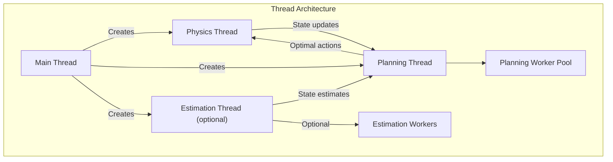
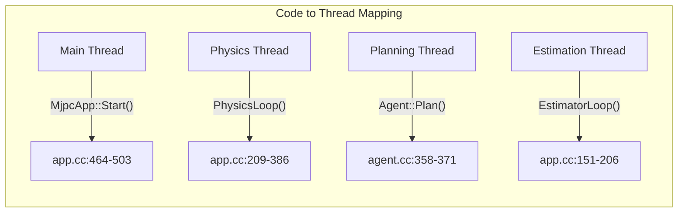
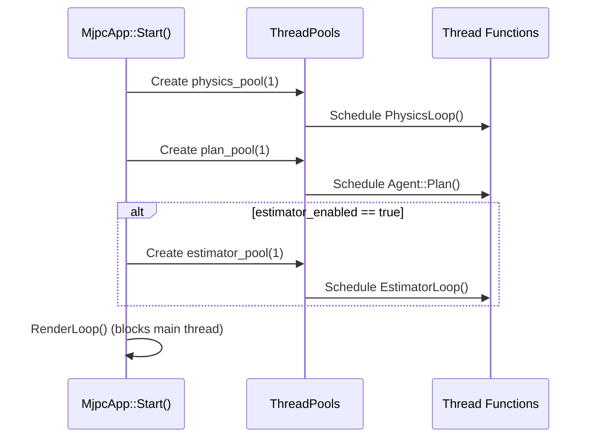
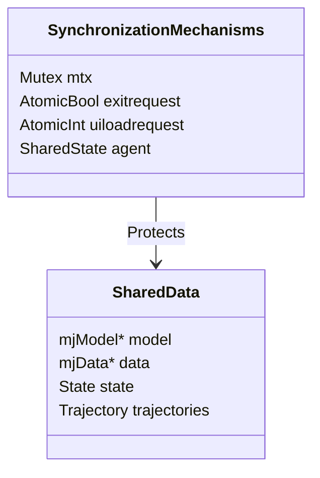
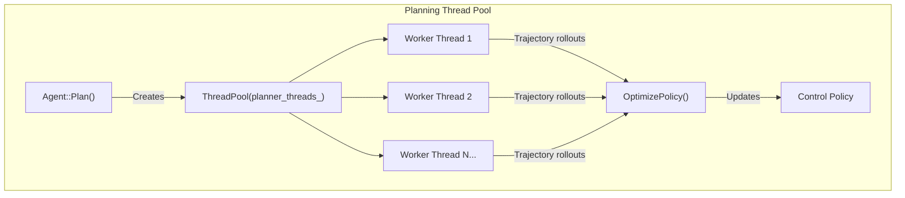
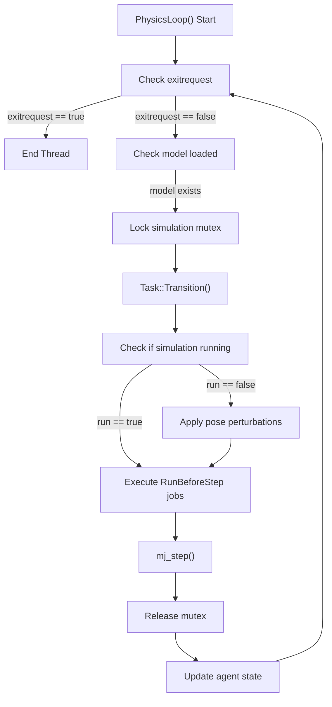
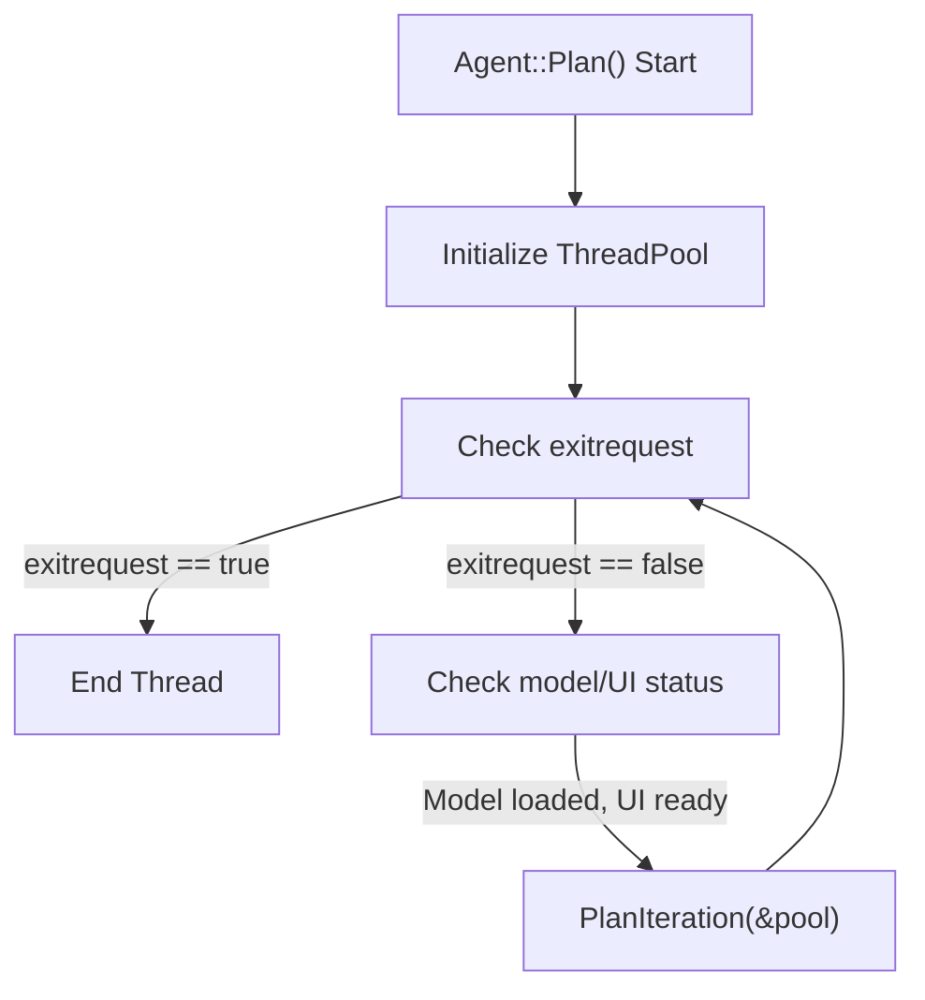
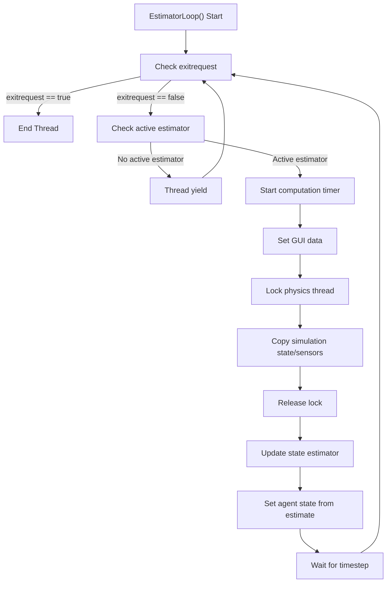
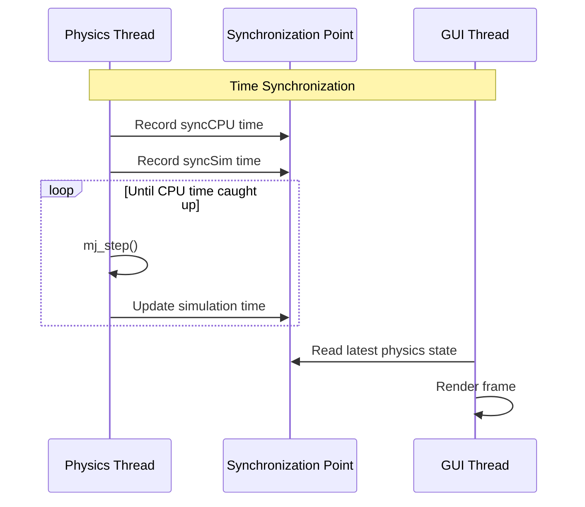

<!-- source: DeepWiki mcp.deepwiki.com · repo google-deepmind/mujoco_mpc · page 2.1 Threading Model · fetched 2026-10-26 -->

# Threading Model

<details>
<summary>Relevant source files</summary>

The following files were used as context for generating this wiki page:

- [mjpc/agent.cc](mjpc/agent.cc)
- [mjpc/agent.h](mjpc/agent.h)
- [mjpc/app.cc](mjpc/app.cc)
- [mjpc/app.h](mjpc/app.h)
- [mjpc/main.cc](mjpc/main.cc)
- [mjpc/planners/planner.cc](mjpc/planners/planner.cc)
- [mjpc/simulate.cc](mjpc/simulate.cc)
- [mjpc/simulate.h](mjpc/simulate.h)

</details>


This document details the multi-threaded architecture of MuJoCo MPC, explaining how different threads work together to enable real-time model predictive control. It covers the main thread types, their interactions, synchronization mechanisms, and how parallel computation is managed.

## Thread Architecture Overview

MuJoCo MPC operates with a multi-threaded design consisting of several specialized threads that run concurrently:



Sources: [mjpc/app.cc:464-503](), [mjpc/agent.cc:358-371]()

## Core Threads and Their Roles

MuJoCo MPC uses four primary thread types, each with distinct responsibilities:

1. **Main Thread**:
   - Initializes the system
   - Creates and manages other threads
   - Handles rendering and user interface
   - Processes user input

2. **Physics Thread**:
   - Executes the MuJoCo simulation
   - Applies control actions to simulated systems
   - Maintains physical state representation
   - Computes task residuals during simulation

3. **Planning Thread**:
   - Generates optimal control policies
   - Coordinates parallel trajectory rollouts
   - Evaluates candidate trajectories
   - Selects best actions based on optimization criteria

4. **Estimation Thread** (optional):
   - Processes sensor data
   - Estimates system state when direct observation is unavailable
   - Maintains filter-based state representation



Sources: [mjpc/app.cc:464-503](), [mjpc/app.cc:209-386](), [mjpc/agent.cc:358-371](), [mjpc/app.cc:151-206]()

## Thread Creation and Management

Threads are created and initialized in the `MjpcApp::Start()` method using thread pools:



The thread creation code is implemented in the `MjpcApp::Start()` method:

```
// start physics thread
mjpc::ThreadPool physics_pool(1);
physics_pool.Schedule([]() { PhysicsLoop(*sim); });

// start estimator thread
mjpc::ThreadPool estimator_pool(1);
if (sim->agent->estimator_enabled) {
  estimator_pool.Schedule([]() { EstimatorLoop(*sim); });
}

// start plan thread
mjpc::ThreadPool plan_pool(1);
plan_pool.Schedule(
    []() { sim->agent->Plan(sim->exitrequest, sim->uiloadrequest); });
```

Sources: [mjpc/app.cc:483-496]()

## Thread Communication and Synchronization

### Shared State and Synchronization Mechanisms

Threads communicate through:

1. **Shared Memory**: Common data structures accessible to multiple threads
2. **Mutex Locks**: Prevent race conditions on shared data
3. **Atomic Variables**: Thread-safe signals for coordination
4. **Condition Variables**: For waiting on specific conditions



Key synchronization points:

1. **Physics and Planning**: 
   - The physics thread updates the agent's state
   - The planning thread reads this state to plan optimal actions
   - The physics thread applies actions from the planner

2. **Physics and Estimation**:
   - The physics thread provides sensor data
   - The estimation thread processes this data and updates state estimates
   - Mutex protects access to shared sensor data

Sources: [mjpc/app.cc:171-188](), [mjpc/agent.cc:365-369]()

## Parallel Planning with Worker Threads

The planning system uses a thread pool to parallelize computational work:



The number of planner threads is dynamically calculated based on hardware availability:

```
// planner threads
planner_threads_ = std::max(1, NumAvailableHardwareThreads() - 3 - 2 * estimator_threads_);
```

This ensures efficient use of CPU resources while leaving cores available for physics, rendering, and estimation.

Sources: [mjpc/agent.cc:153-154](), [mjpc/agent.cc:363-323]()

## Thread Execution Flow

Each thread follows a specific execution pattern:

### Physics Thread Loop



Sources: [mjpc/app.cc:209-386]()

### Planning Thread Loop



Sources: [mjpc/agent.cc:359-371](), [mjpc/agent.cc:283-357]()

### Estimation Thread Loop



Sources: [mjpc/app.cc:151-206]()

## Thread Termination

All threads monitor the `exitrequest` atomic variable and terminate when it becomes `true`:

```
// main loop
while (!exitrequest.load()) {
  if (model_ && uiloadrequest.load() == 0) {
    PlanIteration(&pool);
  }
}  // exitrequest sent -- stop planning
```

This provides a clean shutdown mechanism when the application is closing.

Sources: [mjpc/agent.cc:365-371]()

## Coordination Between Physics and GUI Threads

The physics and GUI threads coordinate through a synchronization mechanism that ensures consistent frame rates while maximizing physics throughput:



The physics thread uses a timing mechanism to maintain real-time performance or specified slowdown factors:

```
// requested slow-down factor
double slowdown = 100 / sim.percentRealTime[sim.real_time_index];

// step while sim lags behind cpu and within refreshTime
while (Seconds((d->time - syncSim) * slowdown) <
            mj::Simulate::Clock::now() - syncCPU &&
        mj::Simulate::Clock::now() - startCPU <
            Seconds(refreshTime)) {
    // simulation steps
}
```

Sources: [mjpc/app.cc:307-343]()

## Thread Safety Considerations

The codebase implements several thread safety mechanisms:

1. **Mutex Protection**: Shared data access is protected by mutexes
   ```
   const std::lock_guard<std::mutex> lock(sim.mtx);
   ```

2. **Atomic Variables**: Status flags use atomic variables for thread-safe updates
   ```
   std::atomic_bool exitrequest = false;
   std::atomic_int uiloadrequest = 0;
   ```

3. **Thread-Local Data**: Each worker thread operates on its own copy of `mjData` to prevent contention

4. **Lock-Free Operations**: Performance-critical sections use lock-free algorithms where possible

Sources: [mjpc/app.cc:171-173](), [mjpc/agent.cc:383-385]()

## Thread Configuration

The number of threads used for different components is determined at runtime based on hardware availability:

| Thread Type | Count | Determination |
|-------------|-------|--------------|
| Physics | 1 | Fixed |
| Main/Rendering | 1 | Fixed |
| Planning | 1 | Fixed control thread |
| Planning Workers | Variable | `NumAvailableHardwareThreads() - 3 - 2 * estimator_threads_` |
| Estimation | 0 or 1 | Based on `estimator_enabled` flag |
| Estimation Workers | 0 or 2 | If estimator enabled |

This configuration ensures efficient use of available CPU resources while maintaining responsive control.

Sources: [mjpc/agent.cc:153-154](), [mjpc/app.cc:467-471]()

---

