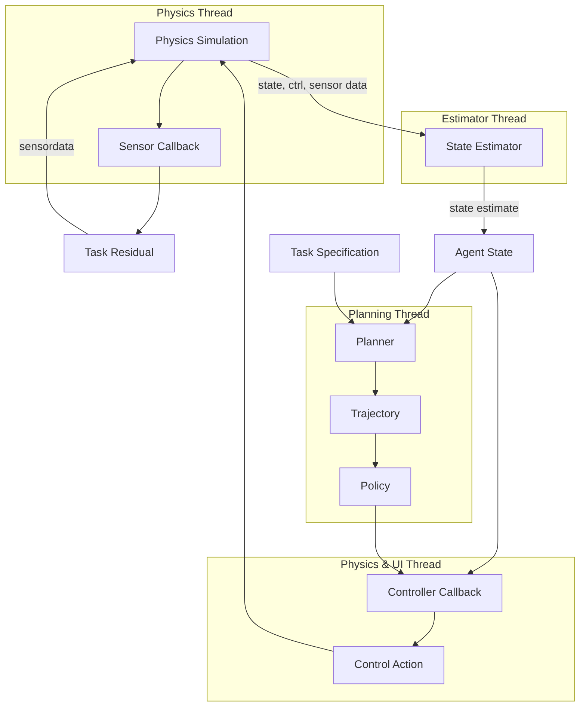
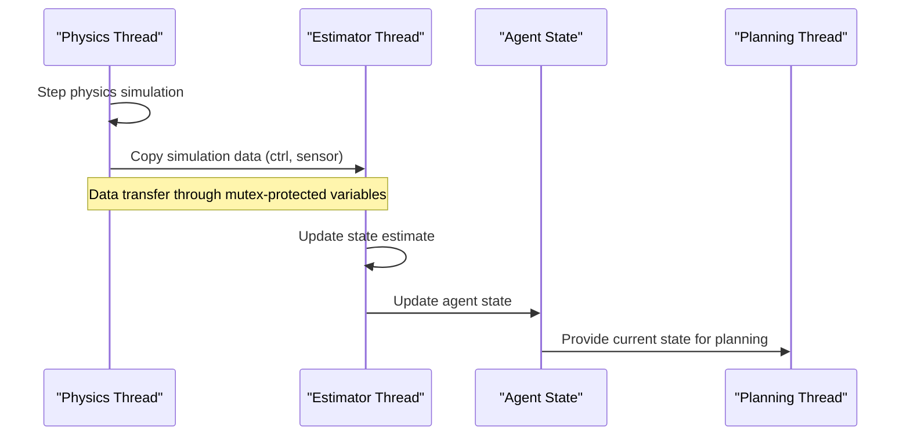
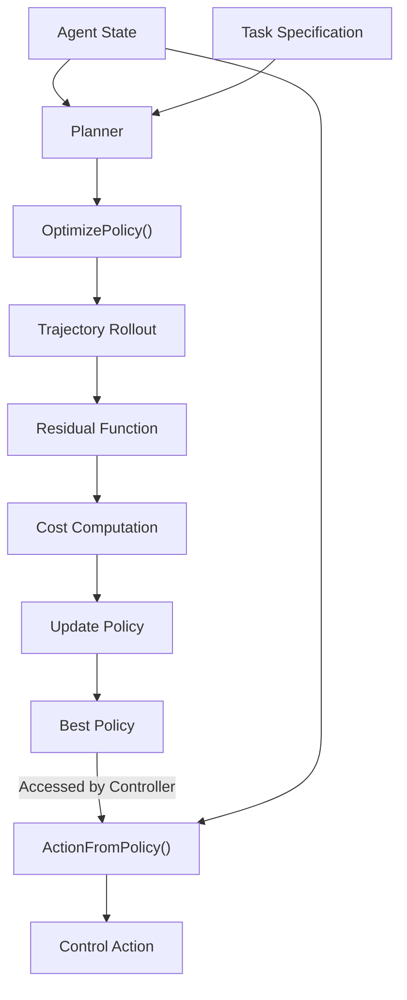
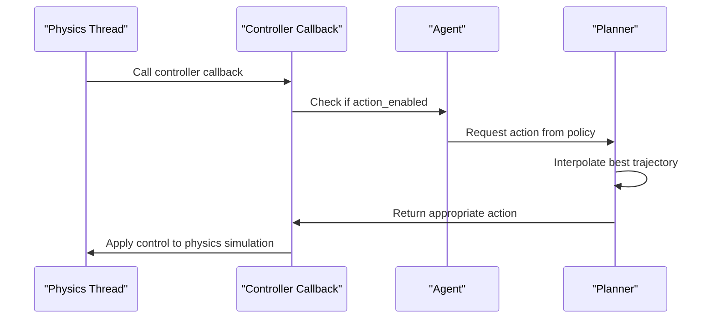
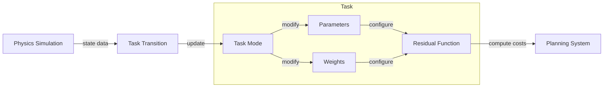
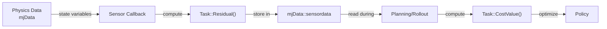
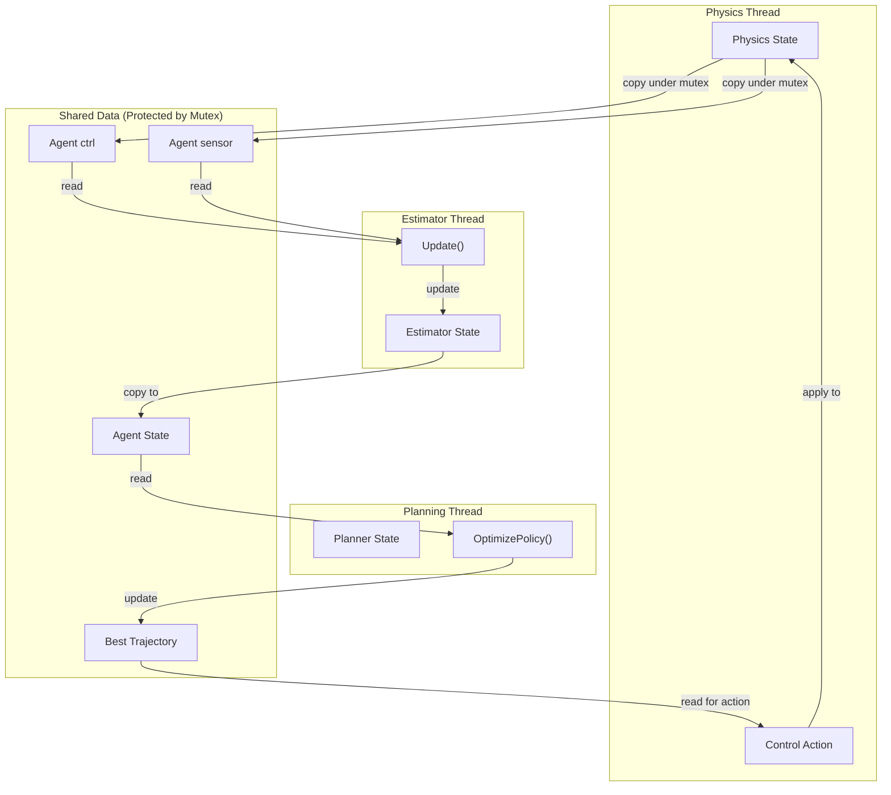
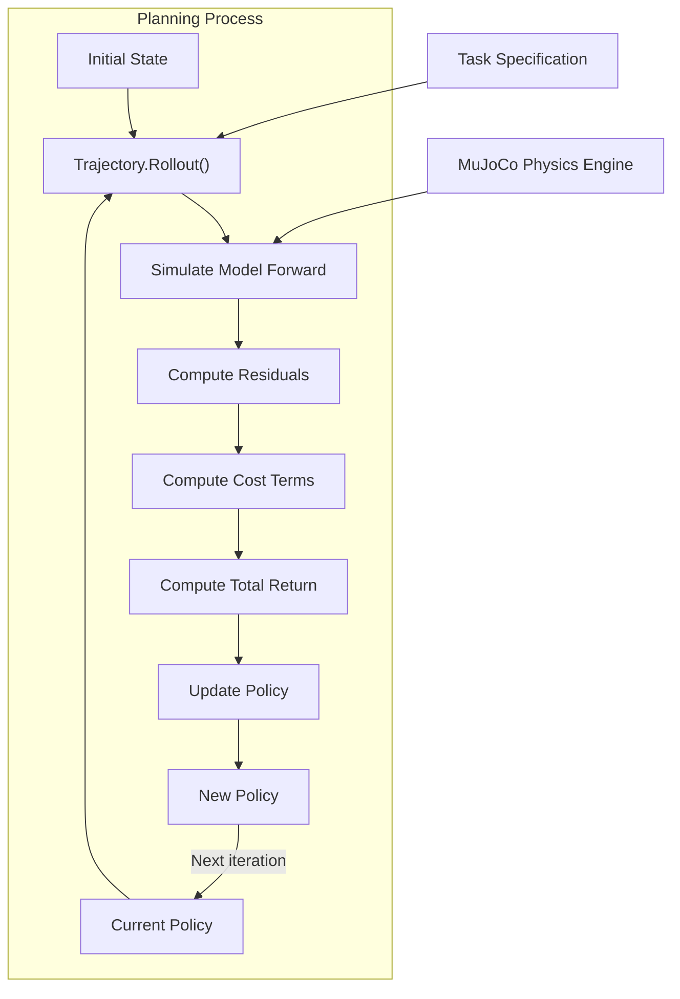
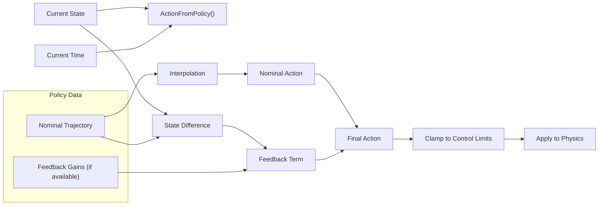

<!-- source: DeepWiki mcp.deepwiki.com · repo google-deepmind/mujoco_mpc · page 2.2 Data Flow · fetched 2026-10-26 -->

# Data Flow

Relevant source files

The following files were used as context for generating this wiki page:

- [mjpc/agent.cc](mjpc/agent.cc)
- [mjpc/agent.h](mjpc/agent.h)
- [mjpc/app.cc](mjpc/app.cc)
- [mjpc/app.h](mjpc/app.h)
- [mjpc/main.cc](mjpc/main.cc)
- [mjpc/planners/ilqg/policy.cc](mjpc/planners/ilqg/policy.cc)
- [mjpc/planners/ilqg/policy.h](mjpc/planners/ilqg/policy.h)
- [mjpc/planners/ilqg/settings.h](mjpc/planners/ilqg/settings.h)
- [mjpc/planners/planner.cc](mjpc/planners/planner.cc)
- [mjpc/simulate.cc](mjpc/simulate.cc)
- [mjpc/simulate.h](mjpc/simulate.h)
- [mjpc/task.cc](mjpc/task.cc)
- [mjpc/task.h](mjpc/task.h)
- [mjpc/tasks/panda/panda.cc](mjpc/tasks/panda/panda.cc)
- [mjpc/tasks/quadrotor/quadrotor.cc](mjpc/tasks/quadrotor/quadrotor.cc)
- [mjpc/tasks/quadrotor/quadrotor.h](mjpc/tasks/quadrotor/quadrotor.h)
- [mjpc/tasks/quadruped/quadruped.cc](mjpc/tasks/quadruped/quadruped.cc)
- [mjpc/tasks/quadruped/quadruped.h](mjpc/tasks/quadruped/quadruped.h)
- [mjpc/tasks/swimmer/swimmer.cc](mjpc/tasks/swimmer/swimmer.cc)
- [mjpc/tasks/swimmer/swimmer.h](mjpc/tasks/swimmer/swimmer.h)
- [mjpc/test/agent/rollout_test.cc](mjpc/test/agent/rollout_test.cc)
- [mjpc/test/testdata/particle_residual.h](mjpc/test/testdata/particle_residual.h)
- [mjpc/trajectory.cc](mjpc/trajectory.cc)
- [mjpc/trajectory.h](mjpc/trajectory.h)

This page explains how data flows between the major components in the MuJoCo MPC system, from state estimation through planning to action selection. It provides an overview of the data pathways between physics simulation, state estimation, planning, and control. For information about the threading model that governs when these components execute, see [Threading Model](#2.1).

## System Overview and Data Flow

The MuJoCo MPC framework implements Model Predictive Control through several interconnected components that exchange data in a specific flow. The following diagram illustrates the high-level data flow between major components:

Sources: [mjpc/agent.cc:359-371](), [mjpc/app.cc:151-206](), [mjpc/app.cc:209-386]()

## Core Data Structures

The following data structures are central to the data flow in MuJoCo MPC:

| Data Structure | Description | Location |
|----------------|-------------|----------|
| `mjData` | MuJoCo's physics state | Managed by MuJoCo |
| `mjpc::State` | Agent's representation of current state | Agent::state |
| `mjpc::Trajectory` | Sequence of states, actions, costs over time | Planner::trajectory |
| `ResidualFn` | Task cost computation | Task::residual |
| `Sensor data` | Raw sensor readings from physics | mjData::sensordata |
| `Control signals` | Control actions to be applied | mjData::ctrl |

Sources: [mjpc/agent.h:182](), [mjpc/trajectory.h:78-87](), [mjpc/task.h:37-50]()

## Detailed Data Flow

### State Estimation Flow

The state estimation flow involves:

1. Physics thread advances the simulation and generates sensor data
2. Estimator thread copies this data (under mutex protection)
3. Estimator updates its internal state representation
4. The updated state is stored in the agent's state structure
5. This state is used by the planner to generate new plans

Sources: [mjpc/app.cc:151-206](), [mjpc/agent.h:182-188]()

### Planning Data Flow

The planning data flow includes:

1. The planner receives the current state and task specification
2. The planner optimizes a policy by:
   - Generating candidate trajectories
   - Computing costs using the task's residual function
   - Selecting the best trajectory
   - Updating the policy based on the best trajectory
3. The policy is then available to the controller

Sources: [mjpc/agent.cc:282-342](), [mjpc/trajectory.cc:52-326]()

### Action Selection Data Flow

The action selection flow is:

1. The physics thread calls the controller callback
2. The callback checks if action is enabled in the agent
3. If enabled, it requests the appropriate action from the planner
4. The planner interpolates the best trajectory to get the action
5. The action is applied to the physics simulation

Sources: [mjpc/app.cc:79-102]()

## Data Flow During Task Transitions

Task transitions affect data flow by:

1. The task monitors the physics state to determine transitions
2. When a transition occurs, the task updates its mode
3. This can modify parameters and weights that configure the residual function
4. The residual function is used to compute costs during planning

Sources: [mjpc/task.cc:141-145](), [mjpc/tasks/quadruped/quadruped.cc:229-395]()

## Residual Function Data Flow

The residual function is a central component in the data flow that computes task costs. Here's how data flows through it:

Key points:

1. The sensor callback uses the current physics state to compute residuals
2. Residuals are stored in the MuJoCo sensor data buffer
3. During planning, these residuals are used to compute cost values
4. Cost values guide the optimization of the policy

Sources: [mjpc/app.cc:105-126](), [mjpc/task.cc:258-261](), [mjpc/trajectory.cc:316-326]()

## Data Communication Between Threads

Thread communication is managed by:

1. Mutexes protect shared data access between threads
2. Physics data is copied to thread-safe buffers
3. Estimator and planner read from these buffers
4. Updated state and trajectories are stored in thread-safe locations
5. Controller reads the best trajectory to determine actions

Sources: [mjpc/app.cc:171-188](), [mjpc/app.cc:275-277](), [mjpc/agent.cc:90-215]()

## Planning and Rollout Data Flow

Planning data flow details:

1. Starting from the current state, the planner rolls out trajectories
2. The MuJoCo physics engine simulates the system dynamics
3. The task's residual function computes costs for each state
4. Total costs guide policy updates
5. The process iterates to optimize the policy

Sources: [mjpc/trajectory.cc:95-210](), [mjpc/trajectory.cc:310-326]()

## Policy Representation and Application

Different planners represent policies differently:

| Planner | Policy Representation | Data Stored |
|---------|----------------------|------------|
| Sampling Planner | Nominal trajectory | States, actions, times |
| iLQG Planner | Nominal trajectory + feedback gains | States, actions, times, feedback matrices |
| Gradient Planner | Parameter vector | Policy parameters |
| Cross Entropy Planner | Distribution parameters | Mean, covariance |

When a policy is applied, data flows as follows:

Sources: [mjpc/planners/ilqg/policy.cc:81-161](), [mjpc/app.cc:79-102]()

## Data Flow Summary

The MuJoCo MPC system's data flow can be summarized as:

1. **State information** flows from the physics simulation to the estimator and then to the planner
2. **Planning data** flows from the task specification and current state to generate optimal policies
3. **Control commands** flow from the policy to the physics simulation
4. **Task parameters** flow from the task specification to configure the residual function
5. **Cost information** flows from the residual function to guide planning optimization

This integrated data flow enables the system to continuously sense, plan, and act in a closed-loop control system.

Sources: [mjpc/agent.cc](), [mjpc/app.cc](), [mjpc/task.cc](), [mjpc/trajectory.cc]()

---

