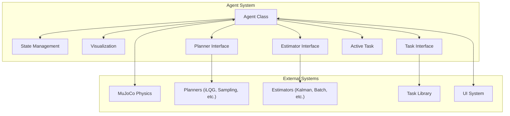
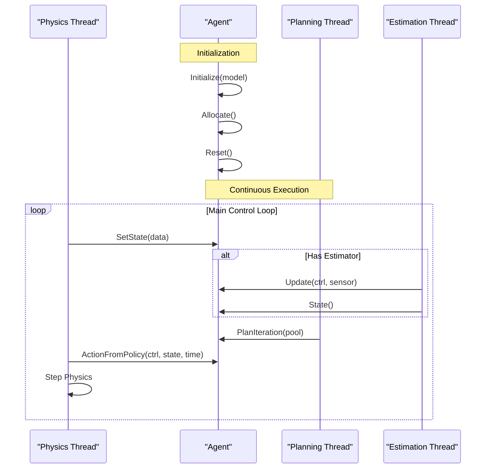
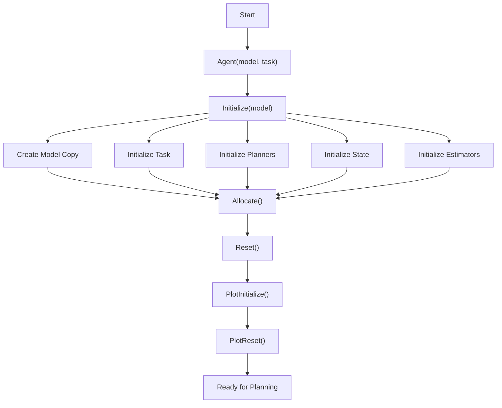
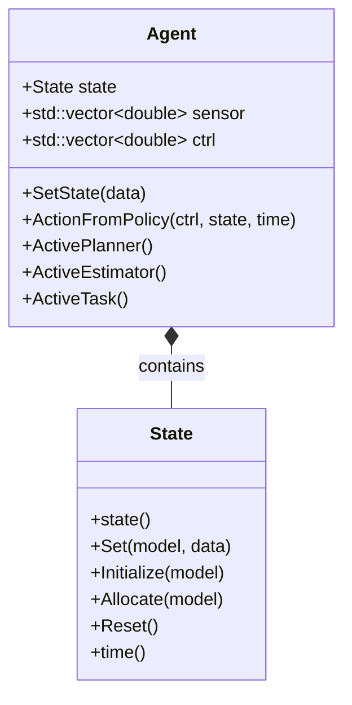
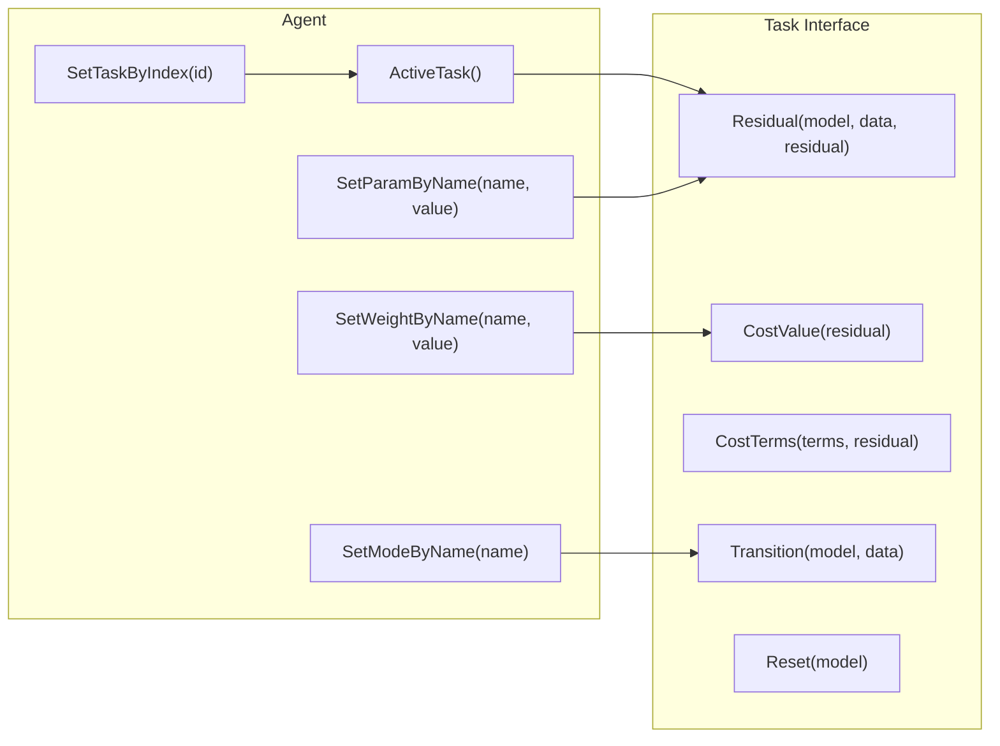
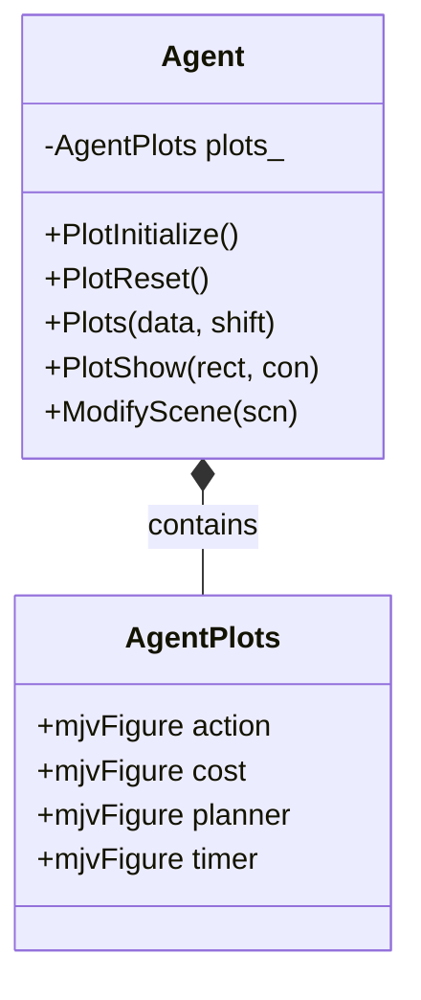
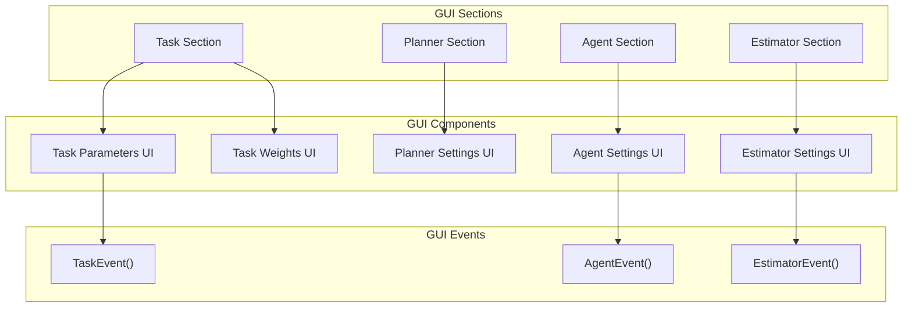
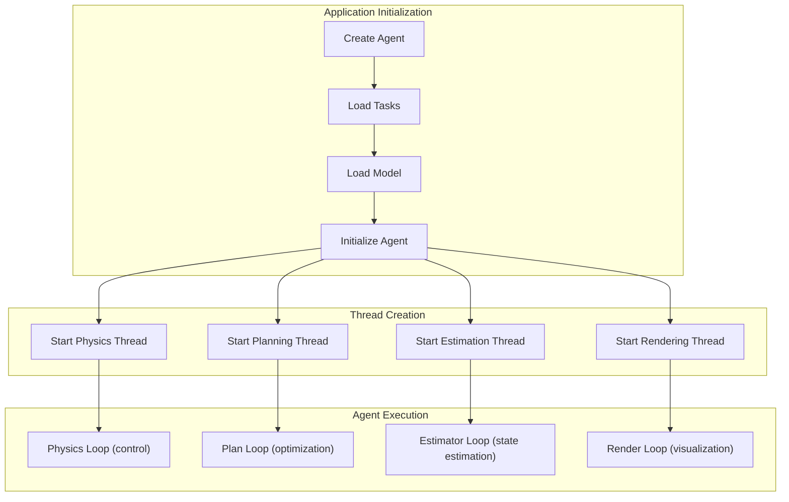

<!-- source: DeepWiki mcp.deepwiki.com · repo google-deepmind/mujoco_mpc · page 3 Agent System · fetched 2026-10-26 -->

# Agent System

<details>
<summary>Relevant source files</summary>

The following files were used as context for generating this wiki page:

- [mjpc/agent.cc](mjpc/agent.cc)
- [mjpc/agent.h](mjpc/agent.h)
- [mjpc/app.cc](mjpc/app.cc)
- [mjpc/app.h](mjpc/app.h)
- [mjpc/main.cc](mjpc/main.cc)
- [mjpc/planners/planner.cc](mjpc/planners/planner.cc)
- [mjpc/simulate.cc](mjpc/simulate.cc)
- [mjpc/simulate.h](mjpc/simulate.h)

</details>


The Agent System is the central orchestration component within MuJoCo MPC. It coordinates planning, execution, state estimation, and task management to implement Model Predictive Control for robotic systems. The Agent manages the interaction between planners, estimators, tasks, and the MuJoCo physics engine within a concurrent execution framework.

For information about the overall system architecture, see [System Architecture](#2). For details on planners, estimators, and tasks that the Agent uses, see [Planners](#4), [Estimators](#5), and [Tasks](#6) respectively.

## Overview and Core Responsibilities

The Agent System serves as the central coordinator of the Model Predictive Control (MPC) framework with the following core responsibilities:

1. **Planning Coordination**: Manages the planning process, delegating optimization to specialized planners
2. **State Management**: Tracks and updates the current system state
3. **Action Selection**: Derives control actions from optimized policies
4. **Task Integration**: Handles tasks and their associated cost functions
5. **Estimation**: Coordinates state estimation when full state information is not directly observable



Sources: [mjpc/agent.h:15-256](), [mjpc/agent.cc:15-1166]()

## Threading Model and Execution Flow

The Agent System operates using a multi-threaded architecture to parallelize computation-intensive tasks. It uses three primary threads:

1. **Physics Thread**: Executes MuJoCo simulation steps and applies control actions
2. **Planning Thread**: Continuously optimizes control policies in the background
3. **Estimation Thread** (optional): Updates state estimates based on sensor readings

The Agent carefully manages thread synchronization to ensure consistent data access across threads.



Sources: [mjpc/app.cc:129-206](), [mjpc/app.cc:208-386](), [mjpc/agent.cc:359-394]()

## Agent Initialization and Configuration

The Agent is initialized with a physics model and task, setting up the planning and estimation systems. The initialization process configures internal parameters like planning horizon, time step, and thread allocation.



Key initialization parameters:
- **Planning Horizon**: Time span for prediction and optimization
- **Time Step**: Simulation step size for trajectory rollouts
- **Integrator**: Numerical integration method
- **Threads**: Number of threads for planning and estimation

Sources: [mjpc/agent.cc:60-174](), [mjpc/app.cc:391-457]()

## Planning Process

The Agent's planning process is executed in a dedicated thread and involves:

1. Setting up the planning model with current state and parameters
2. Executing the selected planner's optimization algorithm
3. Computing trajectories and associated costs
4. Updating the policy for action selection

```mermaid
flowchart TD
    subgraph "Planning Thread"
        Plan["Plan()"] --> PlanIteration["PlanIteration(pool)"]
        PlanIteration --> ModelConfig["Set Model Parameters"]
        ModelConfig --> SetState["Set Planner State"]
        SetState --> CopyResidual["Copy Task Residual"]
        CopyResidual --> OptimizePolicy["Planner.OptimizePolicy()"]
        OptimizePolicy --> ComputeTimes["Compute Times"]
    end
    
    subgraph "Physics Thread"
        PhysicsStep["Physics Step"] --> GetAction["Get Action from Policy"]
        GetAction --> ApplyControl["Apply Control to Model"]
        ApplyControl --> UpdateState["Update State"]
        UpdateState --> PhysicsStep
    end
```



The planning process uses a thread pool to parallelize trajectory rollouts and cost evaluations, enabling efficient utilization of available CPU cores.

Sources: [mjpc/agent.cc:283-357](), [mjpc/agent.cc:359-394]()

## State Management and Action Selection

The Agent maintains the current state of the system and selects actions based on optimized policies:

1. **State Representation**: Includes position, velocity, acceleration, time, mocap data, and user data
2. **State Updates**: Can come from direct measurement or estimation
3. **Action Selection**: The planner's current policy maps states to actions



The Agent implements a controller callback that derives control actions from the current optimized policy based on the current state.

Sources: [mjpc/agent.cc:220-222](), [mjpc/app.cc:79-95]()

## Task Integration

The Agent manages tasks that define objectives, constraints, and dynamics for the MPC problem:

1. **Task Selection**: Can switch between multiple task types
2. **Parameter Management**: Exposes task parameters for tuning via GUI or API
3. **Transitions**: Handles mode transitions within tasks
4. **Residual Functions**: Uses task-defined residual (cost) functions for optimization



The Agent exposes methods to set task parameters and weights, allowing runtime tuning of the optimization problem.

Sources: [mjpc/agent.cc:395-490](), [mjpc/app.cc:110-126]()

## Visualization and Debugging

The Agent provides extensive visualization and debugging capabilities:

1. **Trajectory Visualization**: Shows predicted trajectories in the 3D scene
2. **Cost Plots**: Displays cost components over time
3. **Action Plots**: Shows control inputs over time
4. **Performance Plots**: Monitors planning and computation time



The Agent's visualization system helps debug planning behavior, analyze performance, and understand the optimization process.

Sources: [mjpc/agent.cc:831-1149](), [mjpc/agent.cc:493-564]()

## GUI Integration

The Agent provides a comprehensive GUI for interactive control and configuration:

1. **Task Configuration**: Select tasks and set parameters
2. **Planner Selection**: Choose between different planning algorithms
3. **Visualization Controls**: Toggle various visualization options
4. **Runtime Settings**: Adjust planning horizon, time step, etc.



The GUI allows interactive experimentation with different planning settings, task parameters, and visualization options.

Sources: [mjpc/agent.cc:567-815]()

## API and Integration

The Agent exposes methods for programmatic control and integration with external systems:

```
// Core methods
void Initialize(const mjModel* model)
void Allocate()
void Reset(const double* initial_repeated_action = nullptr)
void Plan(std::atomic<bool>& exitrequest, std::atomic<int>& uiloadrequest)
void PlanIteration(ThreadPool* pool)
void SetState(const mjData* data)

// Task management
void SetTaskList(std::vector<std::shared_ptr<Task>> tasks)
void SetTaskByIndex(int id)
int SetParamByName(std::string_view name, double value)
int SetWeightByName(std::string_view name, double value)
int SetModeByName(std::string_view name)

// Accessors
mjpc::Planner& ActivePlanner() const
mjpc::Estimator& ActiveEstimator() const
Task* ActiveTask() const
```

These methods allow for programmatic control of the Agent system through C++ or via the Python bindings (through gRPC).

Sources: [mjpc/agent.h:47-256]()

## System Integration Example

The following shows how the Agent is integrated into the larger MuJoCo MPC system in the main application:



The Agent is created during application initialization and then operates across multiple threads to perform planning, execution, and estimation in parallel.

Sources: [mjpc/app.cc:391-503](), [mjpc/main.cc:41-71]()

---

