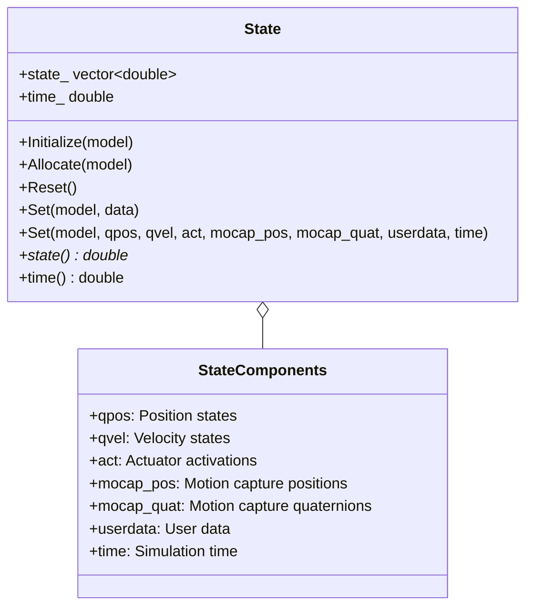
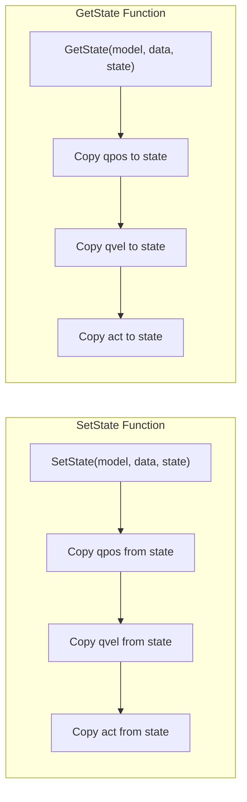
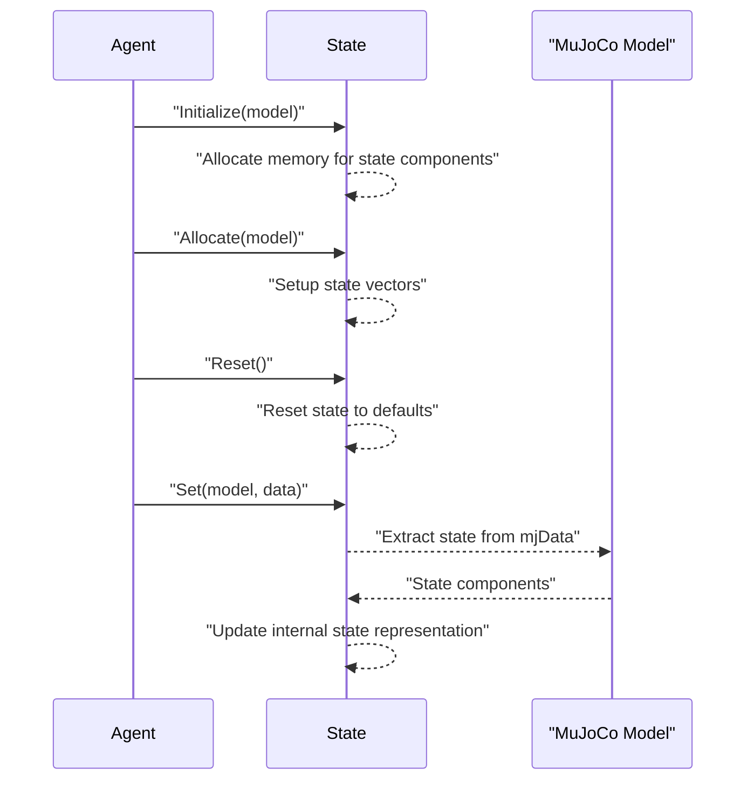
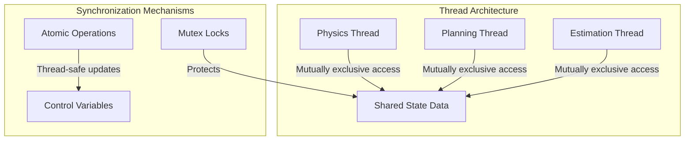
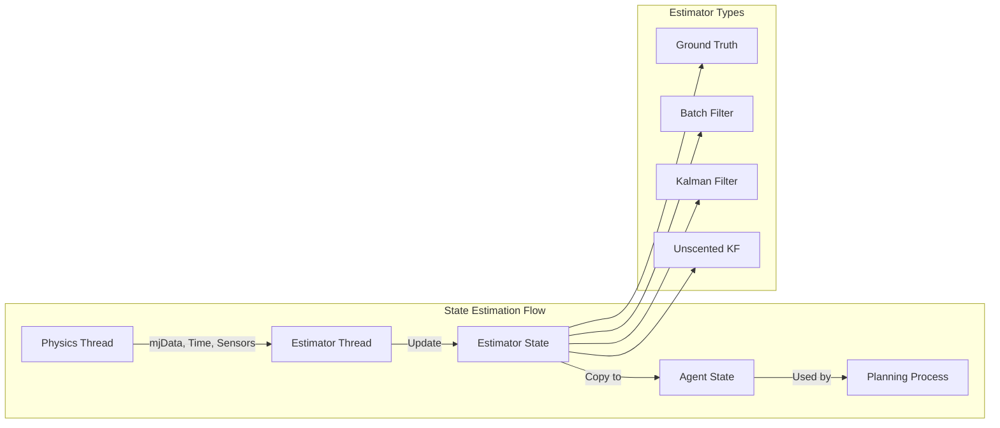
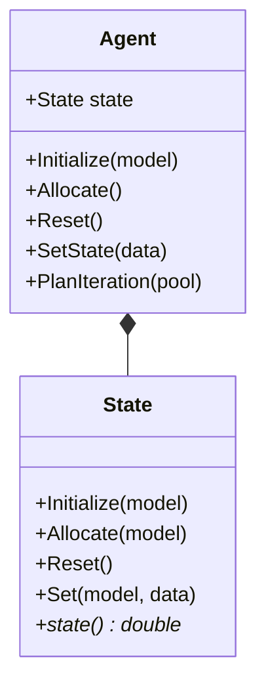
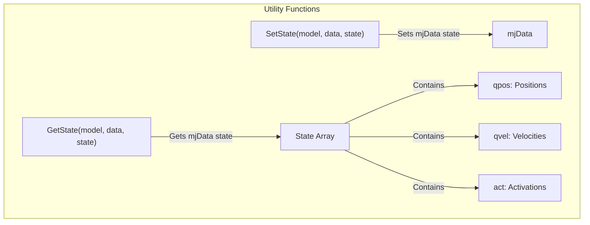
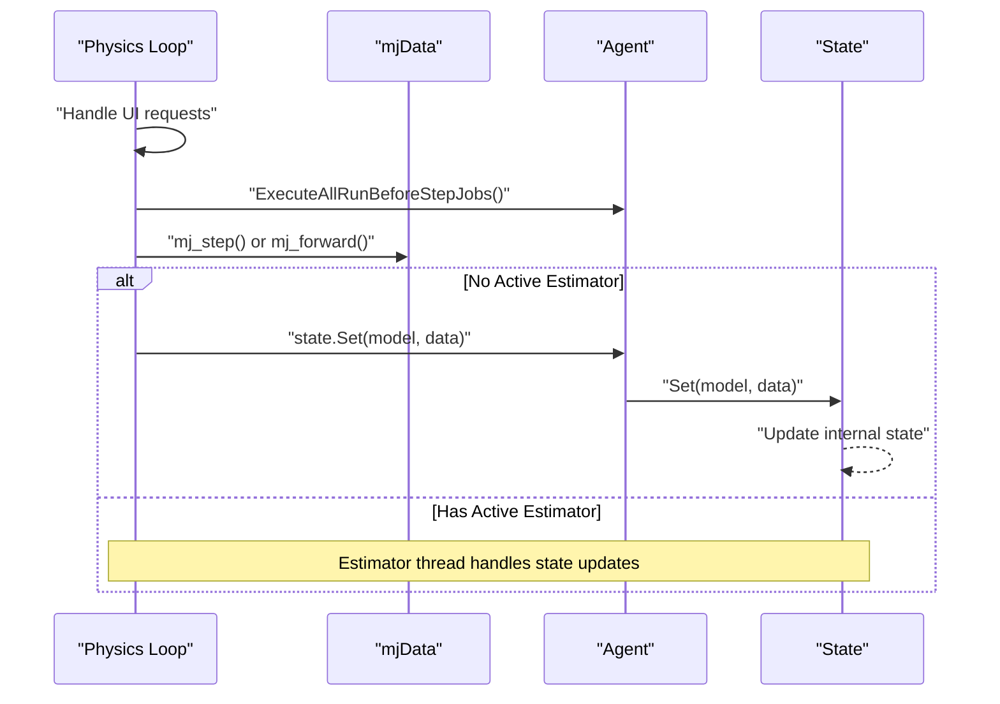

<!-- source: DeepWiki mcp.deepwiki.com · repo google-deepmind/mujoco_mpc · page 3.1 State Management · fetched 2026-10-26 -->

# State Management

Relevant source files

The following files were used as context for generating this wiki page:

- [mjpc/agent.cc](mjpc/agent.cc)
- [mjpc/agent.h](mjpc/agent.h)
- [mjpc/app.cc](mjpc/app.cc)
- [mjpc/app.h](mjpc/app.h)
- [mjpc/main.cc](mjpc/main.cc)
- [mjpc/planners/planner.cc](mjpc/planners/planner.cc)
- [mjpc/simulate.cc](mjpc/simulate.cc)
- [mjpc/simulate.h](mjpc/simulate.h)
- [mjpc/test/utilities/utilities_test.cc](mjpc/test/utilities/utilities_test.cc)
- [mjpc/utilities.cc](mjpc/utilities.cc)
- [mjpc/utilities.h](mjpc/utilities.h)

This page describes how state is managed in the MuJoCo MPC framework. State management refers to how the system represents, maintains, and transitions the state of both the simulation and the planning systems. This is a critical aspect of the model predictive control pipeline as it defines how state is transferred between the physics simulation, the planning algorithm, and the estimation components.

For information on the Agent system that orchestrates state management, see [Agent System](#3).

## State Representation

In MuJoCo MPC, the state is a composite representation consisting of position, velocity, and actuation variables from the MuJoCo physics engine. The system maintains state for both simulation and planning purposes, and ensures proper synchronization between these different contexts.

State data is composed of:
- **qpos**: Position states (joints, free bodies, etc.)
- **qvel**: Velocity states 
- **act**: Actuator activations
- **mocap_pos**: Motion capture positions
- **mocap_quat**: Motion capture quaternions
- **userdata**: User data
- **time**: Simulation time

Sources: [mjpc/agent.h:179-183](mjpc/agent.h:179-183), [mjpc/utilities.cc:77-89](mjpc/utilities.cc:77-89)

## State Operations

The framework provides utility functions to manipulate state data, enabling seamless transfer between MuJoCo's native data structures and the MPC system's state representation.

### Setting and Getting State

Two primary utility functions handle state operations:

These functions map between the MuJoCo data structure (`mjData`) and the state vector used in MPC.

Sources: [mjpc/utilities.cc:77-89](mjpc/utilities.cc:77-89)

### State Initialization and Reset

The `Agent` class manages state initialization and reset:

Sources: [mjpc/agent.cc:118-119](mjpc/agent.cc:118-119), [mjpc/agent.cc:184](mjpc/agent.cc:184), [mjpc/agent.cc:201-202](mjpc/agent.cc:201-202), [mjpc/agent.cc:220-222](mjpc/agent.cc:220-222)

## State Management in the Planning Loop

During the planning process, state management is critical for ensuring that planners work with the correct current state of the system.

```mermaid
flowchart TD
    subgraph "Planning Process"
        A["Agent::PlanIteration"] --> B["Set state for planner"]
        B --> C["Create residual function"]
        C --> D["Optimize policy"]
        D --> E["Release residual function"]
    end
    
    subgraph "State Flow"
        SE["State Estimation"] --> |"Update state"| AP["Agent State"]
        AP --> |"Used by"| PL["Planners"]
        PL --> |"Generate"| TR["Trajectories"]
        TR --> |"Used for"| AC["Action Selection"]
    end
```

The planning loop uses the current state to:
1. Initialize the planning process with the current state
2. Simulate forward in time to evaluate potential trajectories
3. Optimize control actions based on predicted outcomes

Sources: [mjpc/agent.cc:283-314](mjpc/agent.cc:283-314), [mjpc/agent.cc:313-314](mjpc/agent.cc:313-314)

## Thread Safety and Synchronization

State management in MuJoCo MPC is designed to handle multiple threads that might read or write state data. The system employs mutex locks and atomic operations to ensure thread safety.

Key aspects of thread synchronization:
- The physics thread updates the primary state
- The planning thread reads state for trajectory generation
- The estimation thread may update state estimates
- Mutex locks ensure exclusive access to shared state
- RunBeforeStep jobs queue is protected by mutex

Sources: [mjpc/app.cc:171-184](mjpc/app.cc:171-184), [mjpc/app.cc:275-277](mjpc/app.cc:275-277), [mjpc/app.cc:379-384](mjpc/app.cc:379-384), [mjpc/agent.cc:373-393](mjpc/agent.cc:373-393)

## State in Estimation

When state estimation is enabled, the system uses estimated state rather than ground truth from the physics simulation.

In the estimation loop:
1. The physics thread provides simulation data
2. The estimator thread updates state estimates
3. The estimated state is used for planning
4. Different estimator types provide different approaches to state estimation

Sources: [mjpc/app.cc:151-205](mjpc/app.cc:151-205), [mjpc/agent.cc:379-384](mjpc/agent.cc:379-384)

## Implementation Details

### State Management in Agent Class

The `Agent` class maintains a `State` object that represents the current state of the system. It provides methods to:

1. Initialize state based on model
2. Reset state to default values
3. Set state from MuJoCo data
4. Provide state to planners

Sources: [mjpc/agent.h:179-183](mjpc/agent.h:179-183), [mjpc/agent.cc:118-119](mjpc/agent.cc:118-119), [mjpc/agent.cc:184](mjpc/agent.cc:184), [mjpc/agent.cc:220-222](mjpc/agent.cc:220-222)

### State Utility Functions

These utility functions are used throughout the system to convert between MuJoCo's `mjData` and the state representation used by MPC.

Sources: [mjpc/utilities.cc:77-89](mjpc/utilities.cc:77-89), [mjpc/utilities.h:39-43](mjpc/utilities.h:39-43)

## Physics Integration

The physics loop in `app.cc` is responsible for advancing the simulation and updating state. It handles:

1. Running the physics simulation
2. Executing callbacks before physics steps
3. Applying perturbations
4. Synchronizing with CPU time
5. Updating the agent's state

Sources: [mjpc/app.cc:209-386](mjpc/app.cc:209-386), [mjpc/app.cc:329-330](mjpc/app.cc:329-330), [mjpc/app.cc:355-356](mjpc/app.cc:355-356), [mjpc/app.cc:379-384](mjpc/app.cc:379-384)

## Summary

The state management system in MuJoCo MPC:

1. Represents state as a combination of positions, velocities, and actuator activations
2. Provides utilities to transfer state between MuJoCo and MPC components
3. Ensures thread safety through mutexes and atomic operations
4. Supports different estimation approaches
5. Integrates with the physics simulation and planning system

This design facilitates efficient model predictive control by ensuring that all components of the system work with consistent and up-to-date state information.

---

