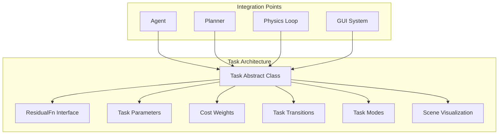
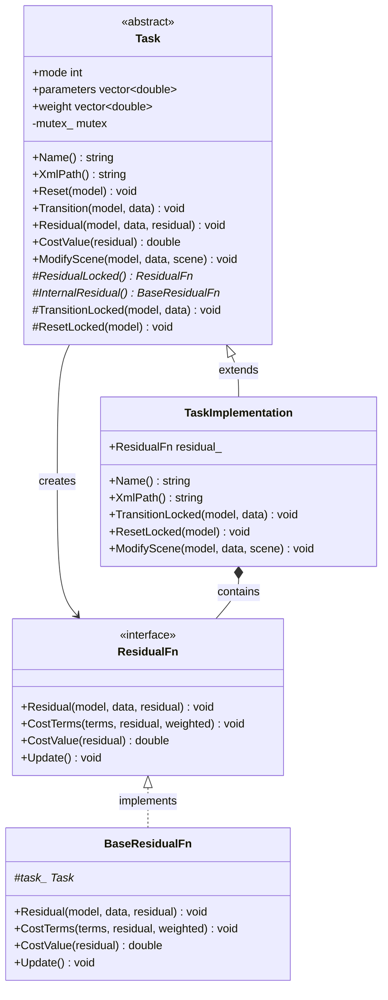
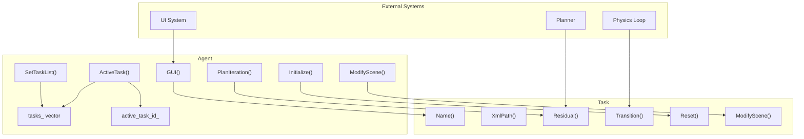
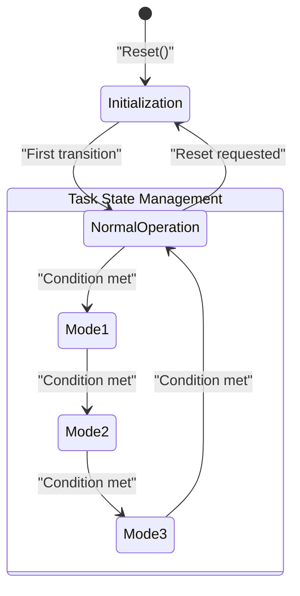
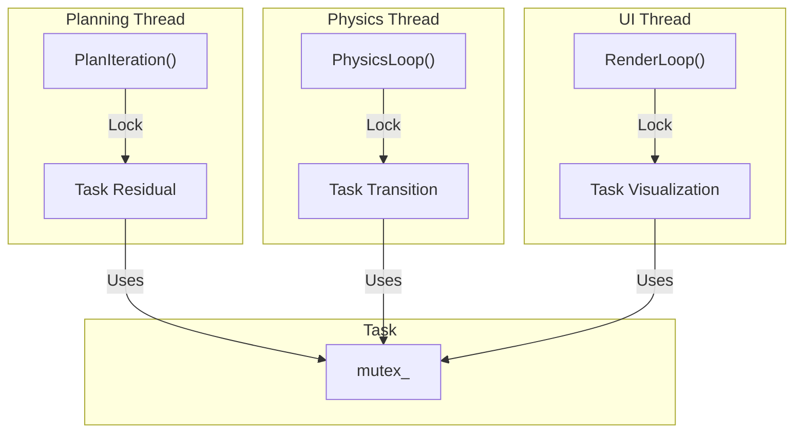
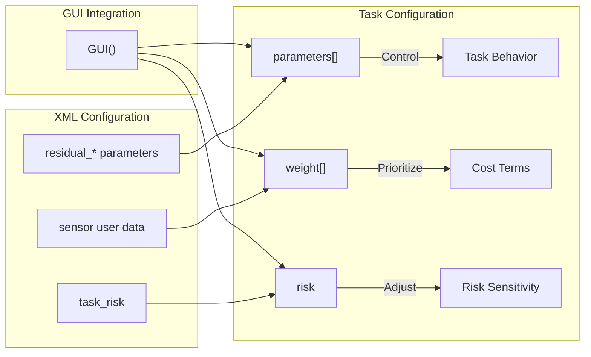
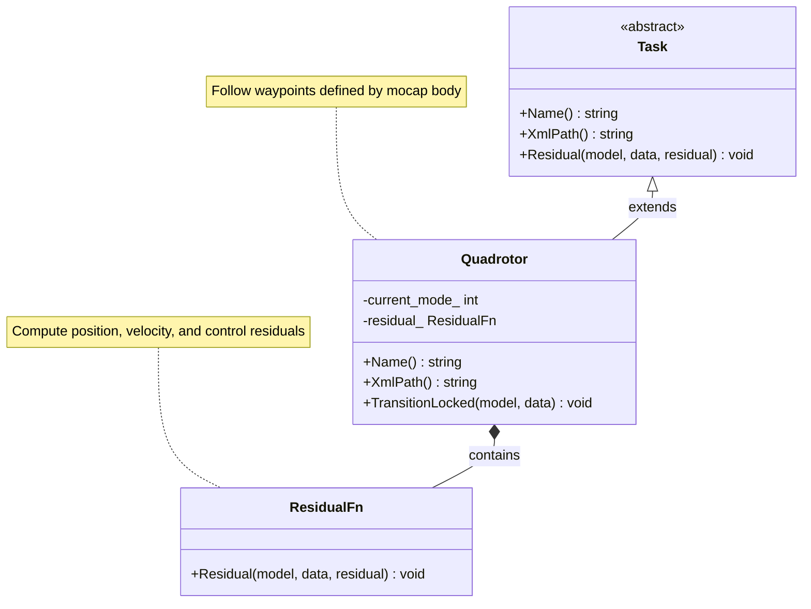
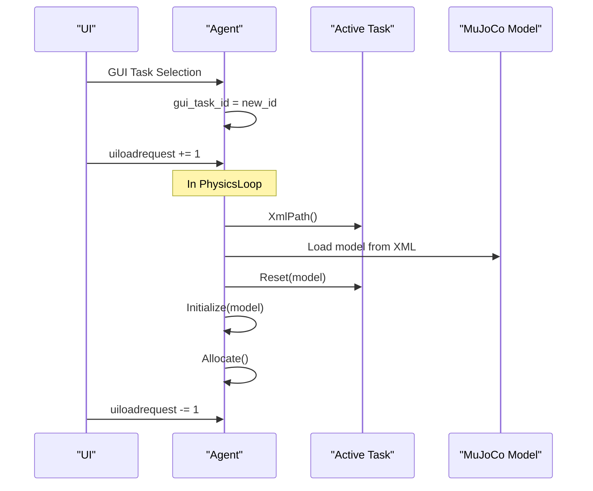

<!-- source: DeepWiki mcp.deepwiki.com · repo google-deepmind/mujoco_mpc · page 3.2 Task Integration · fetched 2026-10-26 -->

# Task Integration

Relevant source files

The following files were used as context for generating this wiki page:

- [mjpc/agent.cc](mjpc/agent.cc)
- [mjpc/agent.h](mjpc/agent.h)
- [mjpc/app.cc](mjpc/app.cc)
- [mjpc/app.h](mjpc/app.h)
- [mjpc/main.cc](mjpc/main.cc)
- [mjpc/planners/planner.cc](mjpc/planners/planner.cc)
- [mjpc/simulate.cc](mjpc/simulate.cc)
- [mjpc/simulate.h](mjpc/simulate.h)
- [mjpc/task.cc](mjpc/task.cc)
- [mjpc/task.h](mjpc/task.h)
- [mjpc/tasks/panda/panda.cc](mjpc/tasks/panda/panda.cc)
- [mjpc/tasks/quadrotor/quadrotor.cc](mjpc/tasks/quadrotor/quadrotor.cc)
- [mjpc/tasks/quadrotor/quadrotor.h](mjpc/tasks/quadrotor/quadrotor.h)
- [mjpc/tasks/quadruped/quadruped.cc](mjpc/tasks/quadruped/quadruped.cc)
- [mjpc/tasks/quadruped/quadruped.h](mjpc/tasks/quadruped/quadruped.h)
- [mjpc/tasks/swimmer/swimmer.cc](mjpc/tasks/swimmer/swimmer.cc)
- [mjpc/tasks/swimmer/swimmer.h](mjpc/tasks/swimmer/swimmer.h)

This document explains how tasks are integrated in the MuJoCo MPC framework. Task integration refers to how task-specific objectives, transitions, and behaviors are incorporated into the overall MPC planning and control system. The Task component defines what the agent should accomplish, while the Agent component (discussed in [Agent System](#3)) is responsible for planning and executing actions to achieve these tasks.

## Overview of the Task System

The Task system defines the core interface and implementation patterns for all control objectives in MuJoCo MPC. Tasks specify their objectives through residual functions, which are used to compute costs that the planner tries to minimize. Tasks can also define state transitions, modes of operation, and custom visualizations.

Sources: [mjpc/task.h](), [mjpc/task.cc](), [mjpc/agent.h](), [mjpc/agent.cc]()

## Task Interface and Design

The core of the task system is the abstract `Task` class, which defines the interface that all tasks must implement.

Key components of the Task interface:
- `Name()` and `XmlPath()`: Identity methods returning task name and model path
- `Residual()`: Computes task-specific residuals for cost calculation
- `Transition()`: Updates task state during physics simulation
- `Reset()`: Initializes or resets the task state
- `ModifyScene()`: Optional method to add task-specific visualization elements

Sources: [mjpc/task.h:14-177](), [mjpc/task.cc:15-264]()

## Task-Agent Integration

The Agent integrates tasks with the planning and control system. The key integration points include:

Key integration mechanisms:
1. **Task Management**: Agent stores and manages a list of available tasks
2. **Task Selection**: Agent can switch between tasks based on user input
3. **Task Initialization**: Agent initializes tasks with the appropriate model
4. **Planning Integration**: Task residuals are used in the planning process
5. **Execution Integration**: Task transitions are called during physics simulation
6. **Visualization Integration**: Task can add custom visualizations to the scene
7. **GUI Integration**: Task parameters and modes are exposed in the GUI

Sources: [mjpc/agent.cc:274-281](), [mjpc/agent.cc:71-174](), [mjpc/agent.cc:283-357](), [mjpc/app.cc:280]()

## Task State Transitions

Tasks can have multiple operational modes with transitions between them:

State transitions are handled through:
1. The `Transition()` method, called during physics simulation
2. The `mode` variable, which tracks the current task state
3. Transition conditions defined in `TransitionLocked()`
4. Mode-specific behaviors in the `Residual()` function

For example, in the Quadruped task, transitions occur between modes like quadruped walking, biped stance, and backflip based on conditions like position, velocity, and user input.

Sources: [mjpc/task.cc:141-145](), [mjpc/tasks/quadruped/quadruped.cc:229-395](), [mjpc/app.cc:280]()

## Task Thread Safety

Tasks are accessed from multiple threads in MuJoCo MPC, requiring careful synchronization:

Thread safety mechanisms:
1. A mutex in the `Task` class protects access to shared state
2. Public methods like `Residual()`, `Transition()`, and `Reset()` acquire the mutex
3. Protected methods like `ResidualLocked()` and `TransitionLocked()` assume the mutex is held
4. The planning thread creates a thread-safe copy of the residual function

Sources: [mjpc/task.h:167](), [mjpc/task.cc:125-261](), [mjpc/agent.cc:319-320]()

## Task Parameters and Weights

Tasks expose parameters and weights that can be adjusted through the GUI:

Parameter and weight management:
1. Task parameters are loaded from model numeric values prefixed with "residual_"
2. Cost weights are loaded from user sensor data and control cost term priorities
3. The Agent's GUI method exposes these parameters for user adjustment
4. Parameter changes are propagated to the task's residual function

Sources: [mjpc/task.cc:38-64](), [mjpc/task.cc:147-245](), [mjpc/agent.cc:605-686]()

## Task Implementation Example

Here's an example of how a concrete task (Quadrotor) is implemented:

Implementation patterns:
1. Task implementation inherits from `Task` and implements required methods
2. Task contains a private `ResidualFn` implementation
3. `ResidualFn::Residual()` computes task-specific residuals
4. `TransitionLocked()` handles mode transitions and state updates
5. Optional `ModifyScene()` adds task-specific visualization

Sources: [mjpc/tasks/quadrotor/quadrotor.h:15-61](), [mjpc/tasks/quadrotor/quadrotor.cc:15-90]()

## Loading and Switching Tasks

The Agent manages task loading and switching:

Key steps in task switching:
1. User selects a task from the GUI
2. Agent updates `gui_task_id` and requests model loading
3. PhysicsLoop loads the task's XML model
4. Agent initializes and resets the task
5. Planning and execution continue with the new task

Sources: [mjpc/agent.cc:739-756](), [mjpc/app.cc:221-257]()

## Summary

Task Integration in MuJoCo MPC provides a flexible, thread-safe framework for defining and executing control tasks. Key aspects include:

1. An abstract Task interface that defines methods for residual calculation and state transitions
2. Integration with the Agent for planning, execution, and visualization
3. Support for multiple task modes with transitions
4. Thread safety mechanisms for multi-threaded access
5. Parameter and weight management for task configuration
6. GUI integration for visualization and interaction

Tasks define what the agent should accomplish, while the Agent handles planning and execution to achieve these objectives.

Sources: [mjpc/task.h](), [mjpc/task.cc](), [mjpc/agent.h](), [mjpc/agent.cc]()

---

