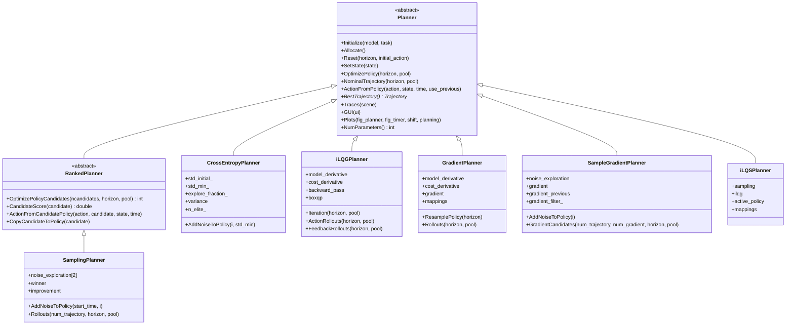
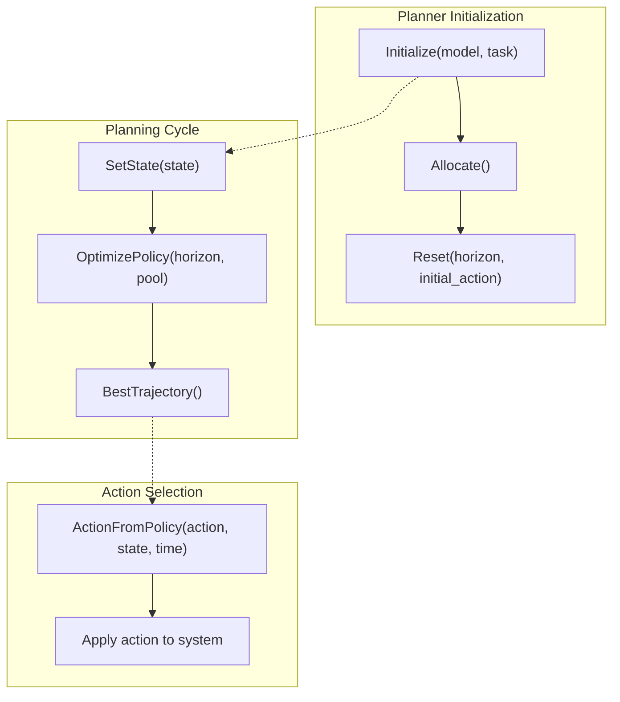
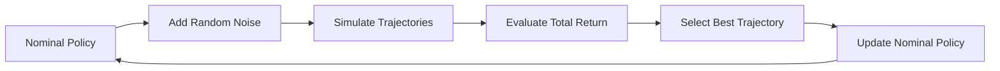
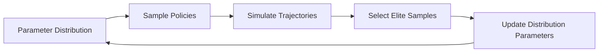
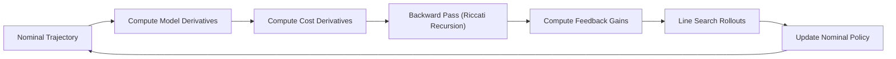
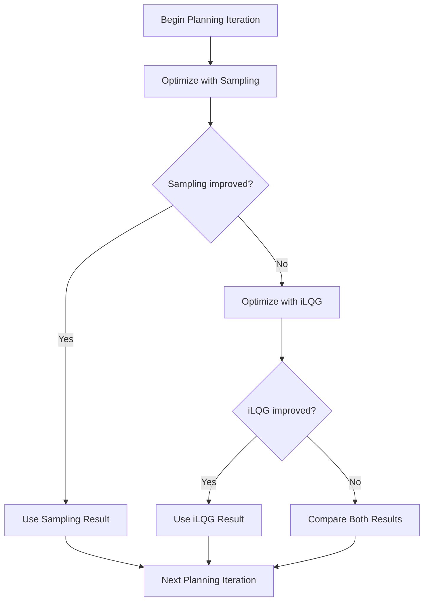

<!-- source: DeepWiki mcp.deepwiki.com · repo google-deepmind/mujoco_mpc · page 4 Planners · fetched 2026-10-26 -->

# Planners

<details>
<summary>Relevant source files</summary>

The following files were used as context for generating this wiki page:

- [mjpc/planners/cross_entropy/planner.cc](mjpc/planners/cross_entropy/planner.cc)
- [mjpc/planners/cross_entropy/planner.h](mjpc/planners/cross_entropy/planner.h)
- [mjpc/planners/gradient/planner.cc](mjpc/planners/gradient/planner.cc)
- [mjpc/planners/gradient/planner.h](mjpc/planners/gradient/planner.h)
- [mjpc/planners/ilqg/planner.cc](mjpc/planners/ilqg/planner.cc)
- [mjpc/planners/ilqg/planner.h](mjpc/planners/ilqg/planner.h)
- [mjpc/planners/ilqs/planner.cc](mjpc/planners/ilqs/planner.cc)
- [mjpc/planners/ilqs/planner.h](mjpc/planners/ilqs/planner.h)
- [mjpc/planners/planner.h](mjpc/planners/planner.h)
- [mjpc/planners/sample_gradient/planner.cc](mjpc/planners/sample_gradient/planner.cc)
- [mjpc/planners/sample_gradient/planner.h](mjpc/planners/sample_gradient/planner.h)
- [mjpc/planners/sampling/planner.cc](mjpc/planners/sampling/planner.cc)
- [mjpc/planners/sampling/planner.h](mjpc/planners/sampling/planner.h)
- [mjpc/tasks/shadow_reorient/task.xml](mjpc/tasks/shadow_reorient/task.xml)

</details>


This document provides a comprehensive overview of the planning algorithms implemented in the MuJoCo MPC framework. Planners are core components that generate optimal control trajectories for robotic systems using model predictive control (MPC) principles. Each planner represents a different optimization approach with its own strengths and computational characteristics.

## Planner Architecture

The MuJoCo MPC framework implements a clean architecture for planners, with a common interface and several specialized implementations.

### Planner Hierarchy



Sources: [mjpc/planners/planner.h:32-103](). [mjpc/planners/sampling/planner.h:40-163](). [mjpc/planners/cross_entropy/planner.h:33-145](). [mjpc/planners/ilqg/planner.h:32-162](). [mjpc/planners/gradient/planner.h:38-164](). [mjpc/planners/sample_gradient/planner.h:35-174](). [mjpc/planners/ilqs/planner.h:39-113]().

### Planning Process Flow



Sources: [mjpc/planners/planner.h:44-58](), [mjpc/planners/planner.h:62-71]().

## Core Planner Components

All planners in the framework share some common components and conceptual elements:

| Component | Description |
|-----------|-------------|
| Policy | Represents a mapping from states to actions, with different representations for different planners |
| Trajectory | Stores states, actions, costs, and other data for a simulated trajectory |
| Model | The MuJoCo physics model used for forward simulation |
| Task | Defines the objective function and constraints |
| ThreadPool | Enables parallel computation during optimization |

### Common Data Members

Most planners maintain:
- A current state representation
- A nominal policy and multiple candidate policies
- Rollout trajectories
- Optimization parameters specific to the algorithm
- Timing information for performance monitoring

Sources: [mjpc/planners/sampling/planner.h:114-163](), [mjpc/planners/cross_entropy/planner.h:94-144](), [mjpc/planners/ilqg/planner.h:93-160](), [mjpc/planners/gradient/planner.h:96-163](), [mjpc/planners/sample_gradient/planner.h:100-174](), [mjpc/planners/ilqs/planner.h:90-112]().

## Sampling-based Planners

Sampling-based planners generate random control sequences, simulate them, and select the best performing ones. They are simple to implement and can handle non-smooth dynamics and costs.

### Sampling Planner

The Sampling Planner uses pure random sampling to find good trajectories:

1. Start with a nominal policy
2. Create multiple candidate policies by adding random noise
3. Simulate trajectories for each candidate policy
4. Select the best trajectory based on total return
5. Update the nominal policy with the best candidate



Key configuration parameters:
- `sampling_trajectories`: Number of candidate trajectories to evaluate
- `sampling_exploration`: Standard deviation for the noise
- `sampling_representation`: Policy interpolation method (Zero, Linear, Cubic)
- `sampling_spline_points`: Number of control points in the spline policy

Sources: [mjpc/planners/sampling/planner.cc:41-77](), [mjpc/planners/sampling/planner.cc:155-207](), [mjpc/planners/sampling/planner.cc:350-392](), [mjpc/tasks/shadow_reorient/task.xml:11-16]().

### Cross Entropy Method

The Cross Entropy Method (CEM) improves on pure sampling by adapting the sampling distribution:

1. Start with an initial mean and variance for control parameters
2. Sample candidate policies from this distribution
3. Evaluate trajectories and select elite samples (best performers)
4. Update the mean and variance based on elite samples
5. Repeat the process with the updated distribution



Key configuration parameters:
- `sampling_trajectories`: Number of candidate trajectories to evaluate
- `std_initial_`: Initial standard deviation for sampling
- `std_min_`: Minimum standard deviation (prevents convergence to local optima)
- `explore_fraction_`: Fraction of trajectories that use full exploration
- `n_elite_`: Number of elite samples used to update the distribution

Sources: [mjpc/planners/cross_entropy/planner.cc:41-74](), [mjpc/planners/cross_entropy/planner.cc:167-290](), [mjpc/planners/cross_entropy/planner.cc:387-442](), [mjpc/tasks/shadow_reorient/task.xml:15-16]().

### Sample Gradient Planner

The Sample Gradient Planner combines sampling with gradient-based optimization:

1. Generate random samples and evaluate trajectories
2. Compute an approximate gradient from the sample returns
3. Generate additional candidates along the gradient direction
4. Evaluate all candidates and select the best
5. Filter the gradient to provide stability across iterations

Key configuration parameters:
- `sampling_trajectories`: Total number of trajectories to evaluate
- `sample_gradient_trajectories`: Number of gradient-based trajectories
- `noise_exploration`: Exploration noise magnitude
- `sample_gradient_filter`: Gradient filter coefficient (0-1)

Sources: [mjpc/planners/sample_gradient/planner.cc:43-74](), [mjpc/planners/sample_gradient/planner.cc:169-272](), [mjpc/planners/sample_gradient/planner.cc:401-492]().

## Derivative-based Planners

Derivative-based planners compute gradients or higher-order derivatives of the cost function with respect to control inputs, enabling more directed optimization.

### iLQG Planner (iterative Linear Quadratic Gaussian)

The iLQG Planner uses second-order approximations of the dynamics and cost:

1. Roll out the nominal trajectory
2. Compute model derivatives (state and control Jacobians)
3. Compute cost derivatives (gradients and Hessians)
4. Perform a backward pass to compute optimal control updates
5. Apply the updates with line search to ensure improvement
6. Iterate until convergence



Key configuration parameters:
- `ilqg_num_rollouts`: Number of line search trajectories
- `ilqg_regularization_type`: Method for regularizing the backward pass
- `derivative_skip`: Step size for finite differencing

Sources: [mjpc/planners/ilqg/planner.cc:41-65](), [mjpc/planners/ilqg/planner.cc:155-205](), [mjpc/planners/ilqg/planner.cc:376-627]().

### Gradient Planner

The Gradient Planner uses first-order gradient descent:

1. Roll out the nominal trajectory
2. Compute model derivatives
3. Compute cost derivatives
4. Calculate the gradient of the cost with respect to controls
5. Update policy parameters in the negative gradient direction
6. Use line search to find an appropriate step size

Key configuration parameters:
- `gradient_num_trajectory`: Number of line search candidates
- `spline representation`: Policy interpolation method
- `derivative_skip`: Step size for finite differencing

Sources: [mjpc/planners/gradient/planner.cc:41-61](), [mjpc/planners/gradient/planner.cc:158-326]().

## Hybrid Planner

### iLQS Planner

The iLQS Planner combines sampling and iLQG approaches:

1. Try to optimize using the sampling planner first
2. If sampling finds improvement, use the sampling result
3. If sampling does not improve, try iLQG optimization
4. Convert between spline-based policies (sampling) and trajectory-based policies (iLQG)
5. Track which approach is currently providing better results



Sources: [mjpc/planners/ilqs/planner.cc:33-40](), [mjpc/planners/ilqs/planner.cc:87-214]().

## Planner Comparison

### Key Characteristics

| Planner | Approach | Derivatives | Memory | Computation | Parallelization |
|---------|----------|-------------|--------|-------------|----------------|
| Sampling | Random search | No | Low | Moderate | High |
| Cross Entropy | Distribution fitting | No | Low | Moderate | High |
| iLQG | Second-order optimization | Yes | High | High | Moderate |
| Gradient | First-order optimization | Yes | Moderate | Moderate | Moderate |
| Sample Gradient | Hybrid | Approximate | Moderate | Moderate | High |
| iLQS | Hybrid | Yes/No | High | High | High |

### When to Use Each Planner

- **Sampling Planner**: Simple problems, non-smooth dynamics or costs, when derivatives are unreliable
- **Cross Entropy**: When sampling needs more efficiency, problems with clear structure
- **iLQG**: Complex dynamics, smooth costs, when accurate derivatives are available
- **Gradient**: Similar to iLQG but with lower computational demands
- **Sample Gradient**: Balance between exploration and exploitation, when approximate gradients are sufficient
- **iLQS**: Complex problems where neither pure sampling nor pure optimization is consistently effective

Sources: Experience from analyzing the code structure and implementation details.

## Implementation Details

### Policy Representation

Different planners use different policy representations:

1. **Spline-based policies** (Sampling, Cross Entropy, Gradient, Sample Gradient):
   - A sequence of control points over time
   - Different interpolation methods (Zero, Linear, Cubic)
   - Easy to perturb and sample

2. **Trajectory-based policies with feedback** (iLQG):
   - Nominal control sequence
   - State-feedback gains for corrections
   - Optimal for linear-quadratic approximations

Sources: [mjpc/planners/sampling/planner.h:125-127](), [mjpc/planners/ilqg/planner.h:104-106](), [mjpc/planners/gradient/planner.h:107-109]().

### Visualization and Monitoring

All planners provide:
- Trajectory visualization in the 3D scene
- GUI elements for configuration
- Performance plots showing:
  - Improvement metrics
  - Computation time breakdowns
  - Algorithm-specific diagnostics

Sources: [mjpc/planners/sampling/planner.cc:401-521](), [mjpc/planners/cross_entropy/planner.cc:450-571](), [mjpc/planners/ilqg/planner.cc:243-374]().

## Examples

Here's an example of planner configuration from a task definition file:

```xml
<custom>
  <numeric name="agent_planner" data="5" />
  <numeric name="agent_horizon" data="0.25" />
  <numeric name="agent_timestep" data="0.01" />
  <numeric name="sampling_spline_points" data="5" />
  <numeric name="sampling_exploration" data="0.2" />
  <numeric name="sampling_representation" data="0" />
  <numeric name="sampling_trajectories" data="60" />
  <numeric name="n_elite" data="8" />
  <numeric name="explore_fraction" data="0.5" />
</custom>
```

This configuration uses the Cross Entropy Method planner (planner ID 5) with specific settings for exploration, number of trajectories, and elite fraction.

Sources: [mjpc/tasks/shadow_reorient/task.xml:6-17]().

In conclusion, MuJoCo MPC offers a diverse set of planners that can be selected and configured based on the specific requirements of the control task. The framework's modular design allows for easy experimentation with different algorithms and parameter settings.

---

