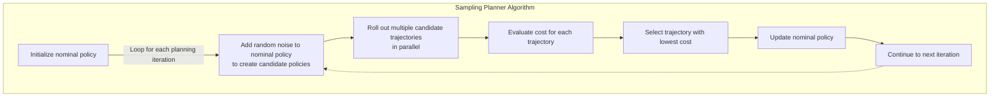
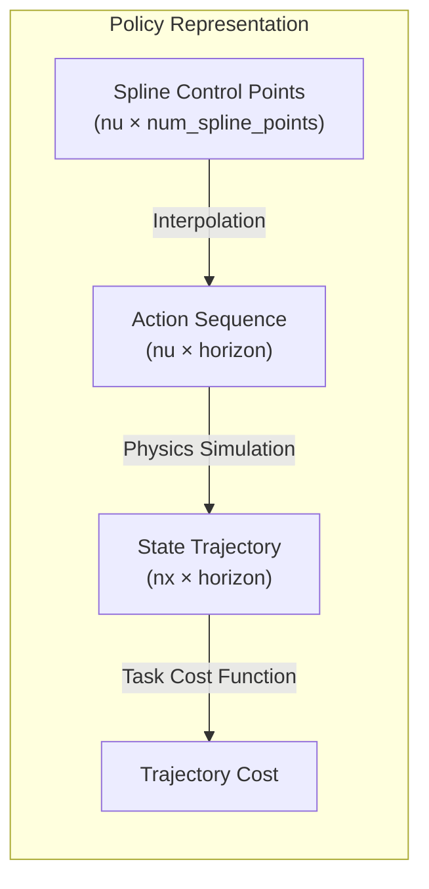
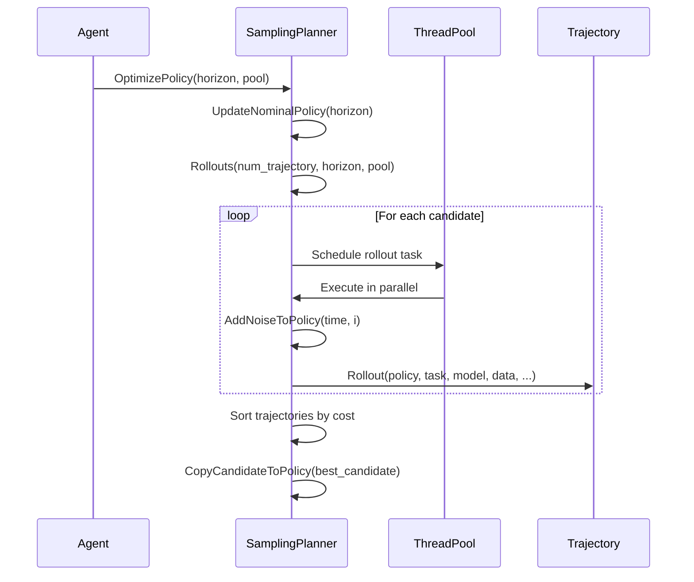
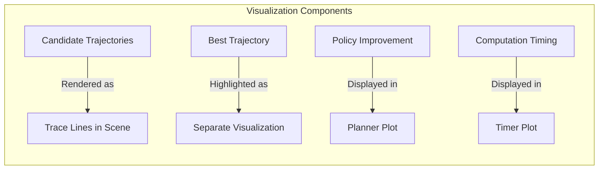

<!-- source: DeepWiki mcp.deepwiki.com · repo google-deepmind/mujoco_mpc · page 4.1 Sampling Planner · fetched 2026-10-26 -->

# Sampling Planner

<details>
<summary>Relevant source files</summary>

The following files were used as context for generating this wiki page:

- [mjpc/planners/gradient/planner.cc](mjpc/planners/gradient/planner.cc)
- [mjpc/planners/gradient/planner.h](mjpc/planners/gradient/planner.h)
- [mjpc/planners/ilqg/planner.cc](mjpc/planners/ilqg/planner.cc)
- [mjpc/planners/ilqg/planner.h](mjpc/planners/ilqg/planner.h)
- [mjpc/planners/ilqs/planner.cc](mjpc/planners/ilqs/planner.cc)
- [mjpc/planners/ilqs/planner.h](mjpc/planners/ilqs/planner.h)
- [mjpc/planners/planner.h](mjpc/planners/planner.h)
- [mjpc/planners/sampling/planner.cc](mjpc/planners/sampling/planner.cc)
- [mjpc/planners/sampling/planner.h](mjpc/planners/sampling/planner.h)

</details>


The Sampling Planner is a trajectory optimization method in MuJoCo MPC that uses random sampling to find effective control policies. It generates multiple candidate trajectories by adding random noise to a nominal policy, simulates these trajectories, and selects the one with the lowest cost. This approach is conceptually simple and does not require derivative information, making it robust for problems with discontinuities or complex dynamics.

For information about other planning approaches available in MuJoCo MPC, see [Planners](#4).

## Algorithm Overview

The Sampling Planner follows a straightforward approach to policy optimization:



Sources: [mjpc/planners/sampling/planner.cc:376-392](), [mjpc/planners/sampling/planner.cc:194-211]()

The Sampling Planner differs from derivative-based approaches like [iLQG Planner](#4.2) and [Gradient Planner](#4.3) in that it doesn't compute model derivatives or cost gradients. Instead, it relies on random exploration to discover effective control strategies.

## Implementation Details

### Core Components

```mermaid
classDiagram
    class SamplingPlanner {
        +Initialize(model, task)
        +Allocate()
        +Reset(horizon, initial_repeated_action)
        +SetState(state)
        +OptimizePolicy(horizon, pool)
        +ActionFromPolicy(action, state, time)
        +UpdateNominalPolicy(horizon)
        +AddNoiseToPolicy(start_time, i)
        +Rollouts(num_trajectory, horizon, pool)
        +BestTrajectory()
        -policy: SamplingPolicy
        -candidate_policy[kMaxTrajectory]
        -trajectory[kMaxTrajectory]
        -noise_exploration[2]
        -winner: int
        -interpolation_: SplineInterpolation
    }
    
    class RankedPlanner {
        <<abstract>>
        +OptimizePolicyCandidates(ncandidates, horizon, pool)
        +CandidateScore(candidate)
        +ActionFromCandidatePolicy(action, candidate, state, time)
        +CopyCandidateToPolicy(candidate)
    }
    
    class Planner {
        <<abstract>>
        +Initialize(model, task)
        +Allocate()
        +Reset(horizon, initial_repeated_action)
        +SetState(state)
        +OptimizePolicy(horizon, pool)
        +NominalTrajectory(horizon, pool)
        +ActionFromPolicy(action, state, time)
        +BestTrajectory()
        +Traces(scn)
        +GUI(ui)
        +Plots(fig_planner, fig_timer, planner_shift, timer_shift, planning, shift)
    }
    
    class SamplingPolicy {
        +Allocate(model, task, horizon)
        +Reset(horizon, initial_repeated_action)
        +Action(action, state, time)
        +CopyFrom(policy, num_spline_points)
        -plan: TimeSpline
        -num_spline_points: int
    }
    
    class Trajectory {
        +Rollout(policy, task, model, data, state, time, mocap, userdata, horizon)
        +Reset(horizon)
        -states
        -actions
        -times
        -residual
        -total_return
    }
    
    Planner <|-- RankedPlanner
    RankedPlanner <|-- SamplingPlanner
    SamplingPlanner --> SamplingPolicy : uses
    SamplingPlanner --> Trajectory : evaluates
```



Sources: [mjpc/planners/sampling/planner.h:40-163](), [mjpc/planners/planner.h:32-102]()

### Policy Representation and Evaluation

The Sampling Planner represents policies using splines to interpolate between control points. This allows for a compact representation of the policy while still supporting complex control behaviors.



Sources: [mjpc/planners/sampling/planner.cc:132-156](), [mjpc/planners/sampling/planner.cc:322-348]()

The `SplineInterpolation` parameter can be set to one of three types:
- Zero spline (constant interpolation)
- Linear spline
- Cubic spline

This affects how the control points are interpolated to generate the full action sequence.

## Key Methods

### OptimizePolicy

The `OptimizePolicy` method is the main entry point for the sampling-based planning process:



Sources: [mjpc/planners/sampling/planner.cc:155-211]()

### AddNoiseToPolicy

This method introduces random variations to the nominal policy to generate candidate policies:

```cpp
void SamplingPlanner::AddNoiseToPolicy(double start_time, int i) {
  // sampling token
  absl::BitGen gen_;

  // get standard deviation, fixed or mixture of noise_exploration[0,1]
  double std = noise_exploration[0];
  constexpr double kStd2Proportion = 0.2;  // hardcoded proportion of 2nd std
  if (noise_exploration[1] > 0 && absl::Bernoulli(gen_, kStd2Proportion)) {
    std = noise_exploration[1];
  }

  for (const TimeSpline::Node& node : candidate_policy[i].plan) {
    for (int k = 0; k < model->nu; k++) {
      double scale = 0.5 * (model->actuator_ctrlrange[2 * k + 1] -
                            model->actuator_ctrlrange[2 * k]);
      double noise = absl::Gaussian<double>(gen_, 0.0, scale * std);
      node.values()[k] += noise;
    }
    Clamp(node.values().data(), model->actuator_ctrlrange, model->nu);
  }
}
```

Sources: [mjpc/planners/sampling/planner.cc:325-348]()

### Rollouts

The `Rollouts` method simulates candidate trajectories in parallel using the ThreadPool:

```cpp
void SamplingPlanner::Rollouts(int num_trajectory, int horizon,
                              ThreadPool& pool) {
  // reset noise compute time
  noise_compute_time = 0.0;

  // random search
  int count_before = pool.GetCount();
  for (int i = 0; i < num_trajectory; i++) {
    pool.Schedule([&s = *this, &model = this->model, &task = this->task,
                  &state = this->state, &time = this->time,
                  &mocap = this->mocap, &userdata = this->userdata, horizon,
                  i]() {
      // copy nominal policy
      {
        const std::shared_lock<std::shared_mutex> lock(s.mtx_);
        s.candidate_policy[i].CopyFrom(s.policy, s.policy.num_spline_points);
      }

      // sample noise policy
      if (i != 0) s.AddNoiseToPolicy(time, i);

      // policy rollout
      s.trajectory[i].Rollout(
          sample_policy_i, task, model, s.data_[ThreadPool::WorkerId()].get(),
          state.data(), time, mocap.data(), userdata.data(), horizon);
    });
  }
  pool.WaitCount(count_before + num_trajectory);
  pool.ResetCount();
}
```

Sources: [mjpc/planners/sampling/planner.cc:354-392]()

## Configuration and Tuning

The Sampling Planner provides several parameters that can be adjusted through the GUI:

| Parameter | Description | Default/Range |
|-----------|-------------|---------------|
| `num_trajectory_` | Number of candidate trajectories to evaluate | Default: 10, Range: 1-128 |
| `noise_exploration[0]` | Primary standard deviation for noise | Default: 0.1, Range: 0.0-1.0 |
| `noise_exploration[1]` | Secondary standard deviation for noise (used with 0.2 probability) | Default: 0.0, Range: 0.0-1.0 |
| `interpolation_` | Type of spline interpolation | Options: Zero, Linear, Cubic |
| `policy.num_spline_points` | Number of control points in the policy | Range: 1-36 |
| `sliding_plan_` | Whether to use sliding window planning | Boolean |

Sources: [mjpc/planners/sampling/planner.cc:446-469](), [mjpc/planners/sampling/planner.cc:53-68]()

## Performance Characteristics

### Computational Profile

The Sampling Planner tracks timing information for different parts of the planning process:

```mermaid
gantt
    title "Sampling Planner Computation Profile"
    dateFormat s
    axisFormat %S
    
    section "Planning Steps"
    Policy Noise Generation    :noise, 0, 0.1
    Trajectory Rollouts        :rollouts, after noise, 0.3
    Policy Update              :update, after rollouts, 0.05
```



Sources: [mjpc/planners/sampling/planner.cc:495-514]()

### Advantages and Limitations

**Advantages:**
- Simple to implement and understand
- Requires no derivative information
- Robust to discontinuities and complex dynamics
- Easily parallelizable

**Limitations:**
- Less sample-efficient than derivative-based methods
- May require more trajectories to find good solutions
- Performance depends on noise parameters and number of trajectories

## Visualization

The Sampling Planner can visualize the sampled trajectories in the MuJoCo GUI:



Sources: [mjpc/planners/sampling/planner.cc:400-443](), [mjpc/planners/sampling/planner.cc:472-520]()

## Comparison with Other Planners

The Sampling Planner is one of several planning approaches in MuJoCo MPC:

| Planner | Approach | Derivative Requirements | Key Characteristics |
|---------|----------|--------------------|---------------------|
| Sampling Planner | Random sampling | None | Simple, robust, parallelizable |
| iLQG Planner | Second-order optimization | Model and cost derivatives | More sample-efficient, handles feedback |
| Gradient Planner | First-order optimization | Model and cost derivatives | Efficient for smooth problems |
| Cross Entropy Planner | Statistical sampling | None | Adapts sampling distribution |
| iLQS Planner | Hybrid approach | Conditional | Combines sampling and iLQG |

Sources: [mjpc/planners/sampling/planner.h:40-163](), [mjpc/planners/ilqg/planner.h:32-165](), [mjpc/planners/gradient/planner.h:38-166](), [mjpc/planners/ilqs/planner.h:32-117]()

## Implementation Notes

- The planner uses thread-safe locking mechanisms with `std::shared_mutex` to protect policy access during parallel operations
- The `winner` variable tracks the index of the best trajectory found
- The `OptimizePolicyCandidates` method provides an interface for generating multiple ranked candidate policies, which can be useful for higher-level planners like iLQS

Sources: [mjpc/planners/sampling/planner.cc:127-137](), [mjpc/planners/sampling/planner.cc:534-542]()

---

