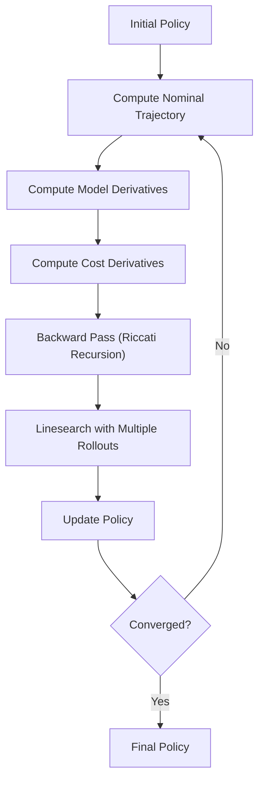
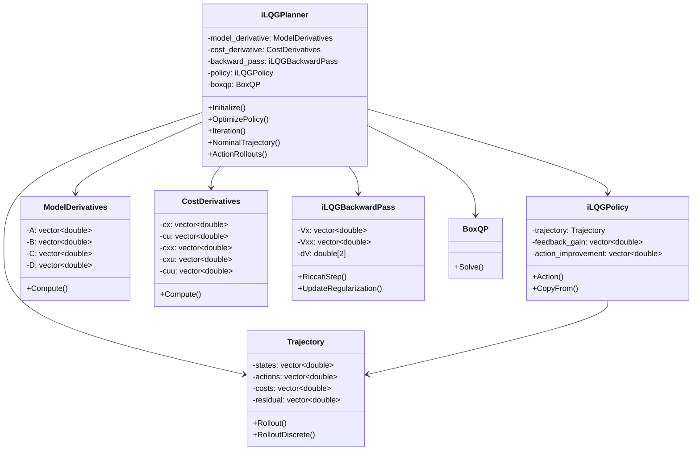
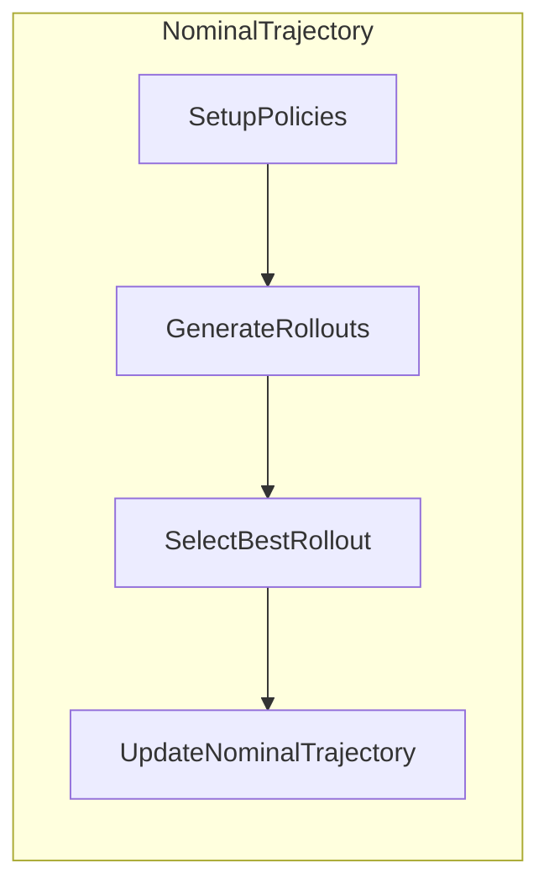
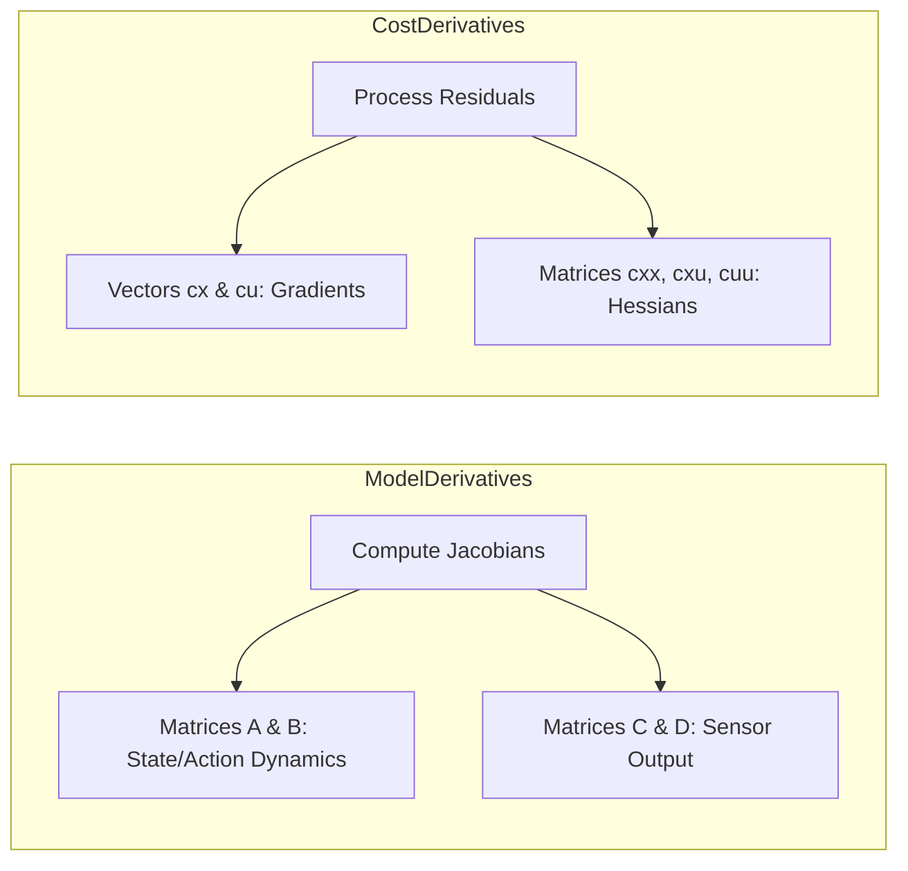
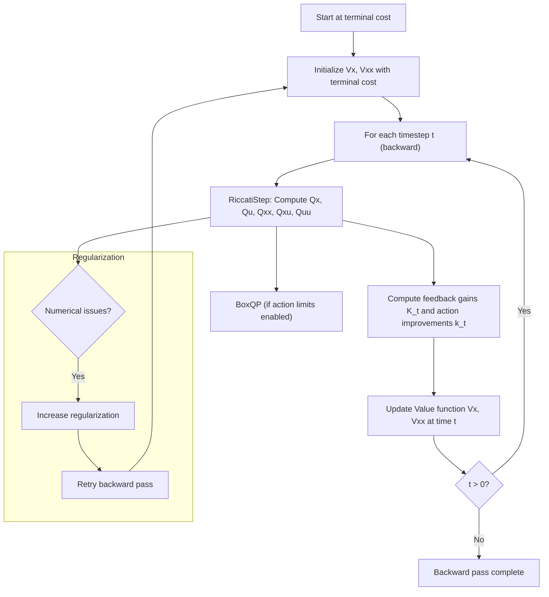
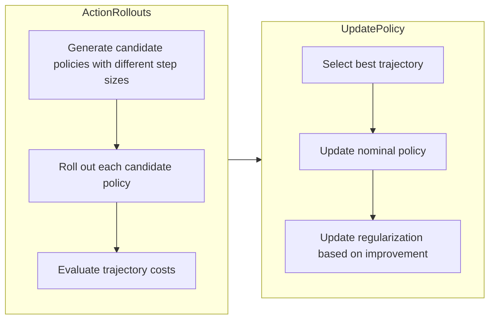
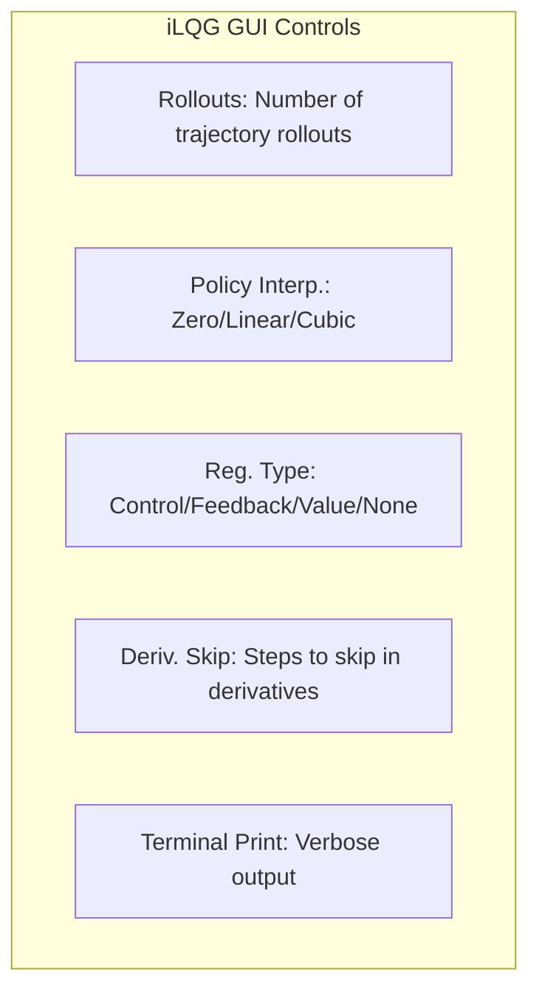
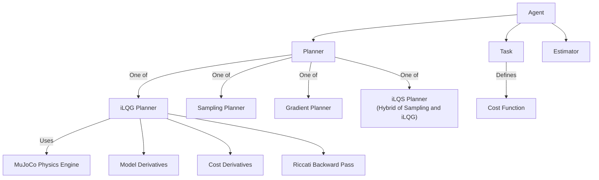

<!-- source: DeepWiki mcp.deepwiki.com · repo google-deepmind/mujoco_mpc · page 4.2 iLQG Planner · fetched 2026-10-26 -->

# iLQG Planner

<details>
<summary>Relevant source files</summary>

The following files were used as context for generating this wiki page:

- [mjpc/planners/gradient/planner.cc](mjpc/planners/gradient/planner.cc)
- [mjpc/planners/gradient/planner.h](mjpc/planners/gradient/planner.h)
- [mjpc/planners/ilqg/planner.cc](mjpc/planners/ilqg/planner.cc)
- [mjpc/planners/ilqg/planner.h](mjpc/planners/ilqg/planner.h)
- [mjpc/planners/ilqg/policy.cc](mjpc/planners/ilqg/policy.cc)
- [mjpc/planners/ilqg/policy.h](mjpc/planners/ilqg/policy.h)
- [mjpc/planners/ilqg/settings.h](mjpc/planners/ilqg/settings.h)
- [mjpc/planners/ilqs/planner.cc](mjpc/planners/ilqs/planner.cc)
- [mjpc/planners/ilqs/planner.h](mjpc/planners/ilqs/planner.h)
- [mjpc/planners/planner.h](mjpc/planners/planner.h)
- [mjpc/planners/sampling/planner.cc](mjpc/planners/sampling/planner.cc)
- [mjpc/planners/sampling/planner.h](mjpc/planners/sampling/planner.h)
- [mjpc/test/agent/rollout_test.cc](mjpc/test/agent/rollout_test.cc)
- [mjpc/test/testdata/particle_residual.h](mjpc/test/testdata/particle_residual.h)
- [mjpc/trajectory.cc](mjpc/trajectory.cc)
- [mjpc/trajectory.h](mjpc/trajectory.h)

</details>


The iLQG (iterative Linear Quadratic Gaussian) Planner is an optimization-based trajectory planning algorithm in MuJoCo MPC that computes locally optimal feedback policies. It linearizes the system dynamics and quadratizes the cost function around a nominal trajectory, then solves the resulting linear-quadratic problem to iteratively improve control policies. For other planning approaches, see [Sampling Planner](#4.1), [Gradient Planner](#4.3), or [Cross Entropy and Sample Gradient Planners](#4.4).

## Algorithm Overview

The iLQG planner operates through an iterative process that refines a control policy toward optimality:



Sources: [mjpc/planners/ilqg/planner.cc:175-627]()

## Key Components

The iLQG planner consists of several interacting components:



Sources: [mjpc/planners/ilqg/planner.h:32-163](), [mjpc/planners/ilqg/policy.h:27-68]()

## Detailed Algorithm Steps

### 1. Nominal Trajectory

The planner begins by rolling out the current policy to generate a nominal trajectory:



Sources: [mjpc/planners/ilqg/planner.cc:166-223]()

### 2. Model and Cost Derivatives

After obtaining a nominal trajectory, the planner computes linearized models and quadratic cost approximations:



Sources: [mjpc/planners/ilqg/planner.cc:389-426]()

### 3. Backward Pass

The backward pass implements a Riccati recursion to compute optimal feedback gains and action improvements:



Sources: [mjpc/planners/ilqg/planner.cc:422-532]()

### 4. Linesearch and Policy Update

After computing action improvements and feedback gains, the planner conducts a linesearch:



Sources: [mjpc/planners/ilqg/planner.cc:536-627](), [mjpc/planners/ilqg/planner.cc:629-692]()

## Configuration Parameters

The iLQG planner offers several configuration parameters:

| Parameter | Description | Default Value |
|-----------|-------------|---------------|
| `min_linesearch_step` | Minimum step size for line search | 1.0e-3 |
| `fd_tolerance` | Finite difference tolerance | 1.0e-6 |
| `fd_mode` | Finite difference mode (0: one-sided, 1: centered) | 0 |
| `min_regularization` | Minimum regularization value | 1.0e-6 |
| `max_regularization` | Maximum regularization value | 1.0e6 |
| `regularization_type` | Type of regularization (0: control, 1: feedback, 2: value, 3: none) | 0 |
| `max_regularization_iterations` | Maximum number of regularization updates per iteration | 5 |
| `action_limits` | Whether to enforce action limits | 1 |
| `nominal_feedback_scaling` | Whether to use feedback scaling for nominal rollouts | 1 |
| `verbose` | Whether to print optimizer information | 0 |

Sources: [mjpc/planners/ilqg/settings.h:15-37]()

## GUI Controls

The iLQG planner provides several GUI elements for runtime configuration:



Sources: [mjpc/planners/ilqg/planner.cc:246-262]()

## Action Generation

The iLQG policy provides actions through a combination of feedforward and feedback components:

```
u(x,t) = u_nominal(t) + K(t)·(x - x_nominal(t))
```

Where:
- `u_nominal(t)` is the nominal action at time t
- `K(t)` is the feedback gain matrix at time t
- `x_nominal(t)` is the nominal state at time t

The policy supports three interpolation methods (zero-order, linear, and cubic) for smooth action generation between timesteps.

Sources: [mjpc/planners/ilqg/policy.cc:82-161]()

## Performance Characteristics

The iLQG planner has several performance characteristics:

1. **Computational Requirements**: The backward pass and derivative calculations are computationally intensive but provide high-quality solutions for smooth problems.

2. **Convergence Properties**: iLQG typically converges faster than first-order methods like gradient descent due to its second-order approximation.

3. **Regularization**: The algorithm uses regularization to handle numerical issues in the backward pass, particularly when the system is poorly conditioned.

4. **Diagnostics**: The planner provides several diagnostic plots:
   - Regularization value
   - Action step size
   - Feedback scaling
   - Computation times for each algorithm component

Sources: [mjpc/planners/ilqg/planner.cc:266-374]()

## Integration with Other Components

The iLQG planner is designed to work within the broader MuJoCo MPC framework:



Sources: [mjpc/planners/ilqs/planner.cc:14-321]()

## When to Use iLQG

The iLQG planner is particularly well-suited for:

1. Problems with continuous, smooth dynamics
2. Cases where feedback is essential for robust performance
3. When high-quality, near-optimal solutions are required
4. Problems with moderate dimensionality where second-order information helps convergence

The iLQG planner provides a balance between computational efficiency and solution quality, making it appropriate for many robotic control applications within the MuJoCo MPC framework.

Sources: [mjpc/planners/ilqg/planner.cc:36-744]()

---

