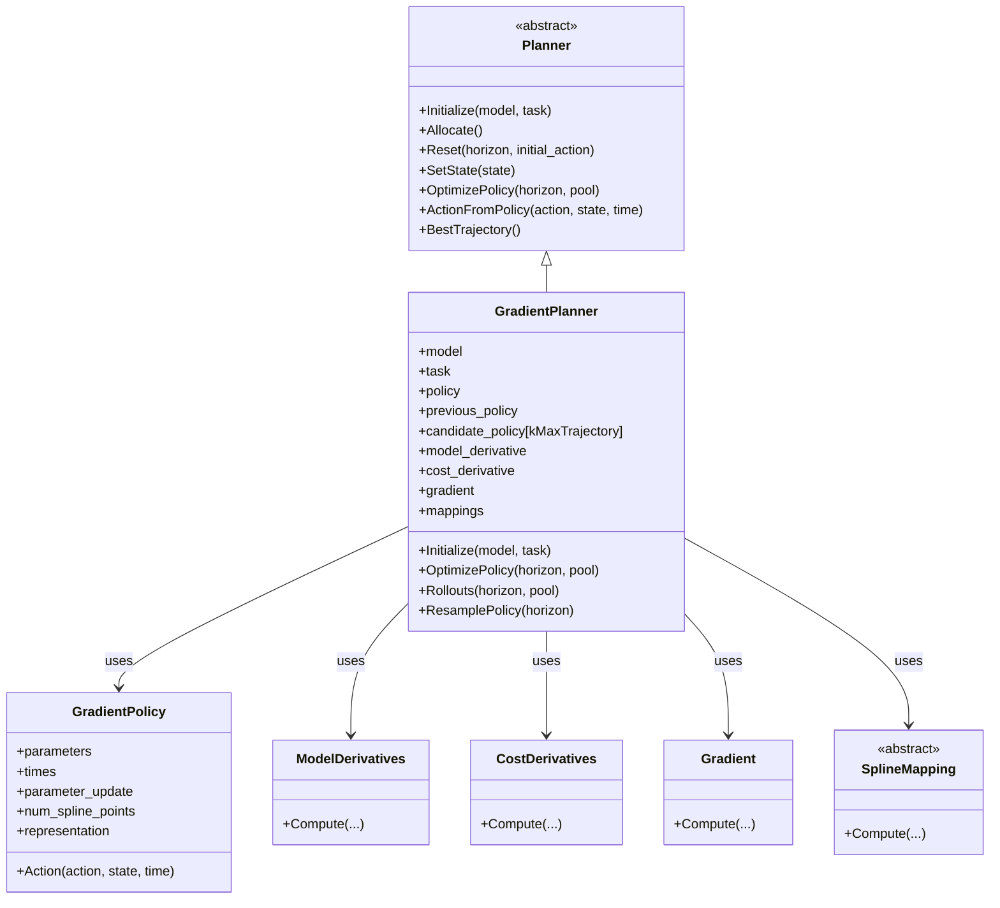
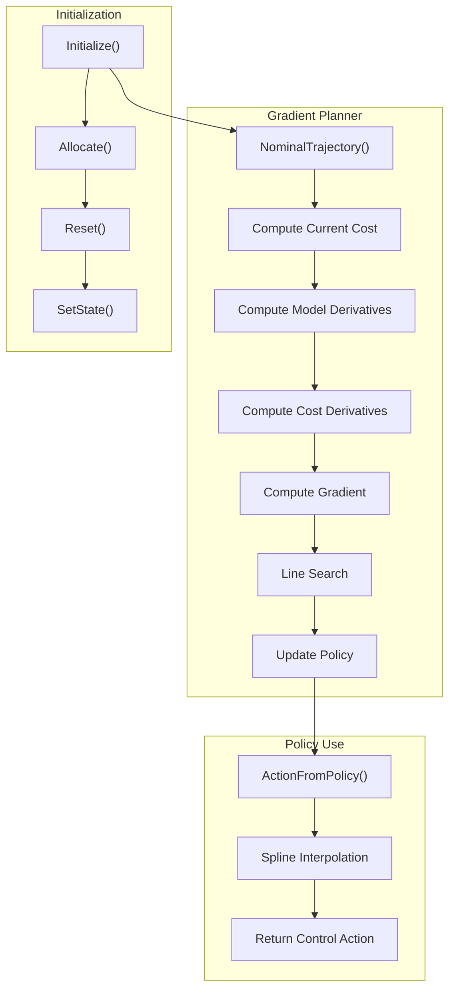
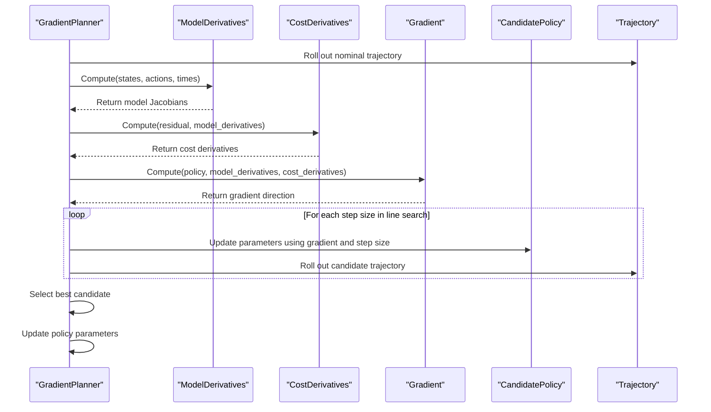
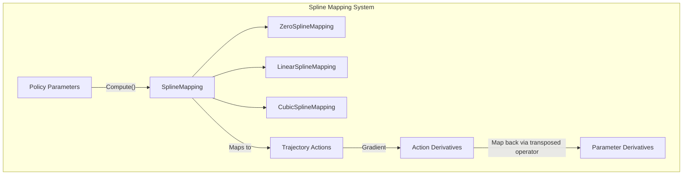
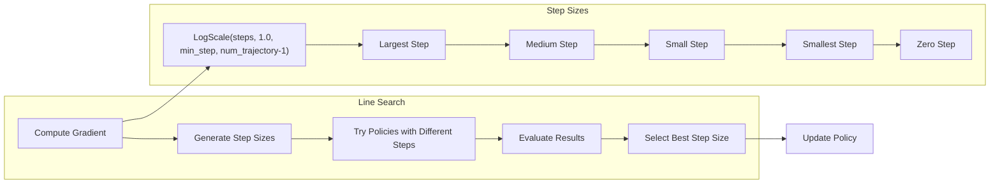
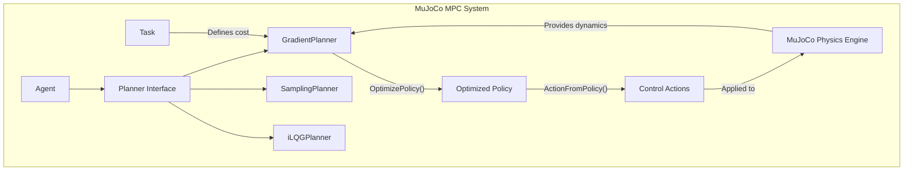

<!-- source: DeepWiki mcp.deepwiki.com · repo google-deepmind/mujoco_mpc · page 4.3 Gradient Planner · fetched 2026-10-26 -->

# Gradient Planner

<details>
<summary>Relevant source files</summary>

The following files were used as context for generating this wiki page:

- [mjpc/planners/gradient/planner.cc](mjpc/planners/gradient/planner.cc)
- [mjpc/planners/gradient/planner.h](mjpc/planners/gradient/planner.h)
- [mjpc/planners/ilqg/planner.cc](mjpc/planners/ilqg/planner.cc)
- [mjpc/planners/ilqg/planner.h](mjpc/planners/ilqg/planner.h)
- [mjpc/planners/ilqs/planner.cc](mjpc/planners/ilqs/planner.cc)
- [mjpc/planners/ilqs/planner.h](mjpc/planners/ilqs/planner.h)
- [mjpc/planners/planner.h](mjpc/planners/planner.h)
- [mjpc/planners/sampling/planner.cc](mjpc/planners/sampling/planner.cc)
- [mjpc/planners/sampling/planner.h](mjpc/planners/sampling/planner.h)

</details>


The Gradient Planner is a first-order optimization method used in MuJoCo MPC for trajectory optimization. It employs gradient descent to iteratively improve a control policy by computing the gradient of the cost function with respect to policy parameters and taking steps in the direction that reduces the cost. 

This page documents the Gradient Planner implementation, its optimization process, and how it integrates with the rest of the MuJoCo MPC framework. For information about other planning methods in MuJoCo MPC, see [Sampling Planner](#4.1), [iLQG Planner](#4.2), or [Cross Entropy and Sample Gradient Planners](#4.4).

## Architecture Overview

The Gradient Planner follows the same basic interface as other planners in the MuJoCo MPC framework, inheriting from the base `Planner` class.



Sources: [mjpc/planners/gradient/planner.h:38-164](), [mjpc/planners/planner.h:32-80]()

## Key Components

The Gradient Planner consists of several key components:

1. **Policy Representation**: Uses spline-based policies with configurable interpolation types (Zero, Linear, or Cubic)
2. **Model Derivatives**: Computes derivatives of the dynamics model
3. **Cost Derivatives**: Computes derivatives of the cost function
4. **Gradient Calculation**: Computes the gradient of the cost with respect to policy parameters
5. **Line Search**: Evaluates multiple step sizes to find the optimal improvement direction



Sources: [mjpc/planners/gradient/planner.cc:39-62](), [mjpc/planners/gradient/planner.cc:159-327]()

## Optimization Process

The core of the Gradient Planner is its `OptimizePolicy` method, which follows these steps:

1. Roll out the current nominal policy to evaluate its performance
2. Compute model derivatives using finite differences or analytic gradients
3. Compute cost derivatives based on the residual function of the task
4. Compute the gradient of the cost with respect to policy parameters
5. Perform a line search by trying different step sizes along the gradient direction
6. Update the policy using the best step size found



Sources: [mjpc/planners/gradient/planner.cc:159-327]()

## Spline Representation and Mapping

The Gradient Planner represents policies using splines, which define control actions as a function of time. The planner supports three types of spline interpolation:

1. **Zero Spline**: Piecewise constant function (zero-order hold)
2. **Linear Spline**: Linear interpolation between control points
3. **Cubic Spline**: Cubic interpolation for smoother transitions

The optimization process works directly with the spline parameters (control points). To compute the gradient, the planner maps between trajectory actions and spline parameters using the appropriate spline mapping:



Sources: [mjpc/planners/gradient/planner.h:42-45](), [mjpc/planners/gradient/planner.cc:242-248]()

The mapping from spline parameters to trajectory actions is linear, which allows the gradient of the cost with respect to actions to be mapped back to a gradient with respect to policy parameters through the transpose of the mapping matrix:

```
parameter_update = mapping^T * action_gradients
```

## Line Search Process

The line search process is a critical component of the Gradient Planner, as it determines how far to move along the gradient direction:



Sources: [mjpc/planners/gradient/planner.cc:267-270](), [mjpc/planners/gradient/planner.cc:383-415]()

## Configuration and Settings

The Gradient Planner provides several configurable parameters:

| Parameter | Description | Default/Range |
|-----------|-------------|---------------|
| `num_trajectory` | Number of trajectories used in line search | 32 |
| `representation` | Spline interpolation type (Zero, Linear, Cubic) | Depends on model |
| `num_spline_points` | Number of spline points for policy representation | Range: 1-36 |
| `derivative_skip` | Skip factor for finite difference computations | 0 (no skip) |
| `min_linesearch_step` | Minimum step size for line search | From settings |

These parameters can be configured through the GUI interface provided by the planner:

Sources: [mjpc/planners/gradient/planner.cc:465-483]()

## Integration with MuJoCo MPC

The Gradient Planner integrates with the overall MuJoCo MPC framework through the standard Planner interface:



Sources: [mjpc/planners/planner.h:32-80](), [mjpc/planners/gradient/planner.cc:344-352]()

## Performance and Debugging

The Gradient Planner provides detailed timing information and diagnostic plots to help monitor and tune its performance:

| Timing Metric | Description |
|---------------|-------------|
| `nominal_compute_time` | Time to compute nominal trajectory |
| `model_derivative_compute_time` | Time to compute model derivatives |
| `cost_derivative_compute_time` | Time to compute cost derivatives |
| `gradient_compute_time` | Time to compute gradient |
| `rollouts_compute_time` | Time to perform line search rollouts |
| `policy_update_compute_time` | Time to update policy |

The planner also provides plotting capabilities to visualize key metrics like step size, improvement, and computation times:

Sources: [mjpc/planners/gradient/planner.cc:487-574]()

## Differences from Other Planners

The Gradient Planner has several key differences from other planners in the MuJoCo MPC framework:

1. **Sampling Planner**: Unlike the Sampling Planner which explores randomly, the Gradient Planner uses gradient information to guide the search direction, potentially leading to faster convergence in smooth cost landscapes.

2. **iLQG Planner**: The Gradient Planner uses first-order information (gradients) while iLQG uses second-order information (Hessians). This makes the Gradient Planner simpler but potentially less efficient for highly nonlinear problems.

3. **Cross-Entropy**: Unlike the Cross-Entropy method which updates a distribution over actions, the Gradient Planner directly updates policy parameters.

For problems with smooth cost functions and relatively simple dynamics, the Gradient Planner often provides a good balance between computational efficiency and solution quality.

Sources: [mjpc/planners/planner.h:32-80](), [mjpc/planners/gradient/planner.cc:159-327](), [mjpc/planners/gradient/planner.h:38-164]()

---

