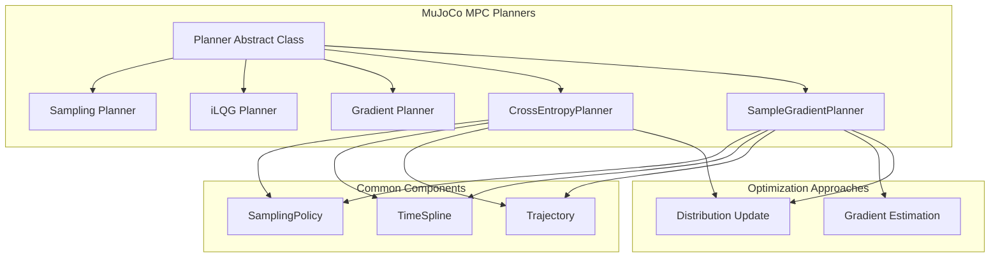
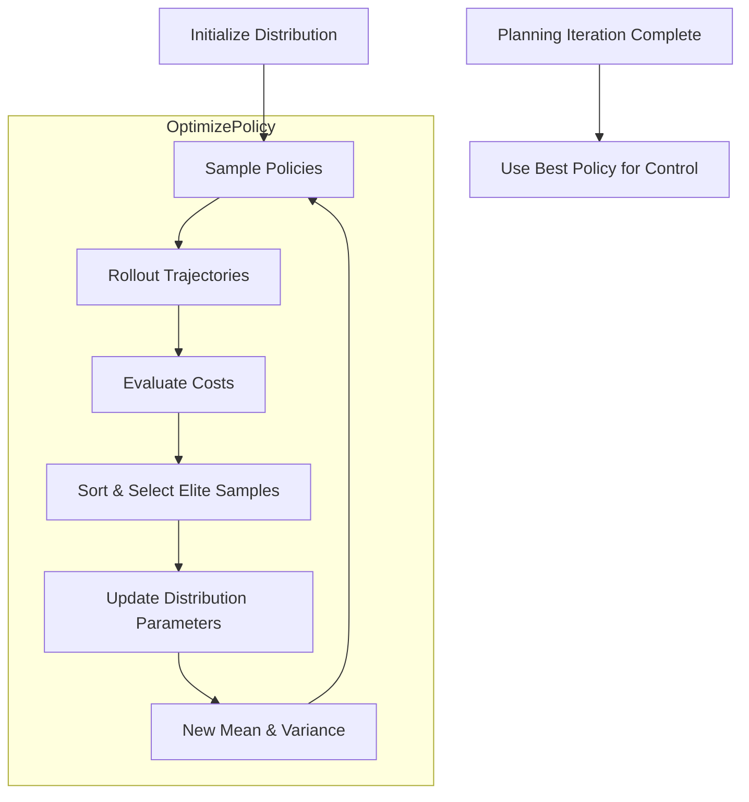
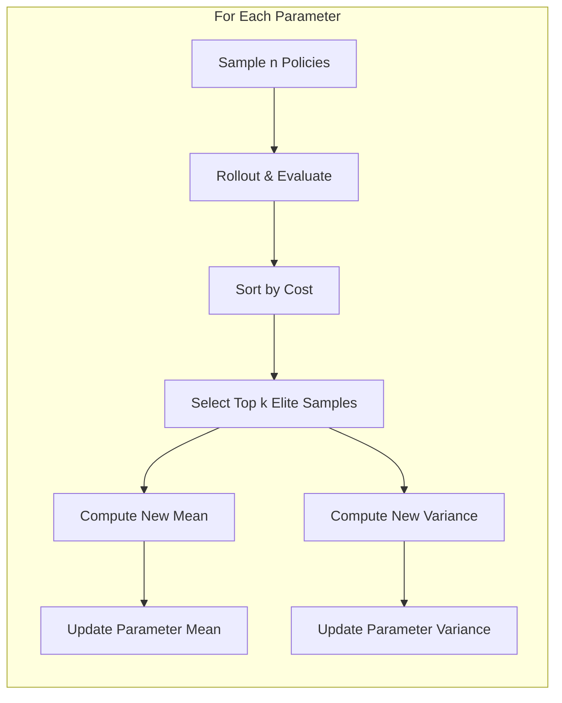
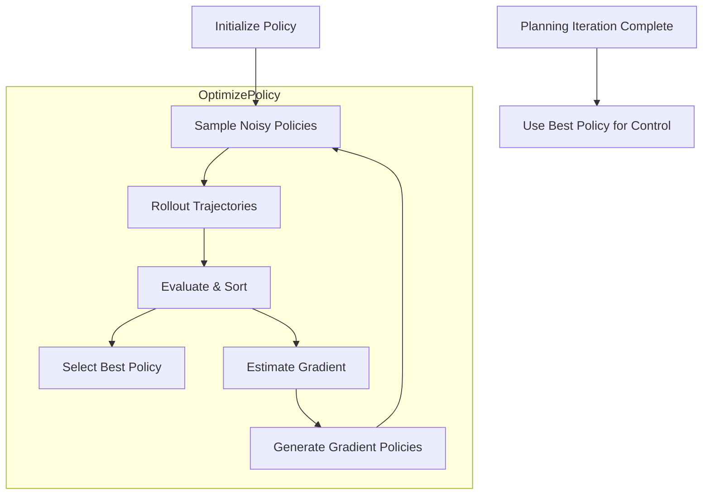
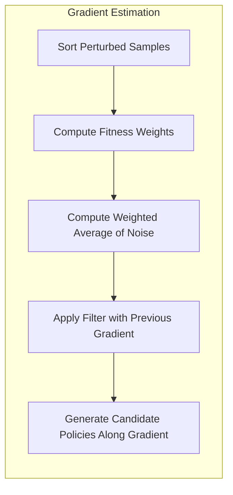
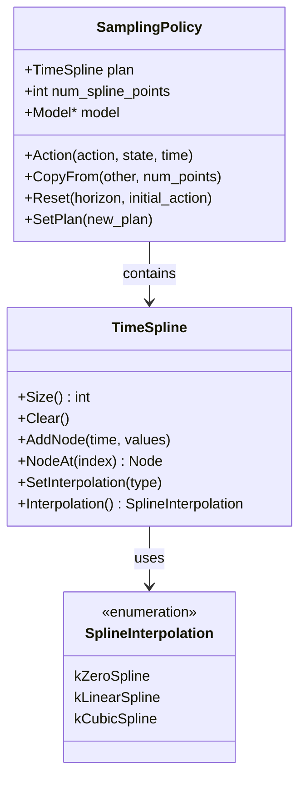

<!-- source: DeepWiki mcp.deepwiki.com · repo google-deepmind/mujoco_mpc · page 4.4 Cross Entropy and Sample Gradient Planners · fetched 2026-10-26 -->

# Cross Entropy and Sample Gradient Planners

<details>
<summary>Relevant source files</summary>

The following files were used as context for generating this wiki page:

- [mjpc/planners/cross_entropy/planner.cc](mjpc/planners/cross_entropy/planner.cc)
- [mjpc/planners/cross_entropy/planner.h](mjpc/planners/cross_entropy/planner.h)
- [mjpc/planners/sample_gradient/planner.cc](mjpc/planners/sample_gradient/planner.cc)
- [mjpc/planners/sample_gradient/planner.h](mjpc/planners/sample_gradient/planner.h)
- [mjpc/tasks/shadow_reorient/task.xml](mjpc/tasks/shadow_reorient/task.xml)

</details>


This page documents the Cross Entropy Method (CEM) and Sample Gradient planners in the MuJoCo MPC framework. These planners are sampling-based optimization methods that generate trajectories by sampling and evaluating candidate policies. While both planners share similar foundations in sampling-based optimization, they employ different techniques for refining the sampling distribution to improve performance.

For information about other planning algorithms available in MuJoCo MPC, see the [Planners overview](#4) and documentation for specific planners like the [Sampling Planner](#4.1) and [iLQG Planner](#4.2).

## Overview and Positioning

Both planners inherit from the base `Planner` class and implement sampling-based policy optimization, but with different approaches to updating the sampling distribution.



Sources: [mjpc/planners/cross_entropy/planner.h:33-145](), [mjpc/planners/sample_gradient/planner.h:35-175]()

## Cross Entropy Method Planner

The Cross Entropy Method planner optimizes a policy by iteratively updating a probability distribution over policy parameters based on the most successful samples from the current distribution.

### Key Concepts

1. **Distribution Maintenance**: Maintains a mean and variance for each policy parameter
2. **Elite Selection**: Selects the top N samples with lowest cost for distribution updates 
3. **Adaptive Refinement**: Gradually narrows the sampling distribution around promising regions

### Algorithm Flow



Sources: [mjpc/planners/cross_entropy/planner.cc:168-291]()

### Implementation Details

The planner maintains a distribution over policy parameters, represented by mean and variance. It samples candidate policies, evaluates them through rollouts, and updates the distribution based on the elite samples.

Key configuration parameters include:
- `num_trajectory_`: Number of sampled trajectories
- `n_elite_`: Number of elite samples used for distribution updates
- `std_initial_`: Initial standard deviation for sampling
- `std_min_`: Minimum standard deviation to prevent premature convergence
- `explore_fraction_`: Fraction of samples that use the initial standard deviation

Sources: [mjpc/planners/cross_entropy/planner.cc:42-75](), [mjpc/planners/cross_entropy/planner.cc:497-520]()

### Distribution Update Process



The core of the update process occurs in the `OptimizePolicy` method, which:
1. Samples candidate policies with noise based on the current variance
2. Evaluates trajectories by rolling out these policies
3. Sorts trajectories by total return
4. Computes the mean and variance of the elite samples
5. Updates the policy distribution parameters

Sources: [mjpc/planners/cross_entropy/planner.cc:226-270]()

## Sample Gradient Planner

The Sample Gradient planner combines sampling-based exploration with gradient-based search, using the sampled trajectories to estimate a gradient direction for more efficient optimization.

### Key Concepts

1. **Mixed Strategy**: Combines random sampling with gradient-based optimization
2. **Gradient Estimation**: Uses sampled trajectories to estimate gradient direction
3. **Multiple Winner Types**: Distinguishes between winners from nominal, perturbed, and gradient-based policies

### Algorithm Flow



Sources: [mjpc/planners/sample_gradient/planner.cc:169-273]()

### Implementation Details

The Sample Gradient planner maintains:
- Random noise samples for policy exploration
- An estimated gradient direction
- Multiple types of candidate policies: nominal, perturbed, and gradient-based

Key configuration parameters include:
- `num_trajectory_`: Number of sampled trajectories
- `num_gradient_`: Number of gradient-based candidates
- `noise_exploration`: Standard deviation for random sampling
- `gradient_filter_`: Weight for combining current and previous gradients

Sources: [mjpc/planners/sample_gradient/planner.cc:42-75](), [mjpc/planners/sample_gradient/planner.cc:559-583]()

### Gradient Estimation and Update



The gradient estimation process occurs in the `GradientCandidates` method:
1. Sorts perturbed policies by total return
2. Applies fitness shaping to compute weights for each sample
3. Computes a weighted average of noise samples to estimate gradient
4. Filters current gradient with previous gradient
5. Generates candidate policies along the gradient direction

Sources: [mjpc/planners/sample_gradient/planner.cc:401-493]()

## Policy Representation

Both planners use a spline-based policy representation through the `SamplingPolicy` class.



The policy is represented as a time-indexed spline with configurable interpolation type (Zero, Linear, or Cubic). The number of spline points determines the granularity of the policy representation.

Sources: [mjpc/planners/cross_entropy/planner.cc:320-348](), [mjpc/planners/sample_gradient/planner.cc:302-326]()

## Comparison of Approaches

| Feature | Cross Entropy Planner | Sample Gradient Planner |
|---------|----------------------|------------------------|
| **Core Technique** | Distribution updates based on elite samples | Combined random sampling with gradient estimation |
| **Distribution Model** | Explicit mean and variance for each parameter | Implicit through gradient direction |
| **Exploration Strategy** | Sampling from distribution with optional forced exploration | Fixed noise standard deviation |
| **Update Mechanism** | Elite averaging | Gradient-based with fitness shaping |
| **Memory of Past Iterations** | Current distribution only | Filtered gradient from previous iteration |
| **Winner Types** | Best trajectory | Categorized as nominal, perturbed, or gradient |

Sources: [mjpc/planners/cross_entropy/planner.cc:446-448](), [mjpc/planners/sample_gradient/planner.cc:496-498](), [mjpc/planners/sample_gradient/planner.cc:232-247]()

## Usage and Configuration

These planners can be selected and configured through model XML files using custom numeric parameters:

```xml
<custom>
  <numeric name="agent_planner" data="5" />         <!-- 5 for Cross Entropy -->
  <numeric name="sampling_trajectories" data="60" />
  <numeric name="n_elite" data="8" />
  <numeric name="explore_fraction" data="0.5" />
  <numeric name="sampling_spline_points" data="5" />
  <numeric name="sampling_exploration" data="0.2" />
  <numeric name="sampling_representation" data="0" />
</custom>
```

Sources: [mjpc/tasks/shadow_reorient/task.xml:6-17]()

### GUI Configuration

Both planners expose their parameters through the GUI for interactive tuning:

For Cross Entropy Planner:
- Number of rollouts
- Spline interpolation type
- Number of spline points
- Initial and minimum standard deviation
- Exploration fraction
- Number of elite samples

For Sample Gradient Planner:
- Number of rollouts
- Spline interpolation type
- Number of spline points
- Noise standard deviation
- Number of gradient rollouts
- Gradient filter parameter

Sources: [mjpc/planners/cross_entropy/planner.cc:496-521](), [mjpc/planners/sample_gradient/planner.cc:558-584]()

## Visualization

Both planners provide visualization capabilities through the `Traces` method, which renders traces of sampled trajectories in the scene. They also implement custom plotting through the `Plots` method to visualize metrics like improvement and computation time.

The Cross Entropy planner visualizes elite trajectories, while the Sample Gradient planner differentiates between noisy (white) and gradient-based (orange) trajectories in its visualization.

Sources: [mjpc/planners/cross_entropy/planner.cc:451-493](), [mjpc/planners/sample_gradient/planner.cc:500-554]()

## When to Use Each Planner

- **Cross Entropy Planner**: Effective for problems with many local minima where distribution-based search is beneficial. Particularly useful when the gradient information is not reliable or when the cost landscape is complex.

- **Sample Gradient Planner**: Combines the exploration benefits of sampling with the efficiency of gradient-based methods. Useful when approximate gradient information can accelerate convergence but pure gradient methods might get stuck in local minima.

Both planners are well-suited for robotics tasks involving complex dynamics where analytical derivatives are difficult to obtain.

---

