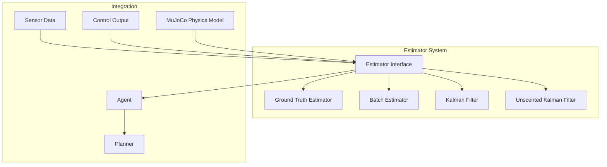
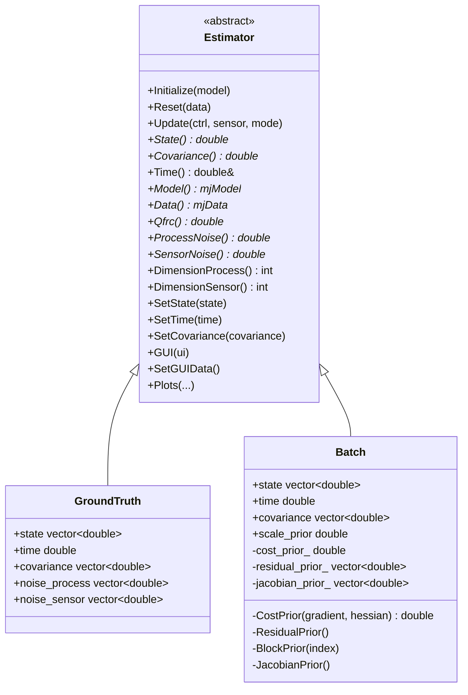
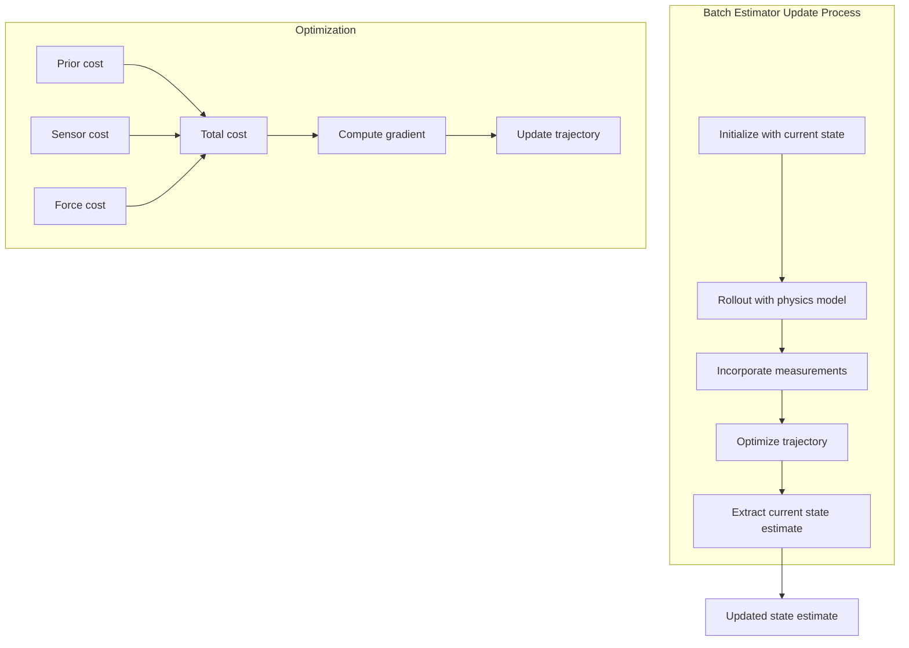
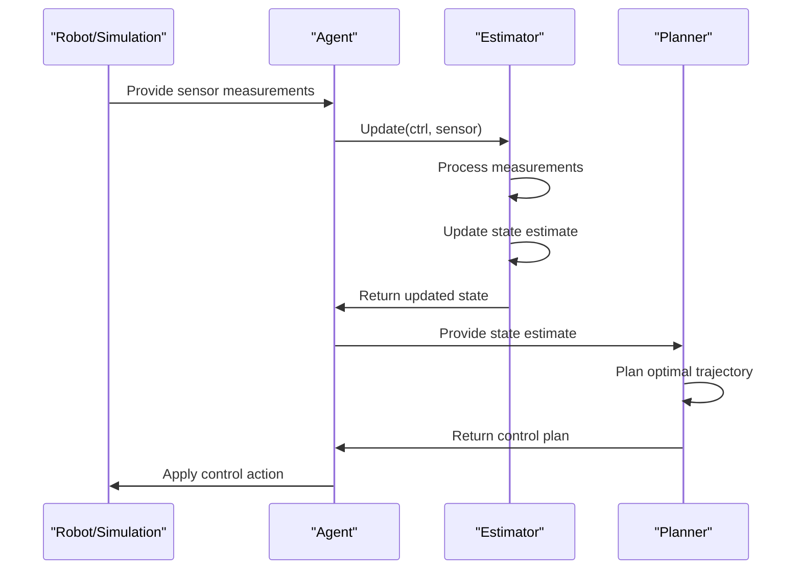

<!-- source: DeepWiki mcp.deepwiki.com · repo google-deepmind/mujoco_mpc · page 5 Estimators · fetched 2026-10-26 -->

# Estimators

<details>
<summary>Relevant source files</summary>

The following files were used as context for generating this wiki page:

- [mjpc/estimators/batch.cc](mjpc/estimators/batch.cc)
- [mjpc/estimators/batch.h](mjpc/estimators/batch.h)
- [mjpc/estimators/estimator.h](mjpc/estimators/estimator.h)
- [mjpc/test/estimator/CMakeLists.txt](mjpc/test/estimator/CMakeLists.txt)
- [mjpc/test/estimator/batch_prior_test.cc](mjpc/test/estimator/batch_prior_test.cc)

</details>


This page documents the state estimation subsystem within the MuJoCo MPC framework. Estimators are responsible for computing the most likely state of a robotic system based on sensor measurements, control inputs, and physics-based dynamics. The state estimates provided by these components are essential for effective model predictive control, as they serve as the starting point for planning trajectories.

## Overview

In real-world robotics applications, the true state of a system is rarely directly observable. Instead, we typically have access to noisy sensor readings that provide partial information about the system state. The Estimators module bridges this gap by implementing various state estimation algorithms that can infer the full system state from these measurements.



Sources: [mjpc/estimators/estimator.h:32-98](), [mjpc/test/estimator/CMakeLists.txt:15-25]()

## Estimator Interface

All estimators in the system implement the `Estimator` abstract base class, which defines a common interface for state estimation algorithms. This abstraction allows the system to switch between different estimation algorithms without changing the rest of the codebase.



Sources: [mjpc/estimators/estimator.h:32-98](), [mjpc/estimators/batch.h:39-267]()

The key methods of the Estimator interface include:

- **Initialize**: Sets up the estimator with a specified MuJoCo model
- **Reset**: Resets the internal state of the estimator
- **Update**: Updates the state estimate based on control inputs and sensor measurements
- **State**: Returns a pointer to the current state estimate
- **Covariance**: Returns a pointer to the state covariance matrix
- **SetState/SetTime/SetCovariance**: Methods to manually set the state, time, or covariance
- **GUI/SetGUIData/Plots**: Methods for visualization and user interface

## Available Estimator Implementations

The framework includes several state estimation algorithms with different characteristics:

### Ground Truth Estimator

The `GroundTruth` estimator is a simple implementation that assumes perfect state information. It directly uses the MuJoCo model to propagate the state forward based on control inputs without any correction from measurements. This estimator is useful for:

- Testing other components in ideal conditions
- Providing a baseline for comparison with other estimators
- Scenarios where the true state is actually available

Implementation details:
- Maintains a copy of the MuJoCo model and data
- Updates state by running a simulation step with the provided control inputs
- Does not utilize sensor measurements for state correction

Sources: [mjpc/estimators/estimator.h:100-288]()

### Batch Estimator

The `Batch` estimator implements a batch estimation technique based on trajectory optimization. It performs optimization over a window of states to find the most likely state sequence given:

1. The physics model dynamics
2. Control inputs
3. Sensor measurements
4. Prior beliefs



Sources: [mjpc/estimators/batch.h:39-267](), [mjpc/estimators/batch.cc:33-197]()

Key features of the Batch estimator:
- Uses a sliding window approach with configurable horizon length (default is 3 steps)
- Handles position and velocity measurements
- Accounts for process and measurement noise
- Provides uncertainty estimates through covariance computation
- Employs trajectory optimization to maintain physical consistency

The optimization process in the Batch estimator minimizes a cost function that includes:
1. Prior cost (difference from previous estimate)
2. Sensor measurement cost (difference between predicted and actual sensor readings)
3. Force consistency cost (adherence to physics-based constraints)

Sources: [mjpc/estimators/batch.cc:533-642](), [mjpc/estimators/batch.cc:645-665]()

### Other Estimators

From the test files, we can see that the framework also includes:

- **Kalman Filter**: A standard Kalman filter implementation for linear systems
- **Unscented Kalman Filter**: An extension of the Kalman filter for nonlinear systems

These estimators are not covered in detail in the provided source files but are available in the codebase.

Sources: [mjpc/test/estimator/CMakeLists.txt:15-25]()

## Implementation Details: Batch Estimator

The Batch estimator is the most sophisticated estimator in the framework. It inherits from both the `Direct` class (for trajectory optimization) and the `Estimator` interface.

### State Representation

The Batch estimator's state includes:
- Position (model->nq elements)
- Velocity (model->nv elements)
- Actuation state (model->na elements)

The covariance matrix represents the uncertainty in the velocity, acceleration, and actuation components (2*nv + na dimensions).

Sources: [mjpc/estimators/batch.cc:69-76]()

### Update Process

The update process in the Batch estimator occurs in several steps:

1. **Initialization**:
   - Sets up memory for state, covariance, residuals, Jacobians, etc.
   - Configures the trajectory length (estimation horizon)

2. **Update**:
   - Advances the physics model with the provided control inputs
   - Incorporates new sensor measurements
   - Optimizes the trajectory to find the most likely state

3. **Optimization**:
   - Computes prior cost and derivatives
   - Computes measurement costs and derivatives
   - Performs gradient-based optimization of the trajectory
   - Updates the state estimate based on the optimized trajectory

Sources: [mjpc/estimators/batch.cc:284-432](), [mjpc/estimators/batch.cc:866-931]()

### Prior Cost Calculation

A key component of the Batch estimator is the prior cost function, which measures how much the current state estimate deviates from the previous estimate. This is calculated as:

```
cost_prior = 0.5 * scale_prior / ntotal * r' * P * r
```

where:
- `r` is the residual (difference between current and previous configurations)
- `P` is the prior weight matrix
- `scale_prior` is a scaling factor
- `ntotal` is the total number of variables

Sources: [mjpc/estimators/batch.cc:533-642](), [mjpc/test/estimator/batch_prior_test.cc:89-125]()

## Integration with MPC Framework

The estimator system integrates with the overall MPC framework through the Agent component. The typical control loop follows this pattern:



Sources: [mjpc/estimators/estimator.h:32-98](), [mjpc/estimators/batch.cc:284-432]()

## Configuration and Tuning

Estimator configuration is essential for achieving good performance. Key parameters include:

### Batch Estimator Configuration

| Parameter | Description | Default Value | File Reference |
|---|---|---|---|
| `configuration_length_` | Estimation horizon (number of steps) | 3 | [mjpc/estimators/batch.cc:52-59]() |
| `scale_prior` | Scaling factor for prior cost | 0.1 | [mjpc/estimators/batch.cc:192]() |
| `process_noise` | Noise in state dynamics | 1.0e-4 | [mjpc/estimators/batch.cc:267-269]() |
| `sensor_noise` | Measurement noise | 1.0e-4 | [mjpc/estimators/batch.cc:272-275]() |

The Batch estimator also provides a GUI for runtime configuration of these parameters, allowing for interactive tuning of the estimator's behavior.

Sources: [mjpc/estimators/batch.cc:946-1117](), [mjpc/estimators/batch.cc:1120-1193]()

## Practical Usage

To use an estimator in your application:

1. **Create and initialize the estimator**:
   ```cpp
   Batch estimator(model, horizon_length);
   ```

2. **Configure the estimator parameters**:
   ```cpp
   estimator.scale_prior = 0.1;  // Set prior weight scaling
   ```

3. **Update the estimator with each new measurement**:
   ```cpp
   estimator.Update(control_input, sensor_readings);
   ```

4. **Access the estimated state and covariance**:
   ```cpp
   double* state = estimator.State();
   double* covariance = estimator.Covariance();
   ```

The estimator can be further customized through the GUI interface, which provides controls for adjusting noise parameters, estimation horizon, and other settings.

Sources: [mjpc/estimators/batch.h:39-267](), [mjpc/estimators/batch.cc:946-1117]()

---

