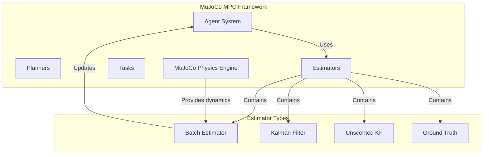
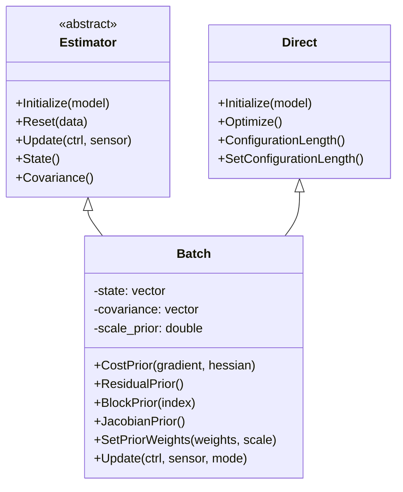
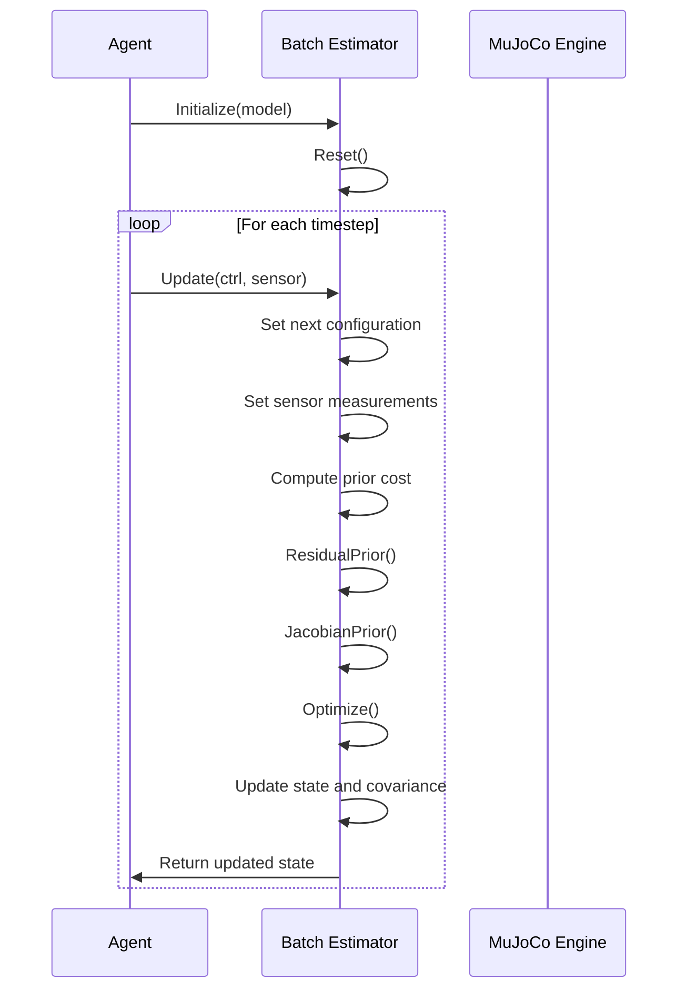
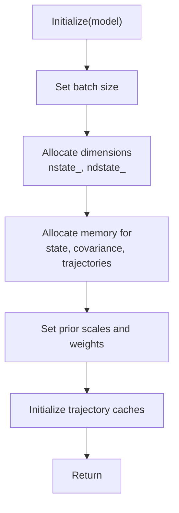
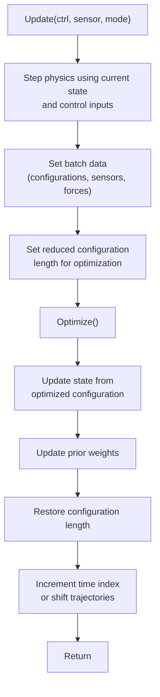

<!-- source: DeepWiki mcp.deepwiki.com · repo google-deepmind/mujoco_mpc · page 5.1 Batch Estimator · fetched 2026-10-26 -->

# Batch Estimator

<details>
<summary>Relevant source files</summary>

The following files were used as context for generating this wiki page:

- [mjpc/estimators/batch.cc](mjpc/estimators/batch.cc)
- [mjpc/estimators/batch.h](mjpc/estimators/batch.h)
- [mjpc/test/estimator/CMakeLists.txt](mjpc/test/estimator/CMakeLists.txt)
- [mjpc/test/estimator/batch_filter_test.cc](mjpc/test/estimator/batch_filter_test.cc)
- [mjpc/test/estimator/batch_prior_test.cc](mjpc/test/estimator/batch_prior_test.cc)
- [mjpc/test/testdata/estimator/particle/task1D.xml](mjpc/test/testdata/estimator/particle/task1D.xml)

</details>


The Batch Estimator is a state estimation component in the MuJoCo MPC framework that performs physically-consistent sensor fusion using a batch optimization approach. It processes multiple measurements over a time window to produce more accurate state estimates, particularly effective in contact-rich behaviors where single-timestep estimators might struggle.

For information about other estimation methods, see [Ground Truth and Other Estimators](#5.2).

## Overview and Architecture

The Batch Estimator processes a batch (or window) of measurements simultaneously, optimizing the state trajectory over multiple timesteps rather than estimating the state at each timestep independently. This approach is particularly effective for handling:

- Nonlinear dynamics
- Contact-rich behaviors
- Discontinuities in sensor measurements
- Systems with complex constraints



Sources: [mjpc/estimators/batch.h:33-50]()

## Class Hierarchy and Inheritance

The Batch Estimator inherits from two base classes:
1. `Direct` - Provides trajectory optimization capabilities
2. `Estimator` - Defines the interface for state estimation components



Sources: [mjpc/estimators/batch.h:39-42](), [mjpc/estimators/batch.cc:33-44]()

## Estimation Process

The Batch Estimator works by:
1. Maintaining a trajectory of states over a configurable time horizon
2. Processing sensor measurements within this window
3. Optimizing the state trajectory to be consistent with both:
   - Physics dynamics (the prior)
   - Sensor measurements
4. Using a weighted least-squares approach to balance between prior belief and measurements



Sources: [mjpc/estimators/batch.cc:284-432]()

## Core Components

The Batch Estimator consists of several key components:

| Component | Description |
|-----------|-------------|
| State | Current estimated state vector containing positions, velocities, and actuator values |
| Covariance | Uncertainty in the estimated state |
| Prior Weights | Defines confidence in the physical model |
| Configuration Trajectory | Sequence of configurations over the estimation horizon |
| Sensor Measurements | Sensor data used for state correction |
| Prior Cost | Cost function for the physics-based prior |
| Optimization | Batch optimization over the trajectory window |

### State Representation

The state vector includes:
- Joint positions (`qpos`): `model->nq` elements
- Joint velocities (`qvel`): `model->nv` elements
- Actuator values (`act`): `model->na` elements

Total state dimension: `nstate_ = nq + nv + na`

Sources: [mjpc/estimators/batch.cc:69-73]()

## Key Methods

### Initialization

The initialization process sets up the Batch Estimator with the specified model and configuration length:



Sources: [mjpc/estimators/batch.cc:46-153]()

### Update Method

The `Update` method is the core function that processes new control inputs and sensor measurements:



Sources: [mjpc/estimators/batch.cc:284-432]()

### Cost Calculation

The cost function combines:
1. Prior cost - Ensures consistency with the physics model
2. Measurement cost - Enforces agreement with sensor data

The total cost is minimized during the optimization process to find the most likely state trajectory.

Sources: [mjpc/estimators/batch.cc:866-932]()

## Configuration

The Batch Estimator can be configured through several parameters:

| Parameter | Description | Default Value |
|-----------|-------------|---------------|
| `configuration_length_` | Length of the estimation window | 3 |
| `scale_prior` | Weight of the physics prior | 0.1 |
| `noise_process` | Process noise covariance | 1.0e-4 |
| `noise_sensor` | Sensor noise covariance | 1.0e-4 |

### GUI Options

The Batch Estimator provides a GUI interface for runtime configuration:

| GUI Option | Description |
|------------|-------------|
| Reset | Reset the estimator to initial state |
| Timestep | Set the simulation timestep |
| Integrator | Select the integration method |
| Horizon | Set the estimation horizon length |
| Prior Scale | Set the weight of the physics prior |
| Process Noise Std. | Set the standard deviation of process noise |
| Sensor Noise Std. | Set the standard deviation of sensor noise |

Sources: [mjpc/estimators/batch.cc:947-1118]()

## Prior Weights

The prior weights define the confidence in the physics model versus sensor measurements. Higher prior weights result in smoother trajectories that more closely follow the physics model, while lower weights allow more influence from sensor measurements.

The prior weight matrix is updated recursively during operation to reflect the accumulated knowledge from previous updates.

Sources: [mjpc/estimators/batch.cc:350-412](), [mjpc/estimators/batch.cc:489-510]()

## Usage Example

To use the Batch Estimator:

1. Create a Batch Estimator instance with the desired horizon length
2. Initialize it with your MuJoCo model
3. Configure process and sensor noise parameters
4. Call the `Update` method at each timestep with control inputs and sensor measurements
5. Retrieve the estimated state using the `State()` method

## Performance Considerations

The Batch Estimator performs optimization over a trajectory window, which is more computationally intensive than single-timestep estimators like Kalman filters. Performance can be tuned by:

1. Adjusting the configuration length (horizon)
2. Modifying optimization parameters
3. Setting appropriate prior weights
4. Utilizing the multi-threading capabilities

The estimator also includes timing instrumentation for performance monitoring.

Sources: [mjpc/estimators/batch.cc:1196-1224]()

## Technical Details

### Filter Settings

The Batch Estimator has specific filter settings that control its behavior:

```
struct FilterSettings {
  bool verbose_prior = false;  // print prior weight update status
  bool assemble_prior_jacobian = false;  // assemble dense prior Jacobian
  bool recursive_prior_update = false;  // recursively update prior matrix
}
```

Sources: [mjpc/estimators/batch.h:152-157]()

### Internal Trajectories

The Batch Estimator maintains several trajectory buffers:

| Trajectory | Description |
|------------|-------------|
| `configuration` | Sequence of joint positions |
| `configuration_previous` | Previous configurations for prior |
| `velocity` | Joint velocities |
| `acceleration` | Joint accelerations |
| `act` | Actuator values |
| `times` | Timestamps |
| `sensor_measurement` | Measured sensor values |
| `sensor_prediction` | Predicted sensor values |
| `sensor_mask` | Flags for active/inactive sensors |

Sources: [mjpc/estimators/batch.h:115-247](), [mjpc/estimators/batch.cc:802-864]()

In summary, the Batch Estimator provides a robust approach to state estimation by optimizing over a trajectory window, balancing physical consistency with sensor measurements. It is particularly effective for systems with complex dynamics, discontinuities, or contact-rich behaviors.

---

