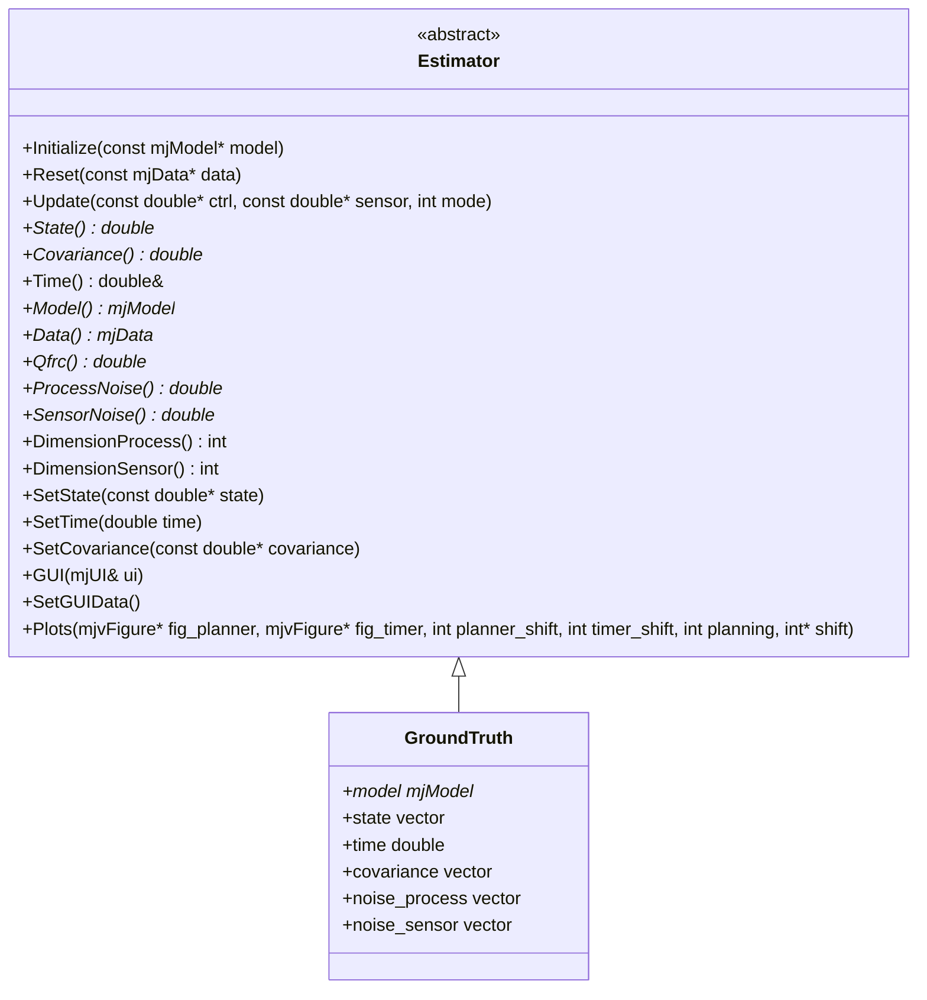
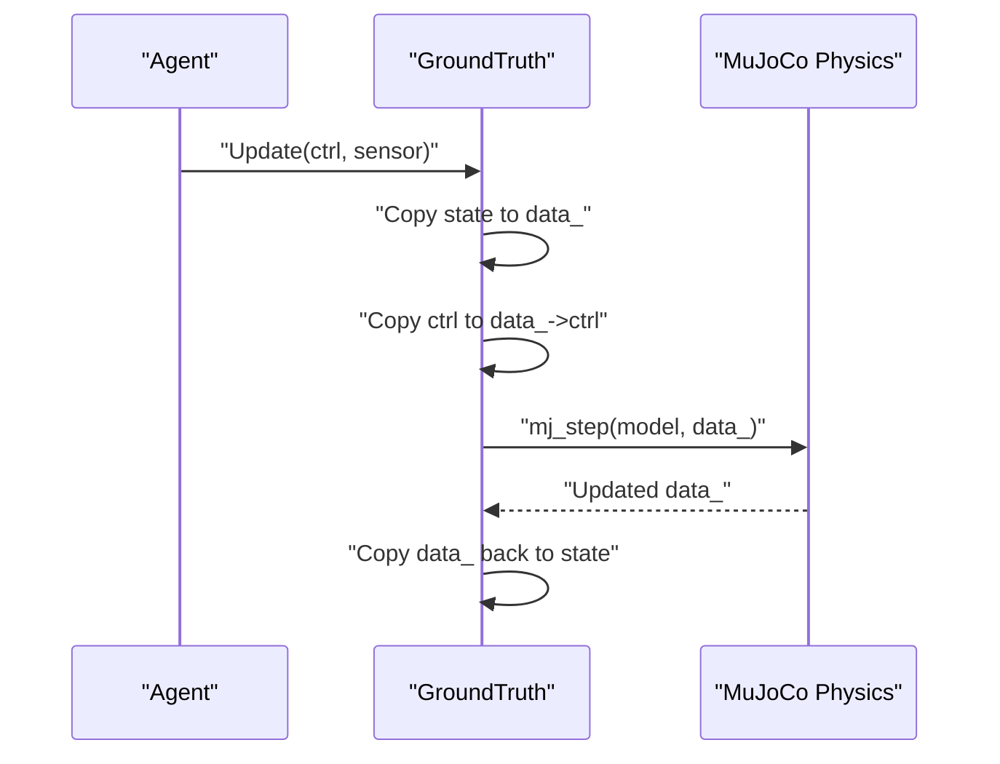
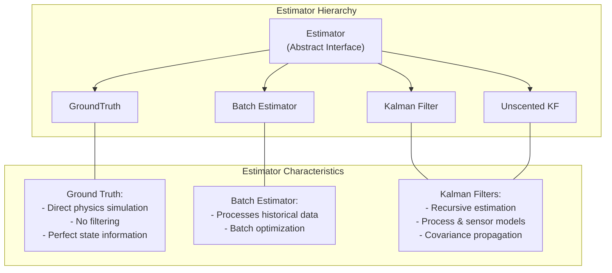
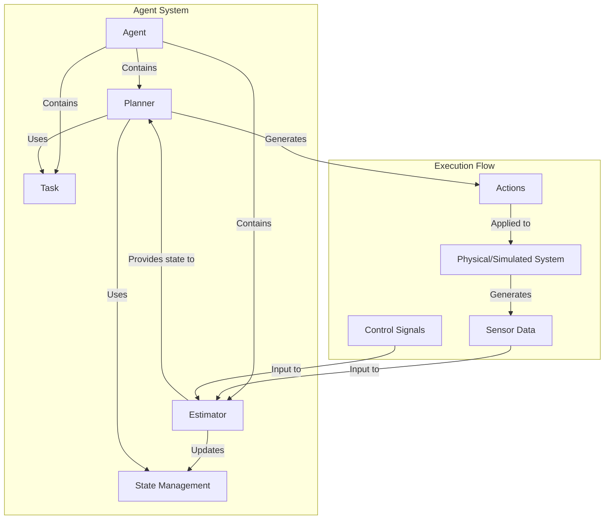

<!-- source: DeepWiki mcp.deepwiki.com · repo google-deepmind/mujoco_mpc · page 5.2 Ground Truth and Other Estimators · fetched 2026-10-26 -->

# Ground Truth and Other Estimators

Relevant source files

The following files were used as context for generating this wiki page:

- [mjpc/estimators/estimator.h](mjpc/estimators/estimator.h)

This document describes the state estimation components within the MuJoCo MPC framework. State estimators are responsible for determining the system's current state based on control inputs and sensor readings. While the Ground Truth estimator is covered in detail, we also provide an overview of other available estimators. For information about the overall estimator system architecture, see [Estimators](#5).

## Estimator Interface

All estimators in MuJoCo MPC implement a common interface defined by the abstract `Estimator` class. This interface provides a consistent API for initializing, updating, and querying estimator state.

The `Estimator` interface includes methods for:

- **Initialization and reset**: `Initialize(model)` and `Reset(data)` set up the estimator with a MuJoCo model and optionally reset its state
- **State updates**: `Update(ctrl, sensor, mode)` processes control inputs and sensor readings to update the state estimate
- **State access**: Methods like `State()`, `Covariance()`, and `Time()` provide access to the estimated state variables
- **Configuration**: Methods to set state, covariance, and access process/sensor noise parameters

Sources: [mjpc/estimators/estimator.h:32-98]()

## Ground Truth Estimator

The Ground Truth estimator provides the simplest form of state estimation by directly using the MuJoCo physics engine to compute the true system state without any filtering or estimation. It is primarily used for debugging, testing, or scenarios where perfect state information is available.

### Implementation

The `GroundTruth` class maintains:

- A copy of the MuJoCo model and data
- A state vector containing positions (`qpos`), velocities (`qvel`), and actuator states (`act`)
- A covariance matrix (mostly for API compatibility)
- Process and sensor noise parameters (again, mostly for API compatibility)

Its `Update` method simply calls MuJoCo's `mj_step` function to advance the simulation:

### Configuration

The Ground Truth estimator can be configured through the following model parameters:

- `estimator_timestep`: Timestep for the estimator's physics simulation (defaults to model timestep)
- `estimator_sensor_start`: Starting index for sensors to be considered (defaults to 0)
- `estimator_number_sensor`: Number of sensors to use (defaults to model's total sensor count)
- `estimator_covariance_initial_scale`: Scale factor for initial covariance matrix (defaults to 1.0e-4)
- `estimator_process_noise_scale`: Scale factor for process noise (defaults to 1.0e-4)
- `estimator_sensor_noise_scale`: Scale factor for sensor noise (defaults to 1.0e-4)

Sources: [mjpc/estimators/estimator.h:100-288]()

## Other Estimators

While the codebase includes other estimator implementations, the Ground Truth estimator is the only one directly visible in the provided file. Based on the system architecture diagrams, the following additional estimators are available:

### Batch Estimator

The Batch Estimator processes a batch of historical measurements to produce a state estimate. For detailed information, see [Batch Estimator](#5.1).

### Kalman Filter-Based Estimators

Kalman filters are recursive estimators that combine predictions from a system model with measurements to estimate the state. MuJoCo MPC includes:

- Standard Kalman Filter (KF)
- Unscented Kalman Filter (UKF) for handling non-linear dynamics

## Choosing an Estimator

The choice of estimator depends on the application requirements:

| Estimator | Use Case | Advantages | Limitations |
|-----------|----------|------------|-------------|
| Ground Truth | Testing, debugging, simulation-only scenarios | Simplest implementation, exact state | Requires perfect state knowledge, not realistic for physical systems |
| Batch Estimator | Applications with delayed measurements or where historical context is important | Can utilize multiple past measurements for better accuracy | Computationally more expensive, introduces delay |
| Kalman Filter | Real-time estimation with noisy sensors | Efficient, handles sensor and process noise | Linear assumptions may not hold for complex systems |
| Unscented KF | Non-linear systems with noisy measurements | Better handles non-linearities than standard KF | More complex implementation, higher computational cost |

## Integration with Agent System

The estimator is a core component of the Agent system, working alongside Planners and Tasks:

The estimator takes sensor readings and control inputs, updating its internal state estimate. The Agent system then uses this estimate for planning and control. While a Ground Truth estimator simplifies this process by providing perfect state information, real-world applications typically require more sophisticated estimation techniques to handle sensor noise and model uncertainties.

Sources: [mjpc/estimators/estimator.h]()

---

