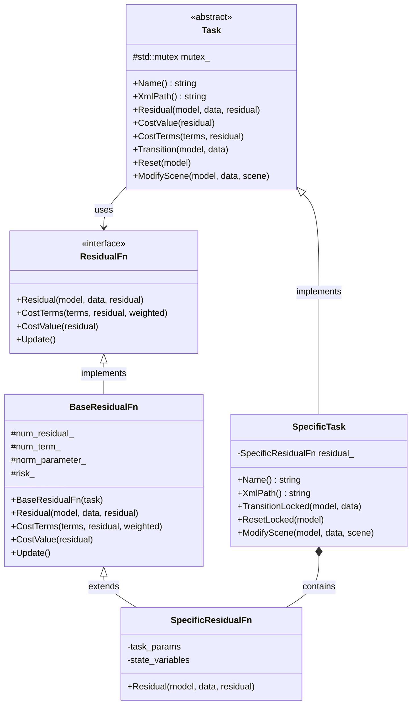
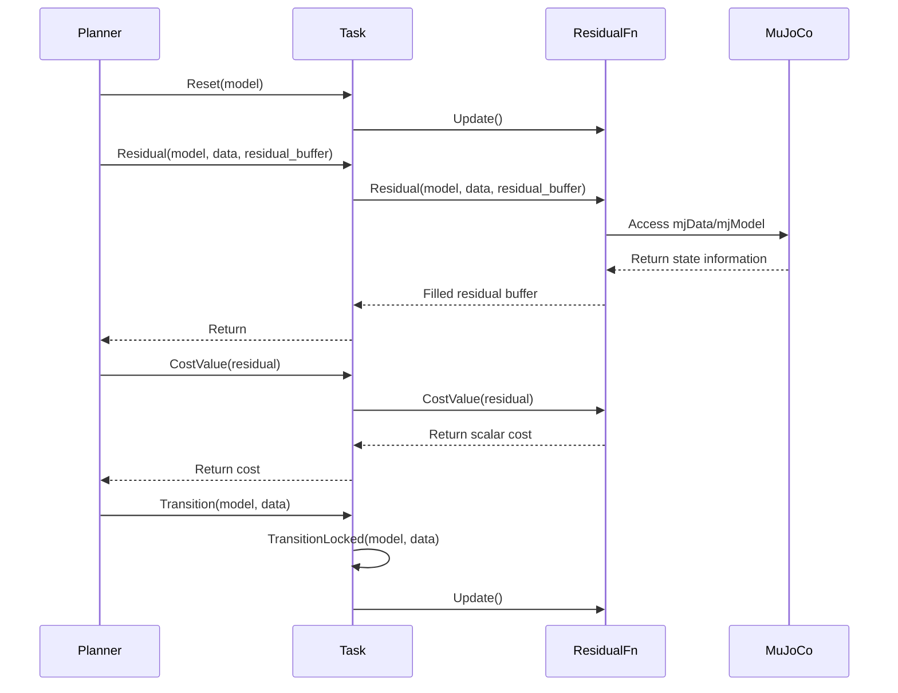
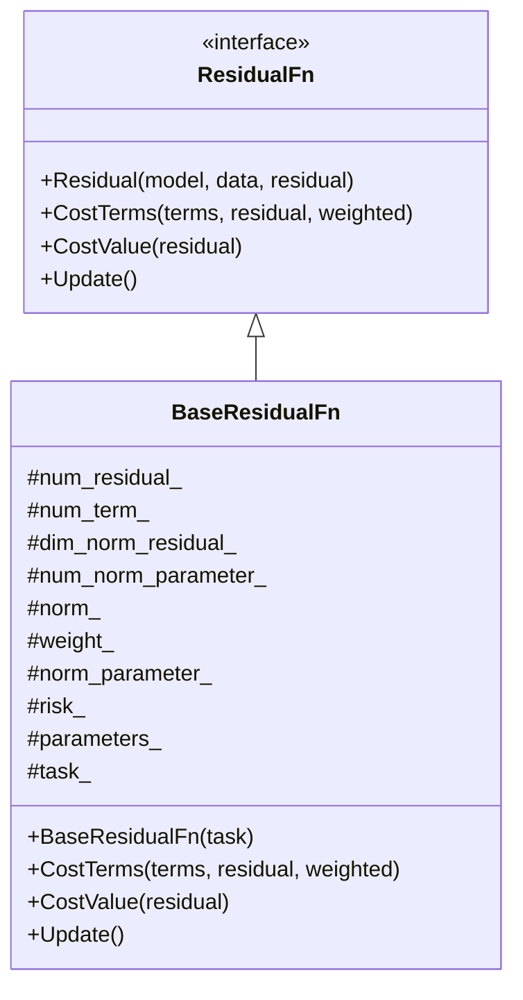
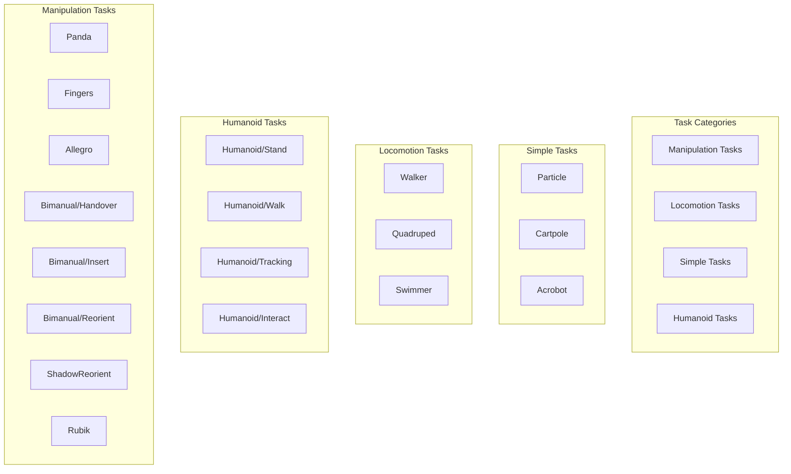
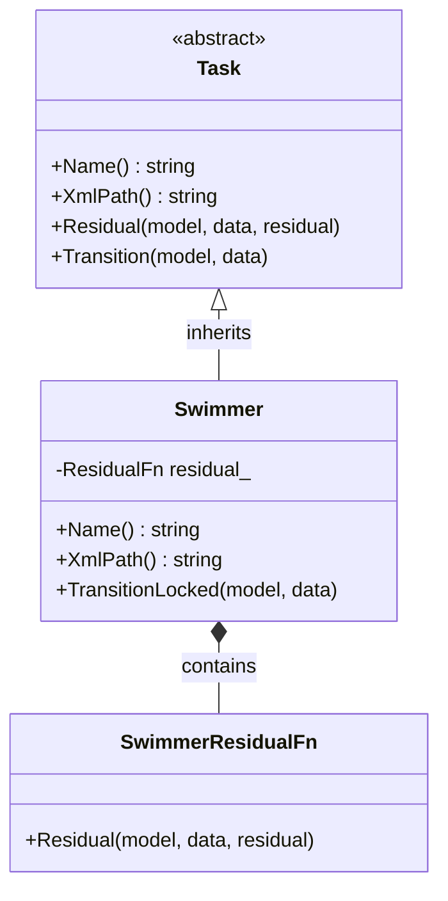
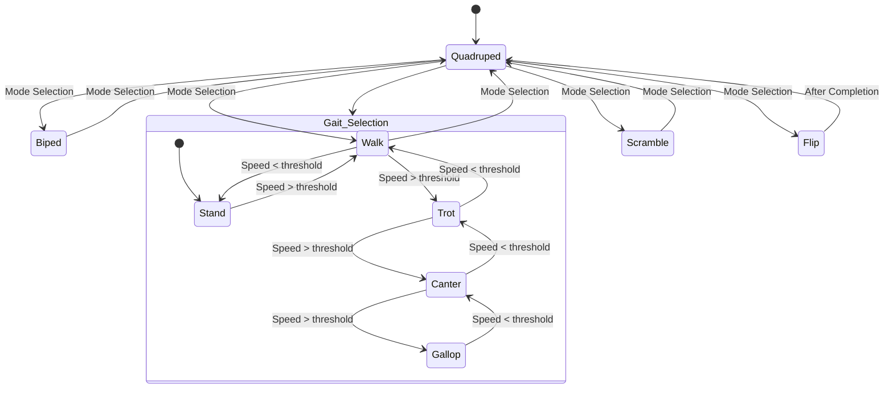

<!-- source: DeepWiki mcp.deepwiki.com · repo google-deepmind/mujoco_mpc · page 6 Tasks · fetched 2026-10-26 -->

# Tasks

<details>
<summary>Relevant source files</summary>

The following files were used as context for generating this wiki page:

- [mjpc/CMakeLists.txt](mjpc/CMakeLists.txt)
- [mjpc/planners/include.cc](mjpc/planners/include.cc)
- [mjpc/task.cc](mjpc/task.cc)
- [mjpc/task.h](mjpc/task.h)
- [mjpc/tasks/cartpole/task.xml](mjpc/tasks/cartpole/task.xml)
- [mjpc/tasks/panda/panda.cc](mjpc/tasks/panda/panda.cc)
- [mjpc/tasks/particle/task.xml](mjpc/tasks/particle/task.xml)
- [mjpc/tasks/particle/task_timevarying.xml](mjpc/tasks/particle/task_timevarying.xml)
- [mjpc/tasks/quadrotor/quadrotor.cc](mjpc/tasks/quadrotor/quadrotor.cc)
- [mjpc/tasks/quadrotor/quadrotor.h](mjpc/tasks/quadrotor/quadrotor.h)
- [mjpc/tasks/quadruped/quadruped.cc](mjpc/tasks/quadruped/quadruped.cc)
- [mjpc/tasks/quadruped/quadruped.h](mjpc/tasks/quadruped/quadruped.h)
- [mjpc/tasks/swimmer/swimmer.cc](mjpc/tasks/swimmer/swimmer.cc)
- [mjpc/tasks/swimmer/swimmer.h](mjpc/tasks/swimmer/swimmer.h)
- [mjpc/tasks/swimmer/task.xml](mjpc/tasks/swimmer/task.xml)
- [mjpc/tasks/tasks.cc](mjpc/tasks/tasks.cc)
- [mjpc/tasks/tasks.h](mjpc/tasks/tasks.h)
- [mjpc/tasks/walker/task.xml](mjpc/tasks/walker/task.xml)
- [mjpc/test/testdata/estimator/box/task0.xml](mjpc/test/testdata/estimator/box/task0.xml)
- [mjpc/test/testdata/estimator/particle/task.xml](mjpc/test/testdata/estimator/particle/task.xml)

</details>


The Tasks system in MuJoCo MPC defines control objectives and simulation environments. Tasks encapsulate the goals that planning and control algorithms attempt to achieve. Each task implements a cost function (via residuals), specifies a physics simulation environment, and can include custom transition logic.

For information about how tasks are used by the Agent system, see [Agent System](#3). For details on implementing specific planners that solve tasks, see [Planners](#4).

## Task System Architecture



Sources: [mjpc/task.h:77-172](), [mjpc/task.cc:15-263](), [mjpc/tasks/quadruped/quadruped.h:24-288]()

## Task and Residual Function Relationship

The core of the task system is the relationship between a Task and its associated ResidualFn. Each Task contains a ResidualFn that computes cost terms used for optimization.



Sources: [mjpc/task.h:84-105](), [mjpc/task.cc:124-145](), [mjpc/tasks/quadruped/quadruped.cc:229-395]()

## Task Base Class

The `Task` class is the abstract base class for all task implementations. It provides the core interface for tasks and handles thread safety through a mutex.

### Key Methods

| Method | Purpose |
|-|-|
| `Name()` | Returns the display name of the task |
| `XmlPath()` | Returns the path to the XML model file |
| `Residual()` | Computes residuals for cost calculation |
| `CostValue()` | Computes scalar cost from residuals |
| `CostTerms()` | Computes individual cost terms |
| `Transition()` | Updates task state when conditions are met |
| `Reset()` | Initializes task state from the model |
| `ModifyScene()` | Adds task-specific visualizations |

### Thread Safety

The Task class uses a mutex to ensure thread safety during residual calculation and state transitions. Most public methods acquire this lock before calling their protected implementations (methods with "Locked" suffix).

Sources: [mjpc/task.h:77-172](), [mjpc/task.cc:125-261]()

## Residual Functions

Residual functions define the cost that planners attempt to minimize. The `ResidualFn` interface and its base implementation `BaseResidualFn` provide the foundation for task-specific residual calculations.

### ResidualFn Interface



Sources: [mjpc/task.h:37-75](), [mjpc/task.cc:66-123]()

### Cost Computation

Costs are computed in three steps:

1. The `Residual()` method computes task-specific residuals
2. The `CostTerms()` method applies norm functions to residuals, optionally with weights
3. The `CostValue()` method computes the final scalar cost, potentially with risk transformation

The flow of cost computation is:
1. State → Residuals → Cost Terms → Cost Value

Sources: [mjpc/task.cc:70-110]()

## Available Tasks

MuJoCo MPC includes a variety of built-in tasks demonstrating different control challenges. These tasks are registered in the `GetTasks()` function.



Sources: [mjpc/tasks/tasks.cc:44-73](), [mjpc/CMakeLists.txt:37-82]()

### Task Categories and Examples

| Category | Examples | Challenges |
|-|-|-|
| **Simple Tasks** | Particle, Cartpole, Acrobot | Basic control, underactuation, swing-up |
| **Locomotion Tasks** | Walker, Quadruped, Swimmer | Gait generation, balance, navigation |
| **Humanoid Tasks** | Stand, Walk, Track, Interact | Full-body control, trajectory following |
| **Manipulation Tasks** | Panda, Allegro, Handover | Object grasping, dexterity, coordination |
| **Aerial Tasks** | Quadrotor | 3D navigation, stabilization |

Sources: [mjpc/CMakeLists.txt:37-82](), [mjpc/tasks/tasks.cc:44-73]()

## Task Implementation Example: Swimmer

To illustrate how tasks are implemented, let's examine the Swimmer task, which is relatively straightforward.



The Swimmer task's residual function computes:
1. Control costs (penalizing large control inputs)
2. Distance between the swimmer's nose and target position

When the swimmer reaches the target, the transition function moves the target to a new random location.

Sources: [mjpc/tasks/swimmer/swimmer.h:23-56](), [mjpc/tasks/swimmer/swimmer.cc:15-62](), [mjpc/tasks/swimmer/task.xml:1-56]()

## Task XML Configuration

Tasks are configured through XML files that define the physics model, sensors, and task parameters. XML configuration typically includes:

1. Physics model definition
2. Agent configuration (planner settings, horizon, timestep)
3. Sensor definitions for residuals and visualization
4. Custom parameters for task-specific behavior

### Example: Cartpole Task XML

The Cartpole task XML defines:
- The physical model (cart and pole)
- Agent parameters (planner selection, horizon, timestep)
- Cost sensors (vertical pole position, cart centering, velocity, control)
- Visualization settings (trace sensors)
- Residual sensors (position, velocity)

Sources: [mjpc/tasks/cartpole/task.xml:1-50](), [mjpc/tasks/swimmer/task.xml:1-56](), [mjpc/tasks/particle/task.xml:1-36]()

## Task Complexity: Quadruped Example

More complex tasks like the Quadruped demonstrate sophisticated state management and transitions. The Quadruped task features:

1. Multiple behavioral modes (stand, walk, trot, gallop, etc.)
2. Automated gait switching based on velocity
3. Custom visualization of support polygon and balance metrics
4. Complex residuals for foot placement, balance, and body orientation



Sources: [mjpc/tasks/quadruped/quadruped.h:24-288](), [mjpc/tasks/quadruped/quadruped.cc:15-825]()

## Creating New Tasks

To create a new task, you need to:

1. Create a class that inherits from `Task`
2. Implement a custom `ResidualFn` that defines the cost function
3. Create an XML file defining the model and sensors
4. Implement the required Task methods (Name, XmlPath, etc.)
5. Register the task in the `GetTasks()` function

The essential components are:
- XML model file with sensor definitions
- Task class implementing the Task interface
- ResidualFn class computing task-specific residuals
- Task transition logic that defines when/how the task changes state

Sources: [mjpc/tasks/tasks.cc:44-73](), [mjpc/tasks/tasks.h:15-29](), [mjpc/tasks/quadrotor/quadrotor.h:15-61](), [mjpc/tasks/panda/panda.cc:15-98]()

## Task Registration

All available tasks are registered in the `GetTasks()` function, which returns a vector of shared pointers to Task instances. This is used by the MuJoCo MPC system to populate the task selection UI and initialize tasks.

```cpp
std::vector<std::shared_ptr<Task>> GetTasks() {
  return {
      std::make_shared<Acrobot>(),
      std::make_shared<Allegro>(),
      std::make_shared<aloha::Handover>(),
      // ... more tasks ...
      std::make_shared<Walker>(),
  };
}
```

Sources: [mjpc/tasks/tasks.cc:44-73](), [mjpc/tasks/tasks.h:15-29]()

## Summary

The Tasks system in MuJoCo MPC provides a flexible framework for defining control objectives. Each task consists of:

1. A model definition in XML that specifies physics properties and sensors
2. A task class that implements the Task interface
3. A residual function that computes cost terms for optimization
4. Optional transition logic and visualization enhancements

Tasks represent the "what" of the control problem, while planners represent the "how." The diverse collection of built-in tasks demonstrates various control challenges from simple problems like Cartpole to complex humanoid and manipulation tasks.

---

