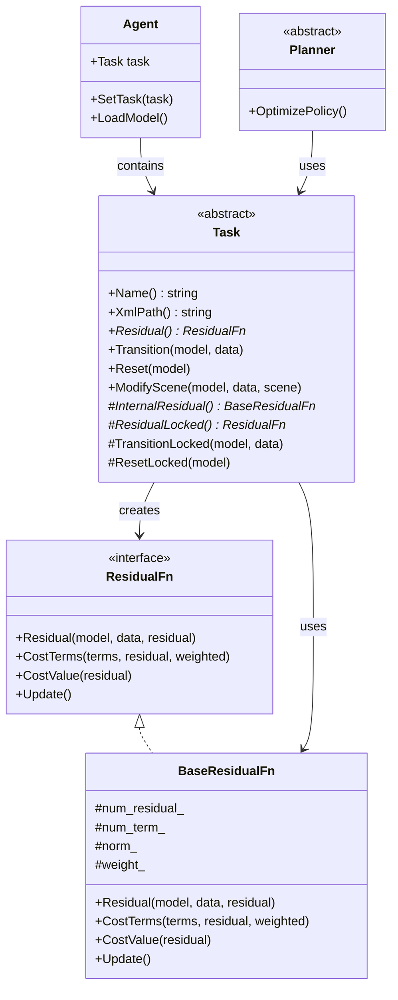
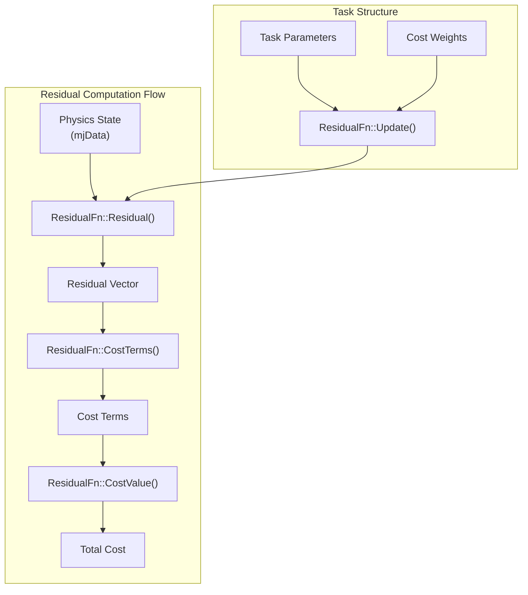
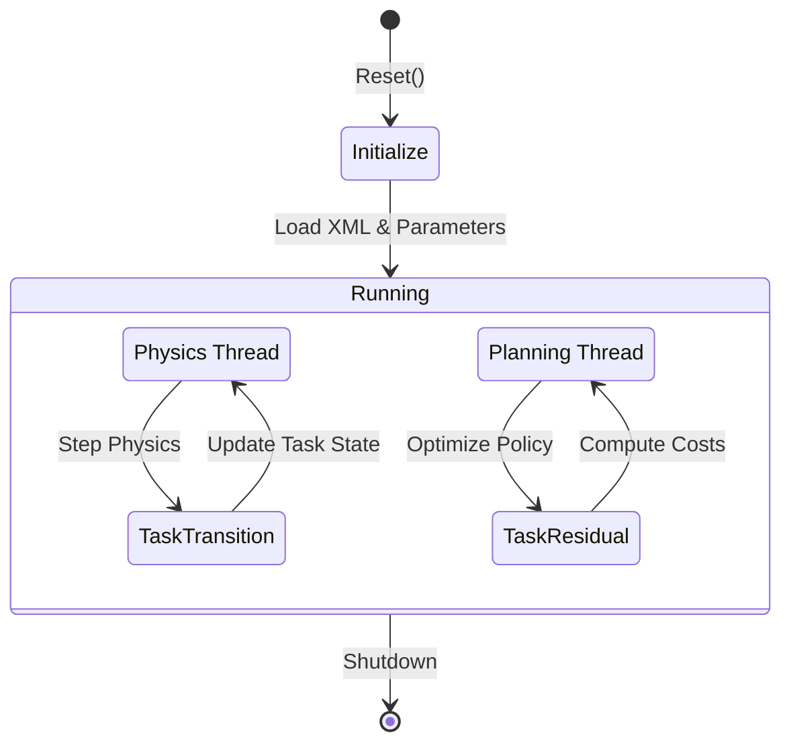
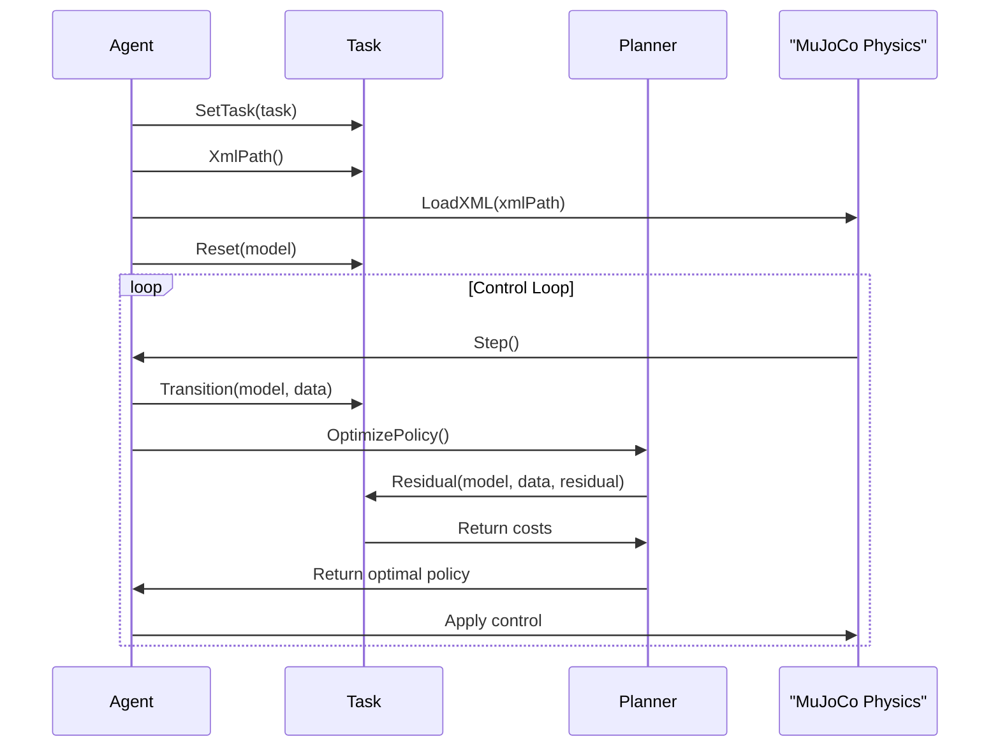

<!-- source: DeepWiki mcp.deepwiki.com · repo google-deepmind/mujoco_mpc · page 6.1 Task Interface · fetched 2026-10-26 -->

# Task Interface

<details>
<summary>Relevant source files</summary>

The following files were used as context for generating this wiki page:

- [mjpc/task.cc](mjpc/task.cc)
- [mjpc/task.h](mjpc/task.h)
- [mjpc/tasks/panda/panda.cc](mjpc/tasks/panda/panda.cc)
- [mjpc/tasks/quadrotor/quadrotor.cc](mjpc/tasks/quadrotor/quadrotor.cc)
- [mjpc/tasks/quadrotor/quadrotor.h](mjpc/tasks/quadrotor/quadrotor.h)
- [mjpc/tasks/quadruped/quadruped.cc](mjpc/tasks/quadruped/quadruped.cc)
- [mjpc/tasks/quadruped/quadruped.h](mjpc/tasks/quadruped/quadruped.h)
- [mjpc/tasks/swimmer/swimmer.cc](mjpc/tasks/swimmer/swimmer.cc)
- [mjpc/tasks/swimmer/swimmer.h](mjpc/tasks/swimmer/swimmer.h)

</details>


This page explains the Task Interface system in MuJoCo MPC, which defines how control tasks are specified, evaluated, and visualized. Tasks define the objective function that planners optimize and serve as the foundation for implementing robotic control behaviors.

For information about specific task implementations such as humanoid locomotion or manipulation, see [Humanoid Tasks](#6.2) and [Manipulation Tasks](#6.3).

## Overview

The Task Interface is a critical component of the MuJoCo MPC framework that bridges the physics simulation with control objectives. It defines:

1. The cost function via residuals that quantify how well the system performs
2. Task parameters that can modify behavior
3. State transitions and logic for handling task progression
4. Visualization tools for task monitoring



Sources: [mjpc/task.h:76-172](), [mjpc/task.h:36-75]()

## Task Class

The `Task` class is an abstract interface that defines the core functionality of a control task in MuJoCo MPC. It's thread-safe and provides methods for computing costs, handling state transitions, and visualizing task state.

### Core Methods

| Method | Purpose |
|--------|---------|
| `Name()` | Returns the task's display name |
| `XmlPath()` | Returns the path to the task's MuJoCo XML file |
| `Residual()` | Returns a thread-safe copy of the residual function |
| `Transition(model, data)` | Updates task state when the physics state changes |
| `Reset(model)` | Initializes task state and parameters from model |
| `ModifyScene(model, data, scene)` | Adds task-specific visualization to the MuJoCo scene |

The `Task` class enforces thread safety through a mutex that protects the residual function and task state. This is crucial because the task may be accessed concurrently by the physics thread, planner thread, and visualization thread.

Sources: [mjpc/task.h:78-172](), [mjpc/task.cc:125-261]()

## Residual Function Interface

The `ResidualFn` interface defines how to compute residuals and costs. Residuals are numerical values that quantify deviations from desired system states or behaviors, and they form the basis for cost functions that planners minimize.



### Core Interface

The `ResidualFn` interface defines four key methods:

1. `Residual(model, data, residual)`: Computes task-specific residuals from the physics state
2. `CostTerms(terms, residual, weighted)`: Computes individual cost terms from residuals
3. `CostValue(residual)`: Computes the total cost value from residuals 
4. `Update()`: Updates internal state from the task parameters and weights

The `BaseResidualFn` class provides a default implementation for methods 2-4, so task implementations typically only need to implement the `Residual` method.

Sources: [mjpc/task.h:36-75](), [mjpc/task.cc:66-110]()

## Task Parameters and Cost Structure

Tasks are configured through parameters and cost weights that can be defined in XML and accessed at runtime.

### Parameters

Parameters are stored in the `parameters` vector and typically define task-specific values like target heights, speeds, or behavior switches. They can be set in the MuJoCo XML model using `<numeric name="residual_..."` elements.

### Cost Structure

Costs are defined through:

1. **Residuals**: Raw error values computed in the `Residual` method
2. **Cost Terms**: Weighted norms of residual components
3. **Total Cost**: Weighted sum of cost terms, possibly with risk transformation

XML structure for defining costs:

```
<sensor name="cost_term_name" type="user">
  <!-- Parameters: [norm_type, weight, reserved, reserved, norm_params...] -->
  <user name="user_params" data="2 1.0 0 0 1.0 ..."/>
</sensor>
```

When the task is loaded, these parameters are parsed to set up the cost structure, including the norm types, weights, and norm parameters for each cost term.

Sources: [mjpc/task.cc:147-245](), [mjpc/task.h:135-146]()

## Task State Management

Tasks can manage internal state to implement complex behaviors like mode transitions or sequences of goals. The `Transition` method is called on each physics step and allows the task to update its state based on the physics state.



### State Transitions

The `TransitionLocked` method is where task-specific state transitions occur. Examples include:

- Checking if a goal has been reached and updating to a new goal
- Changing behavioral modes based on success criteria
- Modifying parameters based on the current physics state

The method is called with the task mutex locked, ensuring thread-safe modification of task state.

Sources: [mjpc/tasks/quadruped/quadruped.cc:229-395](), [mjpc/tasks/quadrotor/quadrotor.cc:59-88](), [mjpc/tasks/swimmer/swimmer.cc:46-60]()

## Implementing Custom Tasks

To implement a custom task, you must create a class that inherits from `Task` and implements the required methods. The most typical pattern includes:

1. A task class that inherits from `Task`
2. A nested `ResidualFn` class that inherits from `BaseResidualFn`
3. Implementation of the abstract methods

### Minimal Task Implementation Example

```cpp
class MyTask : public Task {
 public:
  std::string Name() const override { return "My Task"; }
  std::string XmlPath() const override { return GetModelPath("mytask/task.xml"); }
  
  class ResidualFn : public BaseResidualFn {
   public:
    explicit ResidualFn(const MyTask* task) : BaseResidualFn(task) {}
    void Residual(const mjModel* model, const mjData* data,
                 double* residual) const override {
      // Compute task-specific residuals
    }
  };
  
  MyTask() : residual_(this) {}
  
 protected:
  std::unique_ptr<ResidualFn> ResidualLocked() const override {
    return std::make_unique<ResidualFn>(this);
  }
  ResidualFn* InternalResidual() override { return &residual_; }
  
 private:
  ResidualFn residual_;
};
```

### Example Residual Implementation 

The heart of a task is its `Residual` method, which computes the error values that the planner will try to minimize. A typical implementation might look like:

```cpp
void MyTask::ResidualFn::Residual(const mjModel* model, const mjData* data,
                                 double* residual) const {
  // Position error
  double* position = SensorByName(model, data, "position");
  double* target = data->mocap_pos;
  mju_sub3(residual, position, target);  // residual[0:2] = position - target
  
  // Orientation error
  double* orientation = SensorByName(model, data, "orientation");
  mju_subQuat(residual + 3, orientation, data->mocap_quat);  // residual[3:6] = orientation difference
  
  // Control cost
  mju_copy(residual + 7, data->ctrl, model->nu);  // residual[7:7+nu] = control values
}
```

Sources: [mjpc/tasks/quadrotor/quadrotor.h:28-43](), [mjpc/tasks/quadrotor/quadrotor.cc:29-57](), [mjpc/tasks/swimmer/swimmer.h:27-38]()

## Task Visualization

The `ModifyScene` method allows tasks to add visual elements to the MuJoCo scene to help understand the task state and objectives. This is optional but highly useful for debugging and demonstration.

Common visualization elements include:

- Target positions or trajectories
- Support polygons or stability metrics
- Mode indicators or state visualizations

The method receives the `mjvScene` object, which can be modified to add geometries using MuJoCo's visualization primitives.

Sources: [mjpc/tasks/quadruped/quadruped.cc:397-516]()

## Integration with the Agent System

Tasks are integrated with the Agent system, which is the central orchestrator in MuJoCo MPC. The Agent loads the task, initializes the physics model based on the task's XML, and uses the task's cost function to optimize control policies.



The task's interface allows the Agent and Planner to evaluate different state trajectories and find the optimal control sequence to minimize the task's cost function.

Sources: [mjpc/task.h:83-125]()

## Advanced Task Features

### Risk-Sensitive Cost

Tasks support risk-sensitive cost transformations through the `risk` parameter. When non-zero, the cost is transformed as:

```
risk_cost = (exp(risk * cost) - 1) / risk
```

This allows for more aggressive or conservative planning depending on the risk parameter value.

### Norm Types

Tasks support different norm types for residuals, including:

- L1 norm (absolute value)
- L2 norm (squared error)
- Smoothed L1 norm 
- Huber norm

The norm type can be specified for each cost term in the XML model.

Sources: [mjpc/task.cc:104-110](), [mjpc/task.h:29]()

## Summary

The Task Interface provides a flexible and extensible way to define control objectives in MuJoCo MPC. By implementing the `Task` class and defining appropriate residuals, users can create a wide range of robotic control tasks from simple reaching behaviors to complex locomotion and manipulation.

The thread-safe design ensures that tasks can be safely accessed by multiple components of the system, while the clear separation between residual computation and cost evaluation allows for reuse of common cost structures across different tasks.

---

