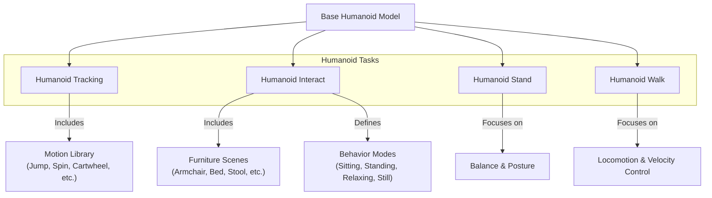
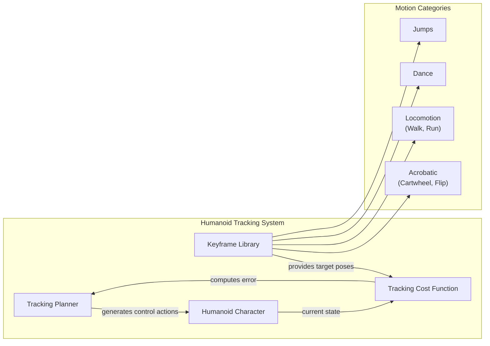
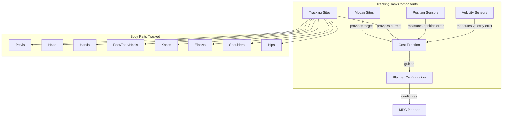
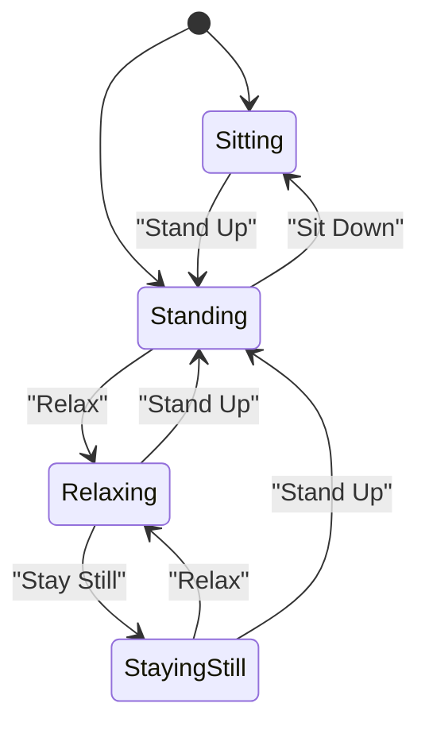
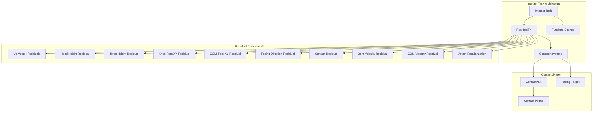
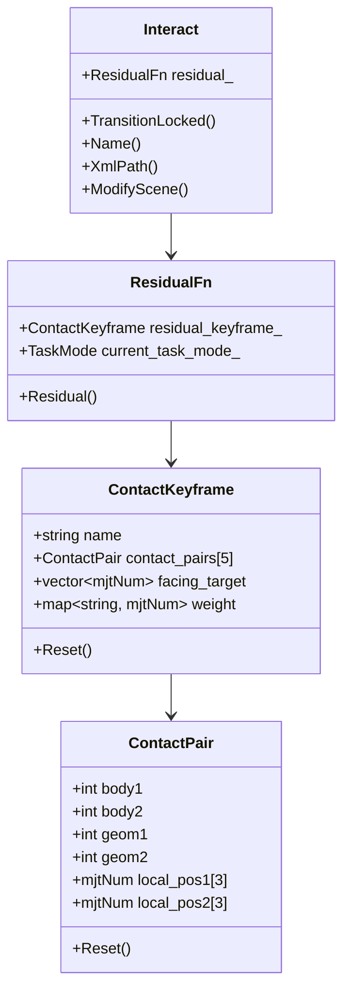
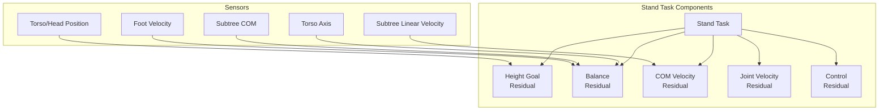
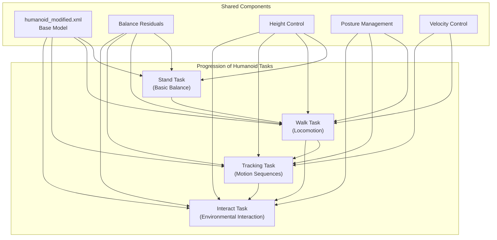

<!-- source: DeepWiki mcp.deepwiki.com · repo google-deepmind/mujoco_mpc · page 6.2 Humanoid Tasks · fetched 2026-10-26 -->

# Humanoid Tasks

Relevant source files

The following files were used as context for generating this wiki page:

- [mjpc/tasks/humanoid/interact/contact_keyframe.cc](mjpc/tasks/humanoid/interact/contact_keyframe.cc)
- [mjpc/tasks/humanoid/interact/contact_keyframe.h](mjpc/tasks/humanoid/interact/contact_keyframe.h)
- [mjpc/tasks/humanoid/interact/interact.cc](mjpc/tasks/humanoid/interact/interact.cc)
- [mjpc/tasks/humanoid/interact/interact.h](mjpc/tasks/humanoid/interact/interact.h)
- [mjpc/tasks/humanoid/interact/scenes/armchair.xml](mjpc/tasks/humanoid/interact/scenes/armchair.xml)
- [mjpc/tasks/humanoid/interact/scenes/bed.xml](mjpc/tasks/humanoid/interact/scenes/bed.xml)
- [mjpc/tasks/humanoid/interact/scenes/bench.xml](mjpc/tasks/humanoid/interact/scenes/bench.xml)
- [mjpc/tasks/humanoid/interact/scenes/dining_chair.xml](mjpc/tasks/humanoid/interact/scenes/dining_chair.xml)
- [mjpc/tasks/humanoid/interact/scenes/stool.xml](mjpc/tasks/humanoid/interact/scenes/stool.xml)
- [mjpc/tasks/humanoid/interact/task.xml](mjpc/tasks/humanoid/interact/task.xml)
- [mjpc/tasks/humanoid/stand/task.xml](mjpc/tasks/humanoid/stand/task.xml)
- [mjpc/tasks/humanoid/tracking/keyframes/CMU-CMU-90-90_19_poses.xml](mjpc/tasks/humanoid/tracking/keyframes/CMU-CMU-90-90_19_poses.xml)
- [mjpc/tasks/humanoid/tracking/task.xml](mjpc/tasks/humanoid/tracking/task.xml)
- [mjpc/tasks/humanoid/walk/task.xml](mjpc/tasks/humanoid/walk/task.xml)

This document describes the humanoid-based tasks in the MuJoCo MPC framework. These tasks leverage a humanoid character model to perform various motions and interactions, showcasing the model predictive control capabilities of the framework. For information about other task types like manipulation tasks, see [Manipulation Tasks](#6.3).

## Overview

The humanoid tasks in MuJoCo MPC consist of several specialized implementations:

1. **Humanoid Tracking**: Motion tracking for predefined sequences (jumps, flips, cartwheels, etc.)
2. **Humanoid Interact**: Interaction with furniture (sitting, standing up, etc.)
3. **Humanoid Stand**: Basic standing and balancing
4. **Humanoid Walk**: Locomotion with velocity control

All tasks share a common humanoid model but differ in their control objectives, residual functions, and environmental setups.

Sources: 
- [mjpc/tasks/humanoid/tracking/task.xml]()
- [mjpc/tasks/humanoid/interact/task.xml]()
- [mjpc/tasks/humanoid/stand/task.xml]()
- [mjpc/tasks/humanoid/walk/task.xml]()

## Humanoid Tracking Task

The Humanoid Tracking task focuses on making the humanoid character follow predefined motion sequences captured as keyframes. This task demonstrates complex motion generation and tracking capabilities.

### Motion Library

The tracking task includes a comprehensive library of motion sequences, each defined as a series of keyframes:

| Motion Type | Description | Source File |
|-------------|-------------|-------------|
| Jump | Simple jump and balance | `CMU-CMU-02-02_04_poses.xml` |
| Kick Spin | Jump with kick and spin | `CMU-CMU-87-87_01_poses.xml` |
| Spin Kick | Jump and spin kick | `CMU-CMU-88-88_06_poses.xml` |
| Cartwheel (1) | Cartwheel motion | `CMU-CMU-88-88_07_poses.xml` |
| Crouch Flip | Crouch and flip backward on hands | `CMU-CMU-88-88_08_poses.xml` |
| Cartwheel (2) | Stretch and cartwheel | `CMU-CMU-88-88_09_poses.xml` |
| Monkey Flip | Monkey backflip | `CMU-CMU-90-90_19_poses.xml` |
| Dance | "Xtra fancy charleston" dance | `CMU-CMU-103-103_08_poses.xml` |
| Run | Running motion | `CMU-CMU-108-108_13_poses.xml` |
| Walk | Walking motion | `CMU-CMU-137-137_40_poses.xml` |

Each motion is defined as a sequence of keyframe poses that the humanoid attempts to match during execution.

Sources:
- [mjpc/tasks/humanoid/tracking/task.xml:8-9]()
- [mjpc/tasks/humanoid/tracking/task.xml:143-152]()
- [mjpc/tasks/humanoid/tracking/keyframes/CMU-CMU-90-90_19_poses.xml]()

### Tracking Implementation

The tracking task works by:

1. Defining tracking sites on the humanoid body (pelvis, head, toes, heels, knees, etc.)
2. Creating mocap bodies to represent target positions
3. Computing positional and velocity differences
4. Using various cost terms to penalize deviations

The tracking implementation includes several types of sensors:
- Joint velocity sensors
- Control magnitude sensors
- Position tracking sensors for body parts
- Velocity tracking sensors for body parts

Sources:
- [mjpc/tasks/humanoid/tracking/task.xml:31-78]()
- [mjpc/tasks/humanoid/tracking/task.xml:82-140]()
- [mjpc/tasks/humanoid/tracking/task.xml:10-19]() (planner configuration)

## Humanoid Interact Task

The Humanoid Interact task focuses on enabling a humanoid character to interact with furniture in natural ways, including sitting down, standing up, relaxing, and staying still.

### Task Modes

The interaction task defines four primary behavior modes:

| Mode | Description | Focus |
|------|-------------|-------|
| Sitting | Sitting on furniture | Head/torso height, knee positions, contact forces |
| Standing | Standing up | Torso height, balance, upright posture |
| Relaxing | Relaxed posture | Minimizing joint velocities and effort |
| Staying Still | Maintaining position | Minimizing COM velocity, maintain position |

Sources:
- [mjpc/tasks/humanoid/interact/interact.h:34-38]()
- [mjpc/tasks/humanoid/interact/task.xml:35]()
- [mjpc/tasks/humanoid/interact/interact.h:42-47]() (default weights)

### Furniture Environments

The interaction task includes multiple furniture scenes that the humanoid can interact with:

| Furniture | Description | File |
|-----------|-------------|------|
| Armchair | Cushioned chair with arms and back | `scenes/armchair.xml` |
| Bed | Sleeping platform with mattress | `scenes/bed.xml` |
| Bench | Long seating surface | `scenes/bench.xml` |
| Stool | Simple seat without back | `scenes/stool.xml` |
| Table | Flat surface with legs | `scenes/table.xml` |
| Dining Chair | Chair with back, seated at table | `scenes/dining_chair.xml` |

Each furniture piece has predefined "home" positions for the humanoid, representing optimal sitting or interaction postures.

Sources:
- [mjpc/tasks/humanoid/interact/task.xml:8-12]()
- [mjpc/tasks/humanoid/interact/interact.h:60-127]()
- [mjpc/tasks/humanoid/interact/contact_keyframe.h:30-60]()
- [mjpc/tasks/humanoid/interact/scenes/armchair.xml]()
- [mjpc/tasks/humanoid/interact/scenes/stool.xml]()

### Contact Keyframe System

The interaction task uses a contact keyframe system to define relationships between the humanoid and furniture:

1. **Contact Pairs**: Defines relationships between specific body parts and furniture elements
2. **Facing Target**: Defines direction the torso should face
3. **Weights**: Configuration of importance values for different residual terms

Sources:
- [mjpc/tasks/humanoid/interact/contact_keyframe.h:46-60]()
- [mjpc/tasks/humanoid/interact/interact.cc:147-200]()
- [mjpc/tasks/humanoid/interact/interact.h:61-105]()

### Residual Components

The interaction task's residual function evaluates multiple aspects of the humanoid's state:

1. **Up Residuals**: Encourage upright orientation of torso, pelvis, and feet
2. **Height Residuals**: Control head and torso heights based on targets
3. **Position Residuals**: 
   - Knee-Feet XY: Keep knees above feet in XY plane
   - COM-Feet XY: Balance center of mass above feet
4. **Orientation Residual**: Face specific direction with torso
5. **Contact Residuals**: Ensure contact between specified body parts and furniture
6. **Regularization**: 
   - COM Velocity: Minimize center of mass velocity
   - Joint Velocity: Minimize joint velocities
   - Control: Minimize control magnitude

Sources:
- [mjpc/tasks/humanoid/interact/interact.cc:30-199]()
- [mjpc/tasks/humanoid/interact/task.xml:41-69]() (sensors)

## Humanoid Stand Task

The Humanoid Stand task focuses on the fundamental capability of maintaining an upright standing posture with balance. This task serves as a baseline for more complex tasks.

### Implementation

The stand task uses a simpler residual structure than the other humanoid tasks, with components focusing on:

1. **Height**: Maintaining target vertical height
2. **Balance**: Keeping center of mass over support base
3. **Velocity Minimization**: Reducing unnecessary COM movement
4. **Joint Velocity Control**: Minimizing joint motion
5. **Control Regularization**: Minimizing control effort

Sources:
- [mjpc/tasks/humanoid/stand/task.xml:14-22]()
- [mjpc/tasks/humanoid/stand/task.xml:18-37]()

## Humanoid Walk Task

The Humanoid Walk task (also called Locomotion) focuses on controlled walking with balance and posture objectives. It addresses natural locomotion with velocity targets.

### Implementation

The walk task has a comprehensive residual structure with components focusing on:

1. **Height**: Maintaining target vertical height
2. **Pelvis/Feet Relationship**: Coordination between pelvis and feet
3. **Balance**: Maintaining balance during locomotion
4. **Upright Posture**: Keeping torso and other body parts correctly oriented
5. **Posture**: Maintaining natural joint configurations
6. **Velocity Control**: Matching target velocity for locomotion
7. **Walk-specific Terms**: Specific metrics for natural walking gait
8. **Control Regularization**: Minimizing control effort

```mermaid
graph TD
    subgraph "Walk Task Components"
        HT["Height\nResidual"]
        PF["Pelvis/Feet\nResidual"]
        BR["Balance\nResidual"]
        UP["Upright\nResidual"]
        PR["Posture\nResidual"]
        VR["Velocity\nResidual"]
        WR["Walk\nResidual"]
        CR["Control\nResidual"]
        
        WT["Walk Task"]
        WT --> HT & PF & BR & UP & PR & VR & WR & CR
    end
    
    subgraph "Sensors"
        TP["Torso Position"]
        TS["Torso Subcom"]
        TV["Torso Velocity"]
        FP["Foot Positions"]
        PP["Pelvis Position"]
        TU["Torso Up Vector"]
        PU["Pelvis Up Vector"]
        FU["Feet Up Vectors"]
        TF["Torso Forward"]
        PF["Pelvis Forward"]
        FF["Feet Forward"]
        FV["Foot Velocity"]
    end
    
    TP & TS --> HT
    PP & FP --> PF
    TS & TV --> BR
    TU & PU & FU --> UP
    TV --> VR
    FV --> WR
```

The Walk task also includes estimator configuration for state estimation during locomotion, allowing it to work with noisy sensor data.

Sources:
- [mjpc/tasks/humanoid/walk/task.xml:14-16]()
- [mjpc/tasks/humanoid/walk/task.xml:18-23]() (estimator configuration)
- [mjpc/tasks/humanoid/walk/task.xml:28-36]() (residual components)
- [mjpc/tasks/humanoid/walk/task.xml:69-86]() (sensors)

## Task Comparison and Relationships

The humanoid tasks form a progression of increasing complexity, with shared components but different focuses:

| Task | Primary Focus | Key Components | 
|------|---------------|----------------|
| Stand | Basic balancing | Height, balance, minimal motion |
| Walk | Controlled locomotion | Velocity matching, natural gait |
| Tracking | Following motion sequences | Keyframe matching, multi-pose transitions |
| Interact | Environmental interaction | Contact relationships, furniture interaction |

Sources:
- [mjpc/tasks/humanoid/tracking/task.xml:4]()
- [mjpc/tasks/humanoid/interact/task.xml:4]()
- [mjpc/tasks/humanoid/stand/task.xml:4]()
- [mjpc/tasks/humanoid/walk/task.xml:4]()

## Task Selection and Execution

Each task is configured through its XML file with custom parameters that define:

1. **Planner Selection**: Which MPC planner to use (sampling, iLQG, gradient)
2. **Planning Horizon**: How far ahead to plan
3. **Timestep**: Control frequency
4. **Exploration Parameters**: For sampling-based planners
5. **Spline Points**: For trajectory representation
6. **Task-specific Parameters**: Target heights, velocities, etc.

Tasks can be selected and transitioned between at runtime through the MPC agent interface.

Sources:
- [mjpc/tasks/humanoid/tracking/task.xml:9-19]()
- [mjpc/tasks/humanoid/interact/task.xml:29-38]()
- [mjpc/tasks/humanoid/stand/task.xml:8-14]()
- [mjpc/tasks/humanoid/walk/task.xml:8-15]()

---

