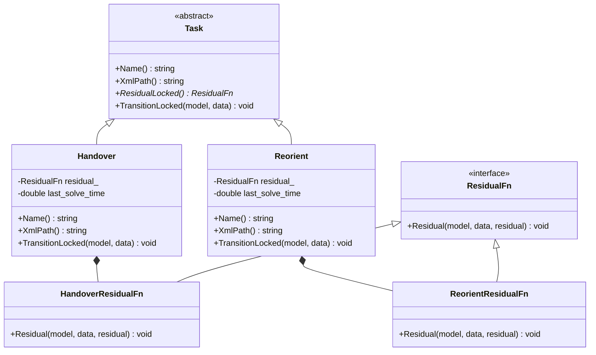
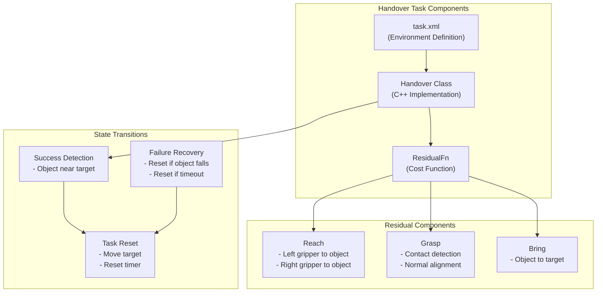
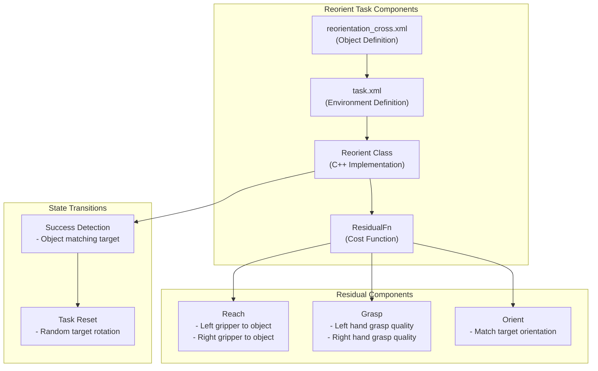
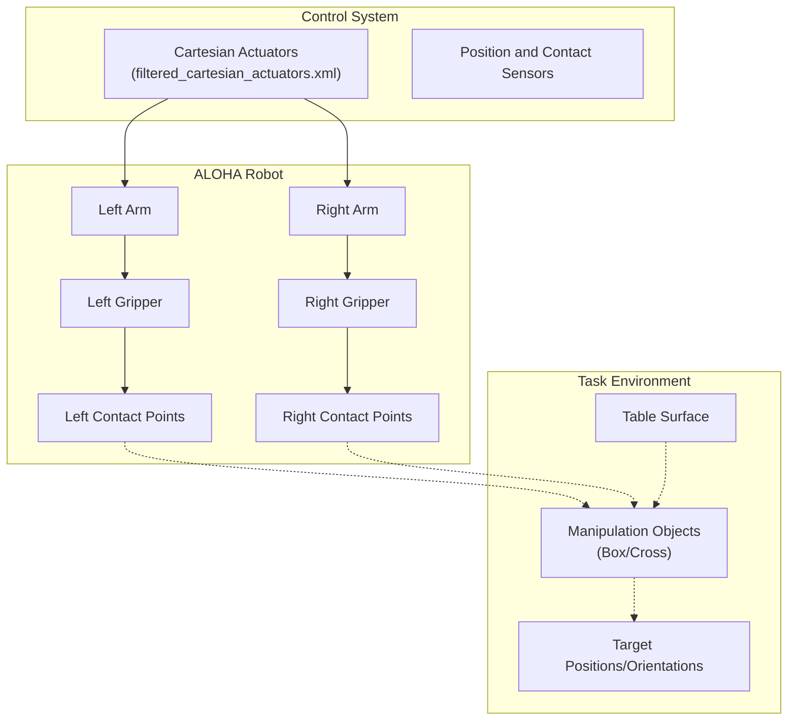

<!-- source: DeepWiki mcp.deepwiki.com · repo google-deepmind/mujoco_mpc · page 6.3 Manipulation Tasks · fetched 2026-10-26 -->

# Manipulation Tasks

Relevant source files

The following files were used as context for generating this wiki page:

- [mjpc/tasks/bimanual/aloha.patch](mjpc/tasks/bimanual/aloha.patch)
- [mjpc/tasks/bimanual/handover/handover.cc](mjpc/tasks/bimanual/handover/handover.cc)
- [mjpc/tasks/bimanual/handover/handover.h](mjpc/tasks/bimanual/handover/handover.h)
- [mjpc/tasks/bimanual/handover/task.xml](mjpc/tasks/bimanual/handover/task.xml)
- [mjpc/tasks/bimanual/reorient/reorient.cc](mjpc/tasks/bimanual/reorient/reorient.cc)
- [mjpc/tasks/bimanual/reorient/reorient.h](mjpc/tasks/bimanual/reorient/reorient.h)
- [mjpc/tasks/bimanual/reorient/task.xml](mjpc/tasks/bimanual/reorient/task.xml)
- [mjpc/tasks/common_assets/reorientation_cross.xml](mjpc/tasks/common_assets/reorientation_cross.xml)

This document provides a detailed overview of the robotic manipulation tasks implemented in the MuJoCo MPC framework. The manipulation tasks specifically focus on bimanual (two-handed) manipulation scenarios, demonstrating the framework's capability to handle complex, multi-limbed coordinated control problems.

## Available Manipulation Tasks

The MuJoCo MPC codebase currently implements two primary bimanual manipulation tasks:

1. **Bimanual Handover** - Transferring an object from one robotic hand to another
2. **Bimanual Reorientation** - Manipulating an object to match a target orientation using two hands

Both tasks utilize the ALOHA robot platform (a dual-arm system with two manipulators) with Cartesian control.

Sources: [mjpc/tasks/bimanual/handover/handover.cc](), [mjpc/tasks/bimanual/reorient/reorient.cc]()

## Task Architecture

The manipulation tasks follow a common architecture pattern that integrates with the MuJoCo MPC framework's task system. Each task implements the core `Task` interface and provides custom residual functions that encode the specific objectives of the manipulation task.

Sources: [mjpc/tasks/bimanual/handover/handover.h](), [mjpc/tasks/bimanual/reorient/reorient.h]()

## Bimanual Handover Task

The Bimanual Handover task involves transferring a small cube between two robot hands, with the goal location changing after each successful handover. This task demonstrates coordination between multiple end-effectors and dynamic object handling.

### Task Implementation

The task is implemented in the `mjpc::aloha::Handover` class, which provides:

1. **Task Definition**: XML model path and task name
2. **Residual Function**: Defines the cost components for planning
3. **Transition Function**: Handles task resets and target position updates

Sources: [mjpc/tasks/bimanual/handover/handover.cc:32-132](), [mjpc/tasks/bimanual/handover/task.xml]()

### Residual Components

The handover task's cost function consists of the following components:

1. **Reach**: Encourages proper alignment of the grippers with the object
   - Left gripper to object distance (with Y and Z components weighted more)
   - Right gripper to object distance (with Y and Z components weighted more)

2. **Grasp**: Evaluates the quality of the grasp based on contact normals
   - Detects contacts between finger pads and the object
   - Computes normal vectors for each contact
   - Evaluates grasp quality by checking if normals are opposite (indicating a stable grasp)

3. **Bring**: Measures the distance between the object and the target location

Each component contributes to the overall cost function that the planner optimizes to generate control inputs.

Sources: [mjpc/tasks/bimanual/handover/handover.cc:33-132]()

### State Transitions

The handover task includes logic for transitioning between states:

- **Success Detection**: When the object is brought close to the target
- **Target Reset**: After success, the target is moved to a new random location
- **Failure Recovery**:
  - If the object falls off the table, it's repositioned
  - If no solution is found within a time limit, the arms are reset

Sources: [mjpc/tasks/bimanual/handover/handover.cc:134-183]()

## Bimanual Reorientation Task

The Bimanual Reorientation task involves manipulating a cross-shaped object to match a target orientation, requiring coordinated control of two robot hands to achieve precise object positioning.

### Task Implementation

The task is implemented in the `mjpc::aloha::Reorient` class with a structure similar to the Handover task:

Sources: [mjpc/tasks/bimanual/reorient/reorient.cc](), [mjpc/tasks/bimanual/reorient/task.xml](), [mjpc/tasks/common_assets/reorientation_cross.xml]()

### Object Representation

The reorientation task uses a cross-shaped object with three perpendicular colored axes, making it easy to visually identify the orientation:

- Red axis (X-direction)
- Green axis (Y-direction)
- Blue axis (Z-direction)

This cross-shaped object is defined in `reorientation_cross.xml` and provides a challenging manipulation target due to its asymmetric shape.

Sources: [mjpc/tasks/common_assets/reorientation_cross.xml:8-16]()

### Residual Components

The reorientation task's cost function consists of:

1. **Reach**: Similar to the handover task, encourages alignment of grippers with the object
   - Left gripper to object distance (with Y and Z components weighted more)
   - Right gripper to object distance (with Y and Z components weighted more)

2. **Grasp**: Evaluated separately for each hand based on contact normals
   - Left hand grasp quality
   - Right hand grasp quality

3. **Orient**: The most complex component, involving matching the object's orientation with the target
   - Constructs representations of the cross shape for both current and target orientations
   - Computes distances between corresponding points to evaluate orientation match

Sources: [mjpc/tasks/bimanual/reorient/reorient.cc:32-140]()

### State Transitions

The reorientation task includes transitions:

- **Success Detection**: When the object orientation closely matches the target orientation
- **Target Reset**: After success, a new random target orientation is set by applying random angular velocities

Sources: [mjpc/tasks/bimanual/reorient/reorient.cc:142-162]()

## Common Implementation Pattern

Both manipulation tasks follow a consistent implementation pattern:

| Component | Description |
|-----------|-------------|
| XML Model | Defines the physical environment, robot, object, and sensors |
| Cost Terms | Defined using user sensors with weights in the XML |
| Task Class | C++ class deriving from the `Task` base class |
| Residual Function | Implements the cost calculation logic |
| Transition Function | Handles task resets and state updates |

This pattern makes it straightforward to implement new manipulation tasks by following the same structure.

Sources: [mjpc/tasks/bimanual/handover/handover.h](), [mjpc/tasks/bimanual/reorient/reorient.h]()

## Robot Platform: ALOHA

Both manipulation tasks utilize the ALOHA dual-arm robot platform, which consists of two robot arms with grippers. The robot model is adapted for Cartesian control in the MuJoCo MPC framework.

The ALOHA model has been modified for the manipulation tasks as shown in the patch file. Key modifications include:

- Adjustment of mesh file paths
- Replacement of joint position actuators with filtered Cartesian actuators
- Addition of special "grasp" contact points on the fingertips

Sources: [mjpc/tasks/bimanual/aloha.patch]()

## Task Sensing and Cost Calculation

Both tasks use a combination of sensors to calculate costs:

1. **Position Sensors**:
   - Object position
   - Gripper positions
   - Target position/orientation

2. **Contact Sensors**:
   - Detect contacts between fingers and objects
   - Used to evaluate grasp quality

3. **User Sensors**:
   - Define cost terms with weights
   - Specify the relative importance of different objectives

The cost calculation flow is:

1. Sensor values are read from MuJoCo simulation
2. Residual components are calculated based on sensor values
3. Weighted residuals form the cost function for planning
4. Planners optimize control inputs to minimize this cost

Sources: [mjpc/tasks/bimanual/handover/task.xml:65-81](), [mjpc/tasks/bimanual/reorient/task.xml:36-47]()

## Custom Planning Configuration

Both manipulation tasks include custom configuration for the planners:

| Parameter | Handover | Reorient |
|-----------|----------|----------|
| Default Planner | Sampling | Sampling |
| Planning Horizon | 0.6s | 0.4s |
| Timestep | 0.01s | 0.01s |
| Sample Width | 0.2 | 0.0025 |
| Policy Width | 0.002 | 0.0035 |
| Exploration Parameters | 0.1, 0.6 | 0.05, 0.3 |
| Trajectory Count | 120 | 120 |

These parameters are tuned to the specific challenges of each task, with the handover task using a longer horizon and wider samples due to the need for more exploration.

Sources: [mjpc/tasks/bimanual/handover/task.xml:11-24](), [mjpc/tasks/bimanual/reorient/task.xml:11-22]()

---

