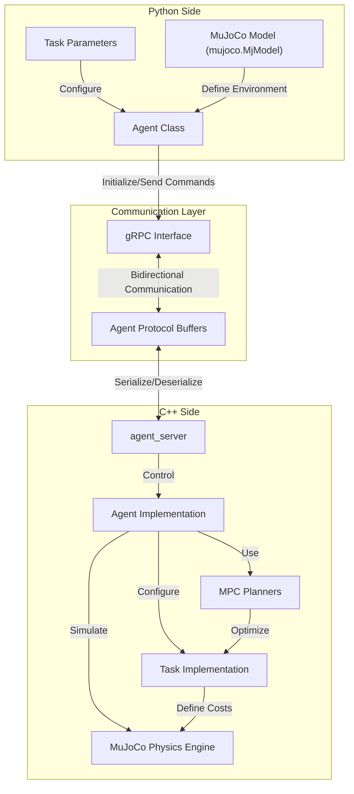
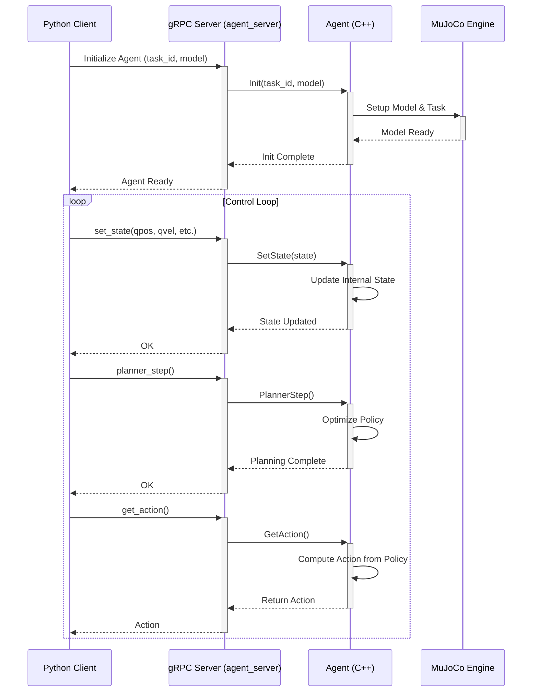
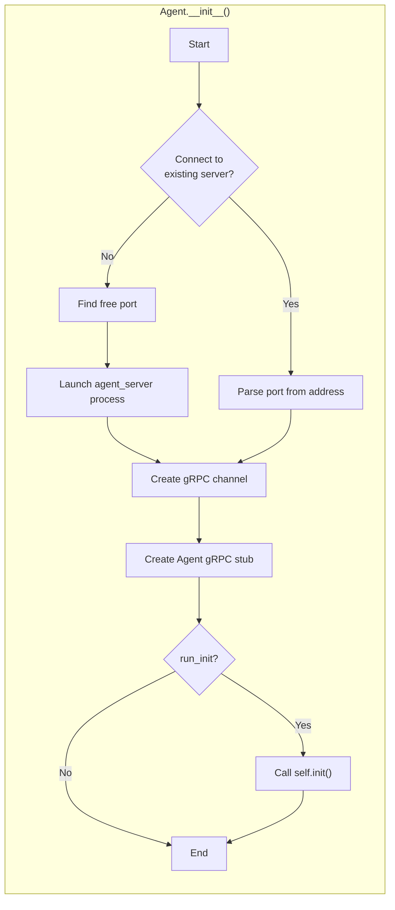
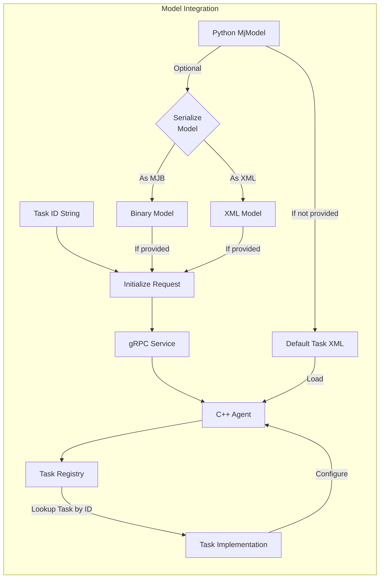
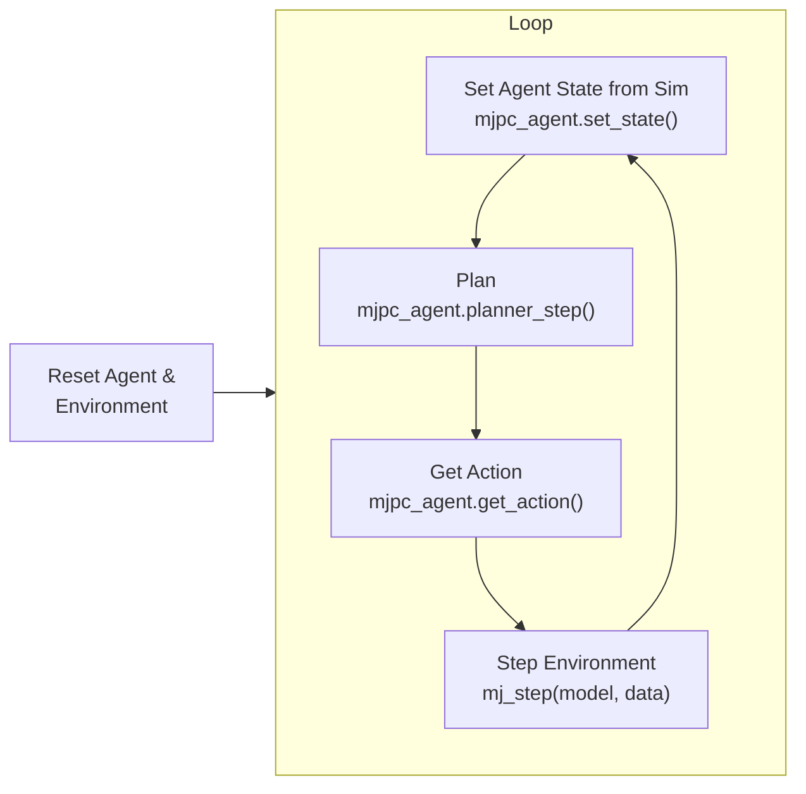
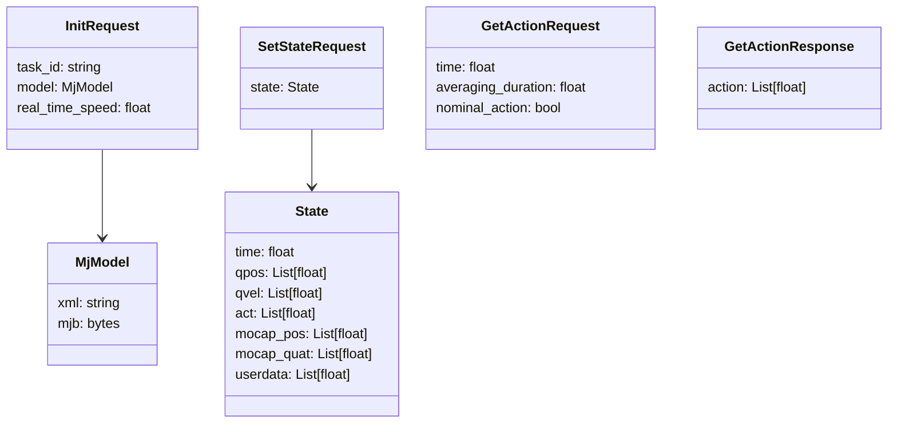
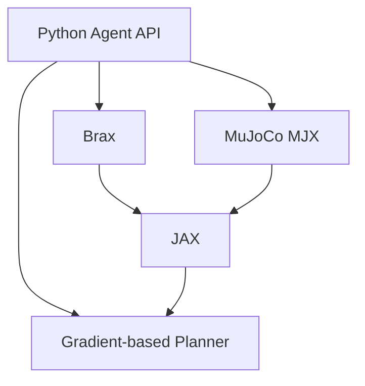

<!-- source: DeepWiki mcp.deepwiki.com · repo google-deepmind/mujoco_mpc · page 7 Python API · fetched 2026-10-26 -->

# Python API

<details>
<summary>Relevant source files</summary>

The following files were used as context for generating this wiki page:

- [README.md](README.md)
- [mjpc/interface.cc](mjpc/interface.cc)
- [mjpc/interface.h](mjpc/interface.h)
- [python/mujoco_mpc/agent.py](python/mujoco_mpc/agent.py)
- [python/mujoco_mpc/agent_test.py](python/mujoco_mpc/agent_test.py)
- [python/mujoco_mpc/ui_agent_test.py](python/mujoco_mpc/ui_agent_test.py)
- [python/setup.py](python/setup.py)

</details>


This page provides documentation for the Python API of MuJoCo MPC, which allows users to interact with the MuJoCo MPC framework from Python. The API enables interfacing with MJPC agents, controlling planning and execution, retrieving state information, and configuring tasks and planners. For information about the underlying C++ agent system, see [Agent System](#3).

## Overview

The MuJoCo MPC Python API provides a high-level interface for creating, controlling, and monitoring model predictive control agents. The API is designed to be simple to use while providing access to the powerful planning and control capabilities of the underlying C++ implementation. It leverages gRPC for communication between Python and the C++ backend.

The API is designed for users who need to:
- Integrate MuJoCo MPC into Python workflows
- Automate planning and control experiments
- Use MuJoCo MPC as a controller for simulated or real robots
- Run MuJoCo MPC in headless mode (without GUI)

Sources: [README.md:157-199]()

## Architecture

The Python API consists of several components that work together to provide a seamless interface between Python code and the C++ MuJoCo MPC implementation.

### High-Level Architecture



Sources: [python/mujoco_mpc/agent.py:16-38](), [python/setup.py:15-59]()

### Communication Flow



Sources: [python/mujoco_mpc/agent.py:68-127](), [python/mujoco_mpc/agent.py:224-249]()

## Agent Class

The primary interface to MuJoCo MPC is the `Agent` class, which manages connection to the C++ backend and provides methods for controlling the agent and retrieving information.

### Key Methods

| Method | Description |
|--------|-------------|
| `__init__` | Creates an Agent instance, launches the server process, and establishes connection |
| `init` | Initializes the agent with a specific task and model |
| `set_state` | Updates the agent's internal state with provided values |
| `get_state` | Retrieves the agent's current state |
| `get_action` | Gets the latest action from the planner |
| `planner_step` | Triggers a planning step |
| `step` | Steps the physics simulation |
| `reset` | Resets the agent's state, settings, and planner |
| `set_task_parameters` | Configures task parameters |
| `get_task_parameters` | Retrieves current task parameters |
| `set_cost_weights` | Sets weights for cost terms |
| `get_cost_weights` | Gets current cost weights |
| `get_mode`/`set_mode` | Gets/sets the agent's mode |
| `best_trajectory` | Retrieves the best trajectory from the planner |

Sources: [python/mujoco_mpc/agent.py:68-393]()

### Initialization

The `Agent` constructor establishes a connection to the C++ backend:



Sources: [python/mujoco_mpc/agent.py:81-123]()

## Task and Model Integration

The Python API can work with both built-in MJPC tasks and custom models created in Python.

### Model Handling

When initializing an agent, you can either:
1. Let the agent use the built-in task model by not providing a model parameter
2. Provide a custom `mujoco.MjModel` that will be serialized and sent to the C++ backend

The model defines the physical environment, while the task (specified by `task_id`) defines the objective and cost functions.



Sources: [python/mujoco_mpc/agent.py:135-177]()

## Usage Examples

### Basic Initialization and Control

```python
import mujoco
from mujoco_mpc import agent

# Load a MuJoCo model
model = mujoco.MjModel.from_xml_path("path/to/your/model.xml")
data = mujoco.MjData(model)

# Initialize the agent with a task ID
with agent.Agent(task_id="Cartpole", model=model) as mjpc_agent:
    # Set a task parameter
    mjpc_agent.set_task_parameter("Goal", 1.0)
    
    # Reset the agent
    mjpc_agent.reset()
    
    # Run a planning step
    mjpc_agent.planner_step()
    
    # Get and apply an action
    action = mjpc_agent.get_action()
    data.ctrl[:] = action
    mujoco.mj_step(model, data)
    
    # Update the agent's state with the new simulation state
    mjpc_agent.set_state(
        time=data.time,
        qpos=data.qpos,
        qvel=data.qvel
    )
```

Sources: [python/mujoco_mpc/agent_test.py:84-101]()

### Control Loop with State Synchronization



Sources: [python/mujoco_mpc/agent_test.py:84-101]()

## Advanced Features

### Action Averaging

The API supports action averaging, which can improve control performance when the control frequency is lower than the simulation frequency:

```python
# Get action averaged over a time window
control_timestep = model.opt.timestep * 5  # 5 simulation steps
action = mjpc_agent.get_action(averaging_duration=control_timestep)
```

The `averaging_duration` parameter causes the agent to internally simulate and average actions over the specified duration, potentially resulting in more accurate control at lower control frequencies.

Sources: [python/mujoco_mpc/agent_test.py:158-204]()

### Best Trajectory Retrieval

The agent can provide the current best trajectory from the planner:

```python
# Get the best trajectory
trajectory = mjpc_agent.best_trajectory()

# Access trajectory components
states = trajectory["states"]     # Shape: [steps, state_dim]
actions = trajectory["actions"]   # Shape: [steps-1, action_dim]
times = trajectory["times"]       # Shape: [steps]
```

This is useful for visualization or for analyzing the planned behavior.

Sources: [python/mujoco_mpc/agent.py:368-384](), [python/mujoco_mpc/agent_test.py:393-416]()

### Cost and Residual Information

The API provides methods to retrieve cost-related information:

```python
# Get total cost
total_cost = mjpc_agent.get_total_cost()

# Get individual cost term values
cost_terms = mjpc_agent.get_cost_term_values()

# Get residuals
residuals = mjpc_agent.get_residuals()
```

Sources: [python/mujoco_mpc/agent.py:251-272]()

## gRPC Integration

The Python API communicates with the C++ backend through gRPC services.

### Protocol Buffers

Communication between Python and C++ uses Protocol Buffers, which define the message formats:



Sources: [python/setup.py:30-92](), [python/mujoco_mpc/agent.py:33-38]()

### Server Process Management

The `Agent` class manages the lifecycle of the gRPC server process:

1. When initialized, it starts a server process on a free port (unless connecting to an existing server)
2. It registers an exit handler to kill the server process when the Python process exits
3. The `__exit__` method of the `Agent` class ensures proper cleanup by closing the gRPC channel and killing the server process

Sources: [python/mujoco_mpc/agent.py:97-115](), [python/mujoco_mpc/agent.py:125-134]()

## MJX Integration

The MuJoCo MPC Python API includes integration with MJX (MuJoCo for JAX), which enables JAX-accelerated simulation and gradient-based optimization.



Note: The MJX integration provides functionality for JAX-accelerated planning, particularly useful for gradient-based planners.

Sources: [python/setup.py:286-293]()

## Installation

### Prerequisites

- Python 3.10 or later
- MuJoCo (installed via pip)
- A built version of MJPC (following the C++ build instructions)

### Installation Steps

1. Build MJPC following the instructions in the [Building and Installation](#8) section
2. Navigate to the `python` directory
3. Install the Python module:
   ```
   python setup.py install
   ```
4. Test the installation:
   ```
   python "mujoco_mpc/agent_test.py"
   ```

Sources: [README.md:159-199]()

## Limitations and Considerations

- The Python API is still experimental and expects experienced users
- The API requires compatibility between the Python-defined model and the C++-defined task
- Limited error handling for verifying this compatibility
- May be difficult to debug without in-depth knowledge of MuJoCo and MJPC

Sources: [README.md:157-159]()

---

