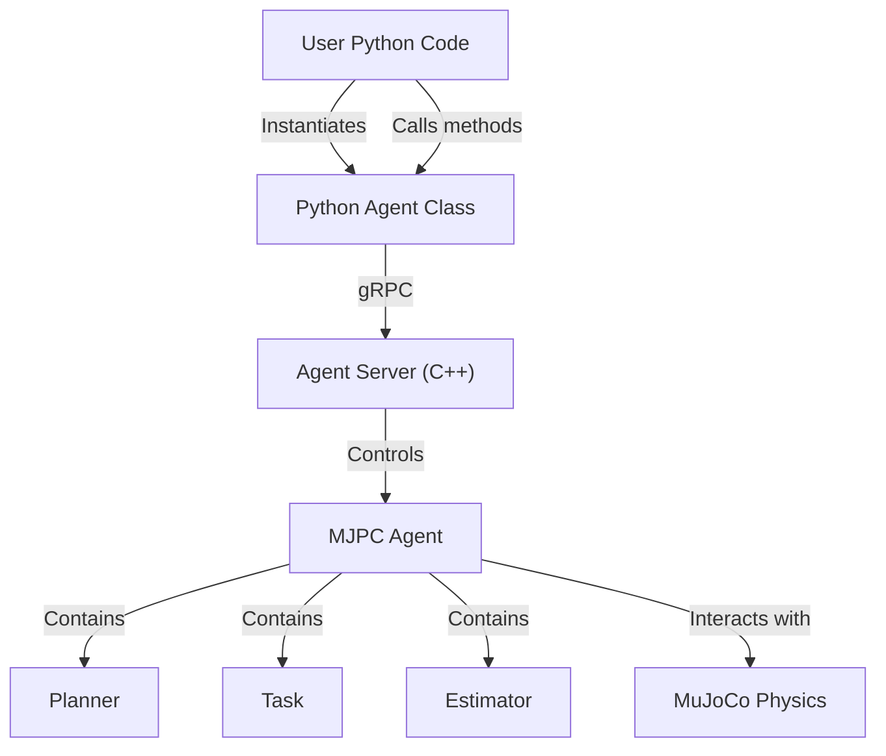
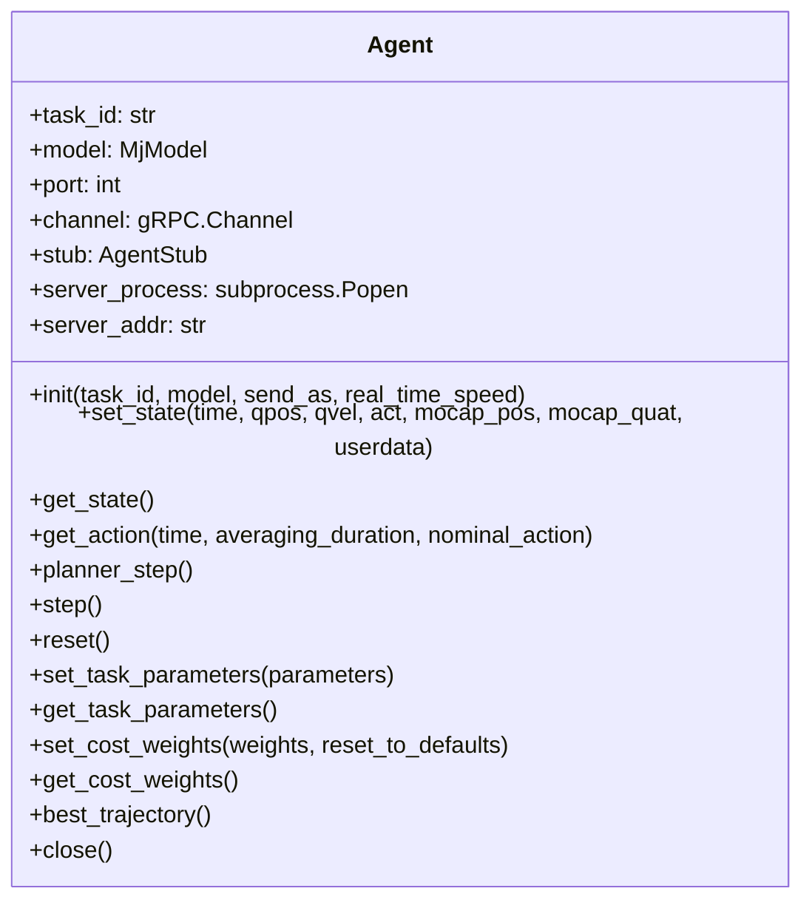
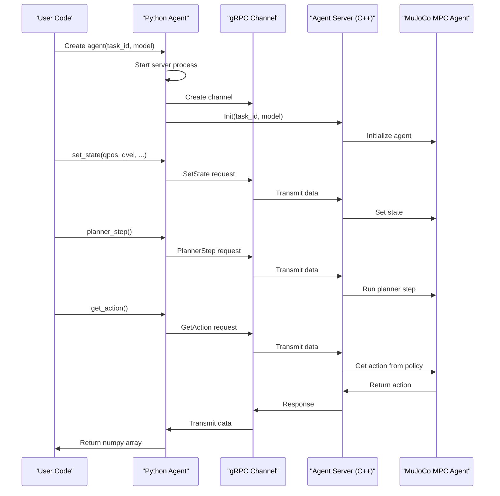

<!-- source: DeepWiki mcp.deepwiki.com · repo google-deepmind/mujoco_mpc · page 7.1 Agent Interface · fetched 2026-10-26 -->

# Agent Interface

<details>
<summary>Relevant source files</summary>

The following files were used as context for generating this wiki page:

- [python/mujoco_mpc/agent.py](python/mujoco_mpc/agent.py)
- [python/mujoco_mpc/agent_test.py](python/mujoco_mpc/agent_test.py)
- [python/mujoco_mpc/ui_agent_test.py](python/mujoco_mpc/ui_agent_test.py)

</details>


The Agent Interface provides a Python API for interacting with MuJoCo MPC agents. It enables users to control and communicate with MPC planners, manage state, set task parameters, and retrieve planning results through a clean, easy-to-use interface. This page documents the core functionality of the Python `Agent` class, which serves as the primary entry point for controlling MPC agents from Python.

For information about the underlying gRPC services that enable communication between Python and C++, see [gRPC Services](#7.2).

## Architecture Overview

The Agent Interface bridges Python applications with the core C++ implementation of MuJoCo MPC through a gRPC-based client-server architecture. The diagram below illustrates how the Python `Agent` class connects to the entire system:



Sources: [python/mujoco_mpc/agent.py:68-134]()

## Agent Class

The `Agent` class is the central component of the Python interface. It manages the connection to the agent server, handles serialization/deserialization of data, and provides a comprehensive set of methods for controlling the MPC agent.



Sources: [python/mujoco_mpc/agent.py:68-134]()

## Initialization and Setup

To use the Agent interface, you need to create an instance of the `Agent` class and initialize it with a task identifier:

```python
from mujoco_mpc import agent as agent_lib
import mujoco

# Option 1: Use default task XML
agent = agent_lib.Agent(task_id="Cartpole")

# Option 2: Provide your own MuJoCo model
model = mujoco.MjModel.from_xml_path("/path/to/task.xml")
agent = agent_lib.Agent(task_id="Cartpole", model=model)
```

The initialization process:
1. Starts the agent server as a subprocess (unless connecting to an existing server)
2. Establishes a gRPC connection
3. Initializes the agent with the specified task

### Constructor Parameters

| Parameter | Type | Description |
|-----------|------|-------------|
| `task_id` | str | Identifier for the MuJoCo MPC task (e.g., "Cartpole", "Humanoid Track") |
| `model` | MjModel | Optional MuJoCo model; if not provided, the default task XML will be used |
| `server_binary_path` | str | Path to the agent server binary; default is automatically determined |
| `extra_flags` | Sequence[str] | Additional command-line flags to pass to the server |
| `real_time_speed` | float | Ratio of running speed to wall clock (0 to 1) |
| `connect_to` | str | Address of an existing agent server to connect to |
| `run_init` | bool | Whether to run initialization immediately |

Sources: [python/mujoco_mpc/agent.py:81-123](), [python/mujoco_mpc/agent_test.py:46-67]()

## State Management

The Agent interface provides methods to get and set the state of the MPC agent:

### Setting State

The `set_state` method updates the agent's internal MuJoCo `data` state:

```python
agent.set_state(
    time=data.time,         # Simulation time
    qpos=data.qpos,         # Joint positions
    qvel=data.qvel,         # Joint velocities
    act=data.act,           # Actuator activations
    mocap_pos=data.mocap_pos,       # Motion capture body positions
    mocap_quat=data.mocap_quat,     # Motion capture body orientations
    userdata=data.userdata,         # Custom user data
)
```

All parameters are optional - only specified values will be updated.

### Getting State

To retrieve the current state:

```python
state = agent.get_state()
# Access components like state.qpos, state.qvel, etc.
```

Sources: [python/mujoco_mpc/agent.py:183-224](), [python/mujoco_mpc/agent_test.py:86-97]()

## Planning and Control

### Running the Planner

To perform a planning step:

```python
agent.planner_step()
```

This triggers the planner to compute a new optimal policy based on the current state.

### Getting Actions

After planning, you can retrieve the optimal action:

```python
# Basic usage
action = agent.get_action()

# With action averaging over a control timestep
action = agent.get_action(averaging_duration=0.01)

# Get nominal action (without feedback terms)
action = agent.get_action(nominal_action=True)
```

The `averaging_duration` parameter is particularly useful when the control frequency is lower than the simulation frequency, as it averages actions over the specified duration to provide better performance.

### Stepping the Physics

To step the physics simulation on the agent side:

```python
agent.step()
```

### Typical Control Loop

A typical control loop using the Agent interface:

```python
# Initialize
agent = agent_lib.Agent(task_id="Cartpole", model=model)

# Control loop
for _ in range(num_steps):
    # Set the current state
    agent.set_state(
        time=data.time, 
        qpos=data.qpos, 
        qvel=data.qvel,
        # other state components as needed
    )
    
    # Plan
    agent.planner_step()
    
    # Get optimal action
    action = agent.get_action()
    
    # Apply action to environment
    data.ctrl[:] = action
    mujoco.mj_step(model, data)
```

Sources: [python/mujoco_mpc/agent.py:226-287](), [python/mujoco_mpc/agent_test.py:76-108](), [python/mujoco_mpc/agent_test.py:213-244]()

## Cost Management

MuJoCo MPC tasks are defined by cost functions composed of weighted cost terms. The Agent interface provides methods to manage these cost weights:

### Getting Cost Information

```python
# Get total cost value
total_cost = agent.get_total_cost()

# Get individual cost term values
term_values = agent.get_cost_term_values()
# Example: {'Vertical': 0.1, 'Velocity': 0.05, 'Control': 0.2}

# Get raw residuals for cost terms
residuals = agent.get_residuals()
```

### Setting Cost Weights

```python
# Set specific cost weights
agent.set_cost_weights({
    'Vertical': 1.0,
    'Velocity': 0.5,
    'Control': 0.1
})

# Reset to defaults and then set specific weights
agent.set_cost_weights(
    {'Vertical': 1.0, 'Control': 0.2},
    reset_to_defaults=True
)

# Get current weights
weights = agent.get_cost_weights()
```

Sources: [python/mujoco_mpc/agent.py:251-272](), [python/mujoco_mpc/agent.py:324-347](), [python/mujoco_mpc/agent_test.py:246-309]()

## Task Parameters and Modes

### Task Parameters

Tasks can have custom parameters that modify their behavior:

```python
# Set a single parameter
agent.set_task_parameter("Goal", 13.0)

# Set multiple parameters
agent.set_task_parameters({
    "Goal": 13.0,
    "Speed": 2.0
})

# Get current parameters
params = agent.get_task_parameters()
```

Task parameters can be numeric values or string selections (for parameters starting with "residual_select_").

### Task Modes

Some tasks support different operational modes:

```python
# Set mode
agent.set_mode("Walk")

# Get current mode
current_mode = agent.get_mode()

# Get all available modes
all_modes = agent.get_all_modes()  # e.g., ["Quadruped", "Biped", "Walk", "Scramble", "Flip"]
```

Sources: [python/mujoco_mpc/agent.py:289-367](), [python/mujoco_mpc/agent_test.py:46-55](), [python/mujoco_mpc/agent_test.py:331-372]()

## Trajectory Information

You can retrieve the best trajectory found by the planner:

```python
trajectory = agent.best_trajectory()

# Access trajectory components:
states = trajectory["states"]     # Shape: [steps, nq+nv+na]
actions = trajectory["actions"]   # Shape: [steps-1, nu]
times = trajectory["times"]       # Shape: [steps]
```

This is useful for visualization or analysis of the planned trajectory.

Sources: [python/mujoco_mpc/agent.py:368-383](), [python/mujoco_mpc/agent_test.py:393-416]()

## Communication Flow

The diagram below illustrates the communication flow between the Python client and the C++ backend:



Sources: [python/mujoco_mpc/agent.py:68-134](), [python/mujoco_mpc/agent.py:183-248]()

## Advanced Features

### Mocap Body Control

For tasks with motion capture bodies, you can set their positions and orientations:

```python
from mujoco_mpc import mjpc_parameters

agent.set_mocap({
    "goal": mjpc_parameters.Pose(
        pos=[1.0, 2.0, 3.0],
        quat=[1.0, 0.0, 0.0, 0.0]
    )
})
```

### Context Manager Support

The `Agent` class supports use as a context manager, which automatically closes resources:

```python
with agent_lib.Agent(task_id="Cartpole", model=model) as agent:
    # Use agent here
    # Resources automatically cleaned up when exiting the context
```

### Connecting to an Existing Server

Instead of starting a new server process, you can connect to an existing one:

```python
agent1 = agent_lib.Agent(task_id="Cartpole", model=model)
agent2 = agent_lib.Agent(
    task_id="Cartpole",
    run_init=False,
    connect_to=f"localhost:{agent1.port}"
)
```

Sources: [python/mujoco_mpc/agent.py:125-134](), [python/mujoco_mpc/agent.py:384-392](), [python/mujoco_mpc/agent_test.py:374-391](), [python/mujoco_mpc/agent_test.py:417-433]()

---

