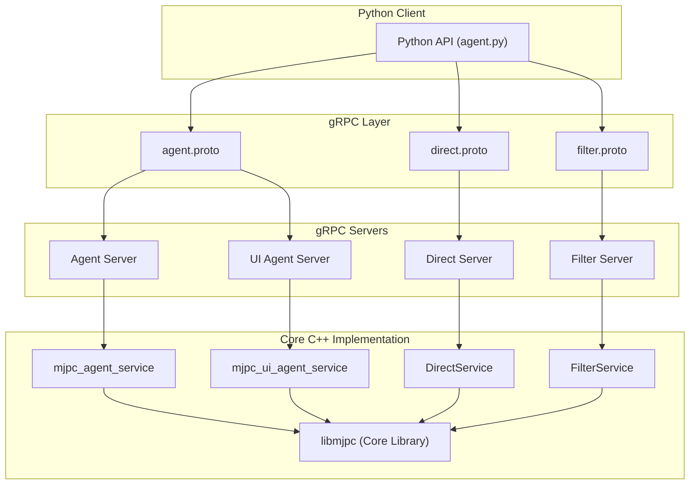
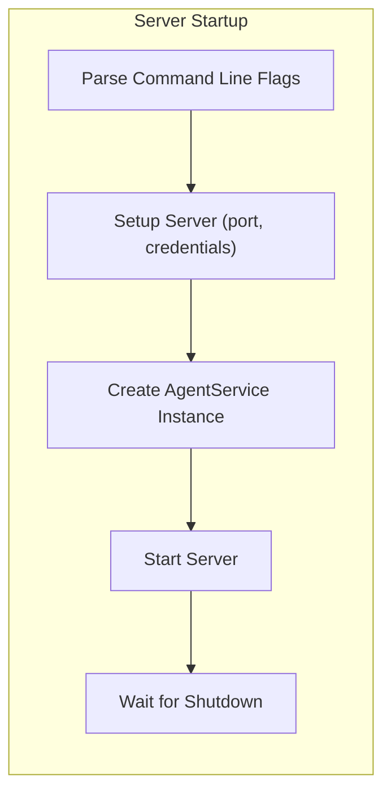
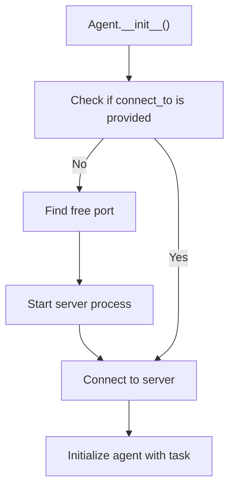
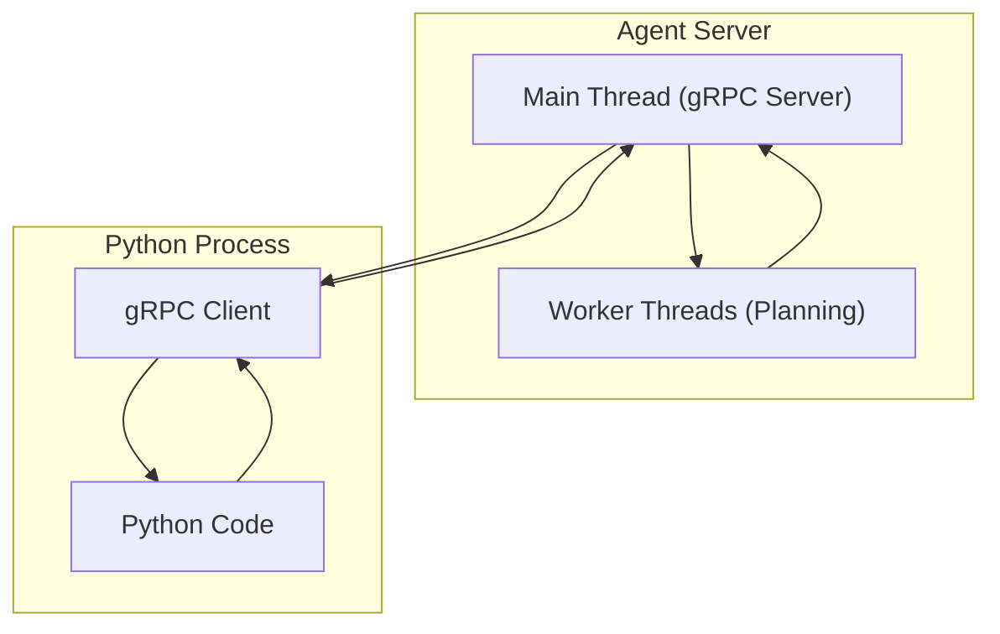

<!-- source: DeepWiki mcp.deepwiki.com · repo google-deepmind/mujoco_mpc · page 7.2 gRPC Services · fetched 2026-10-26 -->

# gRPC Services

<details>
<summary>Relevant source files</summary>

The following files were used as context for generating this wiki page:

- [.github/workflows/build.yml](.github/workflows/build.yml)
- [.gitignore](.gitignore)
- [mjpc/grpc/CMakeLists.txt](mjpc/grpc/CMakeLists.txt)
- [mjpc/grpc/agent_server.cc](mjpc/grpc/agent_server.cc)
- [mjpc/grpc/direct_server.cc](mjpc/grpc/direct_server.cc)
- [mjpc/test/CMakeLists.txt](mjpc/test/CMakeLists.txt)
- [mjpc/test/testdata/estimator/box/task2D.xml](mjpc/test/testdata/estimator/box/task2D.xml)
- [python/mujoco_mpc/agent.py](python/mujoco_mpc/agent.py)
- [python/mujoco_mpc/agent_test.py](python/mujoco_mpc/agent_test.py)
- [python/mujoco_mpc/ui_agent_test.py](python/mujoco_mpc/ui_agent_test.py)

</details>


## Purpose

This page describes the gRPC services used in MuJoCo MPC to enable communication between the Python frontend and the C++ core components. These services provide a client-server architecture that allows users to control and interact with MuJoCo MPC agents, planners, and estimators from Python while the computationally intensive operations happen in optimized C++ code.

For information about the Python API that uses these services, see [Python API Overview](#7) and [Agent Interface](#7.1).

## Architecture Overview

MuJoCo MPC implements several gRPC services that expose different functionalities of the system:



Sources: [mjpc/grpc/CMakeLists.txt:14-342]()

## Service Types

MuJoCo MPC provides four primary gRPC services:

| Service | Purpose | Server Binary | 
|---------|---------|---------------|
| Agent Service | Main interface for controlling MPC agents | agent_server |
| UI Agent Service | Agent control with visualization | ui_agent_server |
| Direct Service | Direct physics computation | direct_server |
| Filter Service | State estimation | filter_server |

Sources: [mjpc/grpc/CMakeLists.txt:189-192](), [mjpc/grpc/CMakeLists.txt:251-254](), [mjpc/grpc/CMakeLists.txt:281-290](), [mjpc/grpc/CMakeLists.txt:312-321]()

### Common Service Architecture

Each gRPC service follows a similar pattern:

```mermaid
classDiagram
    class "Proto Definition" {
        Defines the API contract
        Message types
        Service operations
    }
    
    class "Service Implementation" {
        Implements gRPC service
        Handles incoming requests
        Accesses core library
    }
    
    class "Server Binary" {
        Creates service instance
        Configures gRPC server
        Listens for connections
    }
    
    class "Core Library" {
        libmjpc
        Implementation of planning
        State management
        Physics integration
    }
    
    "Proto Definition" --> "Service Implementation" : defines interface for
    "Service Implementation" --> "Core Library" : uses
    "Server Binary" --> "Service Implementation" : creates and hosts
```

Sources: [mjpc/grpc/agent_server.cc:16-61](), [mjpc/grpc/direct_server.cc:16-56]()

## Agent Service

The Agent Service is the primary gRPC service, providing an interface to control MuJoCo MPC agents. It's implemented in `agent_service.cc/.h` and hosted by `agent_server`.

### Key Operations

The Agent Service supports the following operations:

- Initialize an agent with a specific task
- Set and get state information
- Get action recommendations from the planner
- Step physics simulation
- Reset the agent
- Configure task parameters and cost weights
- Retrieve cost and residual values
- Get trajectory information
- Set modes for multi-modal tasks

Sources: [python/mujoco_mpc/agent.py:81-143](), [python/mujoco_mpc/agent.py:182-392]()

### Server Implementation

The Agent Server is designed to run as a standalone process that listens on a specified port:



Sources: [mjpc/grpc/agent_server.cc:38-61]()

## UI Agent Service

The UI Agent Service extends the standard Agent Service with visualization capabilities. It's implemented in `ui_agent_service.cc/.h` and hosted by `ui_agent_server`.

The UI Agent Server displays a visual interface while simultaneously providing the same gRPC service API as the standard Agent Server. This allows for monitoring the agent's behavior while controlling it programmatically.

Sources: [mjpc/grpc/CMakeLists.txt:251-279](), [python/mujoco_mpc/ui_agent_test.py:47-209]()

## Python Integration

The Python API is implemented in `agent.py` and provides a user-friendly interface to the gRPC services.

### Agent Class

The `Agent` class handles communication with the gRPC services:

```mermaid
classDiagram
    class Agent {
        +__init__(task_id, model, server_binary_path, ...)
        +init(task_id, model, ...)
        +set_state(time, qpos, qvel, ...)
        +get_state()
        +get_action(time, averaging_duration, nominal_action)
        +planner_step()
        +step()
        +reset()
        +set_task_parameter(name, value)
        +set_cost_weights(weights)
        +get_mode()
        +set_mode(mode)
        +best_trajectory()
    }
    
    Agent --> "gRPC Channel" : communicates through
    Agent --> "Server Process" : manages lifecycle of
```

Sources: [python/mujoco_mpc/agent.py:68-392]()

### Server Management

The Python API can either connect to an existing server or spawn a new server process:



Sources: [python/mujoco_mpc/agent.py:81-123](), [python/mujoco_mpc/agent.py:38-50]()

## Protocol Buffers

The communication between Python and C++ is defined by Protocol Buffer (protobuf) definitions. The main message types include:

1. State representations (time, positions, velocities, etc.)
2. Task parameters
3. Cost weights and values
4. Actions and trajectories

Sources: [mjpc/grpc/CMakeLists.txt:59-81]()

## Building gRPC Services

gRPC services are built using CMake with the `-DMJPC_BUILD_GRPC_SERVICE:BOOL=ON` flag. The build process:

1. Finds required dependencies (gRPC, protobuf)
2. Generates C++ code from protobuf definitions
3. Builds the service libraries and server binaries

Sources: [.github/workflows/build.yml:21-26](), [mjpc/grpc/CMakeLists.txt:15-57]()

## Usage Example

Below is a simplified example of how the gRPC services are used from Python:

1. Create an Agent instance, which starts the server and connects to it
2. Initialize the agent with a specific task
3. Set the initial state
4. Request an action from the planner
5. Apply the action to the simulation
6. Repeat steps 3-5 for continuous control

```python
# Example (simplified from agent_test.py)
with agent_lib.Agent(task_id="Cartpole", model=model) as agent:
    agent.set_task_parameters({"Goal": 13})
    
    for _ in range(num_steps):
        agent.set_state(
            time=data.time,
            qpos=data.qpos,
            qvel=data.qvel,
            act=data.act,
            mocap_pos=data.mocap_pos,
            mocap_quat=data.mocap_quat,
            userdata=data.userdata,
        )
        agent.planner_step()
        action = agent.get_action()
        # Apply action to environment
```

Sources: [python/mujoco_mpc/agent_test.py:76-101]()

## Multi-threading and Performance

The gRPC servers support configurable threading for performance optimization. Each server runs in its own process, and the Agent Server specifically can be configured with a custom number of worker threads:



The number of worker threads can be specified with the `--mjpc_workers` flag, where -1 means use all available hardware threads.

Sources: [mjpc/grpc/agent_server.cc:34-36](), [mjpc/grpc/agent_server.cc:49-50]()

---

