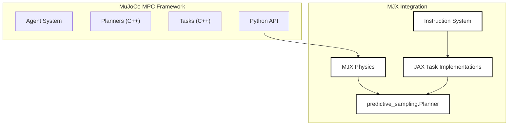
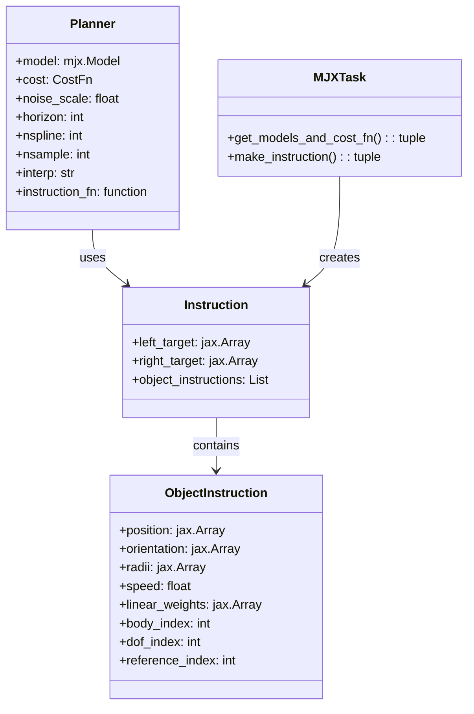
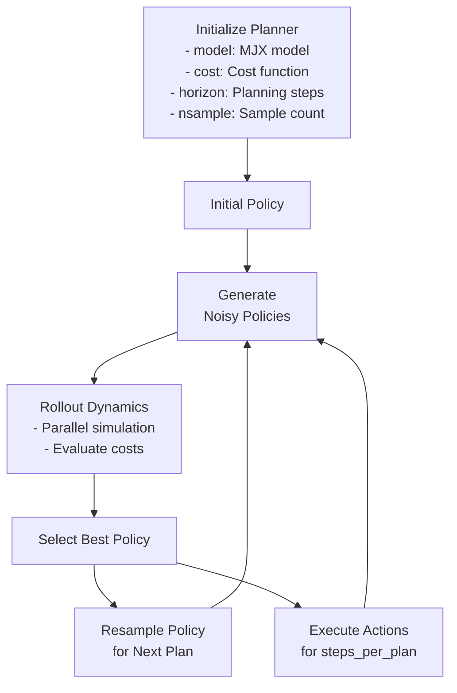
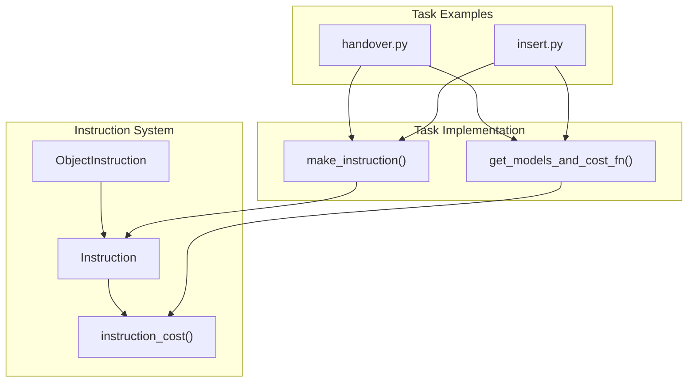
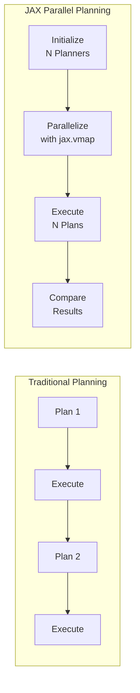

<!-- source: DeepWiki mcp.deepwiki.com · repo google-deepmind/mujoco_mpc · page 7.3 MJX Integration · fetched 2026-10-26 -->

# MJX Integration

<details>
<summary>Relevant source files</summary>

The following files were used as context for generating this wiki page:

- [python/mujoco_mpc/mjx/multi_plan.ipynb](python/mujoco_mpc/mjx/multi_plan.ipynb)
- [python/mujoco_mpc/mjx/predictive_sampling.py](python/mujoco_mpc/mjx/predictive_sampling.py)
- [python/mujoco_mpc/mjx/tasks/bimanual/handover.py](python/mujoco_mpc/mjx/tasks/bimanual/handover.py)
- [python/mujoco_mpc/mjx/tasks/insert.py](python/mujoco_mpc/mjx/tasks/insert.py)
- [python/mujoco_mpc/mjx/tasks/instruction.py](python/mujoco_mpc/mjx/tasks/instruction.py)
- [python/mujoco_mpc/mjx/visualize.py](python/mujoco_mpc/mjx/visualize.py)
- [python/setup_direct.py](python/setup_direct.py)
- [python/setup_filter.py](python/setup_filter.py)

</details>


This page documents the integration of MJX (MuJoCo JAX) with MuJoCo MPC, explaining how JAX-accelerated physics simulation can be used for planning and control. For information about the standard planners in MuJoCo MPC, see [Planners](#4).

## Overview

MJX is a JAX-based implementation of the MuJoCo physics engine that enables accelerated physics simulation on GPUs and provides automatic differentiation capabilities. The MJX integration in MuJoCo MPC allows users to leverage these capabilities for faster sampling-based planning and gradient-based optimization.



Sources: [python/mujoco_mpc/mjx/predictive_sampling.py](), [python/mujoco_mpc/mjx/tasks/instruction.py](), [python/setup_direct.py](), [python/setup_filter.py]()

## Key Components

The MJX integration consists of several key components:

1. **Predictive Sampling Planner** - A JAX-based implementation of a sampling planner for model predictive control
2. **Instruction System** - A flexible system for defining task objectives
3. **JAX Task Implementations** - Task definitions using the MJX framework
4. **Visualization Utilities** - Tools for visualizing planning results



Sources: [python/mujoco_mpc/mjx/predictive_sampling.py:30-49](), [python/mujoco_mpc/mjx/tasks/instruction.py:25-41]()

## Predictive Sampling Planner

The core of the MJX integration is the `Planner` class in the `predictive_sampling` module. This class implements a sampling-based MPC algorithm that:

1. Generates multiple candidate action sequences
2. Simulates them in parallel using MJX
3. Evaluates their costs according to task objectives
4. Selects the best-performing sequence

### Planner Workflow



Sources: [python/mujoco_mpc/mjx/predictive_sampling.py:83-110](), [python/mujoco_mpc/mjx/predictive_sampling.py:133-178]()

### Key Functions

The planner functionality is implemented through these core functions:

| Function | Purpose |
|----------|---------|
| `improve_policy` | Samples noise perturbations, runs rollouts, selects best policy |
| `_rollout` | Expands policy into actions and rolls out dynamics and cost |
| `get_actions` | Expands a policy (spline points) into a full action sequence |
| `resample` | Updates policy after executing some steps |
| `mpc_rollout` | Complete MPC loop with planning and execution |

Sources: [python/mujoco_mpc/mjx/predictive_sampling.py:52-178]()

## Task System

The MJX integration includes a task system based on instructions, which provide a flexible way to define control objectives.

### Instruction System



Sources: [python/mujoco_mpc/mjx/tasks/instruction.py](), [python/mujoco_mpc/mjx/tasks/bimanual/handover.py](), [python/mujoco_mpc/mjx/tasks/insert.py]()

### Task Definition Pattern

All MJX tasks follow a similar pattern for integration:

1. Define a `make_instruction` function that creates appropriate instructions for the task
2. Implement a `get_models_and_cost_fn` function that returns:
   - A simulation model
   - A planning model
   - A cost function
   - An instruction creation function

For example, the Insert task provides models and cost functions for an object insertion task:

```python
# Pattern used by all MJX tasks
def get_models_and_cost_fn():
    # 1. Load model from XML
    # 2. Create planning and simulation models
    # 3. Return (sim_model, plan_model, cost_fn, instruction_fn)
```

Sources: [python/mujoco_mpc/mjx/tasks/insert.py:68-92](), [python/mujoco_mpc/mjx/tasks/bimanual/handover.py:47-71]()

## Example Usage

The following example shows the basic pattern for using the MJX integration for planning:

```python
# 1. Get models and cost function from a task
sim_model, plan_model, cost_fn, instruction_fn = task.get_models_and_cost_fn()

# 2. Create a planner
planner = predictive_sampling.Planner(
    model=mjx.put_model(plan_model),
    cost=cost_fn,
    noise_scale=0.5,
    horizon=128,
    nspline=4,
    nsample=8192,
    interp='zero',
    instruction_fn=instruction_fn,
)

# 3. Initialize simulation data
sim_data = mjx.put_data(sim_model, mujoco.MjData(sim_model))

# 4. Run MPC
sim_data, final_policy, costs, trajectories, terms = predictive_sampling.mpc_rollout(
    nsteps=500,
    steps_per_plan=10,
    p=planner,
    init_policy=initial_policy,
    rng=jax.random.key(0),
    sim_model=mjx.put_model(sim_model),
    sim_data=sim_data,
)
```

Sources: [python/mujoco_mpc/mjx/visualize.py:16-61](), [python/mujoco_mpc/mjx/multi_plan.ipynb:134-226]()

## Parallel Planning

One of the key advantages of the MJX integration is the ability to run multiple planning instances in parallel:



The multi-plan example demonstrates how to use JAX's vectorization capabilities to run multiple planning instances simultaneously:

```python
# Vectorize the mpc_rollout function across multiple policies and initial states
mpc_rollout_multiplan = jax.vmap(
    predictive_sampling.mpc_rollout, 
    in_axes=(None, None, None, 0, 0, None, 0)
)

# Call the vectorized function with multiple policies and initial states
sim_datas, final_policies, costs, trajectories, terms = mpc_rollout_multiplan(
    nsteps, steps_per_plan, planner, 
    multi_policy, rngs, sim_model, sim_datas
)
```

Sources: [python/mujoco_mpc/mjx/multi_plan.ipynb:146-198]()

## Installation and Dependencies

The MJX integration is included in the MuJoCo MPC Python package. It requires:

- MuJoCo (>= 3.1.1)
- mujoco-mjx
- JAX
- brax (for visualization components)

The integration is automatically available when installing the MuJoCo MPC package with test extras:

```python
# From setup_filter.py and setup_direct.py
extras_require={
    "test": [
        "absl-py",
        "mujoco >= 3.1.1",
        "mujoco-mjx",
    ],
}
```

Sources: [python/setup_filter.py:294-300](), [python/setup_direct.py:294-300]()

## Conclusion

The MJX integration provides a powerful extension to MuJoCo MPC, enabling GPU-accelerated simulation, automatic differentiation, and parallel planning. By leveraging JAX's capabilities, it offers significant performance improvements for sampling-based planning methods and opens the door to gradient-based optimization approaches.

---

