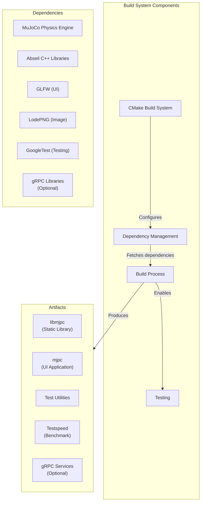
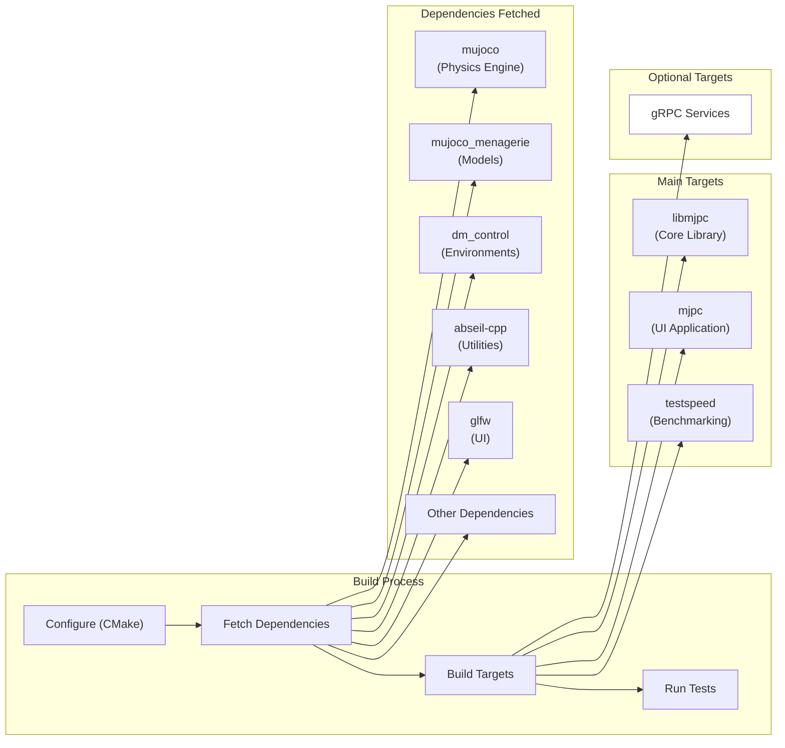
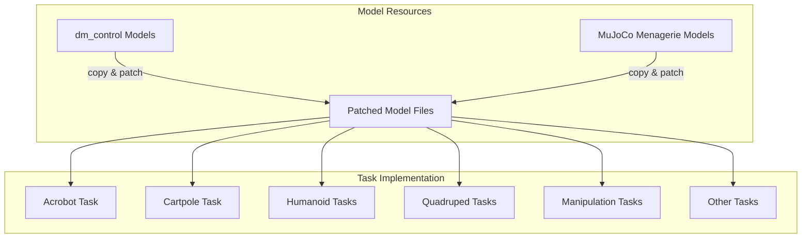

<!-- source: DeepWiki mcp.deepwiki.com · repo google-deepmind/mujoco_mpc · page 8 Building and Installation · fetched 2026-10-26 -->

# Building and Installation

<details>
<summary>Relevant source files</summary>

The following files were used as context for generating this wiki page:

- [.github/workflows/build.yml](.github/workflows/build.yml)
- [.gitignore](.gitignore)
- [CMakeLists.txt](CMakeLists.txt)
- [mjpc/CMakeLists.txt](mjpc/CMakeLists.txt)
- [mjpc/grpc/CMakeLists.txt](mjpc/grpc/CMakeLists.txt)
- [mjpc/grpc/agent_server.cc](mjpc/grpc/agent_server.cc)
- [mjpc/grpc/direct_server.cc](mjpc/grpc/direct_server.cc)
- [mjpc/planners/include.cc](mjpc/planners/include.cc)
- [mjpc/tasks/CMakeLists.txt](mjpc/tasks/CMakeLists.txt)
- [mjpc/tasks/tasks.cc](mjpc/tasks/tasks.cc)
- [mjpc/tasks/tasks.h](mjpc/tasks/tasks.h)
- [mjpc/test/CMakeLists.txt](mjpc/test/CMakeLists.txt)
- [mjpc/test/testdata/estimator/box/task2D.xml](mjpc/test/testdata/estimator/box/task2D.xml)

</details>


This document provides instructions for building and installing MuJoCo MPC from source code. MuJoCo MPC is a framework for implementing Model Predictive Control algorithms that leverages the MuJoCo physics engine. This page covers building the core libraries, executables, and optional gRPC services.

## Overview of Build System

MuJoCo MPC uses CMake as its build system and supports Linux, macOS, and Windows platforms. The build process automatically fetches and builds necessary dependencies including MuJoCo, Abseil, and GLFW.



Sources: [CMakeLists.txt:15-215](), [mjpc/CMakeLists.txt:15-183]()

## Prerequisites

### System Requirements

- **Linux**: Development environment with GCC or Clang
- **macOS**: Xcode Command Line Tools
- **Windows**: Visual Studio with C++ support or MinGW

### Required Packages

#### Linux (Ubuntu/Debian)
```bash
sudo apt-get update && sudo apt-get install \
    build-essential \
    cmake \
    libgl1-mesa-dev \
    libxinerama-dev \
    libxcursor-dev \
    libxrandr-dev \
    libxi-dev \
    ninja-build \
    zlib1g-dev
```

#### macOS
```bash
brew install cmake ninja zlib
```

#### Windows
Install Visual Studio with C++ support, CMake, and optionally Ninja build system.

Sources: [.github/workflows/build.yml:34-56]()

## Building from Source

### Getting the Source Code

Clone the repository and its submodules:

```bash
git clone https://github.com/google-deepmind/mujoco_mpc.git
cd mujoco_mpc
```

### CMake Configuration

The build system provides several configuration options:

| Option | Description | Default |
|--------|-------------|---------|
| `MJPC_BUILD_TESTS` | Build tests for MJPC | ON |
| `MJPC_GRPC_BUILD_TESTS` | Build tests for gRPC | ON |
| `MJPC_BUILD_GRPC_SERVICE` | Build MJPC gRPC service | OFF |
| `PYMJPC_BUILD_TESTS` | Build tests for Python bindings | ON |

Basic configuration:

```bash
mkdir build
cd build
cmake .. -DCMAKE_BUILD_TYPE=Release
```

To enable gRPC services:

```bash
cmake .. -DCMAKE_BUILD_TYPE=Release -DMJPC_BUILD_GRPC_SERVICE=ON
```

Sources: [CMakeLists.txt:43-46]()

### Building

Build all targets:

```bash
cmake --build . --config Release
```

Build specific targets:

```bash
cmake --build . --config Release --target mjpc  # UI application only
```



Sources: [CMakeLists.txt:170-215](), [mjpc/CMakeLists.txt:15-190]()

### Building the Core Components

The core components include:

1. `libmjpc`: Main library containing all planners, tasks, and utility functions
2. `mjpc`: Interactive application for visualizing and testing MPC algorithms
3. `testspeed`: Benchmarking utility for performance testing

These are built by default when using the standard build command.

Sources: [mjpc/CMakeLists.txt:27-227]()

### Building gRPC Services (Optional)

The gRPC services provide remote interfaces to the MuJoCo MPC functionality. This is useful for Python bindings and other language integrations. To build these services:

```bash
cmake .. -DCMAKE_BUILD_TYPE=Release -DMJPC_BUILD_GRPC_SERVICE=ON
cmake --build . --config Release
```

This will build additional executables:
- `agent_server`: Provides remote access to agent/planner functionality
- `ui_agent_server`: Similar to agent_server but with visualization
- `direct_server`: Server for direct trajectory optimization
- `filter_server`: Server for state estimation functionality

Sources: [mjpc/grpc/CMakeLists.txt:1-342]()

## Platform-Specific Notes

### Linux

The build is tested on Ubuntu 20.04 with Clang 12. When building with Clang, use:

```bash
cmake .. -G Ninja \
  -DCMAKE_C_COMPILER=clang-12 \
  -DCMAKE_CXX_COMPILER=clang++-12 \
  -DCMAKE_BUILD_TYPE=Release
```

### macOS

On macOS, the build system needs to handle Objective-C files for native UI integration:

```bash
cmake .. -G Ninja -DCMAKE_BUILD_TYPE=Release
```

The build automatically detects macOS and includes the necessary Objective-C files for Cocoa integration.

### Windows

Windows builds are supported but may require additional configuration. When building on Windows, ensure that the PATH environment variable includes the MuJoCo library path when running tests.

Sources: [.github/workflows/build.yml:10-28](), [mjpc/CMakeLists.txt:192-195]()

## Testing the Build

Run the tests to ensure everything works correctly:

```bash
cd mjpc/test
ctest -C Release --output-on-failure .
```

or for a specific test:

```bash
ctest -C Release --output-on-failure -R <test_name>
```

Sources: [mjpc/test/CMakeLists.txt:15-78](), [.github/workflows/build.yml:71-75]()

## Model Resources

The build process automatically copies and patches model files from dm_control and MuJoCo Menagerie. These models are required for the tasks implemented in MuJoCo MPC.



Sources: [mjpc/tasks/CMakeLists.txt:15-213](), [mjpc/tasks/tasks.cc:15-74]()

## Task Availability

After building, the following tasks are available in the MuJoCo MPC application:

| Category | Available Tasks |
|----------|----------------|
| Basic Control | Acrobot, Cartpole, Particle |
| Humanoid | Stand, Walk, Track, Interact |
| Manipulation | Panda, Allegro hand, Shadow hand reorientation, Rubik's cube |
| Locomotion | Walker, Swimmer, Quadruped |
| Bimanual | Handover, Insert, Reorient |
| Aerial | Quadrotor |

Sources: [mjpc/tasks/tasks.cc:46-73](), [mjpc/planners/include.cc:30-37]()

## Troubleshooting

### Common Build Issues

1. **Missing Dependencies**: Ensure all required system packages are installed.
2. **CMake Version**: The project requires CMake 3.16 or newer.
3. **Build Failures on Windows**: Windows builds may require specific versions of MSVC or additional configuration.

### Runtime Issues

If experiencing runtime errors:
- Check that all model files were correctly copied during the build process
- Ensure the application is run from the correct directory where it can find resources
- Check the MUJOCO_LOG.TXT file for MuJoCo-specific errors

Sources: [.gitignore:30-33]()

## Using the Python API

If you've built the gRPC services, you can use the Python API to interact with MuJoCo MPC. The Python package installation is separate from the C++ build process. See [Python API](#7) for details on using the Python interface to MuJoCo MPC.