# Page: Overview

# Overview

<details>
<summary>Relevant source files</summary>

The following files were used as context for generating this wiki page:

- [README.md](README.md)
- [mjpc/CMakeLists.txt](mjpc/CMakeLists.txt)
- [mjpc/agent.cc](mjpc/agent.cc)
- [mjpc/agent.h](mjpc/agent.h)
- [mjpc/app.cc](mjpc/app.cc)
- [mjpc/app.h](mjpc/app.h)
- [mjpc/interface.cc](mjpc/interface.cc)
- [mjpc/interface.h](mjpc/interface.h)
- [mjpc/main.cc](mjpc/main.cc)
- [mjpc/planners/include.cc](mjpc/planners/include.cc)
- [mjpc/planners/planner.cc](mjpc/planners/planner.cc)
- [mjpc/simulate.cc](mjpc/simulate.cc)
- [mjpc/simulate.h](mjpc/simulate.h)
- [mjpc/tasks/tasks.cc](mjpc/tasks/tasks.cc)
- [mjpc/tasks/tasks.h](mjpc/tasks/tasks.h)
- [python/setup.py](python/setup.py)

</details>


MuJoCo MPC (MJPC) is a comprehensive framework developed by Google DeepMind for real-time Model Predictive Control (MPC) using the MuJoCo physics engine. It provides an interactive application and software stack that enables researchers and engineers to author, solve, and visualize complex robotics tasks with different planning algorithms. This page provides a high-level overview of the system architecture, core components, and execution model.

## Purpose and Core Capabilities

MuJoCo MPC serves as:
1. An interactive application for testing and visualizing MPC solutions
2. A software framework for implementing custom MPC problems
3. A testbed for comparing different planning algorithms on robotics tasks

The framework supports multiple planning methods including:
- Sampling-based planners (Predictive Sampling, Cross Entropy)
- Derivative-based planners (iLQG, Gradient Descent)
- Hybrid approaches (Sample Gradient)

Sources: [README.md:14-21](), [mjpc/planners/include.cc:30-37]()

## System Architecture

The system is built around several key components that work together to provide the MPC functionality:

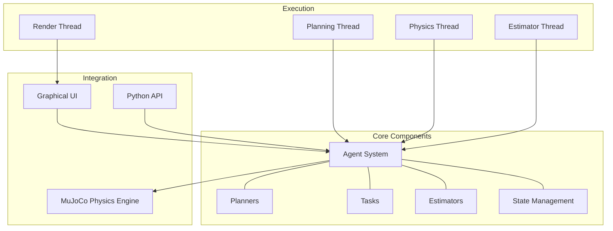

Sources: [mjpc/agent.h:44-256](), [mjpc/app.cc:483-502]()

## Core Components in Detail

### Agent System

The Agent is the central orchestrator of the MPC process. It:
- Initializes and manages the models, planners, estimators, and tasks
- Coordinates the planning and execution loops
- Handles state transitions and updates
- Provides visualization and UI elements

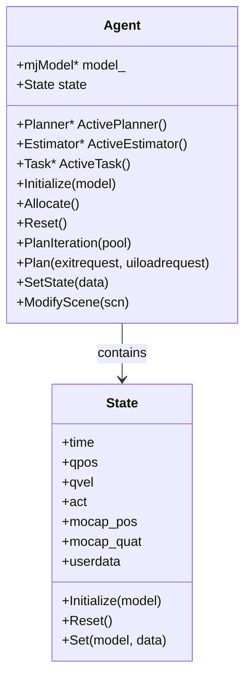

The Agent class maintains the planning model, state information, and references to the active planner, estimator, and task. It provides methods for initialization, memory allocation, and resetting the system, as well as for planning iterations and state updates.

Sources: [mjpc/agent.h:44-256](), [mjpc/agent.cc:60-164]()

### Planning System

MuJoCo MPC includes several planning algorithms, each implemented as a subclass of the `Planner` base class:

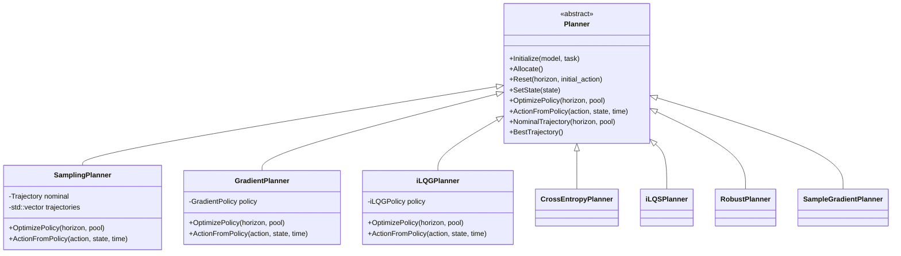

The different planners implement various optimization strategies:
- **SamplingPlanner**: Generates random action sequences and selects the best
- **GradientPlanner**: Uses gradient information to optimize action sequences
- **iLQGPlanner**: Implements iterative Linear Quadratic Gaussian control
- **iLQSPlanner**: Iterative Linear Quadratic regulator for constrained systems
- **CrossEntropyPlanner**: Uses the Cross Entropy Method for sampling
- **RobustPlanner**: Adds robustness to other planners
- **SampleGradientPlanner**: Combines sampling and gradient-based approaches

Sources: [mjpc/planners/include.cc:30-53](), [mjpc/CMakeLists.txt:84-120]()

### Task System

Tasks define the objectives and environments for the MPC problem:

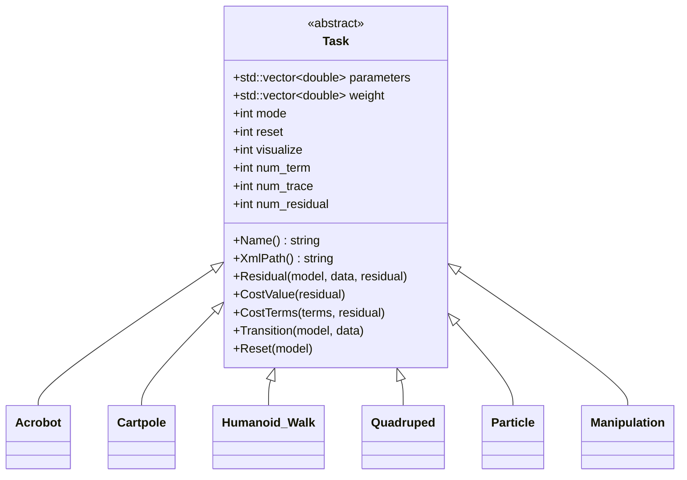

MJPC includes over 20 pre-defined tasks covering a wide range of robotics problems:
- Basic control (Cartpole, Acrobot, Particle)
- Locomotion (Humanoid walking, Quadruped)
- Manipulation (Bimanual handover, reorientation)
- Complex coordination (Rubik's cube, Shadow hand)

Each task defines:
- A residual function that computes the cost/objective
- Transition logic for managing task phases
- Visualization elements for the UI
- Task-specific parameters and weights

Sources: [mjpc/tasks/tasks.cc:46-73](), [mjpc/CMakeLists.txt:37-84]()

### Estimator System

Estimators provide state estimation capabilities when direct state measurement isn't available:

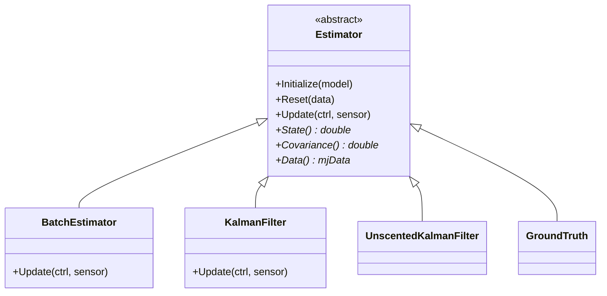

The available estimators include:
- **BatchEstimator**: Performs batch estimation
- **KalmanFilter**: Standard Kalman Filter implementation
- **UnscentedKalmanFilter**: Unscented Kalman Filter for nonlinear systems
- **GroundTruth**: Uses direct state information (no estimation)

Sources: [mjpc/CMakeLists.txt:123-131](), [mjpc/agent.cc:120-126]()

## Execution Model

MuJoCo MPC employs a multi-threaded architecture to efficiently handle planning, physics simulation, state estimation, and rendering:

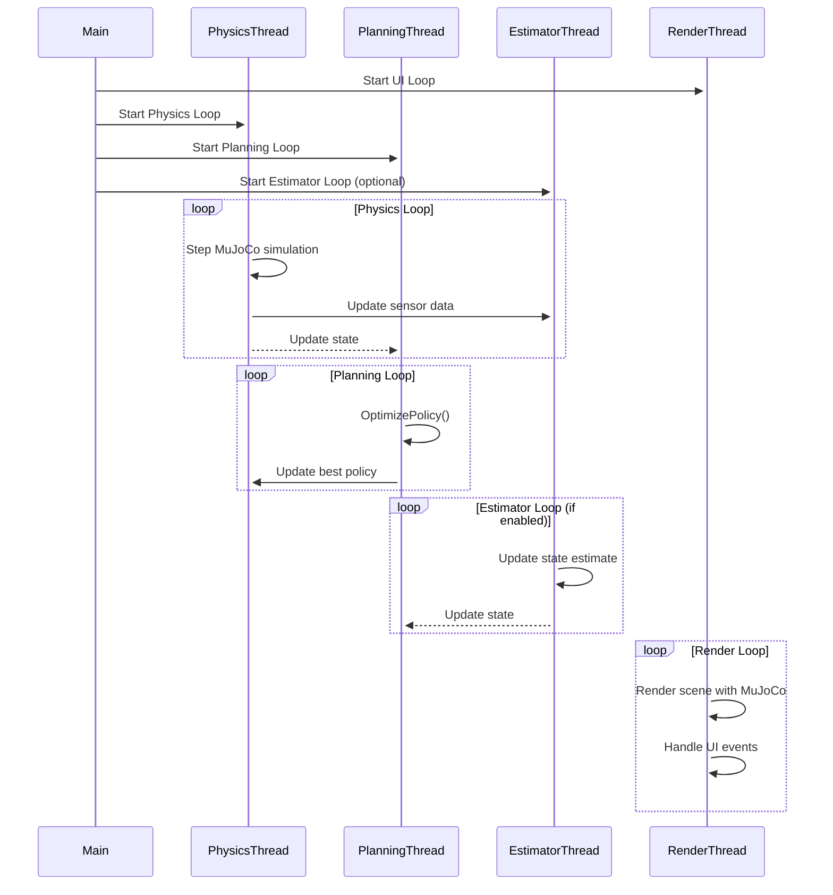

The system operates with the following threads:
1. **Physics Thread**: Runs the MuJoCo simulation at a high frequency
2. **Planning Thread**: Continuously optimizes the control policy
3. **Estimator Thread** (optional): Updates state estimates from sensor data
4. **Render Thread**: Handles UI and visualization

Thread synchronization is carefully managed to ensure efficient operation without deadlocks.

Sources: [mjpc/app.cc:128-386](), [mjpc/agent.cc:359-371]()

## Integration with MuJoCo

MuJoCo MPC tightly integrates with the MuJoCo physics engine:

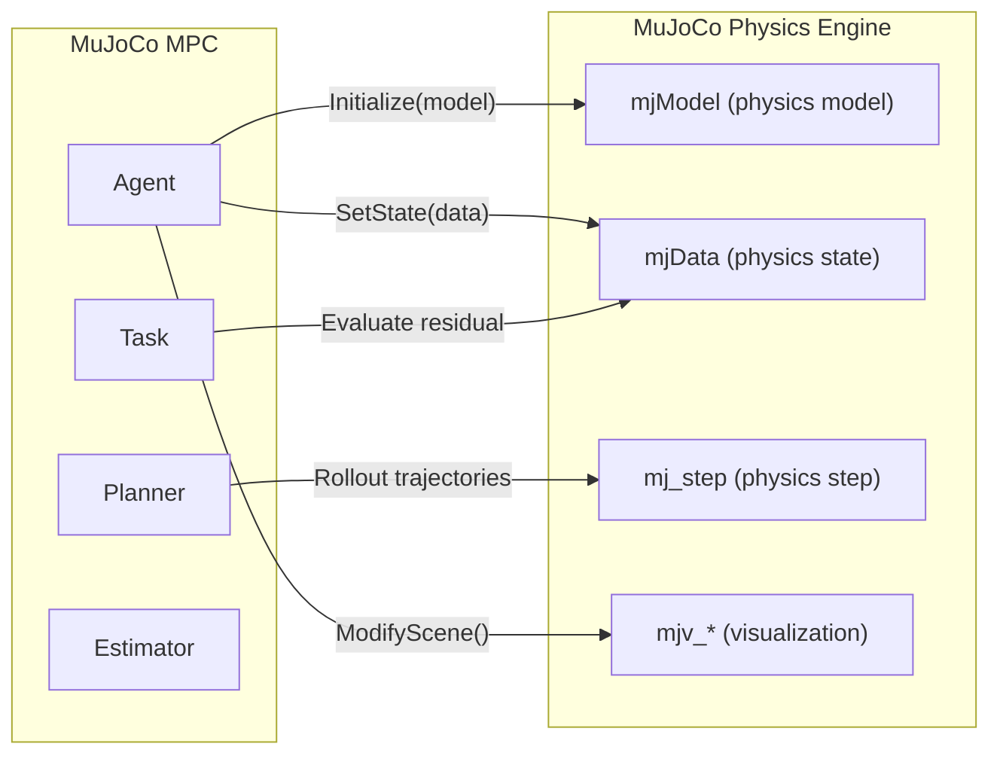

Key integration points include:
- Using MuJoCo's `mjModel` to define the physics model
- Using `mjData` to track the physics state
- Using MuJoCo's `mj_step` function for forward simulation
- Using MuJoCo's visualization functions for rendering
- Adding callbacks for controllers and sensors

Sources: [mjpc/agent.cc:69-114](), [mjpc/app.cc:84-103]()

## Python API

MuJoCo MPC also provides a Python API for use in Python applications:

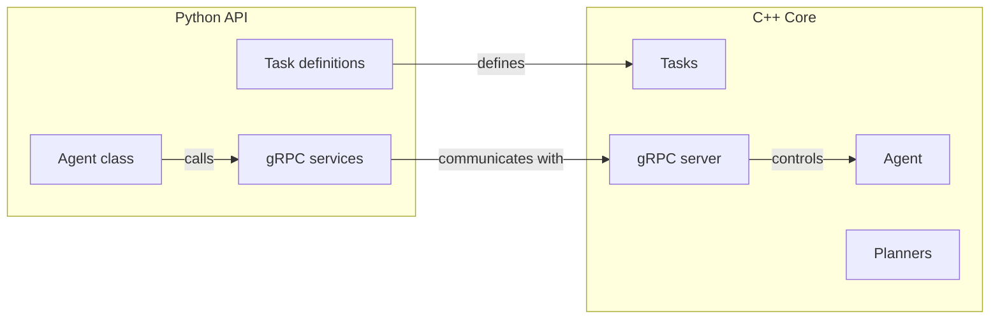

The Python API:
- Uses gRPC to communicate with the C++ core
- Provides a similar interface to the C++ API
- Allows for task definition and control from Python
- Enables integration with other Python libraries

Sources: [python/setup.py:15-315](), [README.md:157-198]()

## Summary

MuJoCo MPC provides a comprehensive framework for implementing Model Predictive Control for robotics applications using the MuJoCo physics engine. Its modular architecture allows for easy extension with new planners, tasks, and estimators, while its multi-threaded execution model ensures efficient real-time performance. The system can be used both as an interactive application through its GUI and as a software library through its C++ and Python APIs.

---

# Page: System Architecture

# System Architecture

<details>
<summary>Relevant source files</summary>

The following files were used as context for generating this wiki page:

- [mjpc/agent.cc](mjpc/agent.cc)
- [mjpc/agent.h](mjpc/agent.h)
- [mjpc/app.cc](mjpc/app.cc)
- [mjpc/app.h](mjpc/app.h)
- [mjpc/estimators/estimator.h](mjpc/estimators/estimator.h)
- [mjpc/main.cc](mjpc/main.cc)
- [mjpc/planners/gradient/planner.cc](mjpc/planners/gradient/planner.cc)
- [mjpc/planners/gradient/planner.h](mjpc/planners/gradient/planner.h)
- [mjpc/planners/ilqg/planner.cc](mjpc/planners/ilqg/planner.cc)
- [mjpc/planners/ilqg/planner.h](mjpc/planners/ilqg/planner.h)
- [mjpc/planners/ilqs/planner.cc](mjpc/planners/ilqs/planner.cc)
- [mjpc/planners/ilqs/planner.h](mjpc/planners/ilqs/planner.h)
- [mjpc/planners/planner.cc](mjpc/planners/planner.cc)
- [mjpc/planners/planner.h](mjpc/planners/planner.h)
- [mjpc/planners/sampling/planner.cc](mjpc/planners/sampling/planner.cc)
- [mjpc/planners/sampling/planner.h](mjpc/planners/sampling/planner.h)
- [mjpc/simulate.cc](mjpc/simulate.cc)
- [mjpc/simulate.h](mjpc/simulate.h)
- [mjpc/test/utilities/utilities_test.cc](mjpc/test/utilities/utilities_test.cc)
- [mjpc/utilities.cc](mjpc/utilities.cc)
- [mjpc/utilities.h](mjpc/utilities.h)

</details>


The MuJoCo MPC framework provides a comprehensive architecture for implementing Model Predictive Control (MPC) for robotics applications, built on top of the MuJoCo physics simulation engine. This document describes the overall system architecture, including component relationships, threading model, and data flow mechanisms.

For information about specific implementations of planners, see [Planners](#4), and for information about state estimation, see [Estimators](#5).

## Core Architecture

The MuJoCo MPC system is built around several key components that work together to enable efficient planning and control:

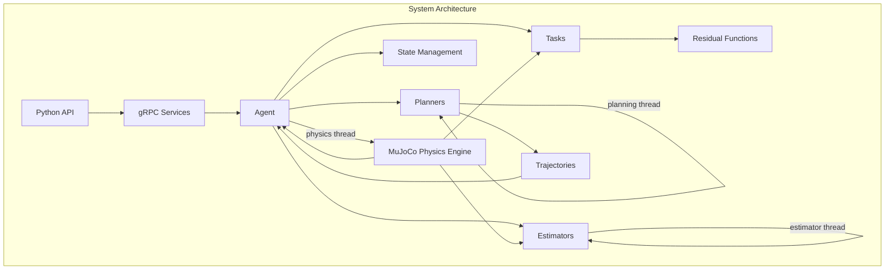

The architecture follows a modular design with clear separation of concerns:

1. **Agent**: The central coordination component that manages planning, estimation, and task execution.
2. **Planners**: Implement optimization algorithms for trajectory generation.
3. **Estimators**: Handle state estimation from noisy observations.
4. **Tasks**: Define objectives and environments through residual functions.
5. **State Management**: Represents and tracks the system state.
6. **MuJoCo Integration**: Provides the physics simulation backend.

Sources: [mjpc/agent.h:45-176](mjpc/agent.h:45-176), [mjpc/agent.cc:46-118](mjpc/agent.cc:46-118), [mjpc/app.cc:389-508](mjpc/app.cc:389-508)

## Threading Model

MuJoCo MPC employs a multi-threaded architecture to enable parallel processing of different system components:

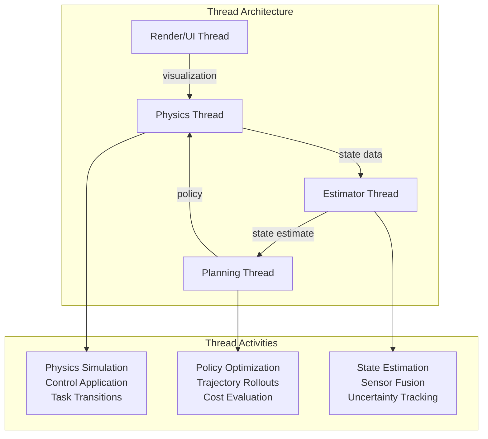

The system operates with these key threads:

1. **Physics Thread**: Manages the MuJoCo simulation, applies control actions, and handles state transitions. This thread is responsible for the core simulation loop and ensuring real-time performance.

2. **Planning Thread**: Optimizes the control policy based on current state estimates. The planning thread can spawn multiple worker threads to parallelize trajectory rollouts and gradient computations.

3. **Estimator Thread**: Processes sensor data to estimate the system state, handling noisy observations and maintaining uncertainty estimates. This thread can be disabled when ground truth state information is available.

4. **Render/UI Thread**: Handles visualization and user interface updates, including trajectory visualization and performance plots.

Thread synchronization is managed through mutexes and atomic operations to ensure data consistency while allowing concurrent execution.

Sources: [mjpc/app.cc:129-387](mjpc/app.cc:129-387), [mjpc/agent.cc:359-376](mjpc/agent.cc:359-376), [mjpc/agent.cc:373-393](mjpc/agent.cc:373-393)

## Data Flow

The data flow in MuJoCo MPC follows a cyclic pattern that enables closed-loop control:

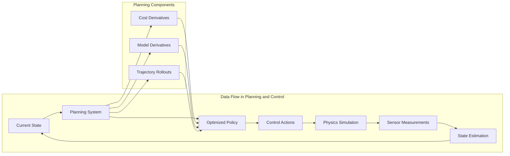

Key aspects of the data flow:

1. **State Representation**: The system state includes position, velocity, and actuation states, stored in the `State` class.

2. **Policy Optimization**: Planners use the current state to optimize a policy through various algorithms (sampling-based, gradient-based, etc.).

3. **Action Execution**: The optimized policy generates control actions that are applied to the simulated (or real) system.

4. **Feedback Loop**: The system's response to actions is measured, estimated, and fed back into the planning process.

5. **Residual Functions**: Tasks define objective functions that map state and action trajectories to costs, which guide the optimization process.

Data is passed between threads using thread-safe mechanisms, with careful consideration for when data is accessed and modified.

Sources: [mjpc/utilities.h:77-122](mjpc/utilities.h:77-122), [mjpc/agent.cc:284-356](mjpc/agent.cc:284-356), [mjpc/planners/sampling/planner.cc:155-222](mjpc/planners/sampling/planner.cc:155-222)

## Component Relationships

The relationships between components are carefully designed to enable flexible and extensible control:

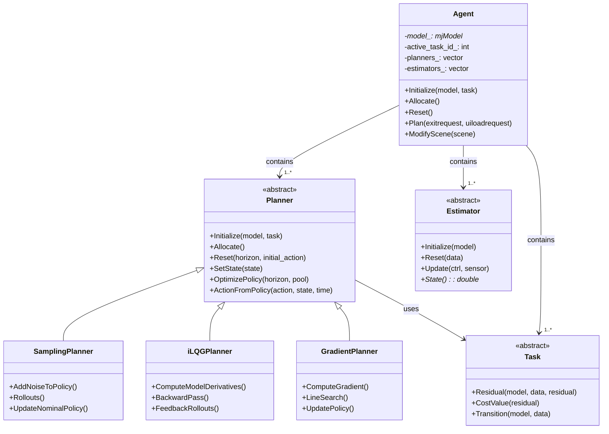

Key design aspects:

1. **Polymorphic Components**: Planners, estimators, and tasks are defined through abstract interfaces, allowing for multiple implementations and runtime selection.

2. **Shared Resources**: Components share access to MuJoCo models and data, with appropriate synchronization.

3. **Extension Points**: The architecture allows adding new planners, estimators, and tasks without modifying core components.

4. **Configuration System**: Components can be configured through model parameters, making it easy to customize behavior.

Sources: [mjpc/agent.h:45-176](mjpc/agent.h:45-176), [mjpc/planners/planner.h:31-102](mjpc/planners/planner.h:31-102), [mjpc/estimators/estimator.h:32-98](mjpc/estimators/estimator.h:32-98)

## Integration with MuJoCo

The system integrates deeply with the MuJoCo physics engine, leveraging its capabilities for simulation and gradient computation:

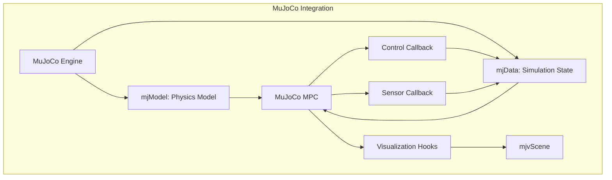

Key integration points:

1. **Physics Models**: The system uses MuJoCo's XML model format for defining robot kinematics, dynamics, and environment properties.

2. **Callbacks**: Custom control and sensor callbacks integrate MPC policies and objective functions with MuJoCo's simulation.

3. **Differentiation**: MuJoCo's finite differencing facilities are used to compute dynamics derivatives for optimization.

4. **Visualization**: The system extends MuJoCo's visualization to display trajectories, state estimates, and performance metrics.

5. **State Management**: MuJoCo's state representation (positions, velocities, actuator states) is mapped to the system's internal state representation.

The integration allows leveraging MuJoCo's efficiency and accuracy while adding sophisticated planning and control capabilities.

Sources: [mjpc/utilities.cc:59-75](mjpc/utilities.cc:59-75), [mjpc/app.cc:79-102](mjpc/app.cc:79-102), [mjpc/app.cc:105-126](mjpc/app.cc:105-126)

## Python API and gRPC Services

The system provides a Python API for ease of use, implemented through gRPC services:

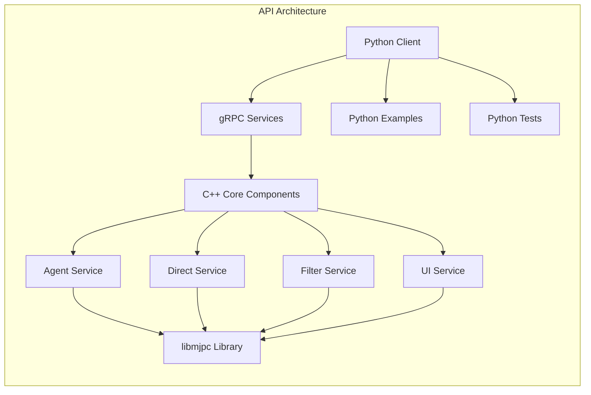

The API architecture enables:

1. **Language-Independent Interface**: The gRPC interface allows controlling the system from Python and potentially other languages.

2. **High-Performance Core**: Performance-critical components remain in C++ while providing a user-friendly interface.

3. **Testing and Examples**: The Python API makes it easier to create tests and usage examples.

4. **Remote Operation**: gRPC services can be deployed remotely, allowing separation of computation and visualization.

This architecture makes the system accessible to researchers and users who prefer Python while maintaining the performance benefits of C++.

Sources: [mjpc/app.cc:30-54](mjpc/app.cc:30-54), [mjpc/app.cc:389-508](mjpc/app.cc:389-508)

## System Configuration and Initialization

The system initialization flow establishes all components and their relationships:

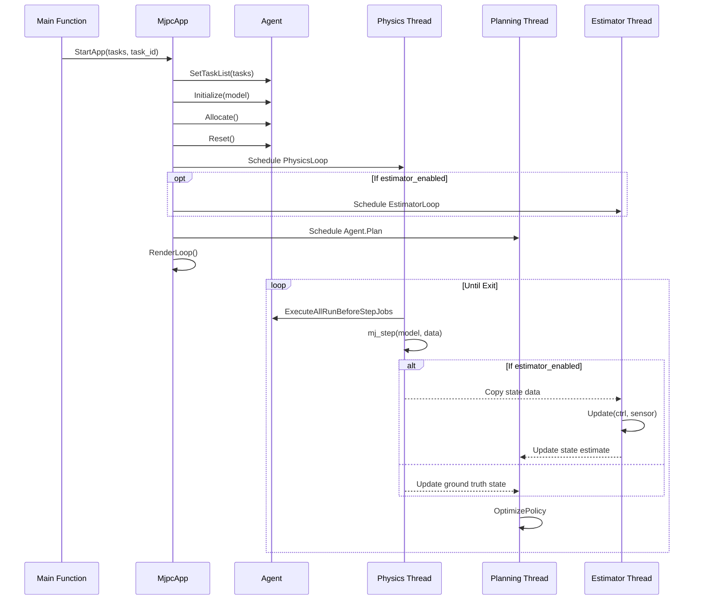

Key initialization steps:

1. **Task Configuration**: Tasks are loaded and configured, defining objectives and environments.

2. **Model Loading**: MuJoCo models are loaded from XML files or created programmatically.

3. **Component Initialization**: The agent, planners, estimators, and state representations are initialized.

4. **Thread Setup**: Threads for physics, planning, estimation, and rendering are created and started.

5. **Configuration Parameters**: Parameters from the MuJoCo model customize component behavior.

The initialization process is designed to be flexible, allowing for runtime reconfiguration and model loading.

Sources: [mjpc/main.cc:40-70](mjpc/main.cc:40-70), [mjpc/app.cc:389-456](mjpc/app.cc:389-456), [mjpc/agent.cc:70-118](mjpc/agent.cc:70-118)

## Performance Considerations

The architecture incorporates several features to ensure high performance:

1. **Parallel Processing**: Multi-threading enables concurrent physics simulation, planning, and estimation.

2. **Efficient Rollouts**: Trajectory rollouts are parallelized using thread pools.

3. **Memory Management**: Careful allocation and reuse of memory reduces overhead.

4. **Adaptive Complexity**: Planning complexity adapts based on available time and computational resources.

5. **Configurable Precision**: Trade-offs between accuracy and speed can be configured.

These considerations make the system suitable for real-time control applications, where computational efficiency is crucial.

Sources: [mjpc/agent.cc:283-356](mjpc/agent.cc:283-356), [mjpc/planners/sampling/planner.cc:155-222](mjpc/planners/sampling/planner.cc:155-222), [mjpc/threadpool.h](mjpc/threadpool.h)

## Summary Table of Key Components

| Component | Purpose | Key Classes | Responsibilities |
|-----------|---------|-------------|------------------|
| Agent | System orchestration | `Agent` | Coordinate planning, estimation, and execution |
| Planners | Trajectory optimization | `SamplingPlanner`, `iLQGPlanner`, `GradientPlanner` | Generate optimal control actions |
| Estimators | State estimation | `GroundTruth`, `BatchEstimator` | Estimate system state from observations |
| Tasks | Define objectives | `Task` | Specify cost functions and transitions |
| Threading | Parallel execution | `ThreadPool` | Manage concurrent processing |
| MuJoCo Integration | Physics simulation | `mjModel`, `mjData` | Simulate system dynamics |
| Python API | User interface | gRPC services | Provide programmatic access |

The MuJoCo MPC architecture provides a flexible, efficient framework for implementing model predictive control, with multiple planning and estimation algorithms, support for various tasks, and integration with the MuJoCo physics engine. This modular design enables both research experimentation and practical applications in robotics control.

---

# Page: Threading Model

# Threading Model

<details>
<summary>Relevant source files</summary>

The following files were used as context for generating this wiki page:

- [mjpc/agent.cc](mjpc/agent.cc)
- [mjpc/agent.h](mjpc/agent.h)
- [mjpc/app.cc](mjpc/app.cc)
- [mjpc/app.h](mjpc/app.h)
- [mjpc/main.cc](mjpc/main.cc)
- [mjpc/planners/planner.cc](mjpc/planners/planner.cc)
- [mjpc/simulate.cc](mjpc/simulate.cc)
- [mjpc/simulate.h](mjpc/simulate.h)

</details>


This document details the multi-threaded architecture of MuJoCo MPC, explaining how different threads work together to enable real-time model predictive control. It covers the main thread types, their interactions, synchronization mechanisms, and how parallel computation is managed.

## Thread Architecture Overview

MuJoCo MPC operates with a multi-threaded design consisting of several specialized threads that run concurrently:

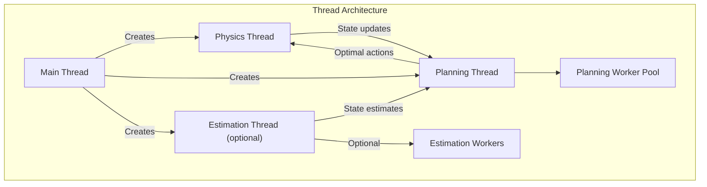

Sources: [mjpc/app.cc:464-503](), [mjpc/agent.cc:358-371]()

## Core Threads and Their Roles

MuJoCo MPC uses four primary thread types, each with distinct responsibilities:

1. **Main Thread**:
   - Initializes the system
   - Creates and manages other threads
   - Handles rendering and user interface
   - Processes user input

2. **Physics Thread**:
   - Executes the MuJoCo simulation
   - Applies control actions to simulated systems
   - Maintains physical state representation
   - Computes task residuals during simulation

3. **Planning Thread**:
   - Generates optimal control policies
   - Coordinates parallel trajectory rollouts
   - Evaluates candidate trajectories
   - Selects best actions based on optimization criteria

4. **Estimation Thread** (optional):
   - Processes sensor data
   - Estimates system state when direct observation is unavailable
   - Maintains filter-based state representation

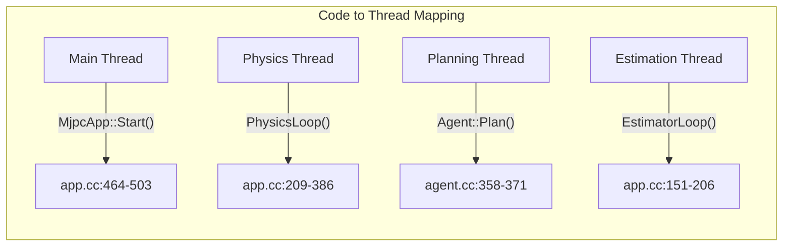

Sources: [mjpc/app.cc:464-503](), [mjpc/app.cc:209-386](), [mjpc/agent.cc:358-371](), [mjpc/app.cc:151-206]()

## Thread Creation and Management

Threads are created and initialized in the `MjpcApp::Start()` method using thread pools:

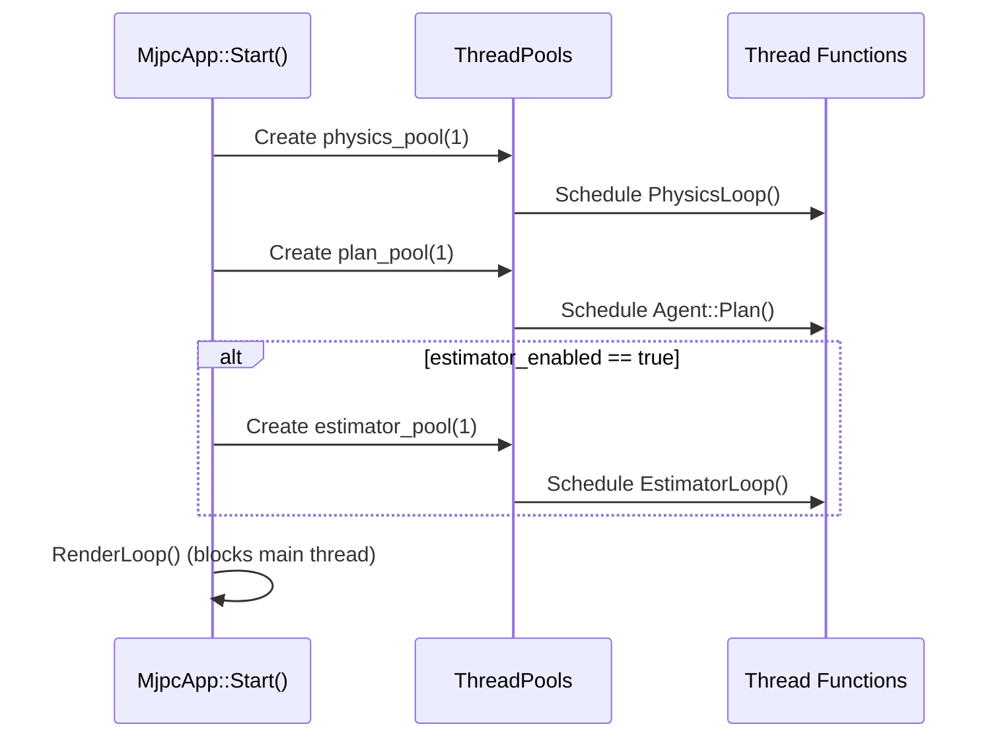

The thread creation code is implemented in the `MjpcApp::Start()` method:

```
// start physics thread
mjpc::ThreadPool physics_pool(1);
physics_pool.Schedule([]() { PhysicsLoop(*sim); });

// start estimator thread
mjpc::ThreadPool estimator_pool(1);
if (sim->agent->estimator_enabled) {
  estimator_pool.Schedule([]() { EstimatorLoop(*sim); });
}

// start plan thread
mjpc::ThreadPool plan_pool(1);
plan_pool.Schedule(
    []() { sim->agent->Plan(sim->exitrequest, sim->uiloadrequest); });
```

Sources: [mjpc/app.cc:483-496]()

## Thread Communication and Synchronization

### Shared State and Synchronization Mechanisms

Threads communicate through:

1. **Shared Memory**: Common data structures accessible to multiple threads
2. **Mutex Locks**: Prevent race conditions on shared data
3. **Atomic Variables**: Thread-safe signals for coordination
4. **Condition Variables**: For waiting on specific conditions

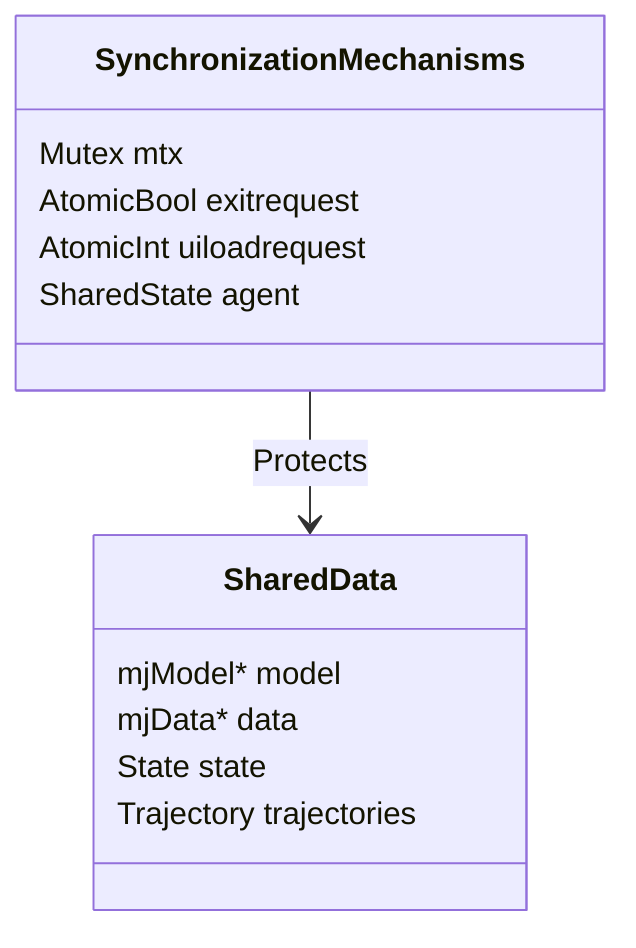

Key synchronization points:

1. **Physics and Planning**: 
   - The physics thread updates the agent's state
   - The planning thread reads this state to plan optimal actions
   - The physics thread applies actions from the planner

2. **Physics and Estimation**:
   - The physics thread provides sensor data
   - The estimation thread processes this data and updates state estimates
   - Mutex protects access to shared sensor data

Sources: [mjpc/app.cc:171-188](), [mjpc/agent.cc:365-369]()

## Parallel Planning with Worker Threads

The planning system uses a thread pool to parallelize computational work:

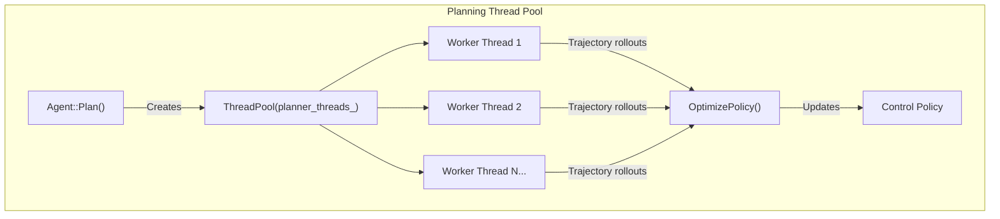

The number of planner threads is dynamically calculated based on hardware availability:

```
// planner threads
planner_threads_ = std::max(1, NumAvailableHardwareThreads() - 3 - 2 * estimator_threads_);
```

This ensures efficient use of CPU resources while leaving cores available for physics, rendering, and estimation.

Sources: [mjpc/agent.cc:153-154](), [mjpc/agent.cc:363-323]()

## Thread Execution Flow

Each thread follows a specific execution pattern:

### Physics Thread Loop

```mermaid
flowchart TD
    PhysicsStart["PhysicsLoop() Start"] --> CheckExit["Check exitrequest"]
    CheckExit --> |"exitrequest == true"| PhysicsEnd["End Thread"]
    CheckExit --> |"exitrequest == false"| CheckModel["Check model loaded"]
    CheckModel --> |"model exists"| SimLock["Lock simulation mutex"]
    SimLock --> RunTransition["Task::Transition()"]
    RunTransition --> CheckRun["Check if simulation running"]
    CheckRun --> |"run == true"| ExecuteJobs["Execute RunBeforeStep jobs"]
    ExecuteJobs --> StepPhysics["mj_step()"]
    StepPhysics --> ReleaseLock["Release mutex"]
    ReleaseLock --> UpdateState["Update agent state"]
    UpdateState --> CheckExit
    CheckRun --> |"run == false"| ApplyPose["Apply pose perturbations"]
    ApplyPose --> ExecuteJobs
```

Sources: [mjpc/app.cc:209-386]()

### Planning Thread Loop

```mermaid
flowchart TD
    PlanStart["Agent::Plan() Start"] --> InitPool["Initialize ThreadPool"]
    InitPool --> CheckExit["Check exitrequest"]
    CheckExit --> |"exitrequest == true"| PlanEnd["End Thread"]
    CheckExit --> |"exitrequest == false"| CheckModel["Check model/UI status"]
    CheckModel --> |"Model loaded, UI ready"| PlanIteration["PlanIteration(&pool)"]
    PlanIteration --> CheckExit
```

Sources: [mjpc/agent.cc:359-371](), [mjpc/agent.cc:283-357]()

### Estimation Thread Loop

```mermaid
flowchart TD
    EstStart["EstimatorLoop() Start"] --> CheckExit["Check exitrequest"]
    CheckExit --> |"exitrequest == true"| EstEnd["End Thread"]
    CheckExit --> |"exitrequest == false"| CheckEstimator["Check active estimator"]
    CheckEstimator --> |"No active estimator"| Yield["Thread yield"]
    Yield --> CheckExit
    CheckEstimator --> |"Active estimator"| StartTimer["Start computation timer"]
    StartTimer --> SetGUI["Set GUI data"]
    SetGUI --> LockPhysics["Lock physics thread"]
    LockPhysics --> CopyState["Copy simulation state/sensors"]
    CopyState --> ReleaseLock["Release lock"]
    ReleaseLock --> UpdateFilter["Update state estimator"]
    UpdateFilter --> SetState["Set agent state from estimate"]
    SetState --> Wait["Wait for timestep"]
    Wait --> CheckExit
```

Sources: [mjpc/app.cc:151-206]()

## Thread Termination

All threads monitor the `exitrequest` atomic variable and terminate when it becomes `true`:

```
// main loop
while (!exitrequest.load()) {
  if (model_ && uiloadrequest.load() == 0) {
    PlanIteration(&pool);
  }
}  // exitrequest sent -- stop planning
```

This provides a clean shutdown mechanism when the application is closing.

Sources: [mjpc/agent.cc:365-371]()

## Coordination Between Physics and GUI Threads

The physics and GUI threads coordinate through a synchronization mechanism that ensures consistent frame rates while maximizing physics throughput:

```mermaid
sequenceDiagram
    participant Physics as Physics Thread
    participant Sync as Synchronization Point
    participant GUI as GUI Thread
    
    Note over Physics,GUI: Time Synchronization
    
    Physics->>Sync: Record syncCPU time
    Physics->>Sync: Record syncSim time
    
    loop Until CPU time caught up
        Physics->>Physics: mj_step()
        Physics->>Sync: Update simulation time
    end
    
    GUI->>Sync: Read latest physics state
    GUI->>GUI: Render frame
```

The physics thread uses a timing mechanism to maintain real-time performance or specified slowdown factors:

```
// requested slow-down factor
double slowdown = 100 / sim.percentRealTime[sim.real_time_index];

// step while sim lags behind cpu and within refreshTime
while (Seconds((d->time - syncSim) * slowdown) <
            mj::Simulate::Clock::now() - syncCPU &&
        mj::Simulate::Clock::now() - startCPU <
            Seconds(refreshTime)) {
    // simulation steps
}
```

Sources: [mjpc/app.cc:307-343]()

## Thread Safety Considerations

The codebase implements several thread safety mechanisms:

1. **Mutex Protection**: Shared data access is protected by mutexes
   ```
   const std::lock_guard<std::mutex> lock(sim.mtx);
   ```

2. **Atomic Variables**: Status flags use atomic variables for thread-safe updates
   ```
   std::atomic_bool exitrequest = false;
   std::atomic_int uiloadrequest = 0;
   ```

3. **Thread-Local Data**: Each worker thread operates on its own copy of `mjData` to prevent contention

4. **Lock-Free Operations**: Performance-critical sections use lock-free algorithms where possible

Sources: [mjpc/app.cc:171-173](), [mjpc/agent.cc:383-385]()

## Thread Configuration

The number of threads used for different components is determined at runtime based on hardware availability:

| Thread Type | Count | Determination |
|-------------|-------|--------------|
| Physics | 1 | Fixed |
| Main/Rendering | 1 | Fixed |
| Planning | 1 | Fixed control thread |
| Planning Workers | Variable | `NumAvailableHardwareThreads() - 3 - 2 * estimator_threads_` |
| Estimation | 0 or 1 | Based on `estimator_enabled` flag |
| Estimation Workers | 0 or 2 | If estimator enabled |

This configuration ensures efficient use of available CPU resources while maintaining responsive control.

Sources: [mjpc/agent.cc:153-154](), [mjpc/app.cc:467-471]()

---

# Page: Data Flow

# Data Flow

<details>
<summary>Relevant source files</summary>

The following files were used as context for generating this wiki page:

- [mjpc/agent.cc](mjpc/agent.cc)
- [mjpc/agent.h](mjpc/agent.h)
- [mjpc/app.cc](mjpc/app.cc)
- [mjpc/app.h](mjpc/app.h)
- [mjpc/main.cc](mjpc/main.cc)
- [mjpc/planners/ilqg/policy.cc](mjpc/planners/ilqg/policy.cc)
- [mjpc/planners/ilqg/policy.h](mjpc/planners/ilqg/policy.h)
- [mjpc/planners/ilqg/settings.h](mjpc/planners/ilqg/settings.h)
- [mjpc/planners/planner.cc](mjpc/planners/planner.cc)
- [mjpc/simulate.cc](mjpc/simulate.cc)
- [mjpc/simulate.h](mjpc/simulate.h)
- [mjpc/task.cc](mjpc/task.cc)
- [mjpc/task.h](mjpc/task.h)
- [mjpc/tasks/panda/panda.cc](mjpc/tasks/panda/panda.cc)
- [mjpc/tasks/quadrotor/quadrotor.cc](mjpc/tasks/quadrotor/quadrotor.cc)
- [mjpc/tasks/quadrotor/quadrotor.h](mjpc/tasks/quadrotor/quadrotor.h)
- [mjpc/tasks/quadruped/quadruped.cc](mjpc/tasks/quadruped/quadruped.cc)
- [mjpc/tasks/quadruped/quadruped.h](mjpc/tasks/quadruped/quadruped.h)
- [mjpc/tasks/swimmer/swimmer.cc](mjpc/tasks/swimmer/swimmer.cc)
- [mjpc/tasks/swimmer/swimmer.h](mjpc/tasks/swimmer/swimmer.h)
- [mjpc/test/agent/rollout_test.cc](mjpc/test/agent/rollout_test.cc)
- [mjpc/test/testdata/particle_residual.h](mjpc/test/testdata/particle_residual.h)
- [mjpc/trajectory.cc](mjpc/trajectory.cc)
- [mjpc/trajectory.h](mjpc/trajectory.h)

</details>


This page explains how data flows between the major components in the MuJoCo MPC system, from state estimation through planning to action selection. It provides an overview of the data pathways between physics simulation, state estimation, planning, and control. For information about the threading model that governs when these components execute, see [Threading Model](#2.1).

## System Overview and Data Flow

The MuJoCo MPC framework implements Model Predictive Control through several interconnected components that exchange data in a specific flow. The following diagram illustrates the high-level data flow between major components:

```mermaid
flowchart TB
    subgraph "Physics Thread"
        Physics["Physics Simulation"]
        SensorCallback["Sensor Callback"]
    end

    subgraph "Estimator Thread"
        Estimator["State Estimator"]
    end

    subgraph "Planning Thread"
        Planner["Planner"]
        Policy["Policy"]
        Trajectory["Trajectory"]
    end

    subgraph "Physics & UI Thread"
        Controller["Controller Callback"]
        ControlAction["Control Action"]
    end

    Physics --> SensorCallback
    SensorCallback --> Residual["Task Residual"]
    Residual --> |"sensordata"| Physics

    Physics --> |"state, ctrl, sensor data"| Estimator
    Estimator --> |"state estimate"| StateData["Agent State"]

    StateData --> Planner
    Task["Task Specification"] --> Planner
    Planner --> Trajectory
    Trajectory --> Policy
    
    StateData --> Controller
    Policy --> Controller
    Controller --> ControlAction
    ControlAction --> Physics
```

Sources: [mjpc/agent.cc:359-371](), [mjpc/app.cc:151-206](), [mjpc/app.cc:209-386]()

## Core Data Structures

The following data structures are central to the data flow in MuJoCo MPC:

| Data Structure | Description | Location |
|----------------|-------------|----------|
| `mjData` | MuJoCo's physics state | Managed by MuJoCo |
| `mjpc::State` | Agent's representation of current state | Agent::state |
| `mjpc::Trajectory` | Sequence of states, actions, costs over time | Planner::trajectory |
| `ResidualFn` | Task cost computation | Task::residual |
| `Sensor data` | Raw sensor readings from physics | mjData::sensordata |
| `Control signals` | Control actions to be applied | mjData::ctrl |

Sources: [mjpc/agent.h:182](), [mjpc/trajectory.h:78-87](), [mjpc/task.h:37-50]()

## Detailed Data Flow

### State Estimation Flow

```mermaid
sequenceDiagram
    participant Physics as "Physics Thread"
    participant Estimator as "Estimator Thread"
    participant AgentState as "Agent State"
    participant Planner as "Planning Thread"

    Physics->>Physics: Step physics simulation
    Physics->>Estimator: Copy simulation data (ctrl, sensor)
    Note over Physics,Estimator: Data transfer through mutex-protected variables
    Estimator->>Estimator: Update state estimate
    Estimator->>AgentState: Update agent state
    AgentState->>Planner: Provide current state for planning
```

The state estimation flow involves:

1. Physics thread advances the simulation and generates sensor data
2. Estimator thread copies this data (under mutex protection)
3. Estimator updates its internal state representation
4. The updated state is stored in the agent's state structure
5. This state is used by the planner to generate new plans

Sources: [mjpc/app.cc:151-206](), [mjpc/agent.h:182-188]()

### Planning Data Flow

```mermaid
flowchart TD
    State["Agent State"] --> Planner
    TaskSpec["Task Specification"] --> Planner
    Planner --> OptimizePolicy["OptimizePolicy()"]
    OptimizePolicy --> Trajectory["Trajectory Rollout"]
    Trajectory --> ResidualFn["Residual Function"]
    ResidualFn --> Cost["Cost Computation"]
    Cost --> UpdatePolicy["Update Policy"]
    UpdatePolicy --> Policy["Best Policy"]
    
    Policy --> |"Accessed by Controller"| ActionSelection["ActionFromPolicy()"]
    State --> ActionSelection
    ActionSelection --> Control["Control Action"]
```

The planning data flow includes:

1. The planner receives the current state and task specification
2. The planner optimizes a policy by:
   - Generating candidate trajectories
   - Computing costs using the task's residual function
   - Selecting the best trajectory
   - Updating the policy based on the best trajectory
3. The policy is then available to the controller

Sources: [mjpc/agent.cc:282-342](), [mjpc/trajectory.cc:52-326]()

### Action Selection Data Flow

```mermaid
sequenceDiagram
    participant P as "Physics Thread"
    participant C as "Controller Callback"
    participant A as "Agent"
    participant Pl as "Planner"

    P->>C: Call controller callback
    C->>A: Check if action_enabled
    A->>Pl: Request action from policy
    Pl->>Pl: Interpolate best trajectory
    Pl->>C: Return appropriate action
    C->>P: Apply control to physics simulation
```

The action selection flow is:

1. The physics thread calls the controller callback
2. The callback checks if action is enabled in the agent
3. If enabled, it requests the appropriate action from the planner
4. The planner interpolates the best trajectory to get the action
5. The action is applied to the physics simulation

Sources: [mjpc/app.cc:79-102]()

## Data Flow During Task Transitions

```mermaid
flowchart LR
    subgraph "Task"
        TaskMode["Task Mode"]
        Parameters["Parameters"]
        Weights["Weights"]
        ResidualFn["Residual Function"]
    end

    Physics["Physics Simulation"] -->|"state data"| TaskTransition["Task Transition"]
    TaskTransition -->|"update"| TaskMode
    TaskMode -->|"modify"| Parameters
    TaskMode -->|"modify"| Weights
    
    Parameters -->|"configure"| ResidualFn
    Weights -->|"configure"| ResidualFn
    ResidualFn -->|"compute costs"| Planning["Planning System"]
```

Task transitions affect data flow by:

1. The task monitors the physics state to determine transitions
2. When a transition occurs, the task updates its mode
3. This can modify parameters and weights that configure the residual function
4. The residual function is used to compute costs during planning

Sources: [mjpc/task.cc:141-145](), [mjpc/tasks/quadruped/quadruped.cc:229-395]()

## Residual Function Data Flow

The residual function is a central component in the data flow that computes task costs. Here's how data flows through it:

```mermaid
flowchart LR
    Physics["Physics Data\nmjData"] -->|"state variables"| SensorCallback["Sensor Callback"]
    SensorCallback -->|"compute"| Residual["Task::Residual()"]
    Residual -->|"store in"| SensorData["mjData::sensordata"]
    
    SensorData -->|"read during"| Planning["Planning/Rollout"]
    Planning -->|"compute"| CostValue["Task::CostValue()"]
    CostValue -->|"optimize"| Policy["Policy"]
```

Key points:

1. The sensor callback uses the current physics state to compute residuals
2. Residuals are stored in the MuJoCo sensor data buffer
3. During planning, these residuals are used to compute cost values
4. Cost values guide the optimization of the policy

Sources: [mjpc/app.cc:105-126](), [mjpc/task.cc:258-261](), [mjpc/trajectory.cc:316-326]()

## Data Communication Between Threads

```mermaid
flowchart TD
    subgraph "Physics Thread"
        PhysicsState["Physics State"]
        ControlAction["Control Action"]
    end
    
    subgraph "Estimator Thread"
        EstimatorState["Estimator State"]
        EstimatorUpdate["Update()"]
    end
    
    subgraph "Planning Thread"
        PlannerState["Planner State"]
        PlannerOptimize["OptimizePolicy()"]
    end
    
    subgraph "Shared Data (Protected by Mutex)"
        AgentState["Agent State"]
        AgentCtrl["Agent ctrl"]
        AgentSensor["Agent sensor"]
        BestTrajectory["Best Trajectory"]
    end
    
    PhysicsState -->|"copy under mutex"| AgentCtrl
    PhysicsState -->|"copy under mutex"| AgentSensor
    AgentCtrl -->|"read"| EstimatorUpdate
    AgentSensor -->|"read"| EstimatorUpdate
    
    EstimatorUpdate -->|"update"| EstimatorState
    EstimatorState -->|"copy to"| AgentState
    
    AgentState -->|"read"| PlannerOptimize
    PlannerOptimize -->|"update"| BestTrajectory
    
    BestTrajectory -->|"read for action"| ControlAction
    ControlAction -->|"apply to"| PhysicsState
```

Thread communication is managed by:

1. Mutexes protect shared data access between threads
2. Physics data is copied to thread-safe buffers
3. Estimator and planner read from these buffers
4. Updated state and trajectories are stored in thread-safe locations
5. Controller reads the best trajectory to determine actions

Sources: [mjpc/app.cc:171-188](), [mjpc/app.cc:275-277](), [mjpc/agent.cc:90-215]()

## Planning and Rollout Data Flow

```mermaid
flowchart TB
    subgraph "Planning Process"
        direction TB
        State["Initial State"] --> RolloutFunction["Trajectory.Rollout()"]
        Policy["Current Policy"] --> RolloutFunction
        RolloutFunction --> SimulateModel["Simulate Model Forward"]
        SimulateModel --> ComputeResiduals["Compute Residuals"]
        ComputeResiduals --> CostTerms["Compute Cost Terms"]
        CostTerms --> TotalReturn["Compute Total Return"]
        TotalReturn --> UpdatePolicy["Update Policy"]
        UpdatePolicy --> NewPolicy["New Policy"]
    end
    
    Task["Task Specification"] --> RolloutFunction
    MuJoCo["MuJoCo Physics Engine"] --> SimulateModel
    NewPolicy --> |"Next iteration"| Policy
```

Planning data flow details:

1. Starting from the current state, the planner rolls out trajectories
2. The MuJoCo physics engine simulates the system dynamics
3. The task's residual function computes costs for each state
4. Total costs guide policy updates
5. The process iterates to optimize the policy

Sources: [mjpc/trajectory.cc:95-210](), [mjpc/trajectory.cc:310-326]()

## Policy Representation and Application

Different planners represent policies differently:

| Planner | Policy Representation | Data Stored |
|---------|----------------------|------------|
| Sampling Planner | Nominal trajectory | States, actions, times |
| iLQG Planner | Nominal trajectory + feedback gains | States, actions, times, feedback matrices |
| Gradient Planner | Parameter vector | Policy parameters |
| Cross Entropy Planner | Distribution parameters | Mean, covariance |

When a policy is applied, data flows as follows:

```mermaid
flowchart LR
    CurrentState["Current State"] --> ActionFromPolicy["ActionFromPolicy()"]
    CurrentTime["Current Time"] --> ActionFromPolicy
    
    subgraph "Policy Data"
        NominalTrajectory["Nominal Trajectory"]
        FeedbackGains["Feedback Gains (if available)"]
    end
    
    NominalTrajectory --> Interpolation["Interpolation"]
    Interpolation --> NominalAction["Nominal Action"]
    
    CurrentState --> StateDifference["State Difference"]
    NominalTrajectory --> StateDifference
    StateDifference --> FeedbackTerm["Feedback Term"]
    FeedbackGains --> FeedbackTerm
    
    NominalAction --> FinalAction["Final Action"]
    FeedbackTerm --> FinalAction
    
    FinalAction --> ClampControls["Clamp to Control Limits"]
    ClampControls --> ApplyAction["Apply to Physics"]
```

Sources: [mjpc/planners/ilqg/policy.cc:81-161](), [mjpc/app.cc:79-102]()

## Data Flow Summary

The MuJoCo MPC system's data flow can be summarized as:

1. **State information** flows from the physics simulation to the estimator and then to the planner
2. **Planning data** flows from the task specification and current state to generate optimal policies
3. **Control commands** flow from the policy to the physics simulation
4. **Task parameters** flow from the task specification to configure the residual function
5. **Cost information** flows from the residual function to guide planning optimization

This integrated data flow enables the system to continuously sense, plan, and act in a closed-loop control system.

Sources: [mjpc/agent.cc](), [mjpc/app.cc](), [mjpc/task.cc](), [mjpc/trajectory.cc]()

---

# Page: Agent System

# Agent System

<details>
<summary>Relevant source files</summary>

The following files were used as context for generating this wiki page:

- [mjpc/agent.cc](mjpc/agent.cc)
- [mjpc/agent.h](mjpc/agent.h)
- [mjpc/app.cc](mjpc/app.cc)
- [mjpc/app.h](mjpc/app.h)
- [mjpc/main.cc](mjpc/main.cc)
- [mjpc/planners/planner.cc](mjpc/planners/planner.cc)
- [mjpc/simulate.cc](mjpc/simulate.cc)
- [mjpc/simulate.h](mjpc/simulate.h)

</details>


The Agent System is the central orchestration component within MuJoCo MPC. It coordinates planning, execution, state estimation, and task management to implement Model Predictive Control for robotic systems. The Agent manages the interaction between planners, estimators, tasks, and the MuJoCo physics engine within a concurrent execution framework.

For information about the overall system architecture, see [System Architecture](#2). For details on planners, estimators, and tasks that the Agent uses, see [Planners](#4), [Estimators](#5), and [Tasks](#6) respectively.

## Overview and Core Responsibilities

The Agent System serves as the central coordinator of the Model Predictive Control (MPC) framework with the following core responsibilities:

1. **Planning Coordination**: Manages the planning process, delegating optimization to specialized planners
2. **State Management**: Tracks and updates the current system state
3. **Action Selection**: Derives control actions from optimized policies
4. **Task Integration**: Handles tasks and their associated cost functions
5. **Estimation**: Coordinates state estimation when full state information is not directly observable

```mermaid
graph TD
    subgraph "Agent System"
        Agent["Agent Class"]
        State["State Management"]
        AgentPlots["Visualization"]
        PlannerInterface["Planner Interface"]
        EstimatorInterface["Estimator Interface"]
        TaskInterface["Task Interface"]
        Tasks["Active Task"]
    end

    subgraph "External Systems"
        MuJoCo["MuJoCo Physics"]
        Planners["Planners (iLQG, Sampling, etc.)"]
        Estimators["Estimators (Kalman, Batch, etc.)"]
        TaskLibrary["Task Library"]
        UI["UI System"]
    end

    Agent --> State
    Agent --> AgentPlots
    Agent --> PlannerInterface
    Agent --> EstimatorInterface
    Agent --> TaskInterface
    Agent --> Tasks

    PlannerInterface --> Planners
    EstimatorInterface --> Estimators
    TaskInterface --> TaskLibrary
    Agent <--> MuJoCo
    Agent <--> UI
```

Sources: [mjpc/agent.h:15-256](), [mjpc/agent.cc:15-1166]()

## Threading Model and Execution Flow

The Agent System operates using a multi-threaded architecture to parallelize computation-intensive tasks. It uses three primary threads:

1. **Physics Thread**: Executes MuJoCo simulation steps and applies control actions
2. **Planning Thread**: Continuously optimizes control policies in the background
3. **Estimation Thread** (optional): Updates state estimates based on sensor readings

The Agent carefully manages thread synchronization to ensure consistent data access across threads.

```mermaid
sequenceDiagram
    participant Physics as "Physics Thread"
    participant Agent as "Agent"
    participant Planning as "Planning Thread"
    participant Estimation as "Estimation Thread"
    
    Note over Agent: Initialization
    Agent->>Agent: Initialize(model)
    Agent->>Agent: Allocate()
    Agent->>Agent: Reset()
    
    Note over Agent,Planning: Continuous Execution
    
    loop Main Control Loop
        Physics->>Agent: SetState(data)
        alt Has Estimator
            Estimation->>Agent: Update(ctrl, sensor)
            Estimation->>Agent: State()
        end
        
        Planning->>Agent: PlanIteration(pool)
        Physics->>Agent: ActionFromPolicy(ctrl, state, time)
        Physics->>Physics: Step Physics
    end
```

Sources: [mjpc/app.cc:129-206](), [mjpc/app.cc:208-386](), [mjpc/agent.cc:359-394]()

## Agent Initialization and Configuration

The Agent is initialized with a physics model and task, setting up the planning and estimation systems. The initialization process configures internal parameters like planning horizon, time step, and thread allocation.

```mermaid
flowchart TD
    Start["Start"] --> Constructor["Agent(model, task)"]
    Constructor --> Initialize["Initialize(model)"]
    Initialize --> ModelCopy["Create Model Copy"]
    Initialize --> TaskInit["Initialize Task"]
    Initialize --> PlannerInit["Initialize Planners"]
    Initialize --> StateInit["Initialize State"]
    Initialize --> EstimatorInit["Initialize Estimators"]
    
    ModelCopy --> Allocate["Allocate()"]
    TaskInit --> Allocate
    PlannerInit --> Allocate
    StateInit --> Allocate
    EstimatorInit --> Allocate
    
    Allocate --> Reset["Reset()"]
    Reset --> PlotInit["PlotInitialize()"]
    PlotInit --> PlotReset["PlotReset()"]
    PlotReset --> Ready["Ready for Planning"]
```

Key initialization parameters:
- **Planning Horizon**: Time span for prediction and optimization
- **Time Step**: Simulation step size for trajectory rollouts
- **Integrator**: Numerical integration method
- **Threads**: Number of threads for planning and estimation

Sources: [mjpc/agent.cc:60-174](), [mjpc/app.cc:391-457]()

## Planning Process

The Agent's planning process is executed in a dedicated thread and involves:

1. Setting up the planning model with current state and parameters
2. Executing the selected planner's optimization algorithm
3. Computing trajectories and associated costs
4. Updating the policy for action selection

```mermaid
flowchart TD
    subgraph "Planning Thread"
        Plan["Plan()"] --> PlanIteration["PlanIteration(pool)"]
        PlanIteration --> ModelConfig["Set Model Parameters"]
        ModelConfig --> SetState["Set Planner State"]
        SetState --> CopyResidual["Copy Task Residual"]
        CopyResidual --> OptimizePolicy["Planner.OptimizePolicy()"]
        OptimizePolicy --> ComputeTimes["Compute Times"]
    end
    
    subgraph "Physics Thread"
        PhysicsStep["Physics Step"] --> GetAction["Get Action from Policy"]
        GetAction --> ApplyControl["Apply Control to Model"]
        ApplyControl --> UpdateState["Update State"]
        UpdateState --> PhysicsStep
    end
```

The planning process uses a thread pool to parallelize trajectory rollouts and cost evaluations, enabling efficient utilization of available CPU cores.

Sources: [mjpc/agent.cc:283-357](), [mjpc/agent.cc:359-394]()

## State Management and Action Selection

The Agent maintains the current state of the system and selects actions based on optimized policies:

1. **State Representation**: Includes position, velocity, acceleration, time, mocap data, and user data
2. **State Updates**: Can come from direct measurement or estimation
3. **Action Selection**: The planner's current policy maps states to actions

```mermaid
classDiagram
    class Agent {
        +State state
        +std::vector~double~ sensor
        +std::vector~double~ ctrl
        +SetState(data)
        +ActionFromPolicy(ctrl, state, time)
        +ActivePlanner()
        +ActiveEstimator()
        +ActiveTask()
    }
    
    class State {
        +state()
        +Set(model, data)
        +Initialize(model)
        +Allocate(model)
        +Reset()
        +time()
    }
    
    Agent *-- State : contains
```

The Agent implements a controller callback that derives control actions from the current optimized policy based on the current state.

Sources: [mjpc/agent.cc:220-222](), [mjpc/app.cc:79-95]()

## Task Integration

The Agent manages tasks that define objectives, constraints, and dynamics for the MPC problem:

1. **Task Selection**: Can switch between multiple task types
2. **Parameter Management**: Exposes task parameters for tuning via GUI or API
3. **Transitions**: Handles mode transitions within tasks
4. **Residual Functions**: Uses task-defined residual (cost) functions for optimization

```mermaid
flowchart LR
    subgraph "Agent"
        ActiveTask["ActiveTask()"]
        SetTaskByIndex["SetTaskByIndex(id)"]
        SetParamByName["SetParamByName(name, value)"]
        SetWeightByName["SetWeightByName(name, value)"]
        SetModeByName["SetModeByName(name)"]
    end
    
    subgraph "Task Interface"
        TaskResidual["Residual(model, data, residual)"]
        TaskCostValue["CostValue(residual)"]
        TaskCostTerms["CostTerms(terms, residual)"]
        TaskTransition["Transition(model, data)"]
        TaskReset["Reset(model)"]
    end
    
    ActiveTask --> TaskResidual
    SetTaskByIndex --> ActiveTask
    SetParamByName --> TaskResidual
    SetWeightByName --> TaskCostValue
    SetModeByName --> TaskTransition
```

The Agent exposes methods to set task parameters and weights, allowing runtime tuning of the optimization problem.

Sources: [mjpc/agent.cc:395-490](), [mjpc/app.cc:110-126]()

## Visualization and Debugging

The Agent provides extensive visualization and debugging capabilities:

1. **Trajectory Visualization**: Shows predicted trajectories in the 3D scene
2. **Cost Plots**: Displays cost components over time
3. **Action Plots**: Shows control inputs over time
4. **Performance Plots**: Monitors planning and computation time

```mermaid
classDiagram
    class AgentPlots {
        +mjvFigure action
        +mjvFigure cost
        +mjvFigure planner
        +mjvFigure timer
    }
    
    class Agent {
        -AgentPlots plots_
        +PlotInitialize()
        +PlotReset()
        +Plots(data, shift)
        +PlotShow(rect, con)
        +ModifyScene(scn)
    }
    
    Agent *-- AgentPlots : contains
```

The Agent's visualization system helps debug planning behavior, analyze performance, and understand the optimization process.

Sources: [mjpc/agent.cc:831-1149](), [mjpc/agent.cc:493-564]()

## GUI Integration

The Agent provides a comprehensive GUI for interactive control and configuration:

1. **Task Configuration**: Select tasks and set parameters
2. **Planner Selection**: Choose between different planning algorithms
3. **Visualization Controls**: Toggle various visualization options
4. **Runtime Settings**: Adjust planning horizon, time step, etc.

```mermaid
flowchart TD
    subgraph "GUI Sections"
        TaskSection["Task Section"]
        AgentSection["Agent Section"]
        PlannerSection["Planner Section"]
        EstimatorSection["Estimator Section"]
    end
    
    subgraph "GUI Events"
        TaskEvent["TaskEvent()"]
        AgentEvent["AgentEvent()"]
        EstimatorEvent["EstimatorEvent()"]
    end
    
    subgraph "GUI Components"
        TaskParams["Task Parameters UI"]
        TaskWeights["Task Weights UI"]
        PlannerSettings["Planner Settings UI"]
        EstimatorSettings["Estimator Settings UI"]
        AgentSettings["Agent Settings UI"]
    end
    
    TaskSection --> TaskParams
    TaskSection --> TaskWeights
    AgentSection --> AgentSettings
    PlannerSection --> PlannerSettings
    EstimatorSection --> EstimatorSettings
    
    TaskParams --> TaskEvent
    AgentSettings --> AgentEvent
    EstimatorSettings --> EstimatorEvent
```

The GUI allows interactive experimentation with different planning settings, task parameters, and visualization options.

Sources: [mjpc/agent.cc:567-815]()

## API and Integration

The Agent exposes methods for programmatic control and integration with external systems:

```
// Core methods
void Initialize(const mjModel* model)
void Allocate()
void Reset(const double* initial_repeated_action = nullptr)
void Plan(std::atomic<bool>& exitrequest, std::atomic<int>& uiloadrequest)
void PlanIteration(ThreadPool* pool)
void SetState(const mjData* data)

// Task management
void SetTaskList(std::vector<std::shared_ptr<Task>> tasks)
void SetTaskByIndex(int id)
int SetParamByName(std::string_view name, double value)
int SetWeightByName(std::string_view name, double value)
int SetModeByName(std::string_view name)

// Accessors
mjpc::Planner& ActivePlanner() const
mjpc::Estimator& ActiveEstimator() const
Task* ActiveTask() const
```

These methods allow for programmatic control of the Agent system through C++ or via the Python bindings (through gRPC).

Sources: [mjpc/agent.h:47-256]()

## System Integration Example

The following shows how the Agent is integrated into the larger MuJoCo MPC system in the main application:

```mermaid
flowchart TD
    subgraph "Application Initialization"
        CreateAgent["Create Agent"]
        LoadTasks["Load Tasks"]
        LoadModel["Load Model"]
        InitializeAgent["Initialize Agent"]
    end
    
    subgraph "Thread Creation"
        StartPhysics["Start Physics Thread"]
        StartPlanning["Start Planning Thread"]
        StartEstimation["Start Estimation Thread"]
        StartRendering["Start Rendering Thread"]
    end
    
    subgraph "Agent Execution"
        PhysicsLoop["Physics Loop (control)"]
        PlanLoop["Plan Loop (optimization)"]
        EstimatorLoop["Estimator Loop (state estimation)"]
        RenderLoop["Render Loop (visualization)"]
    end
    
    CreateAgent --> LoadTasks
    LoadTasks --> LoadModel
    LoadModel --> InitializeAgent
    InitializeAgent --> StartPhysics
    InitializeAgent --> StartPlanning
    InitializeAgent --> StartEstimation
    InitializeAgent --> StartRendering
    
    StartPhysics --> PhysicsLoop
    StartPlanning --> PlanLoop
    StartEstimation --> EstimatorLoop
    StartRendering --> RenderLoop
```

The Agent is created during application initialization and then operates across multiple threads to perform planning, execution, and estimation in parallel.

Sources: [mjpc/app.cc:391-503](), [mjpc/main.cc:41-71]()

---

# Page: State Management

# State Management

<details>
<summary>Relevant source files</summary>

The following files were used as context for generating this wiki page:

- [mjpc/agent.cc](mjpc/agent.cc)
- [mjpc/agent.h](mjpc/agent.h)
- [mjpc/app.cc](mjpc/app.cc)
- [mjpc/app.h](mjpc/app.h)
- [mjpc/main.cc](mjpc/main.cc)
- [mjpc/planners/planner.cc](mjpc/planners/planner.cc)
- [mjpc/simulate.cc](mjpc/simulate.cc)
- [mjpc/simulate.h](mjpc/simulate.h)
- [mjpc/test/utilities/utilities_test.cc](mjpc/test/utilities/utilities_test.cc)
- [mjpc/utilities.cc](mjpc/utilities.cc)
- [mjpc/utilities.h](mjpc/utilities.h)

</details>


This page describes how state is managed in the MuJoCo MPC framework. State management refers to how the system represents, maintains, and transitions the state of both the simulation and the planning systems. This is a critical aspect of the model predictive control pipeline as it defines how state is transferred between the physics simulation, the planning algorithm, and the estimation components.

For information on the Agent system that orchestrates state management, see [Agent System](#3).

## State Representation

In MuJoCo MPC, the state is a composite representation consisting of position, velocity, and actuation variables from the MuJoCo physics engine. The system maintains state for both simulation and planning purposes, and ensures proper synchronization between these different contexts.

```mermaid
classDiagram
    class State {
        +state_ vector~double~
        +time_ double
        +Initialize(model)
        +Allocate(model)
        +Reset()
        +Set(model, data)
        +Set(model, qpos, qvel, act, mocap_pos, mocap_quat, userdata, time)
        +state() double*
        +time() double
    }
    
    class StateComponents {
        +qpos: Position states
        +qvel: Velocity states
        +act: Actuator activations
        +mocap_pos: Motion capture positions
        +mocap_quat: Motion capture quaternions 
        +userdata: User data
        +time: Simulation time
    }
    
    State o-- StateComponents
```

State data is composed of:
- **qpos**: Position states (joints, free bodies, etc.)
- **qvel**: Velocity states 
- **act**: Actuator activations
- **mocap_pos**: Motion capture positions
- **mocap_quat**: Motion capture quaternions
- **userdata**: User data
- **time**: Simulation time

Sources: [mjpc/agent.h:179-183](mjpc/agent.h:179-183), [mjpc/utilities.cc:77-89](mjpc/utilities.cc:77-89)

## State Operations

The framework provides utility functions to manipulate state data, enabling seamless transfer between MuJoCo's native data structures and the MPC system's state representation.

### Setting and Getting State

Two primary utility functions handle state operations:

```mermaid
graph LR
    subgraph "SetState Function"
        SS["SetState(model, data, state)"] --> SS1["Copy qpos from state"]
        SS1 --> SS2["Copy qvel from state"]
        SS2 --> SS3["Copy act from state"]
    end
    
    subgraph "GetState Function"
        GS["GetState(model, data, state)"] --> GS1["Copy qpos to state"]
        GS1 --> GS2["Copy qvel to state"]
        GS2 --> GS3["Copy act to state"]
    end
```

These functions map between the MuJoCo data structure (`mjData`) and the state vector used in MPC.

Sources: [mjpc/utilities.cc:77-89](mjpc/utilities.cc:77-89)

### State Initialization and Reset

The `Agent` class manages state initialization and reset:

```mermaid
sequenceDiagram
    participant Agent
    participant State
    participant Model as "MuJoCo Model"
    
    Agent->>State: "Initialize(model)"
    State-->>State: "Allocate memory for state components"
    
    Agent->>State: "Allocate(model)"
    State-->>State: "Setup state vectors"
    
    Agent->>State: "Reset()"
    State-->>State: "Reset state to defaults"
    
    Agent->>State: "Set(model, data)"
    State-->>Model: "Extract state from mjData"
    Model-->>State: "State components"
    State-->>State: "Update internal state representation"
```

Sources: [mjpc/agent.cc:118-119](mjpc/agent.cc:118-119), [mjpc/agent.cc:184](mjpc/agent.cc:184), [mjpc/agent.cc:201-202](mjpc/agent.cc:201-202), [mjpc/agent.cc:220-222](mjpc/agent.cc:220-222)

## State Management in the Planning Loop

During the planning process, state management is critical for ensuring that planners work with the correct current state of the system.

```mermaid
flowchart TD
    subgraph "Planning Process"
        A["Agent::PlanIteration"] --> B["Set state for planner"]
        B --> C["Create residual function"]
        C --> D["Optimize policy"]
        D --> E["Release residual function"]
    end
    
    subgraph "State Flow"
        SE["State Estimation"] --> |"Update state"| AP["Agent State"]
        AP --> |"Used by"| PL["Planners"]
        PL --> |"Generate"| TR["Trajectories"]
        TR --> |"Used for"| AC["Action Selection"]
    end
```

The planning loop uses the current state to:
1. Initialize the planning process with the current state
2. Simulate forward in time to evaluate potential trajectories
3. Optimize control actions based on predicted outcomes

Sources: [mjpc/agent.cc:283-314](mjpc/agent.cc:283-314), [mjpc/agent.cc:313-314](mjpc/agent.cc:313-314)

## Thread Safety and Synchronization

State management in MuJoCo MPC is designed to handle multiple threads that might read or write state data. The system employs mutex locks and atomic operations to ensure thread safety.

```mermaid
graph TD
    subgraph "Thread Architecture"
        PH["Physics Thread"] --> |"Mutually exclusive access"| SD["Shared State Data"]
        PL["Planning Thread"] --> |"Mutually exclusive access"| SD
        ES["Estimation Thread"] --> |"Mutually exclusive access"| SD
    end
    
    subgraph "Synchronization Mechanisms"
        M["Mutex Locks"] --> |"Protects"| SD
        AO["Atomic Operations"] --> |"Thread-safe updates"| CV["Control Variables"]
    end
```

Key aspects of thread synchronization:
- The physics thread updates the primary state
- The planning thread reads state for trajectory generation
- The estimation thread may update state estimates
- Mutex locks ensure exclusive access to shared state
- RunBeforeStep jobs queue is protected by mutex

Sources: [mjpc/app.cc:171-184](mjpc/app.cc:171-184), [mjpc/app.cc:275-277](mjpc/app.cc:275-277), [mjpc/app.cc:379-384](mjpc/app.cc:379-384), [mjpc/agent.cc:373-393](mjpc/agent.cc:373-393)

## State in Estimation

When state estimation is enabled, the system uses estimated state rather than ground truth from the physics simulation.

```mermaid
flowchart LR
    subgraph "State Estimation Flow"
        PT["Physics Thread"] --> |"mjData, Time, Sensors"| ET["Estimator Thread"]
        ET --> |"Update"| ES["Estimator State"]
        ES --> |"Copy to"| AS["Agent State"]
        AS --> |"Used by"| PP["Planning Process"]
    end
    
    subgraph "Estimator Types"
        GT["Ground Truth"] 
        BF["Batch Filter"]
        KF["Kalman Filter"]
        UKF["Unscented KF"]
        ES --> GT
        ES --> BF
        ES --> KF
        ES --> UKF
    end
```

In the estimation loop:
1. The physics thread provides simulation data
2. The estimator thread updates state estimates
3. The estimated state is used for planning
4. Different estimator types provide different approaches to state estimation

Sources: [mjpc/app.cc:151-205](mjpc/app.cc:151-205), [mjpc/agent.cc:379-384](mjpc/agent.cc:379-384)

## Implementation Details

### State Management in Agent Class

The `Agent` class maintains a `State` object that represents the current state of the system. It provides methods to:

1. Initialize state based on model
2. Reset state to default values
3. Set state from MuJoCo data
4. Provide state to planners

```mermaid
classDiagram
    class Agent {
        +State state
        +Initialize(model)
        +Allocate()
        +Reset()
        +SetState(data)
        +PlanIteration(pool)
    }
    
    class State {
        +Initialize(model)
        +Allocate(model)
        +Reset()
        +Set(model, data)
        +state() double*
    }
    
    Agent *-- State
```

Sources: [mjpc/agent.h:179-183](mjpc/agent.h:179-183), [mjpc/agent.cc:118-119](mjpc/agent.cc:118-119), [mjpc/agent.cc:184](mjpc/agent.cc:184), [mjpc/agent.cc:220-222](mjpc/agent.cc:220-222)

### State Utility Functions

```mermaid
graph TD
    subgraph "Utility Functions"
        SS["SetState(model, data, state)"] --> |"Sets mjData state"| MD["mjData"]
        GS["GetState(model, data, state)"] --> |"Gets mjData state"| ST["State Array"]
        ST --> |"Contains"| QP["qpos: Positions"]
        ST --> |"Contains"| QV["qvel: Velocities"]
        ST --> |"Contains"| AC["act: Activations"]
    end
```

These utility functions are used throughout the system to convert between MuJoCo's `mjData` and the state representation used by MPC.

Sources: [mjpc/utilities.cc:77-89](mjpc/utilities.cc:77-89), [mjpc/utilities.h:39-43](mjpc/utilities.h:39-43)

## Physics Integration

The physics loop in `app.cc` is responsible for advancing the simulation and updating state. It handles:

1. Running the physics simulation
2. Executing callbacks before physics steps
3. Applying perturbations
4. Synchronizing with CPU time
5. Updating the agent's state

```mermaid
sequenceDiagram
    participant PL as "Physics Loop"
    participant MD as "mjData"
    participant AG as "Agent"
    participant ST as "State"
    
    PL->>PL: "Handle UI requests"
    PL->>AG: "ExecuteAllRunBeforeStepJobs()"
    PL->>MD: "mj_step() or mj_forward()"
    
    alt No Active Estimator
        PL->>AG: "state.Set(model, data)"
        AG->>ST: "Set(model, data)"
        ST-->>ST: "Update internal state"
    else Has Active Estimator
        Note over PL,ST: Estimator thread handles state updates
    end
```

Sources: [mjpc/app.cc:209-386](mjpc/app.cc:209-386), [mjpc/app.cc:329-330](mjpc/app.cc:329-330), [mjpc/app.cc:355-356](mjpc/app.cc:355-356), [mjpc/app.cc:379-384](mjpc/app.cc:379-384)

## Summary

The state management system in MuJoCo MPC:

1. Represents state as a combination of positions, velocities, and actuator activations
2. Provides utilities to transfer state between MuJoCo and MPC components
3. Ensures thread safety through mutexes and atomic operations
4. Supports different estimation approaches
5. Integrates with the physics simulation and planning system

This design facilitates efficient model predictive control by ensuring that all components of the system work with consistent and up-to-date state information.

---

# Page: Task Integration

# Task Integration

<details>
<summary>Relevant source files</summary>

The following files were used as context for generating this wiki page:

- [mjpc/agent.cc](mjpc/agent.cc)
- [mjpc/agent.h](mjpc/agent.h)
- [mjpc/app.cc](mjpc/app.cc)
- [mjpc/app.h](mjpc/app.h)
- [mjpc/main.cc](mjpc/main.cc)
- [mjpc/planners/planner.cc](mjpc/planners/planner.cc)
- [mjpc/simulate.cc](mjpc/simulate.cc)
- [mjpc/simulate.h](mjpc/simulate.h)
- [mjpc/task.cc](mjpc/task.cc)
- [mjpc/task.h](mjpc/task.h)
- [mjpc/tasks/panda/panda.cc](mjpc/tasks/panda/panda.cc)
- [mjpc/tasks/quadrotor/quadrotor.cc](mjpc/tasks/quadrotor/quadrotor.cc)
- [mjpc/tasks/quadrotor/quadrotor.h](mjpc/tasks/quadrotor/quadrotor.h)
- [mjpc/tasks/quadruped/quadruped.cc](mjpc/tasks/quadruped/quadruped.cc)
- [mjpc/tasks/quadruped/quadruped.h](mjpc/tasks/quadruped/quadruped.h)
- [mjpc/tasks/swimmer/swimmer.cc](mjpc/tasks/swimmer/swimmer.cc)
- [mjpc/tasks/swimmer/swimmer.h](mjpc/tasks/swimmer/swimmer.h)

</details>


This document explains how tasks are integrated in the MuJoCo MPC framework. Task integration refers to how task-specific objectives, transitions, and behaviors are incorporated into the overall MPC planning and control system. The Task component defines what the agent should accomplish, while the Agent component (discussed in [Agent System](#3)) is responsible for planning and executing actions to achieve these tasks.

## Overview of the Task System

The Task system defines the core interface and implementation patterns for all control objectives in MuJoCo MPC. Tasks specify their objectives through residual functions, which are used to compute costs that the planner tries to minimize. Tasks can also define state transitions, modes of operation, and custom visualizations.

```mermaid
graph TD
    subgraph "Task Architecture"
        Task["Task Abstract Class"] --> ResidualFn["ResidualFn Interface"]
        Task --> Parameters["Task Parameters"]
        Task --> Weights["Cost Weights"]
        Task --> Transitions["Task Transitions"]
        Task --> Modes["Task Modes"]
        Task --> Visualization["Scene Visualization"]
    end
    
    subgraph "Integration Points"
        Agent["Agent"] --> Task
        Planner["Planner"] --> Task
        PhysicsLoop["Physics Loop"] --> Task
        UI["GUI System"] --> Task
    end
```

Sources: [mjpc/task.h](), [mjpc/task.cc](), [mjpc/agent.h](), [mjpc/agent.cc]()

## Task Interface and Design

The core of the task system is the abstract `Task` class, which defines the interface that all tasks must implement.

```mermaid
classDiagram
    class Task {
        <<abstract>>
        +Name() string
        +XmlPath() string
        +mode int
        +Reset(model) void
        +Transition(model, data) void
        +Residual(model, data, residual) void
        +CostValue(residual) double
        +ModifyScene(model, data, scene) void
        +parameters vector~double~
        +weight vector~double~
        #ResidualLocked() ResidualFn*
        #InternalResidual() BaseResidualFn*
        #TransitionLocked(model, data) void
        #ResetLocked(model) void
        -mutex_ mutex
    }
    
    class ResidualFn {
        <<interface>>
        +Residual(model, data, residual) void
        +CostTerms(terms, residual, weighted) void
        +CostValue(residual) double
        +Update() void
    }
    
    class BaseResidualFn {
        +Residual(model, data, residual) void
        +CostTerms(terms, residual, weighted) void
        +CostValue(residual) double
        +Update() void
        #task_ Task*
    }

    class TaskImplementation {
        +ResidualFn residual_
        +Name() string
        +XmlPath() string
        +TransitionLocked(model, data) void
        +ResetLocked(model) void
        +ModifyScene(model, data, scene) void
    }
    
    ResidualFn <|.. BaseResidualFn : implements
    Task <|-- TaskImplementation : extends
    Task --> ResidualFn : creates
    TaskImplementation *-- ResidualFn : contains
```

Key components of the Task interface:
- `Name()` and `XmlPath()`: Identity methods returning task name and model path
- `Residual()`: Computes task-specific residuals for cost calculation
- `Transition()`: Updates task state during physics simulation
- `Reset()`: Initializes or resets the task state
- `ModifyScene()`: Optional method to add task-specific visualization elements

Sources: [mjpc/task.h:14-177](), [mjpc/task.cc:15-264]()

## Task-Agent Integration

The Agent integrates tasks with the planning and control system. The key integration points include:

```mermaid
flowchart TD
    subgraph "Agent"
        TaskList["tasks_ vector"]
        ActiveTaskID["active_task_id_"]
        SetTaskList["SetTaskList()"]
        ActiveTask["ActiveTask()"]
        Initialize["Initialize()"]
        PlanIteration["PlanIteration()"]
        ModifyScene["ModifyScene()"]
        GUI["GUI()"]
    end
    
    subgraph "Task"
        Name["Name()"]
        XmlPath["XmlPath()"]
        Residual["Residual()"]
        Transition["Transition()"]
        Reset["Reset()"]
        TaskModifyScene["ModifyScene()"]
    end
    
    SetTaskList --> TaskList
    ActiveTask --> TaskList
    ActiveTask --> ActiveTaskID
    
    Initialize --> Reset
    PlanIteration --> Residual
    ModifyScene --> TaskModifyScene
    GUI --> Name
    
    subgraph "External Systems"
        Planner["Planner"] --> Residual
        PhysicsLoop["Physics Loop"] --> Transition
        UISystem["UI System"] --> GUI
    end
```

Key integration mechanisms:
1. **Task Management**: Agent stores and manages a list of available tasks
2. **Task Selection**: Agent can switch between tasks based on user input
3. **Task Initialization**: Agent initializes tasks with the appropriate model
4. **Planning Integration**: Task residuals are used in the planning process
5. **Execution Integration**: Task transitions are called during physics simulation
6. **Visualization Integration**: Task can add custom visualizations to the scene
7. **GUI Integration**: Task parameters and modes are exposed in the GUI

Sources: [mjpc/agent.cc:274-281](), [mjpc/agent.cc:71-174](), [mjpc/agent.cc:283-357](), [mjpc/app.cc:280]()

## Task State Transitions

Tasks can have multiple operational modes with transitions between them:

```mermaid
stateDiagram-v2
    [*] --> Initialization: "Reset()"
    Initialization --> NormalOperation: "First transition"
    
    state "Task State Management" as TSM {
        NormalOperation --> Mode1: "Condition met"
        Mode1 --> Mode2: "Condition met"
        Mode2 --> Mode3: "Condition met"
        Mode3 --> NormalOperation: "Condition met"
    }
    
    NormalOperation --> Initialization: "Reset requested"
```

State transitions are handled through:
1. The `Transition()` method, called during physics simulation
2. The `mode` variable, which tracks the current task state
3. Transition conditions defined in `TransitionLocked()`
4. Mode-specific behaviors in the `Residual()` function

For example, in the Quadruped task, transitions occur between modes like quadruped walking, biped stance, and backflip based on conditions like position, velocity, and user input.

Sources: [mjpc/task.cc:141-145](), [mjpc/tasks/quadruped/quadruped.cc:229-395](), [mjpc/app.cc:280]()

## Task Thread Safety

Tasks are accessed from multiple threads in MuJoCo MPC, requiring careful synchronization:

```mermaid
flowchart TD
    subgraph "Planning Thread"
        PlanIteration["PlanIteration()"] --> |"Lock"| TaskResidual["Task Residual"]
    end
    
    subgraph "Physics Thread"
        PhysicsLoop["PhysicsLoop()"] --> |"Lock"| TaskTransition["Task Transition"]
    end
    
    subgraph "UI Thread"
        RenderLoop["RenderLoop()"] --> |"Lock"| TaskVisualization["Task Visualization"]
    end
    
    subgraph "Task"
        TaskResidual --> |"Uses"| mutex["mutex_"]
        TaskTransition --> |"Uses"| mutex
        TaskVisualization --> |"Uses"| mutex
    end
```

Thread safety mechanisms:
1. A mutex in the `Task` class protects access to shared state
2. Public methods like `Residual()`, `Transition()`, and `Reset()` acquire the mutex
3. Protected methods like `ResidualLocked()` and `TransitionLocked()` assume the mutex is held
4. The planning thread creates a thread-safe copy of the residual function

Sources: [mjpc/task.h:167](), [mjpc/task.cc:125-261](), [mjpc/agent.cc:319-320]()

## Task Parameters and Weights

Tasks expose parameters and weights that can be adjusted through the GUI:

```mermaid
flowchart LR
    subgraph "Task Configuration"
        Parameters["parameters[]"] --> |"Control"| TaskBehavior["Task Behavior"]
        Weights["weight[]"] --> |"Prioritize"| CostTerms["Cost Terms"]
        Risk["risk"] --> |"Adjust"| RiskSensitivity["Risk Sensitivity"]
    end
    
    subgraph "GUI Integration"
        GUI["GUI()"] --> Parameters
        GUI --> Weights
        GUI --> Risk
    end
    
    subgraph "XML Configuration"
        ResidualParams["residual_* parameters"] --> Parameters
        SensorUsers["sensor user data"] --> Weights
        TaskRisk["task_risk"] --> Risk
    end
```

Parameter and weight management:
1. Task parameters are loaded from model numeric values prefixed with "residual_"
2. Cost weights are loaded from user sensor data and control cost term priorities
3. The Agent's GUI method exposes these parameters for user adjustment
4. Parameter changes are propagated to the task's residual function

Sources: [mjpc/task.cc:38-64](), [mjpc/task.cc:147-245](), [mjpc/agent.cc:605-686]()

## Task Implementation Example

Here's an example of how a concrete task (Quadrotor) is implemented:

```mermaid
classDiagram
    class Task {
        <<abstract>>
        +Name() string
        +XmlPath() string
        +Residual(model, data, residual) void
    }
    
    class Quadrotor {
        +Name() string
        +XmlPath() string
        +TransitionLocked(model, data) void
        -current_mode_ int
        -residual_ ResidualFn
    }
    
    class ResidualFn {
        +Residual(model, data, residual) void
    }
    
    Task <|-- Quadrotor : extends
    Quadrotor *-- ResidualFn : contains
    
    note for Quadrotor "Follow waypoints defined by mocap body"
    note for ResidualFn "Compute position, velocity, and control residuals"
```

Implementation patterns:
1. Task implementation inherits from `Task` and implements required methods
2. Task contains a private `ResidualFn` implementation
3. `ResidualFn::Residual()` computes task-specific residuals
4. `TransitionLocked()` handles mode transitions and state updates
5. Optional `ModifyScene()` adds task-specific visualization

Sources: [mjpc/tasks/quadrotor/quadrotor.h:15-61](), [mjpc/tasks/quadrotor/quadrotor.cc:15-90]()

## Loading and Switching Tasks

The Agent manages task loading and switching:

```mermaid
sequenceDiagram
    participant UI as "UI"
    participant Agent as "Agent"
    participant Task as "Active Task"
    participant Model as "MuJoCo Model"
    
    UI->>Agent: GUI Task Selection
    Agent->>Agent: gui_task_id = new_id
    UI->>Agent: uiloadrequest += 1
    
    note over Agent: In PhysicsLoop
    Agent->>Task: XmlPath()
    Agent->>Model: Load model from XML
    Agent->>Task: Reset(model)
    Agent->>Agent: Initialize(model)
    Agent->>Agent: Allocate()
    
    UI->>Agent: uiloadrequest -= 1
```

Key steps in task switching:
1. User selects a task from the GUI
2. Agent updates `gui_task_id` and requests model loading
3. PhysicsLoop loads the task's XML model
4. Agent initializes and resets the task
5. Planning and execution continue with the new task

Sources: [mjpc/agent.cc:739-756](), [mjpc/app.cc:221-257]()

## Summary

Task Integration in MuJoCo MPC provides a flexible, thread-safe framework for defining and executing control tasks. Key aspects include:

1. An abstract Task interface that defines methods for residual calculation and state transitions
2. Integration with the Agent for planning, execution, and visualization
3. Support for multiple task modes with transitions
4. Thread safety mechanisms for multi-threaded access
5. Parameter and weight management for task configuration
6. GUI integration for visualization and interaction

Tasks define what the agent should accomplish, while the Agent handles planning and execution to achieve these objectives.

Sources: [mjpc/task.h](), [mjpc/task.cc](), [mjpc/agent.h](), [mjpc/agent.cc]()

---

# Page: Planners

# Planners

<details>
<summary>Relevant source files</summary>

The following files were used as context for generating this wiki page:

- [mjpc/planners/cross_entropy/planner.cc](mjpc/planners/cross_entropy/planner.cc)
- [mjpc/planners/cross_entropy/planner.h](mjpc/planners/cross_entropy/planner.h)
- [mjpc/planners/gradient/planner.cc](mjpc/planners/gradient/planner.cc)
- [mjpc/planners/gradient/planner.h](mjpc/planners/gradient/planner.h)
- [mjpc/planners/ilqg/planner.cc](mjpc/planners/ilqg/planner.cc)
- [mjpc/planners/ilqg/planner.h](mjpc/planners/ilqg/planner.h)
- [mjpc/planners/ilqs/planner.cc](mjpc/planners/ilqs/planner.cc)
- [mjpc/planners/ilqs/planner.h](mjpc/planners/ilqs/planner.h)
- [mjpc/planners/planner.h](mjpc/planners/planner.h)
- [mjpc/planners/sample_gradient/planner.cc](mjpc/planners/sample_gradient/planner.cc)
- [mjpc/planners/sample_gradient/planner.h](mjpc/planners/sample_gradient/planner.h)
- [mjpc/planners/sampling/planner.cc](mjpc/planners/sampling/planner.cc)
- [mjpc/planners/sampling/planner.h](mjpc/planners/sampling/planner.h)
- [mjpc/tasks/shadow_reorient/task.xml](mjpc/tasks/shadow_reorient/task.xml)

</details>


This document provides a comprehensive overview of the planning algorithms implemented in the MuJoCo MPC framework. Planners are core components that generate optimal control trajectories for robotic systems using model predictive control (MPC) principles. Each planner represents a different optimization approach with its own strengths and computational characteristics.

## Planner Architecture

The MuJoCo MPC framework implements a clean architecture for planners, with a common interface and several specialized implementations.

### Planner Hierarchy

```mermaid
classDiagram
    class Planner {
        <<abstract>>
        +Initialize(model, task)
        +Allocate()
        +Reset(horizon, initial_action)
        +SetState(state)
        +OptimizePolicy(horizon, pool)
        +NominalTrajectory(horizon, pool)
        +ActionFromPolicy(action, state, time, use_previous)
        +BestTrajectory() Trajectory*
        +Traces(scene)
        +GUI(ui)
        +Plots(fig_planner, fig_timer, shift, planning)
        +NumParameters() int
    }
    
    class RankedPlanner {
        <<abstract>>
        +OptimizePolicyCandidates(ncandidates, horizon, pool) int
        +CandidateScore(candidate) double
        +ActionFromCandidatePolicy(action, candidate, state, time)
        +CopyCandidateToPolicy(candidate)
    }
    
    class SamplingPlanner {
        +noise_exploration[2]
        +winner
        +improvement
        +AddNoiseToPolicy(start_time, i)
        +Rollouts(num_trajectory, horizon, pool)
    }
    
    class CrossEntropyPlanner {
        +std_initial_
        +std_min_
        +explore_fraction_
        +variance
        +n_elite_
        +AddNoiseToPolicy(i, std_min)
    }
    
    class iLQGPlanner {
        +model_derivative
        +cost_derivative
        +backward_pass
        +boxqp
        +Iteration(horizon, pool)
        +ActionRollouts(horizon, pool)
        +FeedbackRollouts(horizon, pool)
    }
    
    class GradientPlanner {
        +model_derivative
        +cost_derivative
        +gradient
        +mappings
        +ResamplePolicy(horizon)
        +Rollouts(horizon, pool)
    }
    
    class SampleGradientPlanner {
        +noise_exploration
        +gradient
        +gradient_previous
        +gradient_filter_
        +AddNoiseToPolicy(i)
        +GradientCandidates(num_trajectory, num_gradient, horizon, pool)
    }
    
    class iLQSPlanner {
        +sampling
        +ilqg
        +active_policy
        +mappings
    }
    
    Planner <|-- RankedPlanner
    Planner <|-- iLQGPlanner
    Planner <|-- GradientPlanner
    Planner <|-- CrossEntropyPlanner
    Planner <|-- SampleGradientPlanner
    Planner <|-- iLQSPlanner
    RankedPlanner <|-- SamplingPlanner
```

Sources: [mjpc/planners/planner.h:32-103](). [mjpc/planners/sampling/planner.h:40-163](). [mjpc/planners/cross_entropy/planner.h:33-145](). [mjpc/planners/ilqg/planner.h:32-162](). [mjpc/planners/gradient/planner.h:38-164](). [mjpc/planners/sample_gradient/planner.h:35-174](). [mjpc/planners/ilqs/planner.h:39-113]().

### Planning Process Flow

```mermaid
flowchart TD
    subgraph "Planner Initialization"
        Init["Initialize(model, task)"] --> Alloc["Allocate()"]
        Alloc --> Reset["Reset(horizon, initial_action)"]
    end
    
    subgraph "Planning Cycle"
        State["SetState(state)"] --> Optimize["OptimizePolicy(horizon, pool)"]
        Optimize --> BestTraj["BestTrajectory()"]
    end
    
    subgraph "Action Selection"
        GetAction["ActionFromPolicy(action, state, time)"] --> ApplyAction["Apply action to system"]
    end
    
    Init -.-> State
    BestTraj -.-> GetAction
```

Sources: [mjpc/planners/planner.h:44-58](), [mjpc/planners/planner.h:62-71]().

## Core Planner Components

All planners in the framework share some common components and conceptual elements:

| Component | Description |
|-----------|-------------|
| Policy | Represents a mapping from states to actions, with different representations for different planners |
| Trajectory | Stores states, actions, costs, and other data for a simulated trajectory |
| Model | The MuJoCo physics model used for forward simulation |
| Task | Defines the objective function and constraints |
| ThreadPool | Enables parallel computation during optimization |

### Common Data Members

Most planners maintain:
- A current state representation
- A nominal policy and multiple candidate policies
- Rollout trajectories
- Optimization parameters specific to the algorithm
- Timing information for performance monitoring

Sources: [mjpc/planners/sampling/planner.h:114-163](), [mjpc/planners/cross_entropy/planner.h:94-144](), [mjpc/planners/ilqg/planner.h:93-160](), [mjpc/planners/gradient/planner.h:96-163](), [mjpc/planners/sample_gradient/planner.h:100-174](), [mjpc/planners/ilqs/planner.h:90-112]().

## Sampling-based Planners

Sampling-based planners generate random control sequences, simulate them, and select the best performing ones. They are simple to implement and can handle non-smooth dynamics and costs.

### Sampling Planner

The Sampling Planner uses pure random sampling to find good trajectories:

1. Start with a nominal policy
2. Create multiple candidate policies by adding random noise
3. Simulate trajectories for each candidate policy
4. Select the best trajectory based on total return
5. Update the nominal policy with the best candidate

```mermaid
flowchart LR
    Policy["Nominal Policy"] --> Perturb["Add Random Noise"]
    Perturb --> Rollout["Simulate Trajectories"]
    Rollout --> Evaluate["Evaluate Total Return"]
    Evaluate --> Select["Select Best Trajectory"]
    Select --> Update["Update Nominal Policy"]
    Update --> Policy
```

Key configuration parameters:
- `sampling_trajectories`: Number of candidate trajectories to evaluate
- `sampling_exploration`: Standard deviation for the noise
- `sampling_representation`: Policy interpolation method (Zero, Linear, Cubic)
- `sampling_spline_points`: Number of control points in the spline policy

Sources: [mjpc/planners/sampling/planner.cc:41-77](), [mjpc/planners/sampling/planner.cc:155-207](), [mjpc/planners/sampling/planner.cc:350-392](), [mjpc/tasks/shadow_reorient/task.xml:11-16]().

### Cross Entropy Method

The Cross Entropy Method (CEM) improves on pure sampling by adapting the sampling distribution:

1. Start with an initial mean and variance for control parameters
2. Sample candidate policies from this distribution
3. Evaluate trajectories and select elite samples (best performers)
4. Update the mean and variance based on elite samples
5. Repeat the process with the updated distribution

```mermaid
flowchart LR
    Dist["Parameter Distribution"] --> Sample["Sample Policies"]
    Sample --> Rollout["Simulate Trajectories"]
    Rollout --> Elite["Select Elite Samples"]
    Elite --> Update["Update Distribution Parameters"]
    Update --> Dist
```

Key configuration parameters:
- `sampling_trajectories`: Number of candidate trajectories to evaluate
- `std_initial_`: Initial standard deviation for sampling
- `std_min_`: Minimum standard deviation (prevents convergence to local optima)
- `explore_fraction_`: Fraction of trajectories that use full exploration
- `n_elite_`: Number of elite samples used to update the distribution

Sources: [mjpc/planners/cross_entropy/planner.cc:41-74](), [mjpc/planners/cross_entropy/planner.cc:167-290](), [mjpc/planners/cross_entropy/planner.cc:387-442](), [mjpc/tasks/shadow_reorient/task.xml:15-16]().

### Sample Gradient Planner

The Sample Gradient Planner combines sampling with gradient-based optimization:

1. Generate random samples and evaluate trajectories
2. Compute an approximate gradient from the sample returns
3. Generate additional candidates along the gradient direction
4. Evaluate all candidates and select the best
5. Filter the gradient to provide stability across iterations

Key configuration parameters:
- `sampling_trajectories`: Total number of trajectories to evaluate
- `sample_gradient_trajectories`: Number of gradient-based trajectories
- `noise_exploration`: Exploration noise magnitude
- `sample_gradient_filter`: Gradient filter coefficient (0-1)

Sources: [mjpc/planners/sample_gradient/planner.cc:43-74](), [mjpc/planners/sample_gradient/planner.cc:169-272](), [mjpc/planners/sample_gradient/planner.cc:401-492]().

## Derivative-based Planners

Derivative-based planners compute gradients or higher-order derivatives of the cost function with respect to control inputs, enabling more directed optimization.

### iLQG Planner (iterative Linear Quadratic Gaussian)

The iLQG Planner uses second-order approximations of the dynamics and cost:

1. Roll out the nominal trajectory
2. Compute model derivatives (state and control Jacobians)
3. Compute cost derivatives (gradients and Hessians)
4. Perform a backward pass to compute optimal control updates
5. Apply the updates with line search to ensure improvement
6. Iterate until convergence

```mermaid
flowchart LR
    Nominal["Nominal Trajectory"] --> ModelDeriv["Compute Model Derivatives"]
    ModelDeriv --> CostDeriv["Compute Cost Derivatives"]
    CostDeriv --> Backward["Backward Pass (Riccati Recursion)"]
    Backward --> Feedback["Compute Feedback Gains"]
    Feedback --> LineSearch["Line Search Rollouts"]
    LineSearch --> Update["Update Nominal Policy"]
    Update --> Nominal
```

Key configuration parameters:
- `ilqg_num_rollouts`: Number of line search trajectories
- `ilqg_regularization_type`: Method for regularizing the backward pass
- `derivative_skip`: Step size for finite differencing

Sources: [mjpc/planners/ilqg/planner.cc:41-65](), [mjpc/planners/ilqg/planner.cc:155-205](), [mjpc/planners/ilqg/planner.cc:376-627]().

### Gradient Planner

The Gradient Planner uses first-order gradient descent:

1. Roll out the nominal trajectory
2. Compute model derivatives
3. Compute cost derivatives
4. Calculate the gradient of the cost with respect to controls
5. Update policy parameters in the negative gradient direction
6. Use line search to find an appropriate step size

Key configuration parameters:
- `gradient_num_trajectory`: Number of line search candidates
- `spline representation`: Policy interpolation method
- `derivative_skip`: Step size for finite differencing

Sources: [mjpc/planners/gradient/planner.cc:41-61](), [mjpc/planners/gradient/planner.cc:158-326]().

## Hybrid Planner

### iLQS Planner

The iLQS Planner combines sampling and iLQG approaches:

1. Try to optimize using the sampling planner first
2. If sampling finds improvement, use the sampling result
3. If sampling does not improve, try iLQG optimization
4. Convert between spline-based policies (sampling) and trajectory-based policies (iLQG)
5. Track which approach is currently providing better results

```mermaid
flowchart TD
    Start["Begin Planning Iteration"] --> SamplingOpt["Optimize with Sampling"]
    SamplingOpt --> SamplingCheck{"Sampling improved?"}
    SamplingCheck -- "Yes" --> UseS["Use Sampling Result"]
    SamplingCheck -- "No" --> iLQGOpt["Optimize with iLQG"]
    iLQGOpt --> iLQGCheck{"iLQG improved?"}
    iLQGCheck -- "Yes" --> UseiLQG["Use iLQG Result"]
    iLQGCheck -- "No" --> Compare["Compare Both Results"]
    UseS --> Next["Next Planning Iteration"]
    UseiLQG --> Next
    Compare --> Next
```

Sources: [mjpc/planners/ilqs/planner.cc:33-40](), [mjpc/planners/ilqs/planner.cc:87-214]().

## Planner Comparison

### Key Characteristics

| Planner | Approach | Derivatives | Memory | Computation | Parallelization |
|---------|----------|-------------|--------|-------------|----------------|
| Sampling | Random search | No | Low | Moderate | High |
| Cross Entropy | Distribution fitting | No | Low | Moderate | High |
| iLQG | Second-order optimization | Yes | High | High | Moderate |
| Gradient | First-order optimization | Yes | Moderate | Moderate | Moderate |
| Sample Gradient | Hybrid | Approximate | Moderate | Moderate | High |
| iLQS | Hybrid | Yes/No | High | High | High |

### When to Use Each Planner

- **Sampling Planner**: Simple problems, non-smooth dynamics or costs, when derivatives are unreliable
- **Cross Entropy**: When sampling needs more efficiency, problems with clear structure
- **iLQG**: Complex dynamics, smooth costs, when accurate derivatives are available
- **Gradient**: Similar to iLQG but with lower computational demands
- **Sample Gradient**: Balance between exploration and exploitation, when approximate gradients are sufficient
- **iLQS**: Complex problems where neither pure sampling nor pure optimization is consistently effective

Sources: Experience from analyzing the code structure and implementation details.

## Implementation Details

### Policy Representation

Different planners use different policy representations:

1. **Spline-based policies** (Sampling, Cross Entropy, Gradient, Sample Gradient):
   - A sequence of control points over time
   - Different interpolation methods (Zero, Linear, Cubic)
   - Easy to perturb and sample

2. **Trajectory-based policies with feedback** (iLQG):
   - Nominal control sequence
   - State-feedback gains for corrections
   - Optimal for linear-quadratic approximations

Sources: [mjpc/planners/sampling/planner.h:125-127](), [mjpc/planners/ilqg/planner.h:104-106](), [mjpc/planners/gradient/planner.h:107-109]().

### Visualization and Monitoring

All planners provide:
- Trajectory visualization in the 3D scene
- GUI elements for configuration
- Performance plots showing:
  - Improvement metrics
  - Computation time breakdowns
  - Algorithm-specific diagnostics

Sources: [mjpc/planners/sampling/planner.cc:401-521](), [mjpc/planners/cross_entropy/planner.cc:450-571](), [mjpc/planners/ilqg/planner.cc:243-374]().

## Examples

Here's an example of planner configuration from a task definition file:

```xml
<custom>
  <numeric name="agent_planner" data="5" />
  <numeric name="agent_horizon" data="0.25" />
  <numeric name="agent_timestep" data="0.01" />
  <numeric name="sampling_spline_points" data="5" />
  <numeric name="sampling_exploration" data="0.2" />
  <numeric name="sampling_representation" data="0" />
  <numeric name="sampling_trajectories" data="60" />
  <numeric name="n_elite" data="8" />
  <numeric name="explore_fraction" data="0.5" />
</custom>
```

This configuration uses the Cross Entropy Method planner (planner ID 5) with specific settings for exploration, number of trajectories, and elite fraction.

Sources: [mjpc/tasks/shadow_reorient/task.xml:6-17]().

In conclusion, MuJoCo MPC offers a diverse set of planners that can be selected and configured based on the specific requirements of the control task. The framework's modular design allows for easy experimentation with different algorithms and parameter settings.

---

# Page: Sampling Planner

# Sampling Planner

<details>
<summary>Relevant source files</summary>

The following files were used as context for generating this wiki page:

- [mjpc/planners/gradient/planner.cc](mjpc/planners/gradient/planner.cc)
- [mjpc/planners/gradient/planner.h](mjpc/planners/gradient/planner.h)
- [mjpc/planners/ilqg/planner.cc](mjpc/planners/ilqg/planner.cc)
- [mjpc/planners/ilqg/planner.h](mjpc/planners/ilqg/planner.h)
- [mjpc/planners/ilqs/planner.cc](mjpc/planners/ilqs/planner.cc)
- [mjpc/planners/ilqs/planner.h](mjpc/planners/ilqs/planner.h)
- [mjpc/planners/planner.h](mjpc/planners/planner.h)
- [mjpc/planners/sampling/planner.cc](mjpc/planners/sampling/planner.cc)
- [mjpc/planners/sampling/planner.h](mjpc/planners/sampling/planner.h)

</details>


The Sampling Planner is a trajectory optimization method in MuJoCo MPC that uses random sampling to find effective control policies. It generates multiple candidate trajectories by adding random noise to a nominal policy, simulates these trajectories, and selects the one with the lowest cost. This approach is conceptually simple and does not require derivative information, making it robust for problems with discontinuities or complex dynamics.

For information about other planning approaches available in MuJoCo MPC, see [Planners](#4).

## Algorithm Overview

The Sampling Planner follows a straightforward approach to policy optimization:

```mermaid
flowchart TB
    subgraph "Sampling Planner Algorithm"
        Start["Initialize nominal policy"] -->|"Loop for each planning iteration"| Noise["Add random noise to nominal policy\nto create candidate policies"]
        Noise --> Rollout["Roll out multiple candidate trajectories\nin parallel"]
        Rollout --> Evaluate["Evaluate cost for each trajectory"]
        Evaluate --> Select["Select trajectory with lowest cost"]
        Select --> Update["Update nominal policy"]
        Update --> NextIter["Continue to next iteration"]
        NextIter -.-> Noise
    end
```

Sources: [mjpc/planners/sampling/planner.cc:376-392](), [mjpc/planners/sampling/planner.cc:194-211]()

The Sampling Planner differs from derivative-based approaches like [iLQG Planner](#4.2) and [Gradient Planner](#4.3) in that it doesn't compute model derivatives or cost gradients. Instead, it relies on random exploration to discover effective control strategies.

## Implementation Details

### Core Components

```mermaid
classDiagram
    class SamplingPlanner {
        +Initialize(model, task)
        +Allocate()
        +Reset(horizon, initial_repeated_action)
        +SetState(state)
        +OptimizePolicy(horizon, pool)
        +ActionFromPolicy(action, state, time)
        +UpdateNominalPolicy(horizon)
        +AddNoiseToPolicy(start_time, i)
        +Rollouts(num_trajectory, horizon, pool)
        +BestTrajectory()
        -policy: SamplingPolicy
        -candidate_policy[kMaxTrajectory]
        -trajectory[kMaxTrajectory]
        -noise_exploration[2]
        -winner: int
        -interpolation_: SplineInterpolation
    }
    
    class RankedPlanner {
        <<abstract>>
        +OptimizePolicyCandidates(ncandidates, horizon, pool)
        +CandidateScore(candidate)
        +ActionFromCandidatePolicy(action, candidate, state, time)
        +CopyCandidateToPolicy(candidate)
    }
    
    class Planner {
        <<abstract>>
        +Initialize(model, task)
        +Allocate()
        +Reset(horizon, initial_repeated_action)
        +SetState(state)
        +OptimizePolicy(horizon, pool)
        +NominalTrajectory(horizon, pool)
        +ActionFromPolicy(action, state, time)
        +BestTrajectory()
        +Traces(scn)
        +GUI(ui)
        +Plots(fig_planner, fig_timer, planner_shift, timer_shift, planning, shift)
    }
    
    class SamplingPolicy {
        +Allocate(model, task, horizon)
        +Reset(horizon, initial_repeated_action)
        +Action(action, state, time)
        +CopyFrom(policy, num_spline_points)
        -plan: TimeSpline
        -num_spline_points: int
    }
    
    class Trajectory {
        +Rollout(policy, task, model, data, state, time, mocap, userdata, horizon)
        +Reset(horizon)
        -states
        -actions
        -times
        -residual
        -total_return
    }
    
    Planner <|-- RankedPlanner
    RankedPlanner <|-- SamplingPlanner
    SamplingPlanner --> SamplingPolicy : uses
    SamplingPlanner --> Trajectory : evaluates
```

Sources: [mjpc/planners/sampling/planner.h:40-163](), [mjpc/planners/planner.h:32-102]()

### Policy Representation and Evaluation

The Sampling Planner represents policies using splines to interpolate between control points. This allows for a compact representation of the policy while still supporting complex control behaviors.

```mermaid
flowchart LR
    subgraph "Policy Representation"
        direction TB
        SplinePoints["Spline Control Points\n(nu × num_spline_points)"] -->|"Interpolation"| Actions["Action Sequence\n(nu × horizon)"]
        Actions -->|"Physics Simulation"| States["State Trajectory\n(nx × horizon)"]
        States -->|"Task Cost Function"| Cost["Trajectory Cost"]
    end
```

Sources: [mjpc/planners/sampling/planner.cc:132-156](), [mjpc/planners/sampling/planner.cc:322-348]()

The `SplineInterpolation` parameter can be set to one of three types:
- Zero spline (constant interpolation)
- Linear spline
- Cubic spline

This affects how the control points are interpolated to generate the full action sequence.

## Key Methods

### OptimizePolicy

The `OptimizePolicy` method is the main entry point for the sampling-based planning process:

```mermaid
sequenceDiagram
    participant Agent
    participant SamplingPlanner
    participant ThreadPool
    participant Trajectory
    
    Agent->>SamplingPlanner: OptimizePolicy(horizon, pool)
    SamplingPlanner->>SamplingPlanner: UpdateNominalPolicy(horizon)
    SamplingPlanner->>SamplingPlanner: Rollouts(num_trajectory, horizon, pool)
    
    loop For each candidate
        SamplingPlanner->>ThreadPool: Schedule rollout task
        ThreadPool->>SamplingPlanner: Execute in parallel
        SamplingPlanner->>SamplingPlanner: AddNoiseToPolicy(time, i)
        SamplingPlanner->>Trajectory: Rollout(policy, task, model, data, ...)
    end
    
    SamplingPlanner->>SamplingPlanner: Sort trajectories by cost
    SamplingPlanner->>SamplingPlanner: CopyCandidateToPolicy(best_candidate)
```

Sources: [mjpc/planners/sampling/planner.cc:155-211]()

### AddNoiseToPolicy

This method introduces random variations to the nominal policy to generate candidate policies:

```cpp
void SamplingPlanner::AddNoiseToPolicy(double start_time, int i) {
  // sampling token
  absl::BitGen gen_;

  // get standard deviation, fixed or mixture of noise_exploration[0,1]
  double std = noise_exploration[0];
  constexpr double kStd2Proportion = 0.2;  // hardcoded proportion of 2nd std
  if (noise_exploration[1] > 0 && absl::Bernoulli(gen_, kStd2Proportion)) {
    std = noise_exploration[1];
  }

  for (const TimeSpline::Node& node : candidate_policy[i].plan) {
    for (int k = 0; k < model->nu; k++) {
      double scale = 0.5 * (model->actuator_ctrlrange[2 * k + 1] -
                            model->actuator_ctrlrange[2 * k]);
      double noise = absl::Gaussian<double>(gen_, 0.0, scale * std);
      node.values()[k] += noise;
    }
    Clamp(node.values().data(), model->actuator_ctrlrange, model->nu);
  }
}
```

Sources: [mjpc/planners/sampling/planner.cc:325-348]()

### Rollouts

The `Rollouts` method simulates candidate trajectories in parallel using the ThreadPool:

```cpp
void SamplingPlanner::Rollouts(int num_trajectory, int horizon,
                              ThreadPool& pool) {
  // reset noise compute time
  noise_compute_time = 0.0;

  // random search
  int count_before = pool.GetCount();
  for (int i = 0; i < num_trajectory; i++) {
    pool.Schedule([&s = *this, &model = this->model, &task = this->task,
                  &state = this->state, &time = this->time,
                  &mocap = this->mocap, &userdata = this->userdata, horizon,
                  i]() {
      // copy nominal policy
      {
        const std::shared_lock<std::shared_mutex> lock(s.mtx_);
        s.candidate_policy[i].CopyFrom(s.policy, s.policy.num_spline_points);
      }

      // sample noise policy
      if (i != 0) s.AddNoiseToPolicy(time, i);

      // policy rollout
      s.trajectory[i].Rollout(
          sample_policy_i, task, model, s.data_[ThreadPool::WorkerId()].get(),
          state.data(), time, mocap.data(), userdata.data(), horizon);
    });
  }
  pool.WaitCount(count_before + num_trajectory);
  pool.ResetCount();
}
```

Sources: [mjpc/planners/sampling/planner.cc:354-392]()

## Configuration and Tuning

The Sampling Planner provides several parameters that can be adjusted through the GUI:

| Parameter | Description | Default/Range |
|-----------|-------------|---------------|
| `num_trajectory_` | Number of candidate trajectories to evaluate | Default: 10, Range: 1-128 |
| `noise_exploration[0]` | Primary standard deviation for noise | Default: 0.1, Range: 0.0-1.0 |
| `noise_exploration[1]` | Secondary standard deviation for noise (used with 0.2 probability) | Default: 0.0, Range: 0.0-1.0 |
| `interpolation_` | Type of spline interpolation | Options: Zero, Linear, Cubic |
| `policy.num_spline_points` | Number of control points in the policy | Range: 1-36 |
| `sliding_plan_` | Whether to use sliding window planning | Boolean |

Sources: [mjpc/planners/sampling/planner.cc:446-469](), [mjpc/planners/sampling/planner.cc:53-68]()

## Performance Characteristics

### Computational Profile

The Sampling Planner tracks timing information for different parts of the planning process:

```mermaid
gantt
    title "Sampling Planner Computation Profile"
    dateFormat s
    axisFormat %S
    
    section "Planning Steps"
    Policy Noise Generation    :noise, 0, 0.1
    Trajectory Rollouts        :rollouts, after noise, 0.3
    Policy Update              :update, after rollouts, 0.05
```

Sources: [mjpc/planners/sampling/planner.cc:495-514]()

### Advantages and Limitations

**Advantages:**
- Simple to implement and understand
- Requires no derivative information
- Robust to discontinuities and complex dynamics
- Easily parallelizable

**Limitations:**
- Less sample-efficient than derivative-based methods
- May require more trajectories to find good solutions
- Performance depends on noise parameters and number of trajectories

## Visualization

The Sampling Planner can visualize the sampled trajectories in the MuJoCo GUI:

```mermaid
flowchart LR
    subgraph "Visualization Components"
        Trajectory["Candidate Trajectories"] -->|"Rendered as"| Lines["Trace Lines in Scene"]
        BestTrajectory["Best Trajectory"] -->|"Highlighted as"| WinnerLine["Separate Visualization"]
        Improvement["Policy Improvement"] -->|"Displayed in"| PlannerPlot["Planner Plot"]
        Timing["Computation Timing"] -->|"Displayed in"| TimerPlot["Timer Plot"]
    end
```

Sources: [mjpc/planners/sampling/planner.cc:400-443](), [mjpc/planners/sampling/planner.cc:472-520]()

## Comparison with Other Planners

The Sampling Planner is one of several planning approaches in MuJoCo MPC:

| Planner | Approach | Derivative Requirements | Key Characteristics |
|---------|----------|--------------------|---------------------|
| Sampling Planner | Random sampling | None | Simple, robust, parallelizable |
| iLQG Planner | Second-order optimization | Model and cost derivatives | More sample-efficient, handles feedback |
| Gradient Planner | First-order optimization | Model and cost derivatives | Efficient for smooth problems |
| Cross Entropy Planner | Statistical sampling | None | Adapts sampling distribution |
| iLQS Planner | Hybrid approach | Conditional | Combines sampling and iLQG |

Sources: [mjpc/planners/sampling/planner.h:40-163](), [mjpc/planners/ilqg/planner.h:32-165](), [mjpc/planners/gradient/planner.h:38-166](), [mjpc/planners/ilqs/planner.h:32-117]()

## Implementation Notes

- The planner uses thread-safe locking mechanisms with `std::shared_mutex` to protect policy access during parallel operations
- The `winner` variable tracks the index of the best trajectory found
- The `OptimizePolicyCandidates` method provides an interface for generating multiple ranked candidate policies, which can be useful for higher-level planners like iLQS

Sources: [mjpc/planners/sampling/planner.cc:127-137](), [mjpc/planners/sampling/planner.cc:534-542]()

---

# Page: iLQG Planner

# iLQG Planner

<details>
<summary>Relevant source files</summary>

The following files were used as context for generating this wiki page:

- [mjpc/planners/gradient/planner.cc](mjpc/planners/gradient/planner.cc)
- [mjpc/planners/gradient/planner.h](mjpc/planners/gradient/planner.h)
- [mjpc/planners/ilqg/planner.cc](mjpc/planners/ilqg/planner.cc)
- [mjpc/planners/ilqg/planner.h](mjpc/planners/ilqg/planner.h)
- [mjpc/planners/ilqg/policy.cc](mjpc/planners/ilqg/policy.cc)
- [mjpc/planners/ilqg/policy.h](mjpc/planners/ilqg/policy.h)
- [mjpc/planners/ilqg/settings.h](mjpc/planners/ilqg/settings.h)
- [mjpc/planners/ilqs/planner.cc](mjpc/planners/ilqs/planner.cc)
- [mjpc/planners/ilqs/planner.h](mjpc/planners/ilqs/planner.h)
- [mjpc/planners/planner.h](mjpc/planners/planner.h)
- [mjpc/planners/sampling/planner.cc](mjpc/planners/sampling/planner.cc)
- [mjpc/planners/sampling/planner.h](mjpc/planners/sampling/planner.h)
- [mjpc/test/agent/rollout_test.cc](mjpc/test/agent/rollout_test.cc)
- [mjpc/test/testdata/particle_residual.h](mjpc/test/testdata/particle_residual.h)
- [mjpc/trajectory.cc](mjpc/trajectory.cc)
- [mjpc/trajectory.h](mjpc/trajectory.h)

</details>


The iLQG (iterative Linear Quadratic Gaussian) Planner is an optimization-based trajectory planning algorithm in MuJoCo MPC that computes locally optimal feedback policies. It linearizes the system dynamics and quadratizes the cost function around a nominal trajectory, then solves the resulting linear-quadratic problem to iteratively improve control policies. For other planning approaches, see [Sampling Planner](#4.1), [Gradient Planner](#4.3), or [Cross Entropy and Sample Gradient Planners](#4.4).

## Algorithm Overview

The iLQG planner operates through an iterative process that refines a control policy toward optimality:

```mermaid
flowchart TD
    Start["Initial Policy"] --> NominalTraj["Compute Nominal Trajectory"]
    NominalTraj --> ModelDeriv["Compute Model Derivatives"]
    ModelDeriv --> CostDeriv["Compute Cost Derivatives"]
    CostDeriv --> BackwardPass["Backward Pass (Riccati Recursion)"]
    BackwardPass --> Linesearch["Linesearch with Multiple Rollouts"]
    Linesearch --> Update["Update Policy"]
    Update --> Check{"Converged?"}
    Check -->|"No"| NominalTraj
    Check -->|"Yes"| End["Final Policy"]
```

Sources: [mjpc/planners/ilqg/planner.cc:175-627]()

## Key Components

The iLQG planner consists of several interacting components:

```mermaid
classDiagram
    class iLQGPlanner {
        -model_derivative: ModelDerivatives
        -cost_derivative: CostDerivatives
        -backward_pass: iLQGBackwardPass
        -policy: iLQGPolicy
        -boxqp: BoxQP
        +Initialize()
        +OptimizePolicy()
        +Iteration()
        +NominalTrajectory()
        +ActionRollouts()
    }
    
    class iLQGPolicy {
        -trajectory: Trajectory
        -feedback_gain: vector~double~
        -action_improvement: vector~double~
        +Action()
        +CopyFrom()
    }
    
    class ModelDerivatives {
        -A: vector~double~ 
        -B: vector~double~
        -C: vector~double~
        -D: vector~double~
        +Compute()
    }
    
    class CostDerivatives {
        -cx: vector~double~
        -cu: vector~double~
        -cxx: vector~double~
        -cxu: vector~double~
        -cuu: vector~double~
        +Compute()
    }
    
    class iLQGBackwardPass {
        -Vx: vector~double~
        -Vxx: vector~double~
        -dV: double[2]
        +RiccatiStep()
        +UpdateRegularization()
    }
    
    class BoxQP {
        +Solve()
    }
    
    class Trajectory {
        -states: vector~double~
        -actions: vector~double~
        -costs: vector~double~
        -residual: vector~double~
        +Rollout()
        +RolloutDiscrete()
    }
    
    iLQGPlanner --> iLQGPolicy
    iLQGPlanner --> ModelDerivatives
    iLQGPlanner --> CostDerivatives
    iLQGPlanner --> iLQGBackwardPass
    iLQGPlanner --> BoxQP
    iLQGPlanner --> Trajectory
    iLQGPolicy --> Trajectory
```

Sources: [mjpc/planners/ilqg/planner.h:32-163](), [mjpc/planners/ilqg/policy.h:27-68]()

## Detailed Algorithm Steps

### 1. Nominal Trajectory

The planner begins by rolling out the current policy to generate a nominal trajectory:

```mermaid
flowchart LR
    subgraph "NominalTrajectory"
        direction TB
        A[SetupPolicies] --> B[GenerateRollouts]
        B --> C[SelectBestRollout]
        C --> D[UpdateNominalTrajectory]
    end
```

Sources: [mjpc/planners/ilqg/planner.cc:166-223]()

### 2. Model and Cost Derivatives

After obtaining a nominal trajectory, the planner computes linearized models and quadratic cost approximations:

```mermaid
flowchart LR
    subgraph "ModelDerivatives"
        direction TB
        A1[Compute Jacobians] --> B1[Matrices A & B: State/Action Dynamics]
        A1 --> C1[Matrices C & D: Sensor Output]
    end

    subgraph "CostDerivatives"
        direction TB
        A2[Process Residuals] --> B2[Vectors cx & cu: Gradients]
        A2 --> C2[Matrices cxx, cxu, cuu: Hessians]
    end
```

Sources: [mjpc/planners/ilqg/planner.cc:389-426]()

### 3. Backward Pass

The backward pass implements a Riccati recursion to compute optimal feedback gains and action improvements:

```mermaid
flowchart TD
    Start["Start at terminal cost"] --> InitVx["Initialize Vx, Vxx with terminal cost"]
    InitVx --> Loop["For each timestep t (backward)"]
    Loop --> Riccati["RiccatiStep: Compute Qx, Qu, Qxx, Qxu, Quu"]
    Riccati --> QP["BoxQP (if action limits enabled)"]
    Riccati --> Gains["Compute feedback gains K_t and action improvements k_t"]
    Gains --> Value["Update Value function Vx, Vxx at time t"]
    Value --> Check{"t > 0?"}
    Check -->|"Yes"| Loop
    Check -->|"No"| Done["Backward pass complete"]
    
    subgraph "Regularization"
        FailCheck{"Numerical issues?"}
        IncreaseReg["Increase regularization"]
        RetryBP["Retry backward pass"]
    end
    
    Riccati --> FailCheck
    FailCheck -->|"Yes"| IncreaseReg
    IncreaseReg --> RetryBP
    RetryBP --> InitVx
```

Sources: [mjpc/planners/ilqg/planner.cc:422-532]()

### 4. Linesearch and Policy Update

After computing action improvements and feedback gains, the planner conducts a linesearch:

```mermaid
flowchart LR
    subgraph "ActionRollouts"
        direction TB
        A[Generate candidate policies with different step sizes]
        A --> B[Roll out each candidate policy]
        B --> C[Evaluate trajectory costs]
    end
    
    subgraph "UpdatePolicy"
        direction TB
        D[Select best trajectory]
        D --> E[Update nominal policy]
        E --> F[Update regularization based on improvement]
    end
    
    ActionRollouts --> UpdatePolicy
```

Sources: [mjpc/planners/ilqg/planner.cc:536-627](), [mjpc/planners/ilqg/planner.cc:629-692]()

## Configuration Parameters

The iLQG planner offers several configuration parameters:

| Parameter | Description | Default Value |
|-----------|-------------|---------------|
| `min_linesearch_step` | Minimum step size for line search | 1.0e-3 |
| `fd_tolerance` | Finite difference tolerance | 1.0e-6 |
| `fd_mode` | Finite difference mode (0: one-sided, 1: centered) | 0 |
| `min_regularization` | Minimum regularization value | 1.0e-6 |
| `max_regularization` | Maximum regularization value | 1.0e6 |
| `regularization_type` | Type of regularization (0: control, 1: feedback, 2: value, 3: none) | 0 |
| `max_regularization_iterations` | Maximum number of regularization updates per iteration | 5 |
| `action_limits` | Whether to enforce action limits | 1 |
| `nominal_feedback_scaling` | Whether to use feedback scaling for nominal rollouts | 1 |
| `verbose` | Whether to print optimizer information | 0 |

Sources: [mjpc/planners/ilqg/settings.h:15-37]()

## GUI Controls

The iLQG planner provides several GUI elements for runtime configuration:

```mermaid
flowchart TD
    subgraph "iLQG GUI Controls"
        Rollouts["Rollouts: Number of trajectory rollouts"]
        PolicyInterp["Policy Interp.: Zero/Linear/Cubic"]
        RegType["Reg. Type: Control/Feedback/Value/None"]
        DerivSkip["Deriv. Skip: Steps to skip in derivatives"]
        Terminal["Terminal Print: Verbose output"]
    end
```

Sources: [mjpc/planners/ilqg/planner.cc:246-262]()

## Action Generation

The iLQG policy provides actions through a combination of feedforward and feedback components:

```
u(x,t) = u_nominal(t) + K(t)·(x - x_nominal(t))
```

Where:
- `u_nominal(t)` is the nominal action at time t
- `K(t)` is the feedback gain matrix at time t
- `x_nominal(t)` is the nominal state at time t

The policy supports three interpolation methods (zero-order, linear, and cubic) for smooth action generation between timesteps.

Sources: [mjpc/planners/ilqg/policy.cc:82-161]()

## Performance Characteristics

The iLQG planner has several performance characteristics:

1. **Computational Requirements**: The backward pass and derivative calculations are computationally intensive but provide high-quality solutions for smooth problems.

2. **Convergence Properties**: iLQG typically converges faster than first-order methods like gradient descent due to its second-order approximation.

3. **Regularization**: The algorithm uses regularization to handle numerical issues in the backward pass, particularly when the system is poorly conditioned.

4. **Diagnostics**: The planner provides several diagnostic plots:
   - Regularization value
   - Action step size
   - Feedback scaling
   - Computation times for each algorithm component

Sources: [mjpc/planners/ilqg/planner.cc:266-374]()

## Integration with Other Components

The iLQG planner is designed to work within the broader MuJoCo MPC framework:

```mermaid
flowchart TD
    Agent["Agent"] --> Task["Task"]
    Agent --> Planner["Planner"]
    Agent --> Estimator["Estimator"]
    
    Planner --> |"One of"| iLQG["iLQG Planner"]
    Planner --> |"One of"| Sampling["Sampling Planner"]
    Planner --> |"One of"| Gradient["Gradient Planner"]
    Planner --> |"One of"| iLQS["iLQS Planner\n(Hybrid of Sampling and iLQG)"]
    
    iLQG --> |"Uses"| MuJoCo["MuJoCo Physics Engine"]
    Task --> |"Defines"| Cost["Cost Function"]
    
    iLQG --> ModelDerivatives["Model Derivatives"]
    iLQG --> CostDerivatives["Cost Derivatives"]
    iLQG --> BackwardPass["Riccati Backward Pass"]
```

Sources: [mjpc/planners/ilqs/planner.cc:14-321]()

## When to Use iLQG

The iLQG planner is particularly well-suited for:

1. Problems with continuous, smooth dynamics
2. Cases where feedback is essential for robust performance
3. When high-quality, near-optimal solutions are required
4. Problems with moderate dimensionality where second-order information helps convergence

The iLQG planner provides a balance between computational efficiency and solution quality, making it appropriate for many robotic control applications within the MuJoCo MPC framework.

Sources: [mjpc/planners/ilqg/planner.cc:36-744]()

---

# Page: Gradient Planner

# Gradient Planner

<details>
<summary>Relevant source files</summary>

The following files were used as context for generating this wiki page:

- [mjpc/planners/gradient/planner.cc](mjpc/planners/gradient/planner.cc)
- [mjpc/planners/gradient/planner.h](mjpc/planners/gradient/planner.h)
- [mjpc/planners/ilqg/planner.cc](mjpc/planners/ilqg/planner.cc)
- [mjpc/planners/ilqg/planner.h](mjpc/planners/ilqg/planner.h)
- [mjpc/planners/ilqs/planner.cc](mjpc/planners/ilqs/planner.cc)
- [mjpc/planners/ilqs/planner.h](mjpc/planners/ilqs/planner.h)
- [mjpc/planners/planner.h](mjpc/planners/planner.h)
- [mjpc/planners/sampling/planner.cc](mjpc/planners/sampling/planner.cc)
- [mjpc/planners/sampling/planner.h](mjpc/planners/sampling/planner.h)

</details>


The Gradient Planner is a first-order optimization method used in MuJoCo MPC for trajectory optimization. It employs gradient descent to iteratively improve a control policy by computing the gradient of the cost function with respect to policy parameters and taking steps in the direction that reduces the cost. 

This page documents the Gradient Planner implementation, its optimization process, and how it integrates with the rest of the MuJoCo MPC framework. For information about other planning methods in MuJoCo MPC, see [Sampling Planner](#4.1), [iLQG Planner](#4.2), or [Cross Entropy and Sample Gradient Planners](#4.4).

## Architecture Overview

The Gradient Planner follows the same basic interface as other planners in the MuJoCo MPC framework, inheriting from the base `Planner` class.

```mermaid
classDiagram
    class Planner {
        <<abstract>>
        +Initialize(model, task)
        +Allocate()
        +Reset(horizon, initial_action)
        +SetState(state)
        +OptimizePolicy(horizon, pool)
        +ActionFromPolicy(action, state, time)
        +BestTrajectory()
    }
    
    class GradientPlanner {
        +model
        +task
        +policy
        +previous_policy
        +candidate_policy[kMaxTrajectory]
        +model_derivative
        +cost_derivative
        +gradient
        +mappings
        +Initialize(model, task)
        +OptimizePolicy(horizon, pool)
        +Rollouts(horizon, pool)
        +ResamplePolicy(horizon)
    }
    
    class GradientPolicy {
        +parameters
        +times
        +parameter_update
        +num_spline_points
        +representation
        +Action(action, state, time)
    }
    
    class ModelDerivatives {
        +Compute(...)
    }
    
    class CostDerivatives {
        +Compute(...)
    }
    
    class Gradient {
        +Compute(...)
    }
    
    class SplineMapping {
        <<abstract>>
        +Compute(...)
    }
    
    Planner <|-- GradientPlanner
    GradientPlanner --> GradientPolicy : uses
    GradientPlanner --> ModelDerivatives : uses
    GradientPlanner --> CostDerivatives : uses
    GradientPlanner --> Gradient : uses
    GradientPlanner --> SplineMapping : uses
```

Sources: [mjpc/planners/gradient/planner.h:38-164](), [mjpc/planners/planner.h:32-80]()

## Key Components

The Gradient Planner consists of several key components:

1. **Policy Representation**: Uses spline-based policies with configurable interpolation types (Zero, Linear, or Cubic)
2. **Model Derivatives**: Computes derivatives of the dynamics model
3. **Cost Derivatives**: Computes derivatives of the cost function
4. **Gradient Calculation**: Computes the gradient of the cost with respect to policy parameters
5. **Line Search**: Evaluates multiple step sizes to find the optimal improvement direction

```mermaid
flowchart TD
    subgraph "Gradient Planner"
        NominalRollout["NominalTrajectory()"] --> GetCost["Compute Current Cost"]
        GetCost --> ModelDeriv["Compute Model Derivatives"]
        ModelDeriv --> CostDeriv["Compute Cost Derivatives"]
        CostDeriv --> GradientComp["Compute Gradient"]
        GradientComp --> LineSearch["Line Search"]
        LineSearch --> UpdatePolicy["Update Policy"]
    end
    
    subgraph "Initialization"
        Init["Initialize()"] --> Alloc["Allocate()"]
        Alloc --> Reset["Reset()"]
        Reset --> SetState["SetState()"]
    end
    
    subgraph "Policy Use"
        GetAction["ActionFromPolicy()"] --> Interp["Spline Interpolation"]
        Interp --> ReturnAction["Return Control Action"]
    end
    
    Init --> NominalRollout
    UpdatePolicy --> GetAction
```

Sources: [mjpc/planners/gradient/planner.cc:39-62](), [mjpc/planners/gradient/planner.cc:159-327]()

## Optimization Process

The core of the Gradient Planner is its `OptimizePolicy` method, which follows these steps:

1. Roll out the current nominal policy to evaluate its performance
2. Compute model derivatives using finite differences or analytic gradients
3. Compute cost derivatives based on the residual function of the task
4. Compute the gradient of the cost with respect to policy parameters
5. Perform a line search by trying different step sizes along the gradient direction
6. Update the policy using the best step size found

```mermaid
sequenceDiagram
    participant P as "GradientPlanner"
    participant MD as "ModelDerivatives"
    participant CD as "CostDerivatives"
    participant G as "Gradient"
    participant CP as "CandidatePolicy"
    participant T as "Trajectory"
    
    P->>T: Roll out nominal trajectory
    P->>MD: Compute(states, actions, times)
    MD-->>P: Return model Jacobians
    P->>CD: Compute(residual, model_derivatives)
    CD-->>P: Return cost derivatives
    P->>G: Compute(policy, model_derivatives, cost_derivatives)
    G-->>P: Return gradient direction
    
    loop For each step size in line search
        P->>CP: Update parameters using gradient and step size
        P->>T: Roll out candidate trajectory
    end
    
    P->>P: Select best candidate
    P->>P: Update policy parameters
```

Sources: [mjpc/planners/gradient/planner.cc:159-327]()

## Spline Representation and Mapping

The Gradient Planner represents policies using splines, which define control actions as a function of time. The planner supports three types of spline interpolation:

1. **Zero Spline**: Piecewise constant function (zero-order hold)
2. **Linear Spline**: Linear interpolation between control points
3. **Cubic Spline**: Cubic interpolation for smoother transitions

The optimization process works directly with the spline parameters (control points). To compute the gradient, the planner maps between trajectory actions and spline parameters using the appropriate spline mapping:

```mermaid
graph TD
    subgraph "Spline Mapping System"
        SM["SplineMapping"] --> ZSM["ZeroSplineMapping"]
        SM --> LSM["LinearSplineMapping"]
        SM --> CSM["CubicSplineMapping"]
        
        PP["Policy Parameters"] --> |"Compute()"| SM
        SM --> |"Maps to"| TA["Trajectory Actions"]
        TA --> |"Gradient"| AD["Action Derivatives"]
        AD --> |"Map back via transposed operator"| PD["Parameter Derivatives"]
    end
```

Sources: [mjpc/planners/gradient/planner.h:42-45](), [mjpc/planners/gradient/planner.cc:242-248]()

The mapping from spline parameters to trajectory actions is linear, which allows the gradient of the cost with respect to actions to be mapped back to a gradient with respect to policy parameters through the transpose of the mapping matrix:

```
parameter_update = mapping^T * action_gradients
```

## Line Search Process

The line search process is a critical component of the Gradient Planner, as it determines how far to move along the gradient direction:

```mermaid
flowchart LR
    subgraph "Line Search"
        CG["Compute Gradient"] --> LS["Generate Step Sizes"]
        LS --> TP["Try Policies with Different Steps"]
        TP --> ER["Evaluate Results"]
        ER --> SB["Select Best Step Size"]
    end
    
    subgraph "Step Sizes"
        SS["LogScale(steps, 1.0, min_step, num_trajectory-1)"]
        SS --> S1["Largest Step"]
        S1 --> S2["Medium Step"]
        S2 --> S3["Small Step"]
        S3 --> S4["Smallest Step"]
        S4 --> S0["Zero Step"]
    end
    
    CG --> SS
    SB --> UP["Update Policy"]
```

Sources: [mjpc/planners/gradient/planner.cc:267-270](), [mjpc/planners/gradient/planner.cc:383-415]()

## Configuration and Settings

The Gradient Planner provides several configurable parameters:

| Parameter | Description | Default/Range |
|-----------|-------------|---------------|
| `num_trajectory` | Number of trajectories used in line search | 32 |
| `representation` | Spline interpolation type (Zero, Linear, Cubic) | Depends on model |
| `num_spline_points` | Number of spline points for policy representation | Range: 1-36 |
| `derivative_skip` | Skip factor for finite difference computations | 0 (no skip) |
| `min_linesearch_step` | Minimum step size for line search | From settings |

These parameters can be configured through the GUI interface provided by the planner:

Sources: [mjpc/planners/gradient/planner.cc:465-483]()

## Integration with MuJoCo MPC

The Gradient Planner integrates with the overall MuJoCo MPC framework through the standard Planner interface:

```mermaid
graph TD
    subgraph "MuJoCo MPC System"
        Agent["Agent"] --> Planner["Planner Interface"]
        Planner --> GP["GradientPlanner"]
        Planner --> SP["SamplingPlanner"]
        Planner --> ILQG["iLQGPlanner"]
        
        Task["Task"] --> |"Defines cost"| GP
        MuJoCo["MuJoCo Physics Engine"] --> |"Provides dynamics"| GP
        
        GP --> |"OptimizePolicy()"| Plan["Optimized Policy"]
        Plan --> |"ActionFromPolicy()"| Control["Control Actions"]
        Control --> |"Applied to"| MuJoCo
    end
```

Sources: [mjpc/planners/planner.h:32-80](), [mjpc/planners/gradient/planner.cc:344-352]()

## Performance and Debugging

The Gradient Planner provides detailed timing information and diagnostic plots to help monitor and tune its performance:

| Timing Metric | Description |
|---------------|-------------|
| `nominal_compute_time` | Time to compute nominal trajectory |
| `model_derivative_compute_time` | Time to compute model derivatives |
| `cost_derivative_compute_time` | Time to compute cost derivatives |
| `gradient_compute_time` | Time to compute gradient |
| `rollouts_compute_time` | Time to perform line search rollouts |
| `policy_update_compute_time` | Time to update policy |

The planner also provides plotting capabilities to visualize key metrics like step size, improvement, and computation times:

Sources: [mjpc/planners/gradient/planner.cc:487-574]()

## Differences from Other Planners

The Gradient Planner has several key differences from other planners in the MuJoCo MPC framework:

1. **Sampling Planner**: Unlike the Sampling Planner which explores randomly, the Gradient Planner uses gradient information to guide the search direction, potentially leading to faster convergence in smooth cost landscapes.

2. **iLQG Planner**: The Gradient Planner uses first-order information (gradients) while iLQG uses second-order information (Hessians). This makes the Gradient Planner simpler but potentially less efficient for highly nonlinear problems.

3. **Cross-Entropy**: Unlike the Cross-Entropy method which updates a distribution over actions, the Gradient Planner directly updates policy parameters.

For problems with smooth cost functions and relatively simple dynamics, the Gradient Planner often provides a good balance between computational efficiency and solution quality.

Sources: [mjpc/planners/planner.h:32-80](), [mjpc/planners/gradient/planner.cc:159-327](), [mjpc/planners/gradient/planner.h:38-164]()

---

# Page: Cross Entropy and Sample Gradient Planners

# Cross Entropy and Sample Gradient Planners

<details>
<summary>Relevant source files</summary>

The following files were used as context for generating this wiki page:

- [mjpc/planners/cross_entropy/planner.cc](mjpc/planners/cross_entropy/planner.cc)
- [mjpc/planners/cross_entropy/planner.h](mjpc/planners/cross_entropy/planner.h)
- [mjpc/planners/sample_gradient/planner.cc](mjpc/planners/sample_gradient/planner.cc)
- [mjpc/planners/sample_gradient/planner.h](mjpc/planners/sample_gradient/planner.h)
- [mjpc/tasks/shadow_reorient/task.xml](mjpc/tasks/shadow_reorient/task.xml)

</details>


This page documents the Cross Entropy Method (CEM) and Sample Gradient planners in the MuJoCo MPC framework. These planners are sampling-based optimization methods that generate trajectories by sampling and evaluating candidate policies. While both planners share similar foundations in sampling-based optimization, they employ different techniques for refining the sampling distribution to improve performance.

For information about other planning algorithms available in MuJoCo MPC, see the [Planners overview](#4) and documentation for specific planners like the [Sampling Planner](#4.1) and [iLQG Planner](#4.2).

## Overview and Positioning

Both planners inherit from the base `Planner` class and implement sampling-based policy optimization, but with different approaches to updating the sampling distribution.

```mermaid
graph TD
    subgraph "MuJoCo MPC Planners"
        Planner["Planner Abstract Class"]
        Sampling["Sampling Planner"]
        ILQG["iLQG Planner"]
        Gradient["Gradient Planner"]
        CEM["CrossEntropyPlanner"]
        SampleGrad["SampleGradientPlanner"]
        
        Planner --> Sampling
        Planner --> ILQG
        Planner --> Gradient
        Planner --> CEM
        Planner --> SampleGrad
    end
    
    subgraph "Common Components"
        SamplingPolicy["SamplingPolicy"]
        Spline["TimeSpline"]
        Trajectory["Trajectory"]
    end
    
    CEM --> SamplingPolicy
    CEM --> Spline
    CEM --> Trajectory
    
    SampleGrad --> SamplingPolicy
    SampleGrad --> Spline
    SampleGrad --> Trajectory
    
    subgraph "Optimization Approaches"
        Distribution["Distribution Update"]
        GradEstimation["Gradient Estimation"]
    end
    
    CEM --> Distribution
    SampleGrad --> GradEstimation
    SampleGrad --> Distribution
```

Sources: [mjpc/planners/cross_entropy/planner.h:33-145](), [mjpc/planners/sample_gradient/planner.h:35-175]()

## Cross Entropy Method Planner

The Cross Entropy Method planner optimizes a policy by iteratively updating a probability distribution over policy parameters based on the most successful samples from the current distribution.

### Key Concepts

1. **Distribution Maintenance**: Maintains a mean and variance for each policy parameter
2. **Elite Selection**: Selects the top N samples with lowest cost for distribution updates 
3. **Adaptive Refinement**: Gradually narrows the sampling distribution around promising regions

### Algorithm Flow

```mermaid
flowchart TD
    A["Initialize Distribution"] --> B["Sample Policies"]
    B --> C["Rollout Trajectories"]
    C --> D["Evaluate Costs"]
    D --> E["Sort & Select Elite Samples"]
    E --> F["Update Distribution Parameters"]
    F --> G["New Mean & Variance"]
    G --> B
    
    subgraph "OptimizePolicy"
        B
        C
        D
        E
        F
        G
    end
    
    H["Planning Iteration Complete"] --> I["Use Best Policy for Control"]
```

Sources: [mjpc/planners/cross_entropy/planner.cc:168-291]()

### Implementation Details

The planner maintains a distribution over policy parameters, represented by mean and variance. It samples candidate policies, evaluates them through rollouts, and updates the distribution based on the elite samples.

Key configuration parameters include:
- `num_trajectory_`: Number of sampled trajectories
- `n_elite_`: Number of elite samples used for distribution updates
- `std_initial_`: Initial standard deviation for sampling
- `std_min_`: Minimum standard deviation to prevent premature convergence
- `explore_fraction_`: Fraction of samples that use the initial standard deviation

Sources: [mjpc/planners/cross_entropy/planner.cc:42-75](), [mjpc/planners/cross_entropy/planner.cc:497-520]()

### Distribution Update Process

```mermaid
graph LR
    subgraph "For Each Parameter"
        A["Sample n Policies"] --> B["Rollout & Evaluate"]
        B --> C["Sort by Cost"]
        C --> D["Select Top k Elite Samples"]
        D --> E["Compute New Mean"]
        D --> F["Compute New Variance"]
        E --> G["Update Parameter Mean"]
        F --> H["Update Parameter Variance"]
    end
```

The core of the update process occurs in the `OptimizePolicy` method, which:
1. Samples candidate policies with noise based on the current variance
2. Evaluates trajectories by rolling out these policies
3. Sorts trajectories by total return
4. Computes the mean and variance of the elite samples
5. Updates the policy distribution parameters

Sources: [mjpc/planners/cross_entropy/planner.cc:226-270]()

## Sample Gradient Planner

The Sample Gradient planner combines sampling-based exploration with gradient-based search, using the sampled trajectories to estimate a gradient direction for more efficient optimization.

### Key Concepts

1. **Mixed Strategy**: Combines random sampling with gradient-based optimization
2. **Gradient Estimation**: Uses sampled trajectories to estimate gradient direction
3. **Multiple Winner Types**: Distinguishes between winners from nominal, perturbed, and gradient-based policies

### Algorithm Flow

```mermaid
flowchart TD
    A["Initialize Policy"] --> B["Sample Noisy Policies"]
    B --> C["Rollout Trajectories"]
    C --> D["Evaluate & Sort"]
    D --> E["Select Best Policy"]
    D --> F["Estimate Gradient"]
    F --> G["Generate Gradient Policies"]
    G --> B
    
    subgraph "OptimizePolicy"
        B
        C
        D
        E
        F
        G
    end
    
    H["Planning Iteration Complete"] --> I["Use Best Policy for Control"]
```

Sources: [mjpc/planners/sample_gradient/planner.cc:169-273]()

### Implementation Details

The Sample Gradient planner maintains:
- Random noise samples for policy exploration
- An estimated gradient direction
- Multiple types of candidate policies: nominal, perturbed, and gradient-based

Key configuration parameters include:
- `num_trajectory_`: Number of sampled trajectories
- `num_gradient_`: Number of gradient-based candidates
- `noise_exploration`: Standard deviation for random sampling
- `gradient_filter_`: Weight for combining current and previous gradients

Sources: [mjpc/planners/sample_gradient/planner.cc:42-75](), [mjpc/planners/sample_gradient/planner.cc:559-583]()

### Gradient Estimation and Update

```mermaid
graph LR
    subgraph "Gradient Estimation"
        A["Sort Perturbed Samples"] --> B["Compute Fitness Weights"]
        B --> C["Compute Weighted Average of Noise"]
        C --> D["Apply Filter with Previous Gradient"]
        D --> E["Generate Candidate Policies Along Gradient"]
    end
```

The gradient estimation process occurs in the `GradientCandidates` method:
1. Sorts perturbed policies by total return
2. Applies fitness shaping to compute weights for each sample
3. Computes a weighted average of noise samples to estimate gradient
4. Filters current gradient with previous gradient
5. Generates candidate policies along the gradient direction

Sources: [mjpc/planners/sample_gradient/planner.cc:401-493]()

## Policy Representation

Both planners use a spline-based policy representation through the `SamplingPolicy` class.

```mermaid
classDiagram
    class SamplingPolicy {
        +TimeSpline plan
        +int num_spline_points
        +Model* model
        +Action(action, state, time)
        +CopyFrom(other, num_points)
        +Reset(horizon, initial_action)
        +SetPlan(new_plan)
    }
    
    class TimeSpline {
        +Size() int
        +Clear()
        +AddNode(time, values)
        +NodeAt(index) Node
        +SetInterpolation(type)
        +Interpolation() SplineInterpolation
    }
    
    SamplingPolicy --> TimeSpline : contains
    
    class SplineInterpolation {
        <<enumeration>>
        kZeroSpline
        kLinearSpline
        kCubicSpline
    }
    
    TimeSpline --> SplineInterpolation : uses
```

The policy is represented as a time-indexed spline with configurable interpolation type (Zero, Linear, or Cubic). The number of spline points determines the granularity of the policy representation.

Sources: [mjpc/planners/cross_entropy/planner.cc:320-348](), [mjpc/planners/sample_gradient/planner.cc:302-326]()

## Comparison of Approaches

| Feature | Cross Entropy Planner | Sample Gradient Planner |
|---------|----------------------|------------------------|
| **Core Technique** | Distribution updates based on elite samples | Combined random sampling with gradient estimation |
| **Distribution Model** | Explicit mean and variance for each parameter | Implicit through gradient direction |
| **Exploration Strategy** | Sampling from distribution with optional forced exploration | Fixed noise standard deviation |
| **Update Mechanism** | Elite averaging | Gradient-based with fitness shaping |
| **Memory of Past Iterations** | Current distribution only | Filtered gradient from previous iteration |
| **Winner Types** | Best trajectory | Categorized as nominal, perturbed, or gradient |

Sources: [mjpc/planners/cross_entropy/planner.cc:446-448](), [mjpc/planners/sample_gradient/planner.cc:496-498](), [mjpc/planners/sample_gradient/planner.cc:232-247]()

## Usage and Configuration

These planners can be selected and configured through model XML files using custom numeric parameters:

```xml
<custom>
  <numeric name="agent_planner" data="5" />         <!-- 5 for Cross Entropy -->
  <numeric name="sampling_trajectories" data="60" />
  <numeric name="n_elite" data="8" />
  <numeric name="explore_fraction" data="0.5" />
  <numeric name="sampling_spline_points" data="5" />
  <numeric name="sampling_exploration" data="0.2" />
  <numeric name="sampling_representation" data="0" />
</custom>
```

Sources: [mjpc/tasks/shadow_reorient/task.xml:6-17]()

### GUI Configuration

Both planners expose their parameters through the GUI for interactive tuning:

For Cross Entropy Planner:
- Number of rollouts
- Spline interpolation type
- Number of spline points
- Initial and minimum standard deviation
- Exploration fraction
- Number of elite samples

For Sample Gradient Planner:
- Number of rollouts
- Spline interpolation type
- Number of spline points
- Noise standard deviation
- Number of gradient rollouts
- Gradient filter parameter

Sources: [mjpc/planners/cross_entropy/planner.cc:496-521](), [mjpc/planners/sample_gradient/planner.cc:558-584]()

## Visualization

Both planners provide visualization capabilities through the `Traces` method, which renders traces of sampled trajectories in the scene. They also implement custom plotting through the `Plots` method to visualize metrics like improvement and computation time.

The Cross Entropy planner visualizes elite trajectories, while the Sample Gradient planner differentiates between noisy (white) and gradient-based (orange) trajectories in its visualization.

Sources: [mjpc/planners/cross_entropy/planner.cc:451-493](), [mjpc/planners/sample_gradient/planner.cc:500-554]()

## When to Use Each Planner

- **Cross Entropy Planner**: Effective for problems with many local minima where distribution-based search is beneficial. Particularly useful when the gradient information is not reliable or when the cost landscape is complex.

- **Sample Gradient Planner**: Combines the exploration benefits of sampling with the efficiency of gradient-based methods. Useful when approximate gradient information can accelerate convergence but pure gradient methods might get stuck in local minima.

Both planners are well-suited for robotics tasks involving complex dynamics where analytical derivatives are difficult to obtain.

---

# Page: Estimators

# Estimators

<details>
<summary>Relevant source files</summary>

The following files were used as context for generating this wiki page:

- [mjpc/estimators/batch.cc](mjpc/estimators/batch.cc)
- [mjpc/estimators/batch.h](mjpc/estimators/batch.h)
- [mjpc/estimators/estimator.h](mjpc/estimators/estimator.h)
- [mjpc/test/estimator/CMakeLists.txt](mjpc/test/estimator/CMakeLists.txt)
- [mjpc/test/estimator/batch_prior_test.cc](mjpc/test/estimator/batch_prior_test.cc)

</details>


This page documents the state estimation subsystem within the MuJoCo MPC framework. Estimators are responsible for computing the most likely state of a robotic system based on sensor measurements, control inputs, and physics-based dynamics. The state estimates provided by these components are essential for effective model predictive control, as they serve as the starting point for planning trajectories.

## Overview

In real-world robotics applications, the true state of a system is rarely directly observable. Instead, we typically have access to noisy sensor readings that provide partial information about the system state. The Estimators module bridges this gap by implementing various state estimation algorithms that can infer the full system state from these measurements.

```mermaid
graph TD
    subgraph "Estimator System"
        EstimatorBase["Estimator Interface"]
        GT["Ground Truth Estimator"]
        Batch["Batch Estimator"]
        KF["Kalman Filter"]
        UKF["Unscented Kalman Filter"]
        
        EstimatorBase --> GT
        EstimatorBase --> Batch
        EstimatorBase --> KF
        EstimatorBase --> UKF
    end
    
    subgraph "Integration"
        Agent["Agent"]
        Planner["Planner"]
        SensorData["Sensor Data"]
        ControlOutput["Control Output"]
        PhysicsModel["MuJoCo Physics Model"]
    end
    
    SensorData --> EstimatorBase
    ControlOutput --> EstimatorBase
    PhysicsModel --> EstimatorBase
    EstimatorBase --> Agent
    Agent --> Planner
```

Sources: [mjpc/estimators/estimator.h:32-98](), [mjpc/test/estimator/CMakeLists.txt:15-25]()

## Estimator Interface

All estimators in the system implement the `Estimator` abstract base class, which defines a common interface for state estimation algorithms. This abstraction allows the system to switch between different estimation algorithms without changing the rest of the codebase.

```mermaid
classDiagram
    class Estimator {
        <<abstract>>
        +Initialize(model)
        +Reset(data)
        +Update(ctrl, sensor, mode)
        +State() double*
        +Covariance() double*
        +Time() double&
        +Model() mjModel*
        +Data() mjData*
        +Qfrc() double*
        +ProcessNoise() double*
        +SensorNoise() double*
        +DimensionProcess() int
        +DimensionSensor() int
        +SetState(state)
        +SetTime(time)
        +SetCovariance(covariance)
        +GUI(ui)
        +SetGUIData()
        +Plots(...)
    }
    
    class GroundTruth {
        +state vector~double~
        +time double
        +covariance vector~double~
        +noise_process vector~double~
        +noise_sensor vector~double~
    }
    
    class Batch {
        +state vector~double~
        +time double
        +covariance vector~double~
        +scale_prior double
        -cost_prior_ double
        -residual_prior_ vector~double~
        -jacobian_prior_ vector~double~
        -CostPrior(gradient, hessian) double
        -ResidualPrior()
        -BlockPrior(index)
        -JacobianPrior()
    }
    
    Estimator <|-- GroundTruth
    Estimator <|-- Batch
```

Sources: [mjpc/estimators/estimator.h:32-98](), [mjpc/estimators/batch.h:39-267]()

The key methods of the Estimator interface include:

- **Initialize**: Sets up the estimator with a specified MuJoCo model
- **Reset**: Resets the internal state of the estimator
- **Update**: Updates the state estimate based on control inputs and sensor measurements
- **State**: Returns a pointer to the current state estimate
- **Covariance**: Returns a pointer to the state covariance matrix
- **SetState/SetTime/SetCovariance**: Methods to manually set the state, time, or covariance
- **GUI/SetGUIData/Plots**: Methods for visualization and user interface

## Available Estimator Implementations

The framework includes several state estimation algorithms with different characteristics:

### Ground Truth Estimator

The `GroundTruth` estimator is a simple implementation that assumes perfect state information. It directly uses the MuJoCo model to propagate the state forward based on control inputs without any correction from measurements. This estimator is useful for:

- Testing other components in ideal conditions
- Providing a baseline for comparison with other estimators
- Scenarios where the true state is actually available

Implementation details:
- Maintains a copy of the MuJoCo model and data
- Updates state by running a simulation step with the provided control inputs
- Does not utilize sensor measurements for state correction

Sources: [mjpc/estimators/estimator.h:100-288]()

### Batch Estimator

The `Batch` estimator implements a batch estimation technique based on trajectory optimization. It performs optimization over a window of states to find the most likely state sequence given:

1. The physics model dynamics
2. Control inputs
3. Sensor measurements
4. Prior beliefs

```mermaid
graph TD
    subgraph "Batch Estimator Update Process"
        Init["Initialize with current state"]
        Rollout["Rollout with physics model"]
        MeasUpdate["Incorporate measurements"]
        Optimize["Optimize trajectory"]
        Extract["Extract current state estimate"]
        
        Init --> Rollout
        Rollout --> MeasUpdate
        MeasUpdate --> Optimize
        Optimize --> Extract
    end
    
    subgraph "Optimization"
        Prior["Prior cost"]
        Sensor["Sensor cost"]
        Force["Force cost"]
        Total["Total cost"]
        
        Prior --> Total
        Sensor --> Total
        Force --> Total
        Total --> Gradient["Compute gradient"]
        Gradient --> Update["Update trajectory"]
    end
    
    Extract --> State["Updated state estimate"]
```

Sources: [mjpc/estimators/batch.h:39-267](), [mjpc/estimators/batch.cc:33-197]()

Key features of the Batch estimator:
- Uses a sliding window approach with configurable horizon length (default is 3 steps)
- Handles position and velocity measurements
- Accounts for process and measurement noise
- Provides uncertainty estimates through covariance computation
- Employs trajectory optimization to maintain physical consistency

The optimization process in the Batch estimator minimizes a cost function that includes:
1. Prior cost (difference from previous estimate)
2. Sensor measurement cost (difference between predicted and actual sensor readings)
3. Force consistency cost (adherence to physics-based constraints)

Sources: [mjpc/estimators/batch.cc:533-642](), [mjpc/estimators/batch.cc:645-665]()

### Other Estimators

From the test files, we can see that the framework also includes:

- **Kalman Filter**: A standard Kalman filter implementation for linear systems
- **Unscented Kalman Filter**: An extension of the Kalman filter for nonlinear systems

These estimators are not covered in detail in the provided source files but are available in the codebase.

Sources: [mjpc/test/estimator/CMakeLists.txt:15-25]()

## Implementation Details: Batch Estimator

The Batch estimator is the most sophisticated estimator in the framework. It inherits from both the `Direct` class (for trajectory optimization) and the `Estimator` interface.

### State Representation

The Batch estimator's state includes:
- Position (model->nq elements)
- Velocity (model->nv elements)
- Actuation state (model->na elements)

The covariance matrix represents the uncertainty in the velocity, acceleration, and actuation components (2*nv + na dimensions).

Sources: [mjpc/estimators/batch.cc:69-76]()

### Update Process

The update process in the Batch estimator occurs in several steps:

1. **Initialization**:
   - Sets up memory for state, covariance, residuals, Jacobians, etc.
   - Configures the trajectory length (estimation horizon)

2. **Update**:
   - Advances the physics model with the provided control inputs
   - Incorporates new sensor measurements
   - Optimizes the trajectory to find the most likely state

3. **Optimization**:
   - Computes prior cost and derivatives
   - Computes measurement costs and derivatives
   - Performs gradient-based optimization of the trajectory
   - Updates the state estimate based on the optimized trajectory

Sources: [mjpc/estimators/batch.cc:284-432](), [mjpc/estimators/batch.cc:866-931]()

### Prior Cost Calculation

A key component of the Batch estimator is the prior cost function, which measures how much the current state estimate deviates from the previous estimate. This is calculated as:

```
cost_prior = 0.5 * scale_prior / ntotal * r' * P * r
```

where:
- `r` is the residual (difference between current and previous configurations)
- `P` is the prior weight matrix
- `scale_prior` is a scaling factor
- `ntotal` is the total number of variables

Sources: [mjpc/estimators/batch.cc:533-642](), [mjpc/test/estimator/batch_prior_test.cc:89-125]()

## Integration with MPC Framework

The estimator system integrates with the overall MPC framework through the Agent component. The typical control loop follows this pattern:

```mermaid
sequenceDiagram
    participant Robot as "Robot/Simulation"
    participant Agent as "Agent"
    participant Estimator as "Estimator"
    participant Planner as "Planner"
    
    Robot->>Agent: Provide sensor measurements
    Agent->>Estimator: Update(ctrl, sensor)
    Estimator->>Estimator: Process measurements
    Estimator->>Estimator: Update state estimate
    Estimator->>Agent: Return updated state
    Agent->>Planner: Provide state estimate
    Planner->>Planner: Plan optimal trajectory
    Planner->>Agent: Return control plan
    Agent->>Robot: Apply control action
```

Sources: [mjpc/estimators/estimator.h:32-98](), [mjpc/estimators/batch.cc:284-432]()

## Configuration and Tuning

Estimator configuration is essential for achieving good performance. Key parameters include:

### Batch Estimator Configuration

| Parameter | Description | Default Value | File Reference |
|---|---|---|---|
| `configuration_length_` | Estimation horizon (number of steps) | 3 | [mjpc/estimators/batch.cc:52-59]() |
| `scale_prior` | Scaling factor for prior cost | 0.1 | [mjpc/estimators/batch.cc:192]() |
| `process_noise` | Noise in state dynamics | 1.0e-4 | [mjpc/estimators/batch.cc:267-269]() |
| `sensor_noise` | Measurement noise | 1.0e-4 | [mjpc/estimators/batch.cc:272-275]() |

The Batch estimator also provides a GUI for runtime configuration of these parameters, allowing for interactive tuning of the estimator's behavior.

Sources: [mjpc/estimators/batch.cc:946-1117](), [mjpc/estimators/batch.cc:1120-1193]()

## Practical Usage

To use an estimator in your application:

1. **Create and initialize the estimator**:
   ```cpp
   Batch estimator(model, horizon_length);
   ```

2. **Configure the estimator parameters**:
   ```cpp
   estimator.scale_prior = 0.1;  // Set prior weight scaling
   ```

3. **Update the estimator with each new measurement**:
   ```cpp
   estimator.Update(control_input, sensor_readings);
   ```

4. **Access the estimated state and covariance**:
   ```cpp
   double* state = estimator.State();
   double* covariance = estimator.Covariance();
   ```

The estimator can be further customized through the GUI interface, which provides controls for adjusting noise parameters, estimation horizon, and other settings.

Sources: [mjpc/estimators/batch.h:39-267](), [mjpc/estimators/batch.cc:946-1117]()

---

# Page: Batch Estimator

# Batch Estimator

<details>
<summary>Relevant source files</summary>

The following files were used as context for generating this wiki page:

- [mjpc/estimators/batch.cc](mjpc/estimators/batch.cc)
- [mjpc/estimators/batch.h](mjpc/estimators/batch.h)
- [mjpc/test/estimator/CMakeLists.txt](mjpc/test/estimator/CMakeLists.txt)
- [mjpc/test/estimator/batch_filter_test.cc](mjpc/test/estimator/batch_filter_test.cc)
- [mjpc/test/estimator/batch_prior_test.cc](mjpc/test/estimator/batch_prior_test.cc)
- [mjpc/test/testdata/estimator/particle/task1D.xml](mjpc/test/testdata/estimator/particle/task1D.xml)

</details>


The Batch Estimator is a state estimation component in the MuJoCo MPC framework that performs physically-consistent sensor fusion using a batch optimization approach. It processes multiple measurements over a time window to produce more accurate state estimates, particularly effective in contact-rich behaviors where single-timestep estimators might struggle.

For information about other estimation methods, see [Ground Truth and Other Estimators](#5.2).

## Overview and Architecture

The Batch Estimator processes a batch (or window) of measurements simultaneously, optimizing the state trajectory over multiple timesteps rather than estimating the state at each timestep independently. This approach is particularly effective for handling:

- Nonlinear dynamics
- Contact-rich behaviors
- Discontinuities in sensor measurements
- Systems with complex constraints

```mermaid
graph TD
    subgraph "MuJoCo MPC Framework"
        Agent["Agent System"]
        Planners["Planners"]
        Estimators["Estimators"]
        Tasks["Tasks"]
        MuJoCo["MuJoCo Physics Engine"]
    end

    subgraph "Estimator Types"
        BatchEstimator["Batch Estimator"]
        KalmanFilter["Kalman Filter"]
        UKF["Unscented KF"]
        GroundTruth["Ground Truth"]
    end

    Agent -->|"Uses"| Estimators
    Estimators -->|"Contains"| BatchEstimator
    Estimators -->|"Contains"| KalmanFilter
    Estimators -->|"Contains"| UKF
    Estimators -->|"Contains"| GroundTruth
    MuJoCo -->|"Provides dynamics"| BatchEstimator
    BatchEstimator -->|"Updates"| Agent
```

Sources: [mjpc/estimators/batch.h:33-50]()

## Class Hierarchy and Inheritance

The Batch Estimator inherits from two base classes:
1. `Direct` - Provides trajectory optimization capabilities
2. `Estimator` - Defines the interface for state estimation components

```mermaid
classDiagram
    class Estimator {
        <<abstract>>
        +Initialize(model)
        +Reset(data)
        +Update(ctrl, sensor)
        +State()
        +Covariance()
    }
    
    class Direct {
        +Initialize(model)
        +Optimize()
        +ConfigurationLength()
        +SetConfigurationLength()
    }
    
    class Batch {
        -state: vector<double>
        -covariance: vector<double>
        -scale_prior: double
        +CostPrior(gradient, hessian)
        +ResidualPrior()
        +BlockPrior(index)
        +JacobianPrior()
        +SetPriorWeights(weights, scale)
        +Update(ctrl, sensor, mode)
    }
    
    Estimator <|-- Batch
    Direct <|-- Batch
```

Sources: [mjpc/estimators/batch.h:39-42](), [mjpc/estimators/batch.cc:33-44]()

## Estimation Process

The Batch Estimator works by:
1. Maintaining a trajectory of states over a configurable time horizon
2. Processing sensor measurements within this window
3. Optimizing the state trajectory to be consistent with both:
   - Physics dynamics (the prior)
   - Sensor measurements
4. Using a weighted least-squares approach to balance between prior belief and measurements

```mermaid
sequenceDiagram
    participant A as Agent
    participant B as Batch Estimator
    participant M as MuJoCo Engine
    
    A->>B: Initialize(model)
    B->>B: Reset()
    
    loop For each timestep
        A->>B: Update(ctrl, sensor)
        B->>B: Set next configuration
        B->>B: Set sensor measurements
        B->>B: Compute prior cost
        B->>B: ResidualPrior()
        B->>B: JacobianPrior()
        B->>B: Optimize()
        B->>B: Update state and covariance
        B->>A: Return updated state
    end
```

Sources: [mjpc/estimators/batch.cc:284-432]()

## Core Components

The Batch Estimator consists of several key components:

| Component | Description |
|-----------|-------------|
| State | Current estimated state vector containing positions, velocities, and actuator values |
| Covariance | Uncertainty in the estimated state |
| Prior Weights | Defines confidence in the physical model |
| Configuration Trajectory | Sequence of configurations over the estimation horizon |
| Sensor Measurements | Sensor data used for state correction |
| Prior Cost | Cost function for the physics-based prior |
| Optimization | Batch optimization over the trajectory window |

### State Representation

The state vector includes:
- Joint positions (`qpos`): `model->nq` elements
- Joint velocities (`qvel`): `model->nv` elements
- Actuator values (`act`): `model->na` elements

Total state dimension: `nstate_ = nq + nv + na`

Sources: [mjpc/estimators/batch.cc:69-73]()

## Key Methods

### Initialization

The initialization process sets up the Batch Estimator with the specified model and configuration length:

```mermaid
flowchart TD
    Start["Initialize(model)"] --> SetBatchSize["Set batch size"]
    SetBatchSize --> AllocDimensions["Allocate dimensions\nnstate_, ndstate_"]
    AllocDimensions --> AllocateMemory["Allocate memory for\nstate, covariance, trajectories"]
    AllocateMemory --> SetPriors["Set prior scales and weights"]
    SetPriors --> InitCaches["Initialize trajectory caches"]
    InitCaches --> End["Return"]
```

Sources: [mjpc/estimators/batch.cc:46-153]()

### Update Method

The `Update` method is the core function that processes new control inputs and sensor measurements:

```mermaid
flowchart TD
    Start["Update(ctrl, sensor, mode)"] --> StepPhysics["Step physics using current state\nand control inputs"]
    StepPhysics --> SetBatchData["Set batch data\n(configurations, sensors, forces)"]
    SetBatchData --> SetReducedConfig["Set reduced configuration\nlength for optimization"]
    SetReducedConfig --> RunOptimize["Optimize()"]
    RunOptimize --> UpdateState["Update state from\noptimized configuration"]
    UpdateState --> UpdatePriorWeights["Update prior weights"]
    UpdatePriorWeights --> RestoreConfig["Restore configuration length"]
    RestoreConfig --> IncrementOrShift["Increment time index\nor shift trajectories"]
    IncrementOrShift --> End["Return"]
```

Sources: [mjpc/estimators/batch.cc:284-432]()

### Cost Calculation

The cost function combines:
1. Prior cost - Ensures consistency with the physics model
2. Measurement cost - Enforces agreement with sensor data

The total cost is minimized during the optimization process to find the most likely state trajectory.

Sources: [mjpc/estimators/batch.cc:866-932]()

## Configuration

The Batch Estimator can be configured through several parameters:

| Parameter | Description | Default Value |
|-----------|-------------|---------------|
| `configuration_length_` | Length of the estimation window | 3 |
| `scale_prior` | Weight of the physics prior | 0.1 |
| `noise_process` | Process noise covariance | 1.0e-4 |
| `noise_sensor` | Sensor noise covariance | 1.0e-4 |

### GUI Options

The Batch Estimator provides a GUI interface for runtime configuration:

| GUI Option | Description |
|------------|-------------|
| Reset | Reset the estimator to initial state |
| Timestep | Set the simulation timestep |
| Integrator | Select the integration method |
| Horizon | Set the estimation horizon length |
| Prior Scale | Set the weight of the physics prior |
| Process Noise Std. | Set the standard deviation of process noise |
| Sensor Noise Std. | Set the standard deviation of sensor noise |

Sources: [mjpc/estimators/batch.cc:947-1118]()

## Prior Weights

The prior weights define the confidence in the physics model versus sensor measurements. Higher prior weights result in smoother trajectories that more closely follow the physics model, while lower weights allow more influence from sensor measurements.

The prior weight matrix is updated recursively during operation to reflect the accumulated knowledge from previous updates.

Sources: [mjpc/estimators/batch.cc:350-412](), [mjpc/estimators/batch.cc:489-510]()

## Usage Example

To use the Batch Estimator:

1. Create a Batch Estimator instance with the desired horizon length
2. Initialize it with your MuJoCo model
3. Configure process and sensor noise parameters
4. Call the `Update` method at each timestep with control inputs and sensor measurements
5. Retrieve the estimated state using the `State()` method

## Performance Considerations

The Batch Estimator performs optimization over a trajectory window, which is more computationally intensive than single-timestep estimators like Kalman filters. Performance can be tuned by:

1. Adjusting the configuration length (horizon)
2. Modifying optimization parameters
3. Setting appropriate prior weights
4. Utilizing the multi-threading capabilities

The estimator also includes timing instrumentation for performance monitoring.

Sources: [mjpc/estimators/batch.cc:1196-1224]()

## Technical Details

### Filter Settings

The Batch Estimator has specific filter settings that control its behavior:

```
struct FilterSettings {
  bool verbose_prior = false;  // print prior weight update status
  bool assemble_prior_jacobian = false;  // assemble dense prior Jacobian
  bool recursive_prior_update = false;  // recursively update prior matrix
}
```

Sources: [mjpc/estimators/batch.h:152-157]()

### Internal Trajectories

The Batch Estimator maintains several trajectory buffers:

| Trajectory | Description |
|------------|-------------|
| `configuration` | Sequence of joint positions |
| `configuration_previous` | Previous configurations for prior |
| `velocity` | Joint velocities |
| `acceleration` | Joint accelerations |
| `act` | Actuator values |
| `times` | Timestamps |
| `sensor_measurement` | Measured sensor values |
| `sensor_prediction` | Predicted sensor values |
| `sensor_mask` | Flags for active/inactive sensors |

Sources: [mjpc/estimators/batch.h:115-247](), [mjpc/estimators/batch.cc:802-864]()

In summary, the Batch Estimator provides a robust approach to state estimation by optimizing over a trajectory window, balancing physical consistency with sensor measurements. It is particularly effective for systems with complex dynamics, discontinuities, or contact-rich behaviors.

---

# Page: Ground Truth and Other Estimators

# Ground Truth and Other Estimators

<details>
<summary>Relevant source files</summary>

The following files were used as context for generating this wiki page:

- [mjpc/estimators/estimator.h](mjpc/estimators/estimator.h)

</details>


This document describes the state estimation components within the MuJoCo MPC framework. State estimators are responsible for determining the system's current state based on control inputs and sensor readings. While the Ground Truth estimator is covered in detail, we also provide an overview of other available estimators. For information about the overall estimator system architecture, see [Estimators](#5).

## Estimator Interface

All estimators in MuJoCo MPC implement a common interface defined by the abstract `Estimator` class. This interface provides a consistent API for initializing, updating, and querying estimator state.

```mermaid
classDiagram
    class Estimator {
        <<abstract>>
        +Initialize(const mjModel* model)
        +Reset(const mjData* data)
        +Update(const double* ctrl, const double* sensor, int mode)
        +State() double*
        +Covariance() double*
        +Time() double&
        +Model() mjModel*
        +Data() mjData*
        +Qfrc() double*
        +ProcessNoise() double*
        +SensorNoise() double*
        +DimensionProcess() int
        +DimensionSensor() int
        +SetState(const double* state)
        +SetTime(double time)
        +SetCovariance(const double* covariance)
        +GUI(mjUI& ui)
        +SetGUIData()
        +Plots(mjvFigure* fig_planner, mjvFigure* fig_timer, int planner_shift, int timer_shift, int planning, int* shift)
    }
    
    class GroundTruth {
        +model mjModel*
        +state vector<double>
        +time double
        +covariance vector<double>
        +noise_process vector<double>
        +noise_sensor vector<double>
    }
    
    Estimator <|-- GroundTruth
```

The `Estimator` interface includes methods for:

- **Initialization and reset**: `Initialize(model)` and `Reset(data)` set up the estimator with a MuJoCo model and optionally reset its state
- **State updates**: `Update(ctrl, sensor, mode)` processes control inputs and sensor readings to update the state estimate
- **State access**: Methods like `State()`, `Covariance()`, and `Time()` provide access to the estimated state variables
- **Configuration**: Methods to set state, covariance, and access process/sensor noise parameters

Sources: [mjpc/estimators/estimator.h:32-98]()

## Ground Truth Estimator

The Ground Truth estimator provides the simplest form of state estimation by directly using the MuJoCo physics engine to compute the true system state without any filtering or estimation. It is primarily used for debugging, testing, or scenarios where perfect state information is available.

### Implementation

The `GroundTruth` class maintains:

- A copy of the MuJoCo model and data
- A state vector containing positions (`qpos`), velocities (`qvel`), and actuator states (`act`)
- A covariance matrix (mostly for API compatibility)
- Process and sensor noise parameters (again, mostly for API compatibility)

Its `Update` method simply calls MuJoCo's `mj_step` function to advance the simulation:

```mermaid
sequenceDiagram
    participant A as "Agent"
    participant GT as "GroundTruth"
    participant MJ as "MuJoCo Physics"
    
    A->>GT: "Update(ctrl, sensor)"
    GT->>GT: "Copy state to data_"
    GT->>GT: "Copy ctrl to data_->ctrl"
    GT->>MJ: "mj_step(model, data_)"
    MJ-->>GT: "Updated data_"
    GT->>GT: "Copy data_ back to state"
```

### Configuration

The Ground Truth estimator can be configured through the following model parameters:

- `estimator_timestep`: Timestep for the estimator's physics simulation (defaults to model timestep)
- `estimator_sensor_start`: Starting index for sensors to be considered (defaults to 0)
- `estimator_number_sensor`: Number of sensors to use (defaults to model's total sensor count)
- `estimator_covariance_initial_scale`: Scale factor for initial covariance matrix (defaults to 1.0e-4)
- `estimator_process_noise_scale`: Scale factor for process noise (defaults to 1.0e-4)
- `estimator_sensor_noise_scale`: Scale factor for sensor noise (defaults to 1.0e-4)

Sources: [mjpc/estimators/estimator.h:100-288]()

## Other Estimators

While the codebase includes other estimator implementations, the Ground Truth estimator is the only one directly visible in the provided file. Based on the system architecture diagrams, the following additional estimators are available:

### Batch Estimator

The Batch Estimator processes a batch of historical measurements to produce a state estimate. For detailed information, see [Batch Estimator](#5.1).

### Kalman Filter-Based Estimators

Kalman filters are recursive estimators that combine predictions from a system model with measurements to estimate the state. MuJoCo MPC includes:

- Standard Kalman Filter (KF)
- Unscented Kalman Filter (UKF) for handling non-linear dynamics

```mermaid
graph TD
    subgraph "Estimator Hierarchy"
        Est["Estimator<br>(Abstract Interface)"]
        GT["GroundTruth"]
        BatchEst["Batch Estimator"]
        KF["Kalman Filter"]
        UKF["Unscented KF"]
    end
    
    Est --> GT
    Est --> BatchEst
    Est --> KF
    Est --> UKF
    
    subgraph "Estimator Characteristics"
        GTChar["Ground Truth:<br>- Direct physics simulation<br>- No filtering<br>- Perfect state information"]
        BatchChar["Batch Estimator:<br>- Processes historical data<br>- Batch optimization"]
        KFChar["Kalman Filters:<br>- Recursive estimation<br>- Process & sensor models<br>- Covariance propagation"]
    end
    
    GT --- GTChar
    BatchEst --- BatchChar
    KF --- KFChar
    UKF --- KFChar
```

## Choosing an Estimator

The choice of estimator depends on the application requirements:

| Estimator | Use Case | Advantages | Limitations |
|-----------|----------|------------|-------------|
| Ground Truth | Testing, debugging, simulation-only scenarios | Simplest implementation, exact state | Requires perfect state knowledge, not realistic for physical systems |
| Batch Estimator | Applications with delayed measurements or where historical context is important | Can utilize multiple past measurements for better accuracy | Computationally more expensive, introduces delay |
| Kalman Filter | Real-time estimation with noisy sensors | Efficient, handles sensor and process noise | Linear assumptions may not hold for complex systems |
| Unscented KF | Non-linear systems with noisy measurements | Better handles non-linearities than standard KF | More complex implementation, higher computational cost |

## Integration with Agent System

The estimator is a core component of the Agent system, working alongside Planners and Tasks:

```mermaid
flowchart TD
    subgraph "Agent System"
        Agent["Agent"]
        State["State Management"]
        
        Agent -->|"Contains"| Planner["Planner"]
        Agent -->|"Contains"| Estimator["Estimator"]
        Agent -->|"Contains"| Task["Task"]
        
        Estimator -->|"Updates"| State
        Planner -->|"Uses"| State
        Planner -->|"Uses"| Task
    end
    
    subgraph "Execution Flow"
        Sensor["Sensor Data"] -->|"Input to"| Estimator
        Control["Control Signals"] -->|"Input to"| Estimator
        Estimator -->|"Provides state to"| Planner
        Planner -->|"Generates"| Action["Actions"]
        Action -->|"Applied to"| System["Physical/Simulated System"]
        System -->|"Generates"| Sensor
    end
```

The estimator takes sensor readings and control inputs, updating its internal state estimate. The Agent system then uses this estimate for planning and control. While a Ground Truth estimator simplifies this process by providing perfect state information, real-world applications typically require more sophisticated estimation techniques to handle sensor noise and model uncertainties.

Sources: [mjpc/estimators/estimator.h]()

---

# Page: Tasks

# Tasks

<details>
<summary>Relevant source files</summary>

The following files were used as context for generating this wiki page:

- [mjpc/CMakeLists.txt](mjpc/CMakeLists.txt)
- [mjpc/planners/include.cc](mjpc/planners/include.cc)
- [mjpc/task.cc](mjpc/task.cc)
- [mjpc/task.h](mjpc/task.h)
- [mjpc/tasks/cartpole/task.xml](mjpc/tasks/cartpole/task.xml)
- [mjpc/tasks/panda/panda.cc](mjpc/tasks/panda/panda.cc)
- [mjpc/tasks/particle/task.xml](mjpc/tasks/particle/task.xml)
- [mjpc/tasks/particle/task_timevarying.xml](mjpc/tasks/particle/task_timevarying.xml)
- [mjpc/tasks/quadrotor/quadrotor.cc](mjpc/tasks/quadrotor/quadrotor.cc)
- [mjpc/tasks/quadrotor/quadrotor.h](mjpc/tasks/quadrotor/quadrotor.h)
- [mjpc/tasks/quadruped/quadruped.cc](mjpc/tasks/quadruped/quadruped.cc)
- [mjpc/tasks/quadruped/quadruped.h](mjpc/tasks/quadruped/quadruped.h)
- [mjpc/tasks/swimmer/swimmer.cc](mjpc/tasks/swimmer/swimmer.cc)
- [mjpc/tasks/swimmer/swimmer.h](mjpc/tasks/swimmer/swimmer.h)
- [mjpc/tasks/swimmer/task.xml](mjpc/tasks/swimmer/task.xml)
- [mjpc/tasks/tasks.cc](mjpc/tasks/tasks.cc)
- [mjpc/tasks/tasks.h](mjpc/tasks/tasks.h)
- [mjpc/tasks/walker/task.xml](mjpc/tasks/walker/task.xml)
- [mjpc/test/testdata/estimator/box/task0.xml](mjpc/test/testdata/estimator/box/task0.xml)
- [mjpc/test/testdata/estimator/particle/task.xml](mjpc/test/testdata/estimator/particle/task.xml)

</details>


The Tasks system in MuJoCo MPC defines control objectives and simulation environments. Tasks encapsulate the goals that planning and control algorithms attempt to achieve. Each task implements a cost function (via residuals), specifies a physics simulation environment, and can include custom transition logic.

For information about how tasks are used by the Agent system, see [Agent System](#3). For details on implementing specific planners that solve tasks, see [Planners](#4).

## Task System Architecture

```mermaid
classDiagram
    class Task {
        <<abstract>>
        +Name() string
        +XmlPath() string
        +Residual(model, data, residual)
        +CostValue(residual)
        +CostTerms(terms, residual)
        +Transition(model, data)
        +Reset(model)
        +ModifyScene(model, data, scene)
        #std::mutex mutex_
    }
    
    class ResidualFn {
        <<interface>>
        +Residual(model, data, residual)
        +CostTerms(terms, residual, weighted)
        +CostValue(residual)
        +Update()
    }
    
    class BaseResidualFn {
        +BaseResidualFn(task)
        +Residual(model, data, residual)
        +CostTerms(terms, residual, weighted)
        +CostValue(residual)
        +Update()
        #num_residual_
        #num_term_
        #norm_parameter_
        #risk_
    }
    
    class SpecificTask {
        +Name() string
        +XmlPath() string
        +TransitionLocked(model, data)
        +ResetLocked(model)
        +ModifyScene(model, data, scene)
        -SpecificResidualFn residual_
    }
    
    class SpecificResidualFn {
        +Residual(model, data, residual)
        -task_params
        -state_variables
    }
    
    Task --> ResidualFn : uses
    ResidualFn <|-- BaseResidualFn : implements
    BaseResidualFn <|-- SpecificResidualFn : extends
    Task <|-- SpecificTask : implements
    SpecificTask *-- SpecificResidualFn : contains
```

Sources: [mjpc/task.h:77-172](), [mjpc/task.cc:15-263](), [mjpc/tasks/quadruped/quadruped.h:24-288]()

## Task and Residual Function Relationship

The core of the task system is the relationship between a Task and its associated ResidualFn. Each Task contains a ResidualFn that computes cost terms used for optimization.

```mermaid
sequenceDiagram
    participant Planner
    participant Task
    participant ResidualFn
    participant MuJoCo
    
    Planner->>Task: Reset(model)
    Task->>ResidualFn: Update()
    
    Planner->>Task: Residual(model, data, residual_buffer)
    Task->>ResidualFn: Residual(model, data, residual_buffer)
    ResidualFn->>MuJoCo: Access mjData/mjModel
    MuJoCo-->>ResidualFn: Return state information
    ResidualFn-->>Task: Filled residual buffer
    Task-->>Planner: Return

    Planner->>Task: CostValue(residual)
    Task->>ResidualFn: CostValue(residual)
    ResidualFn-->>Task: Return scalar cost
    Task-->>Planner: Return cost
    
    Planner->>Task: Transition(model, data)
    Task->>Task: TransitionLocked(model, data)
    Task->>ResidualFn: Update()
```

Sources: [mjpc/task.h:84-105](), [mjpc/task.cc:124-145](), [mjpc/tasks/quadruped/quadruped.cc:229-395]()

## Task Base Class

The `Task` class is the abstract base class for all task implementations. It provides the core interface for tasks and handles thread safety through a mutex.

### Key Methods

| Method | Purpose |
|-|-|
| `Name()` | Returns the display name of the task |
| `XmlPath()` | Returns the path to the XML model file |
| `Residual()` | Computes residuals for cost calculation |
| `CostValue()` | Computes scalar cost from residuals |
| `CostTerms()` | Computes individual cost terms |
| `Transition()` | Updates task state when conditions are met |
| `Reset()` | Initializes task state from the model |
| `ModifyScene()` | Adds task-specific visualizations |

### Thread Safety

The Task class uses a mutex to ensure thread safety during residual calculation and state transitions. Most public methods acquire this lock before calling their protected implementations (methods with "Locked" suffix).

Sources: [mjpc/task.h:77-172](), [mjpc/task.cc:125-261]()

## Residual Functions

Residual functions define the cost that planners attempt to minimize. The `ResidualFn` interface and its base implementation `BaseResidualFn` provide the foundation for task-specific residual calculations.

### ResidualFn Interface

```mermaid
classDiagram
    class ResidualFn {
        <<interface>>
        +Residual(model, data, residual)
        +CostTerms(terms, residual, weighted)
        +CostValue(residual)
        +Update()
    }
    
    class BaseResidualFn {
        +BaseResidualFn(task)
        +CostTerms(terms, residual, weighted)
        +CostValue(residual)
        +Update()
        #num_residual_
        #num_term_
        #dim_norm_residual_
        #num_norm_parameter_
        #norm_
        #weight_
        #norm_parameter_
        #risk_
        #parameters_
        #task_
    }
    
    ResidualFn <|-- BaseResidualFn
```

Sources: [mjpc/task.h:37-75](), [mjpc/task.cc:66-123]()

### Cost Computation

Costs are computed in three steps:

1. The `Residual()` method computes task-specific residuals
2. The `CostTerms()` method applies norm functions to residuals, optionally with weights
3. The `CostValue()` method computes the final scalar cost, potentially with risk transformation

The flow of cost computation is:
1. State → Residuals → Cost Terms → Cost Value

Sources: [mjpc/task.cc:70-110]()

## Available Tasks

MuJoCo MPC includes a variety of built-in tasks demonstrating different control challenges. These tasks are registered in the `GetTasks()` function.

```mermaid
graph TD
    subgraph "Task Categories"
        Manipulation["Manipulation Tasks"]
        Locomotion["Locomotion Tasks"]
        Simple["Simple Tasks"]
        Humanoid["Humanoid Tasks"]
    end
    
    subgraph "Simple Tasks"
        Particle["Particle"]
        Cartpole["Cartpole"]
        Acrobot["Acrobot"]
    end
    
    subgraph "Locomotion Tasks"
        Walker["Walker"]
        Quadruped["Quadruped"]
        Swimmer["Swimmer"]
    end
    
    subgraph "Humanoid Tasks"
        Stand["Humanoid/Stand"]
        Walk["Humanoid/Walk"]
        Track["Humanoid/Tracking"]
        Interact["Humanoid/Interact"]
    end
    
    subgraph "Manipulation Tasks"
        Panda["Panda"]
        Fingers["Fingers"]
        Allegro["Allegro"]
        Handover["Bimanual/Handover"]
        Insert["Bimanual/Insert"]
        Reorient["Bimanual/Reorient"]
        Shadow["ShadowReorient"]
        Rubik["Rubik"]
    end
```

Sources: [mjpc/tasks/tasks.cc:44-73](), [mjpc/CMakeLists.txt:37-82]()

### Task Categories and Examples

| Category | Examples | Challenges |
|-|-|-|
| **Simple Tasks** | Particle, Cartpole, Acrobot | Basic control, underactuation, swing-up |
| **Locomotion Tasks** | Walker, Quadruped, Swimmer | Gait generation, balance, navigation |
| **Humanoid Tasks** | Stand, Walk, Track, Interact | Full-body control, trajectory following |
| **Manipulation Tasks** | Panda, Allegro, Handover | Object grasping, dexterity, coordination |
| **Aerial Tasks** | Quadrotor | 3D navigation, stabilization |

Sources: [mjpc/CMakeLists.txt:37-82](), [mjpc/tasks/tasks.cc:44-73]()

## Task Implementation Example: Swimmer

To illustrate how tasks are implemented, let's examine the Swimmer task, which is relatively straightforward.

```mermaid
classDiagram
    class Task {
        <<abstract>>
        +Name() string
        +XmlPath() string
        +Residual(model, data, residual)
        +Transition(model, data)
    }
    
    class Swimmer {
        +Name() string
        +XmlPath() string
        +TransitionLocked(model, data)
        -ResidualFn residual_
    }
    
    class SwimmerResidualFn {
        +Residual(model, data, residual)
    }
    
    Task <|-- Swimmer : inherits
    Swimmer *-- SwimmerResidualFn : contains
```

The Swimmer task's residual function computes:
1. Control costs (penalizing large control inputs)
2. Distance between the swimmer's nose and target position

When the swimmer reaches the target, the transition function moves the target to a new random location.

Sources: [mjpc/tasks/swimmer/swimmer.h:23-56](), [mjpc/tasks/swimmer/swimmer.cc:15-62](), [mjpc/tasks/swimmer/task.xml:1-56]()

## Task XML Configuration

Tasks are configured through XML files that define the physics model, sensors, and task parameters. XML configuration typically includes:

1. Physics model definition
2. Agent configuration (planner settings, horizon, timestep)
3. Sensor definitions for residuals and visualization
4. Custom parameters for task-specific behavior

### Example: Cartpole Task XML

The Cartpole task XML defines:
- The physical model (cart and pole)
- Agent parameters (planner selection, horizon, timestep)
- Cost sensors (vertical pole position, cart centering, velocity, control)
- Visualization settings (trace sensors)
- Residual sensors (position, velocity)

Sources: [mjpc/tasks/cartpole/task.xml:1-50](), [mjpc/tasks/swimmer/task.xml:1-56](), [mjpc/tasks/particle/task.xml:1-36]()

## Task Complexity: Quadruped Example

More complex tasks like the Quadruped demonstrate sophisticated state management and transitions. The Quadruped task features:

1. Multiple behavioral modes (stand, walk, trot, gallop, etc.)
2. Automated gait switching based on velocity
3. Custom visualization of support polygon and balance metrics
4. Complex residuals for foot placement, balance, and body orientation

```mermaid
stateDiagram-v2
    [*] --> Quadruped
    Quadruped --> Biped: Mode Selection
    Quadruped --> Walk: Mode Selection
    Quadruped --> Scramble: Mode Selection
    Quadruped --> Flip: Mode Selection
    
    Biped --> Quadruped: Mode Selection
    Walk --> Quadruped: Mode Selection
    Scramble --> Quadruped: Mode Selection
    Flip --> Quadruped: After Completion
    
    state Gait_Selection {
        [*] --> Stand
        Stand --> Walk: Speed > threshold
        Walk --> Trot: Speed > threshold
        Trot --> Canter: Speed > threshold
        Canter --> Gallop: Speed > threshold
        
        Gallop --> Canter: Speed < threshold
        Canter --> Trot: Speed < threshold
        Trot --> Walk: Speed < threshold
        Walk --> Stand: Speed < threshold
    }
    
    Quadruped --> Gait_Selection
```

Sources: [mjpc/tasks/quadruped/quadruped.h:24-288](), [mjpc/tasks/quadruped/quadruped.cc:15-825]()

## Creating New Tasks

To create a new task, you need to:

1. Create a class that inherits from `Task`
2. Implement a custom `ResidualFn` that defines the cost function
3. Create an XML file defining the model and sensors
4. Implement the required Task methods (Name, XmlPath, etc.)
5. Register the task in the `GetTasks()` function

The essential components are:
- XML model file with sensor definitions
- Task class implementing the Task interface
- ResidualFn class computing task-specific residuals
- Task transition logic that defines when/how the task changes state

Sources: [mjpc/tasks/tasks.cc:44-73](), [mjpc/tasks/tasks.h:15-29](), [mjpc/tasks/quadrotor/quadrotor.h:15-61](), [mjpc/tasks/panda/panda.cc:15-98]()

## Task Registration

All available tasks are registered in the `GetTasks()` function, which returns a vector of shared pointers to Task instances. This is used by the MuJoCo MPC system to populate the task selection UI and initialize tasks.

```cpp
std::vector<std::shared_ptr<Task>> GetTasks() {
  return {
      std::make_shared<Acrobot>(),
      std::make_shared<Allegro>(),
      std::make_shared<aloha::Handover>(),
      // ... more tasks ...
      std::make_shared<Walker>(),
  };
}
```

Sources: [mjpc/tasks/tasks.cc:44-73](), [mjpc/tasks/tasks.h:15-29]()

## Summary

The Tasks system in MuJoCo MPC provides a flexible framework for defining control objectives. Each task consists of:

1. A model definition in XML that specifies physics properties and sensors
2. A task class that implements the Task interface
3. A residual function that computes cost terms for optimization
4. Optional transition logic and visualization enhancements

Tasks represent the "what" of the control problem, while planners represent the "how." The diverse collection of built-in tasks demonstrates various control challenges from simple problems like Cartpole to complex humanoid and manipulation tasks.

---

# Page: Task Interface

# Task Interface

<details>
<summary>Relevant source files</summary>

The following files were used as context for generating this wiki page:

- [mjpc/task.cc](mjpc/task.cc)
- [mjpc/task.h](mjpc/task.h)
- [mjpc/tasks/panda/panda.cc](mjpc/tasks/panda/panda.cc)
- [mjpc/tasks/quadrotor/quadrotor.cc](mjpc/tasks/quadrotor/quadrotor.cc)
- [mjpc/tasks/quadrotor/quadrotor.h](mjpc/tasks/quadrotor/quadrotor.h)
- [mjpc/tasks/quadruped/quadruped.cc](mjpc/tasks/quadruped/quadruped.cc)
- [mjpc/tasks/quadruped/quadruped.h](mjpc/tasks/quadruped/quadruped.h)
- [mjpc/tasks/swimmer/swimmer.cc](mjpc/tasks/swimmer/swimmer.cc)
- [mjpc/tasks/swimmer/swimmer.h](mjpc/tasks/swimmer/swimmer.h)

</details>


This page explains the Task Interface system in MuJoCo MPC, which defines how control tasks are specified, evaluated, and visualized. Tasks define the objective function that planners optimize and serve as the foundation for implementing robotic control behaviors.

For information about specific task implementations such as humanoid locomotion or manipulation, see [Humanoid Tasks](#6.2) and [Manipulation Tasks](#6.3).

## Overview

The Task Interface is a critical component of the MuJoCo MPC framework that bridges the physics simulation with control objectives. It defines:

1. The cost function via residuals that quantify how well the system performs
2. Task parameters that can modify behavior
3. State transitions and logic for handling task progression
4. Visualization tools for task monitoring

```mermaid
classDiagram
    class Task {
        <<abstract>>
        +Name() string
        +XmlPath() string
        +Residual() ResidualFn*
        +Transition(model, data)
        +Reset(model)
        +ModifyScene(model, data, scene)
        #InternalResidual() BaseResidualFn*
        #ResidualLocked() ResidualFn*
        #TransitionLocked(model, data)
        #ResetLocked(model)
    }

    class ResidualFn {
        <<interface>>
        +Residual(model, data, residual)
        +CostTerms(terms, residual, weighted)
        +CostValue(residual)
        +Update()
    }

    class BaseResidualFn {
        +Residual(model, data, residual)
        +CostTerms(terms, residual, weighted)
        +CostValue(residual)
        +Update()
        #num_residual_
        #num_term_
        #norm_
        #weight_
    }

    class Agent {
        +Task task
        +SetTask(task)
        +LoadModel()
    }

    class Planner {
        <<abstract>>
        +OptimizePolicy()
    }

    ResidualFn <|.. BaseResidualFn
    Task --> ResidualFn : creates
    Task --> BaseResidualFn : uses
    Agent --> Task : contains
    Planner --> Task : uses
```

Sources: [mjpc/task.h:76-172](), [mjpc/task.h:36-75]()

## Task Class

The `Task` class is an abstract interface that defines the core functionality of a control task in MuJoCo MPC. It's thread-safe and provides methods for computing costs, handling state transitions, and visualizing task state.

### Core Methods

| Method | Purpose |
|--------|---------|
| `Name()` | Returns the task's display name |
| `XmlPath()` | Returns the path to the task's MuJoCo XML file |
| `Residual()` | Returns a thread-safe copy of the residual function |
| `Transition(model, data)` | Updates task state when the physics state changes |
| `Reset(model)` | Initializes task state and parameters from model |
| `ModifyScene(model, data, scene)` | Adds task-specific visualization to the MuJoCo scene |

The `Task` class enforces thread safety through a mutex that protects the residual function and task state. This is crucial because the task may be accessed concurrently by the physics thread, planner thread, and visualization thread.

Sources: [mjpc/task.h:78-172](), [mjpc/task.cc:125-261]()

## Residual Function Interface

The `ResidualFn` interface defines how to compute residuals and costs. Residuals are numerical values that quantify deviations from desired system states or behaviors, and they form the basis for cost functions that planners minimize.

```mermaid
flowchart TD
    subgraph "Residual Computation Flow"
        Physics["Physics State \n(mjData)"] --> ResidualFn["ResidualFn::Residual()"]
        ResidualFn --> Residuals["Residual Vector"]
        Residuals --> CostTerms["ResidualFn::CostTerms()"]
        CostTerms --> Terms["Cost Terms"]
        Terms --> CostValue["ResidualFn::CostValue()"]
        CostValue --> Cost["Total Cost"]
    end

    subgraph "Task Structure"
        TaskParams["Task Parameters"] --> Update["ResidualFn::Update()"]
        TaskWeights["Cost Weights"] --> Update
        Update --> ResidualFn
    end
```

### Core Interface

The `ResidualFn` interface defines four key methods:

1. `Residual(model, data, residual)`: Computes task-specific residuals from the physics state
2. `CostTerms(terms, residual, weighted)`: Computes individual cost terms from residuals
3. `CostValue(residual)`: Computes the total cost value from residuals 
4. `Update()`: Updates internal state from the task parameters and weights

The `BaseResidualFn` class provides a default implementation for methods 2-4, so task implementations typically only need to implement the `Residual` method.

Sources: [mjpc/task.h:36-75](), [mjpc/task.cc:66-110]()

## Task Parameters and Cost Structure

Tasks are configured through parameters and cost weights that can be defined in XML and accessed at runtime.

### Parameters

Parameters are stored in the `parameters` vector and typically define task-specific values like target heights, speeds, or behavior switches. They can be set in the MuJoCo XML model using `<numeric name="residual_..."` elements.

### Cost Structure

Costs are defined through:

1. **Residuals**: Raw error values computed in the `Residual` method
2. **Cost Terms**: Weighted norms of residual components
3. **Total Cost**: Weighted sum of cost terms, possibly with risk transformation

XML structure for defining costs:

```
<sensor name="cost_term_name" type="user">
  <!-- Parameters: [norm_type, weight, reserved, reserved, norm_params...] -->
  <user name="user_params" data="2 1.0 0 0 1.0 ..."/>
</sensor>
```

When the task is loaded, these parameters are parsed to set up the cost structure, including the norm types, weights, and norm parameters for each cost term.

Sources: [mjpc/task.cc:147-245](), [mjpc/task.h:135-146]()

## Task State Management

Tasks can manage internal state to implement complex behaviors like mode transitions or sequences of goals. The `Transition` method is called on each physics step and allows the task to update its state based on the physics state.

```mermaid
stateDiagram-v2
    [*] --> Initialize: Reset()
    Initialize --> Running: Load XML & Parameters
    
    state Running {
        Physics: Physics Thread
        Planning: Planning Thread
        
        Physics --> TaskTransition: Step Physics
        TaskTransition --> Physics: Update Task State
        Planning --> TaskResidual: Optimize Policy
        TaskResidual --> Planning: Compute Costs
    }
    
    Running --> [*]: Shutdown
```

### State Transitions

The `TransitionLocked` method is where task-specific state transitions occur. Examples include:

- Checking if a goal has been reached and updating to a new goal
- Changing behavioral modes based on success criteria
- Modifying parameters based on the current physics state

The method is called with the task mutex locked, ensuring thread-safe modification of task state.

Sources: [mjpc/tasks/quadruped/quadruped.cc:229-395](), [mjpc/tasks/quadrotor/quadrotor.cc:59-88](), [mjpc/tasks/swimmer/swimmer.cc:46-60]()

## Implementing Custom Tasks

To implement a custom task, you must create a class that inherits from `Task` and implements the required methods. The most typical pattern includes:

1. A task class that inherits from `Task`
2. A nested `ResidualFn` class that inherits from `BaseResidualFn`
3. Implementation of the abstract methods

### Minimal Task Implementation Example

```cpp
class MyTask : public Task {
 public:
  std::string Name() const override { return "My Task"; }
  std::string XmlPath() const override { return GetModelPath("mytask/task.xml"); }
  
  class ResidualFn : public BaseResidualFn {
   public:
    explicit ResidualFn(const MyTask* task) : BaseResidualFn(task) {}
    void Residual(const mjModel* model, const mjData* data,
                 double* residual) const override {
      // Compute task-specific residuals
    }
  };
  
  MyTask() : residual_(this) {}
  
 protected:
  std::unique_ptr<ResidualFn> ResidualLocked() const override {
    return std::make_unique<ResidualFn>(this);
  }
  ResidualFn* InternalResidual() override { return &residual_; }
  
 private:
  ResidualFn residual_;
};
```

### Example Residual Implementation 

The heart of a task is its `Residual` method, which computes the error values that the planner will try to minimize. A typical implementation might look like:

```cpp
void MyTask::ResidualFn::Residual(const mjModel* model, const mjData* data,
                                 double* residual) const {
  // Position error
  double* position = SensorByName(model, data, "position");
  double* target = data->mocap_pos;
  mju_sub3(residual, position, target);  // residual[0:2] = position - target
  
  // Orientation error
  double* orientation = SensorByName(model, data, "orientation");
  mju_subQuat(residual + 3, orientation, data->mocap_quat);  // residual[3:6] = orientation difference
  
  // Control cost
  mju_copy(residual + 7, data->ctrl, model->nu);  // residual[7:7+nu] = control values
}
```

Sources: [mjpc/tasks/quadrotor/quadrotor.h:28-43](), [mjpc/tasks/quadrotor/quadrotor.cc:29-57](), [mjpc/tasks/swimmer/swimmer.h:27-38]()

## Task Visualization

The `ModifyScene` method allows tasks to add visual elements to the MuJoCo scene to help understand the task state and objectives. This is optional but highly useful for debugging and demonstration.

Common visualization elements include:

- Target positions or trajectories
- Support polygons or stability metrics
- Mode indicators or state visualizations

The method receives the `mjvScene` object, which can be modified to add geometries using MuJoCo's visualization primitives.

Sources: [mjpc/tasks/quadruped/quadruped.cc:397-516]()

## Integration with the Agent System

Tasks are integrated with the Agent system, which is the central orchestrator in MuJoCo MPC. The Agent loads the task, initializes the physics model based on the task's XML, and uses the task's cost function to optimize control policies.

```mermaid
sequenceDiagram
    participant Agent
    participant Task
    participant Planner
    participant Physics as "MuJoCo Physics"
    
    Agent->>Task: SetTask(task)
    Agent->>Task: XmlPath()
    Agent->>Physics: LoadXML(xmlPath)
    Agent->>Task: Reset(model)
    
    loop Control Loop
        Physics->>Agent: Step()
        Agent->>Task: Transition(model, data)
        Agent->>Planner: OptimizePolicy()
        Planner->>Task: Residual(model, data, residual)
        Task->>Planner: Return costs
        Planner->>Agent: Return optimal policy
        Agent->>Physics: Apply control
    end
```

The task's interface allows the Agent and Planner to evaluate different state trajectories and find the optimal control sequence to minimize the task's cost function.

Sources: [mjpc/task.h:83-125]()

## Advanced Task Features

### Risk-Sensitive Cost

Tasks support risk-sensitive cost transformations through the `risk` parameter. When non-zero, the cost is transformed as:

```
risk_cost = (exp(risk * cost) - 1) / risk
```

This allows for more aggressive or conservative planning depending on the risk parameter value.

### Norm Types

Tasks support different norm types for residuals, including:

- L1 norm (absolute value)
- L2 norm (squared error)
- Smoothed L1 norm 
- Huber norm

The norm type can be specified for each cost term in the XML model.

Sources: [mjpc/task.cc:104-110](), [mjpc/task.h:29]()

## Summary

The Task Interface provides a flexible and extensible way to define control objectives in MuJoCo MPC. By implementing the `Task` class and defining appropriate residuals, users can create a wide range of robotic control tasks from simple reaching behaviors to complex locomotion and manipulation.

The thread-safe design ensures that tasks can be safely accessed by multiple components of the system, while the clear separation between residual computation and cost evaluation allows for reuse of common cost structures across different tasks.

---

# Page: Humanoid Tasks

# Humanoid Tasks

<details>
<summary>Relevant source files</summary>

The following files were used as context for generating this wiki page:

- [mjpc/tasks/humanoid/interact/contact_keyframe.cc](mjpc/tasks/humanoid/interact/contact_keyframe.cc)
- [mjpc/tasks/humanoid/interact/contact_keyframe.h](mjpc/tasks/humanoid/interact/contact_keyframe.h)
- [mjpc/tasks/humanoid/interact/interact.cc](mjpc/tasks/humanoid/interact/interact.cc)
- [mjpc/tasks/humanoid/interact/interact.h](mjpc/tasks/humanoid/interact/interact.h)
- [mjpc/tasks/humanoid/interact/scenes/armchair.xml](mjpc/tasks/humanoid/interact/scenes/armchair.xml)
- [mjpc/tasks/humanoid/interact/scenes/bed.xml](mjpc/tasks/humanoid/interact/scenes/bed.xml)
- [mjpc/tasks/humanoid/interact/scenes/bench.xml](mjpc/tasks/humanoid/interact/scenes/bench.xml)
- [mjpc/tasks/humanoid/interact/scenes/dining_chair.xml](mjpc/tasks/humanoid/interact/scenes/dining_chair.xml)
- [mjpc/tasks/humanoid/interact/scenes/stool.xml](mjpc/tasks/humanoid/interact/scenes/stool.xml)
- [mjpc/tasks/humanoid/interact/task.xml](mjpc/tasks/humanoid/interact/task.xml)
- [mjpc/tasks/humanoid/stand/task.xml](mjpc/tasks/humanoid/stand/task.xml)
- [mjpc/tasks/humanoid/tracking/keyframes/CMU-CMU-90-90_19_poses.xml](mjpc/tasks/humanoid/tracking/keyframes/CMU-CMU-90-90_19_poses.xml)
- [mjpc/tasks/humanoid/tracking/task.xml](mjpc/tasks/humanoid/tracking/task.xml)
- [mjpc/tasks/humanoid/walk/task.xml](mjpc/tasks/humanoid/walk/task.xml)

</details>


This document describes the humanoid-based tasks in the MuJoCo MPC framework. These tasks leverage a humanoid character model to perform various motions and interactions, showcasing the model predictive control capabilities of the framework. For information about other task types like manipulation tasks, see [Manipulation Tasks](#6.3).

## Overview

The humanoid tasks in MuJoCo MPC consist of several specialized implementations:

1. **Humanoid Tracking**: Motion tracking for predefined sequences (jumps, flips, cartwheels, etc.)
2. **Humanoid Interact**: Interaction with furniture (sitting, standing up, etc.)
3. **Humanoid Stand**: Basic standing and balancing
4. **Humanoid Walk**: Locomotion with velocity control

All tasks share a common humanoid model but differ in their control objectives, residual functions, and environmental setups.

```mermaid
flowchart TD
    subgraph "Humanoid Tasks"
        HT["Humanoid Tracking"]
        HI["Humanoid Interact"]
        HS["Humanoid Stand"]
        HW["Humanoid Walk"]
    end
    
    HB["Base Humanoid Model"]
    HB --> HT & HI & HS & HW
    
    HT --> |"Includes"| Motions["Motion Library\n(Jump, Spin, Cartwheel, etc.)"]
    HI --> |"Includes"| Furniture["Furniture Scenes\n(Armchair, Bed, Stool, etc.)"]
    HI --> |"Defines"| Behaviors["Behavior Modes\n(Sitting, Standing, Relaxing, Still)"]
    HS --> |"Focuses on"| Balance["Balance & Posture"]
    HW --> |"Focuses on"| Locomotion["Locomotion & Velocity Control"]
```

Sources: 
- [mjpc/tasks/humanoid/tracking/task.xml]()
- [mjpc/tasks/humanoid/interact/task.xml]()
- [mjpc/tasks/humanoid/stand/task.xml]()
- [mjpc/tasks/humanoid/walk/task.xml]()

## Humanoid Tracking Task

The Humanoid Tracking task focuses on making the humanoid character follow predefined motion sequences captured as keyframes. This task demonstrates complex motion generation and tracking capabilities.

### Motion Library

The tracking task includes a comprehensive library of motion sequences, each defined as a series of keyframes:

| Motion Type | Description | Source File |
|-------------|-------------|-------------|
| Jump | Simple jump and balance | `CMU-CMU-02-02_04_poses.xml` |
| Kick Spin | Jump with kick and spin | `CMU-CMU-87-87_01_poses.xml` |
| Spin Kick | Jump and spin kick | `CMU-CMU-88-88_06_poses.xml` |
| Cartwheel (1) | Cartwheel motion | `CMU-CMU-88-88_07_poses.xml` |
| Crouch Flip | Crouch and flip backward on hands | `CMU-CMU-88-88_08_poses.xml` |
| Cartwheel (2) | Stretch and cartwheel | `CMU-CMU-88-88_09_poses.xml` |
| Monkey Flip | Monkey backflip | `CMU-CMU-90-90_19_poses.xml` |
| Dance | "Xtra fancy charleston" dance | `CMU-CMU-103-103_08_poses.xml` |
| Run | Running motion | `CMU-CMU-108-108_13_poses.xml` |
| Walk | Walking motion | `CMU-CMU-137-137_40_poses.xml` |

Each motion is defined as a sequence of keyframe poses that the humanoid attempts to match during execution.

```mermaid
flowchart LR
    subgraph "Humanoid Tracking System"
        TP["Tracking Planner"]
        KF["Keyframe Library"]
        TC["Tracking Cost Function"]
        HC["Humanoid Character"]
    end
    
    KF --> |"provides target poses"| TC
    HC --> |"current state"| TC
    TC --> |"computes error"| TP
    TP --> |"generates control actions"| HC
    
    subgraph "Motion Categories"
        A["Acrobatic\n(Cartwheel, Flip)"]
        L["Locomotion\n(Walk, Run)"]
        D["Dance"]
        J["Jumps"]
    end
    
    KF --> A & L & D & J
```

Sources:
- [mjpc/tasks/humanoid/tracking/task.xml:8-9]()
- [mjpc/tasks/humanoid/tracking/task.xml:143-152]()
- [mjpc/tasks/humanoid/tracking/keyframes/CMU-CMU-90-90_19_poses.xml]()

### Tracking Implementation

The tracking task works by:

1. Defining tracking sites on the humanoid body (pelvis, head, toes, heels, knees, etc.)
2. Creating mocap bodies to represent target positions
3. Computing positional and velocity differences
4. Using various cost terms to penalize deviations

The tracking implementation includes several types of sensors:
- Joint velocity sensors
- Control magnitude sensors
- Position tracking sensors for body parts
- Velocity tracking sensors for body parts

```mermaid
graph TD
    subgraph "Tracking Task Components"
        MS["Mocap Sites"] 
        TS["Tracking Sites"]
        PS["Position Sensors"]
        VS["Velocity Sensors"]
        CF["Cost Function"]
        PC["Planner Configuration"]
    end
    
    MS --> |"provides target"| CF
    TS --> |"provides current"| CF
    PS --> |"measures position error"| CF
    VS --> |"measures velocity error"| CF
    CF --> |"guides"| PC
    PC --> |"configures"| Planner["MPC Planner"]
    
    subgraph "Body Parts Tracked"
        BP1["Pelvis"]
        BP2["Head"]
        BP3["Hands"]
        BP4["Feet/Toes/Heels"]
        BP5["Knees"]
        BP6["Elbows"]
        BP7["Shoulders"]
        BP8["Hips"]
    end
    
    TS --> BP1 & BP2 & BP3 & BP4 & BP5 & BP6 & BP7 & BP8
```

Sources:
- [mjpc/tasks/humanoid/tracking/task.xml:31-78]()
- [mjpc/tasks/humanoid/tracking/task.xml:82-140]()
- [mjpc/tasks/humanoid/tracking/task.xml:10-19]() (planner configuration)

## Humanoid Interact Task

The Humanoid Interact task focuses on enabling a humanoid character to interact with furniture in natural ways, including sitting down, standing up, relaxing, and staying still.

### Task Modes

The interaction task defines four primary behavior modes:

| Mode | Description | Focus |
|------|-------------|-------|
| Sitting | Sitting on furniture | Head/torso height, knee positions, contact forces |
| Standing | Standing up | Torso height, balance, upright posture |
| Relaxing | Relaxed posture | Minimizing joint velocities and effort |
| Staying Still | Maintaining position | Minimizing COM velocity, maintain position |

```mermaid
stateDiagram-v2
    [*] --> Sitting
    [*] --> Standing
    
    Sitting --> Standing: "Stand Up"
    Standing --> Sitting: "Sit Down"
    Standing --> Relaxing: "Relax"
    Relaxing --> StayingStill: "Stay Still"
    StayingStill --> Relaxing: "Relax"
    Relaxing --> Standing: "Stand Up"
    StayingStill --> Standing: "Stand Up"
```

Sources:
- [mjpc/tasks/humanoid/interact/interact.h:34-38]()
- [mjpc/tasks/humanoid/interact/task.xml:35]()
- [mjpc/tasks/humanoid/interact/interact.h:42-47]() (default weights)

### Furniture Environments

The interaction task includes multiple furniture scenes that the humanoid can interact with:

| Furniture | Description | File |
|-----------|-------------|------|
| Armchair | Cushioned chair with arms and back | `scenes/armchair.xml` |
| Bed | Sleeping platform with mattress | `scenes/bed.xml` |
| Bench | Long seating surface | `scenes/bench.xml` |
| Stool | Simple seat without back | `scenes/stool.xml` |
| Table | Flat surface with legs | `scenes/table.xml` |
| Dining Chair | Chair with back, seated at table | `scenes/dining_chair.xml` |

Each furniture piece has predefined "home" positions for the humanoid, representing optimal sitting or interaction postures.

```mermaid
graph TD
    subgraph "Interact Task Architecture"
        IT["Interact Task"]
        RM["ResidualFn"]
        CK["ContactKeyframe"]
        FS["Furniture Scenes"]
        IT --> RM
        RM --> CK
        IT --> FS
    end
    
    subgraph "Residual Components"
        UP["Up Vector Residuals"]
        HH["Head Height Residual"]
        TH["Torso Height Residual"]
        KF["Knee-Feet XY Residual"]
        CF["COM-Feet XY Residual"]
        FD["Facing Direction Residual"]
        CR["Contact Residual"]
        JV["Joint Velocity Residual"]
        CV["COM Velocity Residual"]
        AR["Action Regularization"]
    end
    
    RM --> UP & HH & TH & KF & CF & FD & CR & JV & CV & AR
    
    subgraph "Contact System"
        CP["ContactPair"]
        CPS["Contact Points"]
        FT["Facing Target"]
    end
    
    CK --> CP & FT
    CP --> CPS
```

Sources:
- [mjpc/tasks/humanoid/interact/task.xml:8-12]()
- [mjpc/tasks/humanoid/interact/interact.h:60-127]()
- [mjpc/tasks/humanoid/interact/contact_keyframe.h:30-60]()
- [mjpc/tasks/humanoid/interact/scenes/armchair.xml]()
- [mjpc/tasks/humanoid/interact/scenes/stool.xml]()

### Contact Keyframe System

The interaction task uses a contact keyframe system to define relationships between the humanoid and furniture:

1. **Contact Pairs**: Defines relationships between specific body parts and furniture elements
2. **Facing Target**: Defines direction the torso should face
3. **Weights**: Configuration of importance values for different residual terms

```mermaid
classDiagram
    class ContactKeyframe {
        +string name
        +ContactPair contact_pairs[5]
        +vector~mjtNum~ facing_target
        +map~string, mjtNum~ weight
        +Reset()
    }
    
    class ContactPair {
        +int body1
        +int body2
        +int geom1
        +int geom2
        +mjtNum local_pos1[3]
        +mjtNum local_pos2[3]
        +Reset()
    }
    
    class Interact {
        +ResidualFn residual_
        +TransitionLocked()
        +Name()
        +XmlPath()
        +ModifyScene()
    }
    
    class ResidualFn {
        +ContactKeyframe residual_keyframe_
        +TaskMode current_task_mode_
        +Residual()
    }
    
    Interact --> ResidualFn
    ResidualFn --> ContactKeyframe
    ContactKeyframe --> ContactPair
```

Sources:
- [mjpc/tasks/humanoid/interact/contact_keyframe.h:46-60]()
- [mjpc/tasks/humanoid/interact/interact.cc:147-200]()
- [mjpc/tasks/humanoid/interact/interact.h:61-105]()

### Residual Components

The interaction task's residual function evaluates multiple aspects of the humanoid's state:

1. **Up Residuals**: Encourage upright orientation of torso, pelvis, and feet
2. **Height Residuals**: Control head and torso heights based on targets
3. **Position Residuals**: 
   - Knee-Feet XY: Keep knees above feet in XY plane
   - COM-Feet XY: Balance center of mass above feet
4. **Orientation Residual**: Face specific direction with torso
5. **Contact Residuals**: Ensure contact between specified body parts and furniture
6. **Regularization**: 
   - COM Velocity: Minimize center of mass velocity
   - Joint Velocity: Minimize joint velocities
   - Control: Minimize control magnitude

Sources:
- [mjpc/tasks/humanoid/interact/interact.cc:30-199]()
- [mjpc/tasks/humanoid/interact/task.xml:41-69]() (sensors)

## Humanoid Stand Task

The Humanoid Stand task focuses on the fundamental capability of maintaining an upright standing posture with balance. This task serves as a baseline for more complex tasks.

### Implementation

The stand task uses a simpler residual structure than the other humanoid tasks, with components focusing on:

1. **Height**: Maintaining target vertical height
2. **Balance**: Keeping center of mass over support base
3. **Velocity Minimization**: Reducing unnecessary COM movement
4. **Joint Velocity Control**: Minimizing joint motion
5. **Control Regularization**: Minimizing control effort

```mermaid
graph TD
    subgraph "Stand Task Components"
        HG["Height Goal\nResidual"]
        BR["Balance\nResidual"]
        CMV["COM Velocity\nResidual"]
        JVR["Joint Velocity\nResidual"]
        CR["Control\nResidual"]
        
        ST["Stand Task"]
        ST --> HG
        ST --> BR
        ST --> CMV
        ST --> JVR
        ST --> CR
    end
    
    subgraph "Sensors"
        HP["Torso/Head Position"]
        TA["Torso Axis"]
        SL["Subtree Linear Velocity"]
        SC["Subtree COM"]
        FV["Foot Velocity"]
    end
    
    HP --> HG
    TA & SC --> BR
    SL --> CMV
    FV --> BR
```

Sources:
- [mjpc/tasks/humanoid/stand/task.xml:14-22]()
- [mjpc/tasks/humanoid/stand/task.xml:18-37]()

## Humanoid Walk Task

The Humanoid Walk task (also called Locomotion) focuses on controlled walking with balance and posture objectives. It addresses natural locomotion with velocity targets.

### Implementation

The walk task has a comprehensive residual structure with components focusing on:

1. **Height**: Maintaining target vertical height
2. **Pelvis/Feet Relationship**: Coordination between pelvis and feet
3. **Balance**: Maintaining balance during locomotion
4. **Upright Posture**: Keeping torso and other body parts correctly oriented
5. **Posture**: Maintaining natural joint configurations
6. **Velocity Control**: Matching target velocity for locomotion
7. **Walk-specific Terms**: Specific metrics for natural walking gait
8. **Control Regularization**: Minimizing control effort

```mermaid
graph TD
    subgraph "Walk Task Components"
        HT["Height\nResidual"]
        PF["Pelvis/Feet\nResidual"]
        BR["Balance\nResidual"]
        UP["Upright\nResidual"]
        PR["Posture\nResidual"]
        VR["Velocity\nResidual"]
        WR["Walk\nResidual"]
        CR["Control\nResidual"]
        
        WT["Walk Task"]
        WT --> HT & PF & BR & UP & PR & VR & WR & CR
    end
    
    subgraph "Sensors"
        TP["Torso Position"]
        TS["Torso Subcom"]
        TV["Torso Velocity"]
        FP["Foot Positions"]
        PP["Pelvis Position"]
        TU["Torso Up Vector"]
        PU["Pelvis Up Vector"]
        FU["Feet Up Vectors"]
        TF["Torso Forward"]
        PF["Pelvis Forward"]
        FF["Feet Forward"]
        FV["Foot Velocity"]
    end
    
    TP & TS --> HT
    PP & FP --> PF
    TS & TV --> BR
    TU & PU & FU --> UP
    TV --> VR
    FV --> WR
```

The Walk task also includes estimator configuration for state estimation during locomotion, allowing it to work with noisy sensor data.

Sources:
- [mjpc/tasks/humanoid/walk/task.xml:14-16]()
- [mjpc/tasks/humanoid/walk/task.xml:18-23]() (estimator configuration)
- [mjpc/tasks/humanoid/walk/task.xml:28-36]() (residual components)
- [mjpc/tasks/humanoid/walk/task.xml:69-86]() (sensors)

## Task Comparison and Relationships

The humanoid tasks form a progression of increasing complexity, with shared components but different focuses:

| Task | Primary Focus | Key Components | 
|------|---------------|----------------|
| Stand | Basic balancing | Height, balance, minimal motion |
| Walk | Controlled locomotion | Velocity matching, natural gait |
| Tracking | Following motion sequences | Keyframe matching, multi-pose transitions |
| Interact | Environmental interaction | Contact relationships, furniture interaction |

```mermaid
graph TD
    subgraph "Progression of Humanoid Tasks"
        stand["Stand Task\n(Basic Balance)"]
        walk["Walk Task\n(Locomotion)"]
        track["Tracking Task\n(Motion Sequences)"]
        interact["Interact Task\n(Environmental Interaction)"]
    end
    
    stand --> walk
    walk --> track
    track & walk --> interact
    
    subgraph "Shared Components"
        humanoid["humanoid_modified.xml\nBase Model"]
        balance["Balance Residuals"]
        height["Height Control"]
        posture["Posture Management"]
        velocity["Velocity Control"]
    end
    
    humanoid --> stand & walk & track & interact
    balance --> stand & walk & track & interact
    height --> stand & walk & track & interact
    posture --> walk & track & interact
    velocity --> walk & track
```

Sources:
- [mjpc/tasks/humanoid/tracking/task.xml:4]()
- [mjpc/tasks/humanoid/interact/task.xml:4]()
- [mjpc/tasks/humanoid/stand/task.xml:4]()
- [mjpc/tasks/humanoid/walk/task.xml:4]()

## Task Selection and Execution

Each task is configured through its XML file with custom parameters that define:

1. **Planner Selection**: Which MPC planner to use (sampling, iLQG, gradient)
2. **Planning Horizon**: How far ahead to plan
3. **Timestep**: Control frequency
4. **Exploration Parameters**: For sampling-based planners
5. **Spline Points**: For trajectory representation
6. **Task-specific Parameters**: Target heights, velocities, etc.

Tasks can be selected and transitioned between at runtime through the MPC agent interface.

Sources:
- [mjpc/tasks/humanoid/tracking/task.xml:9-19]()
- [mjpc/tasks/humanoid/interact/task.xml:29-38]()
- [mjpc/tasks/humanoid/stand/task.xml:8-14]()
- [mjpc/tasks/humanoid/walk/task.xml:8-15]()

---

# Page: Manipulation Tasks

# Manipulation Tasks

<details>
<summary>Relevant source files</summary>

The following files were used as context for generating this wiki page:

- [mjpc/tasks/bimanual/aloha.patch](mjpc/tasks/bimanual/aloha.patch)
- [mjpc/tasks/bimanual/handover/handover.cc](mjpc/tasks/bimanual/handover/handover.cc)
- [mjpc/tasks/bimanual/handover/handover.h](mjpc/tasks/bimanual/handover/handover.h)
- [mjpc/tasks/bimanual/handover/task.xml](mjpc/tasks/bimanual/handover/task.xml)
- [mjpc/tasks/bimanual/reorient/reorient.cc](mjpc/tasks/bimanual/reorient/reorient.cc)
- [mjpc/tasks/bimanual/reorient/reorient.h](mjpc/tasks/bimanual/reorient/reorient.h)
- [mjpc/tasks/bimanual/reorient/task.xml](mjpc/tasks/bimanual/reorient/task.xml)
- [mjpc/tasks/common_assets/reorientation_cross.xml](mjpc/tasks/common_assets/reorientation_cross.xml)

</details>


This document provides a detailed overview of the robotic manipulation tasks implemented in the MuJoCo MPC framework. The manipulation tasks specifically focus on bimanual (two-handed) manipulation scenarios, demonstrating the framework's capability to handle complex, multi-limbed coordinated control problems.

## Available Manipulation Tasks

The MuJoCo MPC codebase currently implements two primary bimanual manipulation tasks:

1. **Bimanual Handover** - Transferring an object from one robotic hand to another
2. **Bimanual Reorientation** - Manipulating an object to match a target orientation using two hands

Both tasks utilize the ALOHA robot platform (a dual-arm system with two manipulators) with Cartesian control.

Sources: [mjpc/tasks/bimanual/handover/handover.cc](), [mjpc/tasks/bimanual/reorient/reorient.cc]()

## Task Architecture

The manipulation tasks follow a common architecture pattern that integrates with the MuJoCo MPC framework's task system. Each task implements the core `Task` interface and provides custom residual functions that encode the specific objectives of the manipulation task.

```mermaid
classDiagram
    class Task {
        <<abstract>>
        +Name() string
        +XmlPath() string
        +ResidualLocked() ResidualFn*
        +TransitionLocked(model, data) void
    }
    
    class Handover {
        +Name() string
        +XmlPath() string
        +TransitionLocked(model, data) void
        -ResidualFn residual_
        -double last_solve_time
    }
    
    class Reorient {
        +Name() string
        +XmlPath() string
        +TransitionLocked(model, data) void
        -ResidualFn residual_
        -double last_solve_time
    }
    
    class ResidualFn {
        <<interface>>
        +Residual(model, data, residual) void
    }
    
    class HandoverResidualFn {
        +Residual(model, data, residual) void
    }
    
    class ReorientResidualFn {
        +Residual(model, data, residual) void
    }
    
    Task <|-- Handover
    Task <|-- Reorient
    
    Handover *-- HandoverResidualFn
    Reorient *-- ReorientResidualFn
    
    ResidualFn <|-- HandoverResidualFn
    ResidualFn <|-- ReorientResidualFn
```

Sources: [mjpc/tasks/bimanual/handover/handover.h](), [mjpc/tasks/bimanual/reorient/reorient.h]()

## Bimanual Handover Task

The Bimanual Handover task involves transferring a small cube between two robot hands, with the goal location changing after each successful handover. This task demonstrates coordination between multiple end-effectors and dynamic object handling.

### Task Implementation

The task is implemented in the `mjpc::aloha::Handover` class, which provides:

1. **Task Definition**: XML model path and task name
2. **Residual Function**: Defines the cost components for planning
3. **Transition Function**: Handles task resets and target position updates

```mermaid
flowchart TD
    subgraph "Handover Task Components"
        XML["task.xml\n(Environment Definition)"]
        HandoverClass["Handover Class\n(C++ Implementation)"]
        ResidualFn["ResidualFn\n(Cost Function)"]
    end
    
    subgraph "Residual Components"
        Reach["Reach\n- Left gripper to object\n- Right gripper to object"]
        Grasp["Grasp\n- Contact detection\n- Normal alignment"]
        Bring["Bring\n- Object to target"]
    end
    
    subgraph "State Transitions"
        Success["Success Detection\n- Object near target"]
        Reset["Task Reset\n- Move target\n- Reset timer"]
        Recovery["Failure Recovery\n- Reset if object falls\n- Reset if timeout"]
    end
    
    XML --> HandoverClass
    HandoverClass --> ResidualFn
    HandoverClass --> Success
    
    ResidualFn --> Reach
    ResidualFn --> Grasp
    ResidualFn --> Bring
    
    Success --> Reset
    Recovery --> Reset
```

Sources: [mjpc/tasks/bimanual/handover/handover.cc:32-132](), [mjpc/tasks/bimanual/handover/task.xml]()

### Residual Components

The handover task's cost function consists of the following components:

1. **Reach**: Encourages proper alignment of the grippers with the object
   - Left gripper to object distance (with Y and Z components weighted more)
   - Right gripper to object distance (with Y and Z components weighted more)

2. **Grasp**: Evaluates the quality of the grasp based on contact normals
   - Detects contacts between finger pads and the object
   - Computes normal vectors for each contact
   - Evaluates grasp quality by checking if normals are opposite (indicating a stable grasp)

3. **Bring**: Measures the distance between the object and the target location

Each component contributes to the overall cost function that the planner optimizes to generate control inputs.

Sources: [mjpc/tasks/bimanual/handover/handover.cc:33-132]()

### State Transitions

The handover task includes logic for transitioning between states:

- **Success Detection**: When the object is brought close to the target
- **Target Reset**: After success, the target is moved to a new random location
- **Failure Recovery**:
  - If the object falls off the table, it's repositioned
  - If no solution is found within a time limit, the arms are reset

Sources: [mjpc/tasks/bimanual/handover/handover.cc:134-183]()

## Bimanual Reorientation Task

The Bimanual Reorientation task involves manipulating a cross-shaped object to match a target orientation, requiring coordinated control of two robot hands to achieve precise object positioning.

### Task Implementation

The task is implemented in the `mjpc::aloha::Reorient` class with a structure similar to the Handover task:

```mermaid
flowchart TD
    subgraph "Reorient Task Components"
        XML["task.xml\n(Environment Definition)"]
        ReorientClass["Reorient Class\n(C++ Implementation)"]
        ResidualFn["ResidualFn\n(Cost Function)"]
        Cross["reorientation_cross.xml\n(Object Definition)"]
    end
    
    subgraph "Residual Components"
        Reach["Reach\n- Left gripper to object\n- Right gripper to object"]
        Grasp["Grasp\n- Left hand grasp quality\n- Right hand grasp quality"]
        Orient["Orient\n- Match target orientation"]
    end
    
    subgraph "State Transitions"
        Success["Success Detection\n- Object matching target"]
        Reset["Task Reset\n- Random target rotation"]
    end
    
    XML --> ReorientClass
    Cross --> XML
    ReorientClass --> ResidualFn
    ReorientClass --> Success
    
    ResidualFn --> Reach
    ResidualFn --> Grasp
    ResidualFn --> Orient
    
    Success --> Reset
```

Sources: [mjpc/tasks/bimanual/reorient/reorient.cc](), [mjpc/tasks/bimanual/reorient/task.xml](), [mjpc/tasks/common_assets/reorientation_cross.xml]()

### Object Representation

The reorientation task uses a cross-shaped object with three perpendicular colored axes, making it easy to visually identify the orientation:

- Red axis (X-direction)
- Green axis (Y-direction)
- Blue axis (Z-direction)

This cross-shaped object is defined in `reorientation_cross.xml` and provides a challenging manipulation target due to its asymmetric shape.

Sources: [mjpc/tasks/common_assets/reorientation_cross.xml:8-16]()

### Residual Components

The reorientation task's cost function consists of:

1. **Reach**: Similar to the handover task, encourages alignment of grippers with the object
   - Left gripper to object distance (with Y and Z components weighted more)
   - Right gripper to object distance (with Y and Z components weighted more)

2. **Grasp**: Evaluated separately for each hand based on contact normals
   - Left hand grasp quality
   - Right hand grasp quality

3. **Orient**: The most complex component, involving matching the object's orientation with the target
   - Constructs representations of the cross shape for both current and target orientations
   - Computes distances between corresponding points to evaluate orientation match

Sources: [mjpc/tasks/bimanual/reorient/reorient.cc:32-140]()

### State Transitions

The reorientation task includes transitions:

- **Success Detection**: When the object orientation closely matches the target orientation
- **Target Reset**: After success, a new random target orientation is set by applying random angular velocities

Sources: [mjpc/tasks/bimanual/reorient/reorient.cc:142-162]()

## Common Implementation Pattern

Both manipulation tasks follow a consistent implementation pattern:

| Component | Description |
|-----------|-------------|
| XML Model | Defines the physical environment, robot, object, and sensors |
| Cost Terms | Defined using user sensors with weights in the XML |
| Task Class | C++ class deriving from the `Task` base class |
| Residual Function | Implements the cost calculation logic |
| Transition Function | Handles task resets and state updates |

This pattern makes it straightforward to implement new manipulation tasks by following the same structure.

Sources: [mjpc/tasks/bimanual/handover/handover.h](), [mjpc/tasks/bimanual/reorient/reorient.h]()

## Robot Platform: ALOHA

Both manipulation tasks utilize the ALOHA dual-arm robot platform, which consists of two robot arms with grippers. The robot model is adapted for Cartesian control in the MuJoCo MPC framework.

```mermaid
flowchart TB
    subgraph "ALOHA Robot"
        LeftArm["Left Arm"]
        RightArm["Right Arm"]
        LeftGripper["Left Gripper"]
        RightGripper["Right Gripper"]
        LeftContact["Left Contact Points"]
        RightContact["Right Contact Points"]
    end
    
    subgraph "Control System"
        CartesianControl["Cartesian Actuators\n(filtered_cartesian_actuators.xml)"]
        Sensors["Position and Contact Sensors"]
    end
    
    subgraph "Task Environment"
        Objects["Manipulation Objects\n(Box/Cross)"]
        Targets["Target Positions/Orientations"]
        Table["Table Surface"]
    end
    
    LeftArm --> LeftGripper
    RightArm --> RightGripper
    LeftGripper --> LeftContact
    RightGripper --> RightContact
    
    CartesianControl --> LeftArm
    CartesianControl --> RightArm
    
    LeftContact -.-> Objects
    RightContact -.-> Objects
    Objects -.-> Targets
    Table -.-> Objects
```

The ALOHA model has been modified for the manipulation tasks as shown in the patch file. Key modifications include:

- Adjustment of mesh file paths
- Replacement of joint position actuators with filtered Cartesian actuators
- Addition of special "grasp" contact points on the fingertips

Sources: [mjpc/tasks/bimanual/aloha.patch]()

## Task Sensing and Cost Calculation

Both tasks use a combination of sensors to calculate costs:

1. **Position Sensors**:
   - Object position
   - Gripper positions
   - Target position/orientation

2. **Contact Sensors**:
   - Detect contacts between fingers and objects
   - Used to evaluate grasp quality

3. **User Sensors**:
   - Define cost terms with weights
   - Specify the relative importance of different objectives

The cost calculation flow is:

1. Sensor values are read from MuJoCo simulation
2. Residual components are calculated based on sensor values
3. Weighted residuals form the cost function for planning
4. Planners optimize control inputs to minimize this cost

Sources: [mjpc/tasks/bimanual/handover/task.xml:65-81](), [mjpc/tasks/bimanual/reorient/task.xml:36-47]()

## Custom Planning Configuration

Both manipulation tasks include custom configuration for the planners:

| Parameter | Handover | Reorient |
|-----------|----------|----------|
| Default Planner | Sampling | Sampling |
| Planning Horizon | 0.6s | 0.4s |
| Timestep | 0.01s | 0.01s |
| Sample Width | 0.2 | 0.0025 |
| Policy Width | 0.002 | 0.0035 |
| Exploration Parameters | 0.1, 0.6 | 0.05, 0.3 |
| Trajectory Count | 120 | 120 |

These parameters are tuned to the specific challenges of each task, with the handover task using a longer horizon and wider samples due to the need for more exploration.

Sources: [mjpc/tasks/bimanual/handover/task.xml:11-24](), [mjpc/tasks/bimanual/reorient/task.xml:11-22]()

---

# Page: Python API

# Python API

<details>
<summary>Relevant source files</summary>

The following files were used as context for generating this wiki page:

- [README.md](README.md)
- [mjpc/interface.cc](mjpc/interface.cc)
- [mjpc/interface.h](mjpc/interface.h)
- [python/mujoco_mpc/agent.py](python/mujoco_mpc/agent.py)
- [python/mujoco_mpc/agent_test.py](python/mujoco_mpc/agent_test.py)
- [python/mujoco_mpc/ui_agent_test.py](python/mujoco_mpc/ui_agent_test.py)
- [python/setup.py](python/setup.py)

</details>


This page provides documentation for the Python API of MuJoCo MPC, which allows users to interact with the MuJoCo MPC framework from Python. The API enables interfacing with MJPC agents, controlling planning and execution, retrieving state information, and configuring tasks and planners. For information about the underlying C++ agent system, see [Agent System](#3).

## Overview

The MuJoCo MPC Python API provides a high-level interface for creating, controlling, and monitoring model predictive control agents. The API is designed to be simple to use while providing access to the powerful planning and control capabilities of the underlying C++ implementation. It leverages gRPC for communication between Python and the C++ backend.

The API is designed for users who need to:
- Integrate MuJoCo MPC into Python workflows
- Automate planning and control experiments
- Use MuJoCo MPC as a controller for simulated or real robots
- Run MuJoCo MPC in headless mode (without GUI)

Sources: [README.md:157-199]()

## Architecture

The Python API consists of several components that work together to provide a seamless interface between Python code and the C++ MuJoCo MPC implementation.

### High-Level Architecture

```mermaid
flowchart TB
    subgraph "Python Side"
        PyAPI["Agent Class"]
        PyParams["Task Parameters"]
        PyModel["MuJoCo Model (mujoco.MjModel)"]
    end

    subgraph "Communication Layer"
        GRPC["gRPC Interface"]
        Proto["Agent Protocol Buffers"]
    end

    subgraph "C++ Side"
        AgentServer["agent_server"]
        CppAgent["Agent Implementation"]
        Planner["MPC Planners"]
        Task["Task Implementation"]
        MuJoCo["MuJoCo Physics Engine"]
    end

    PyAPI --> |"Initialize/Send Commands"| GRPC
    PyParams --> |"Configure"| PyAPI
    PyModel --> |"Define Environment"| PyAPI
    
    GRPC <--> |"Bidirectional Communication"| Proto
    Proto <--> |"Serialize/Deserialize"| AgentServer
    
    AgentServer --> |"Control"| CppAgent
    CppAgent --> |"Use"| Planner
    CppAgent --> |"Configure"| Task
    CppAgent --> |"Simulate"| MuJoCo
    Planner --> |"Optimize"| Task
    Task --> |"Define Costs"| MuJoCo
```

Sources: [python/mujoco_mpc/agent.py:16-38](), [python/setup.py:15-59]()

### Communication Flow

```mermaid
sequenceDiagram
    participant P as Python Client
    participant S as gRPC Server (agent_server)
    participant A as Agent (C++)
    participant M as MuJoCo Engine

    P->>+S: Initialize Agent (task_id, model)
    S->>+A: Init(task_id, model)
    A->>+M: Setup Model & Task
    M-->>-A: Model Ready
    A-->>-S: Init Complete
    S-->>-P: Agent Ready

    loop Control Loop
        P->>+S: set_state(qpos, qvel, etc.)
        S->>+A: SetState(state)
        A->>A: Update Internal State
        A-->>-S: State Updated
        S-->>-P: OK

        P->>+S: planner_step()
        S->>+A: PlannerStep()
        A->>A: Optimize Policy
        A-->>-S: Planning Complete
        S-->>-P: OK

        P->>+S: get_action()
        S->>+A: GetAction()
        A->>A: Compute Action from Policy
        A-->>-S: Return Action
        S-->>-P: Action
    end
```

Sources: [python/mujoco_mpc/agent.py:68-127](), [python/mujoco_mpc/agent.py:224-249]()

## Agent Class

The primary interface to MuJoCo MPC is the `Agent` class, which manages connection to the C++ backend and provides methods for controlling the agent and retrieving information.

### Key Methods

| Method | Description |
|--------|-------------|
| `__init__` | Creates an Agent instance, launches the server process, and establishes connection |
| `init` | Initializes the agent with a specific task and model |
| `set_state` | Updates the agent's internal state with provided values |
| `get_state` | Retrieves the agent's current state |
| `get_action` | Gets the latest action from the planner |
| `planner_step` | Triggers a planning step |
| `step` | Steps the physics simulation |
| `reset` | Resets the agent's state, settings, and planner |
| `set_task_parameters` | Configures task parameters |
| `get_task_parameters` | Retrieves current task parameters |
| `set_cost_weights` | Sets weights for cost terms |
| `get_cost_weights` | Gets current cost weights |
| `get_mode`/`set_mode` | Gets/sets the agent's mode |
| `best_trajectory` | Retrieves the best trajectory from the planner |

Sources: [python/mujoco_mpc/agent.py:68-393]()

### Initialization

The `Agent` constructor establishes a connection to the C++ backend:

```mermaid
flowchart LR
    subgraph "Agent.__init__()"
        Start["Start"] --> CheckConnect{"Connect to\nexisting server?"}
        CheckConnect -->|"No"| FindPort["Find free port"]
        FindPort --> LaunchServer["Launch agent_server process"]
        LaunchServer --> CreateChannel["Create gRPC channel"]
        CheckConnect -->|"Yes"| ParsePort["Parse port from address"]
        ParsePort --> CreateChannel
        CreateChannel --> CreateStub["Create Agent gRPC stub"]
        CreateStub --> InitAgent{"run_init?"}
        InitAgent -->|"Yes"| CallInit["Call self.init()"]
        InitAgent -->|"No"| End["End"]
        CallInit --> End
    end
```

Sources: [python/mujoco_mpc/agent.py:81-123]()

## Task and Model Integration

The Python API can work with both built-in MJPC tasks and custom models created in Python.

### Model Handling

When initializing an agent, you can either:
1. Let the agent use the built-in task model by not providing a model parameter
2. Provide a custom `mujoco.MjModel` that will be serialized and sent to the C++ backend

The model defines the physical environment, while the task (specified by `task_id`) defines the objective and cost functions.

```mermaid
flowchart TB
    subgraph "Model Integration"
        direction TB
        PythonModel["Python MjModel"] -->|"Optional"| SerializeModel{"Serialize\nModel"}
        SerializeModel -->|"As MJB"| BinaryModel["Binary Model"]
        SerializeModel -->|"As XML"| XMLModel["XML Model"]
        
        TaskID["Task ID String"] --> InitRequest["Initialize Request"]
        BinaryModel -->|"If provided"| InitRequest
        XMLModel -->|"If provided"| InitRequest
        
        InitRequest --> GRPCStub["gRPC Service"]
        GRPCStub --> CppAgent["C++ Agent"]
        
        CppAgent --> TaskRegistry["Task Registry"]
        TaskRegistry -->|"Lookup Task by ID"| TaskImpl["Task Implementation"]
        
        TaskImpl -->|"Configure"| CppAgent
        PythonModel -->|"If not provided"| TaskXML["Default Task XML"]
        TaskXML -->|"Load"| CppAgent
    end
```

Sources: [python/mujoco_mpc/agent.py:135-177]()

## Usage Examples

### Basic Initialization and Control

```python
import mujoco
from mujoco_mpc import agent

# Load a MuJoCo model
model = mujoco.MjModel.from_xml_path("path/to/your/model.xml")
data = mujoco.MjData(model)

# Initialize the agent with a task ID
with agent.Agent(task_id="Cartpole", model=model) as mjpc_agent:
    # Set a task parameter
    mjpc_agent.set_task_parameter("Goal", 1.0)
    
    # Reset the agent
    mjpc_agent.reset()
    
    # Run a planning step
    mjpc_agent.planner_step()
    
    # Get and apply an action
    action = mjpc_agent.get_action()
    data.ctrl[:] = action
    mujoco.mj_step(model, data)
    
    # Update the agent's state with the new simulation state
    mjpc_agent.set_state(
        time=data.time,
        qpos=data.qpos,
        qvel=data.qvel
    )
```

Sources: [python/mujoco_mpc/agent_test.py:84-101]()

### Control Loop with State Synchronization

```mermaid
flowchart LR
    Reset["Reset Agent &\nEnvironment"] --> Loop["Control Loop"]
    
    subgraph Loop
        direction TB
        SetState["Set Agent State from Sim\nmjpc_agent.set_state()"] --> PlannerStep["Plan\nmjpc_agent.planner_step()"]
        PlannerStep --> GetAction["Get Action\nmjpc_agent.get_action()"]
        GetAction --> StepEnv["Step Environment\nmj_step(model, data)"]
        StepEnv --> SetState
    end
```

Sources: [python/mujoco_mpc/agent_test.py:84-101]()

## Advanced Features

### Action Averaging

The API supports action averaging, which can improve control performance when the control frequency is lower than the simulation frequency:

```python
# Get action averaged over a time window
control_timestep = model.opt.timestep * 5  # 5 simulation steps
action = mjpc_agent.get_action(averaging_duration=control_timestep)
```

The `averaging_duration` parameter causes the agent to internally simulate and average actions over the specified duration, potentially resulting in more accurate control at lower control frequencies.

Sources: [python/mujoco_mpc/agent_test.py:158-204]()

### Best Trajectory Retrieval

The agent can provide the current best trajectory from the planner:

```python
# Get the best trajectory
trajectory = mjpc_agent.best_trajectory()

# Access trajectory components
states = trajectory["states"]     # Shape: [steps, state_dim]
actions = trajectory["actions"]   # Shape: [steps-1, action_dim]
times = trajectory["times"]       # Shape: [steps]
```

This is useful for visualization or for analyzing the planned behavior.

Sources: [python/mujoco_mpc/agent.py:368-384](), [python/mujoco_mpc/agent_test.py:393-416]()

### Cost and Residual Information

The API provides methods to retrieve cost-related information:

```python
# Get total cost
total_cost = mjpc_agent.get_total_cost()

# Get individual cost term values
cost_terms = mjpc_agent.get_cost_term_values()

# Get residuals
residuals = mjpc_agent.get_residuals()
```

Sources: [python/mujoco_mpc/agent.py:251-272]()

## gRPC Integration

The Python API communicates with the C++ backend through gRPC services.

### Protocol Buffers

Communication between Python and C++ uses Protocol Buffers, which define the message formats:

```mermaid
classDiagram
    class State {
        time: float
        qpos: List[float]
        qvel: List[float]
        act: List[float]
        mocap_pos: List[float]
        mocap_quat: List[float]
        userdata: List[float]
    }
    
    class InitRequest {
        task_id: string
        model: MjModel
        real_time_speed: float
    }
    
    class MjModel {
        xml: string
        mjb: bytes
    }
    
    class SetStateRequest {
        state: State
    }
    
    class GetActionRequest {
        time: float
        averaging_duration: float
        nominal_action: bool
    }
    
    class GetActionResponse {
        action: List[float]
    }
    
    InitRequest --> MjModel
    SetStateRequest --> State
```

Sources: [python/setup.py:30-92](), [python/mujoco_mpc/agent.py:33-38]()

### Server Process Management

The `Agent` class manages the lifecycle of the gRPC server process:

1. When initialized, it starts a server process on a free port (unless connecting to an existing server)
2. It registers an exit handler to kill the server process when the Python process exits
3. The `__exit__` method of the `Agent` class ensures proper cleanup by closing the gRPC channel and killing the server process

Sources: [python/mujoco_mpc/agent.py:97-115](), [python/mujoco_mpc/agent.py:125-134]()

## MJX Integration

The MuJoCo MPC Python API includes integration with MJX (MuJoCo for JAX), which enables JAX-accelerated simulation and gradient-based optimization.

```mermaid
flowchart TB
    PyAPI["Python Agent API"] --> Brax["Brax"]
    PyAPI --> MuJoCoMJX["MuJoCo MJX"]
    Brax --> JAX["JAX"]
    MuJoCoMJX --> JAX
    PyAPI --> GradientPlanner["Gradient-based Planner"]
    JAX --> GradientPlanner
```

Note: The MJX integration provides functionality for JAX-accelerated planning, particularly useful for gradient-based planners.

Sources: [python/setup.py:286-293]()

## Installation

### Prerequisites

- Python 3.10 or later
- MuJoCo (installed via pip)
- A built version of MJPC (following the C++ build instructions)

### Installation Steps

1. Build MJPC following the instructions in the [Building and Installation](#8) section
2. Navigate to the `python` directory
3. Install the Python module:
   ```
   python setup.py install
   ```
4. Test the installation:
   ```
   python "mujoco_mpc/agent_test.py"
   ```

Sources: [README.md:159-199]()

## Limitations and Considerations

- The Python API is still experimental and expects experienced users
- The API requires compatibility between the Python-defined model and the C++-defined task
- Limited error handling for verifying this compatibility
- May be difficult to debug without in-depth knowledge of MuJoCo and MJPC

Sources: [README.md:157-159]()

---

# Page: Agent Interface

# Agent Interface

<details>
<summary>Relevant source files</summary>

The following files were used as context for generating this wiki page:

- [python/mujoco_mpc/agent.py](python/mujoco_mpc/agent.py)
- [python/mujoco_mpc/agent_test.py](python/mujoco_mpc/agent_test.py)
- [python/mujoco_mpc/ui_agent_test.py](python/mujoco_mpc/ui_agent_test.py)

</details>


The Agent Interface provides a Python API for interacting with MuJoCo MPC agents. It enables users to control and communicate with MPC planners, manage state, set task parameters, and retrieve planning results through a clean, easy-to-use interface. This page documents the core functionality of the Python `Agent` class, which serves as the primary entry point for controlling MPC agents from Python.

For information about the underlying gRPC services that enable communication between Python and C++, see [gRPC Services](#7.2).

## Architecture Overview

The Agent Interface bridges Python applications with the core C++ implementation of MuJoCo MPC through a gRPC-based client-server architecture. The diagram below illustrates how the Python `Agent` class connects to the entire system:

```mermaid
graph TD
    PyAgent["Python Agent Class"] -->|"gRPC"| AgentServer["Agent Server (C++)"]
    AgentServer -->|"Controls"| MJPCAgent["MJPC Agent"]
    MJPCAgent -->|"Contains"| Planner["Planner"]
    MJPCAgent -->|"Contains"| Task["Task"]
    MJPCAgent -->|"Contains"| Estimator["Estimator"]
    MJPCAgent -->|"Interacts with"| MuJoCo["MuJoCo Physics"]
    
    User["User Python Code"] -->|"Instantiates"| PyAgent
    User -->|"Calls methods"| PyAgent
```

Sources: [python/mujoco_mpc/agent.py:68-134]()

## Agent Class

The `Agent` class is the central component of the Python interface. It manages the connection to the agent server, handles serialization/deserialization of data, and provides a comprehensive set of methods for controlling the MPC agent.

```mermaid
classDiagram
    class Agent {
        +task_id: str
        +model: MjModel
        +port: int
        +channel: gRPC.Channel
        +stub: AgentStub
        +server_process: subprocess.Popen
        +server_addr: str
        +init(task_id, model, send_as, real_time_speed)
        +set_state(time, qpos, qvel, act, mocap_pos, mocap_quat, userdata)
        +get_state()
        +get_action(time, averaging_duration, nominal_action)
        +planner_step()
        +step()
        +reset()
        +set_task_parameters(parameters)
        +get_task_parameters()
        +set_cost_weights(weights, reset_to_defaults)
        +get_cost_weights()
        +best_trajectory()
        +close()
    }
```

Sources: [python/mujoco_mpc/agent.py:68-134]()

## Initialization and Setup

To use the Agent interface, you need to create an instance of the `Agent` class and initialize it with a task identifier:

```python
from mujoco_mpc import agent as agent_lib
import mujoco

# Option 1: Use default task XML
agent = agent_lib.Agent(task_id="Cartpole")

# Option 2: Provide your own MuJoCo model
model = mujoco.MjModel.from_xml_path("/path/to/task.xml")
agent = agent_lib.Agent(task_id="Cartpole", model=model)
```

The initialization process:
1. Starts the agent server as a subprocess (unless connecting to an existing server)
2. Establishes a gRPC connection
3. Initializes the agent with the specified task

### Constructor Parameters

| Parameter | Type | Description |
|-----------|------|-------------|
| `task_id` | str | Identifier for the MuJoCo MPC task (e.g., "Cartpole", "Humanoid Track") |
| `model` | MjModel | Optional MuJoCo model; if not provided, the default task XML will be used |
| `server_binary_path` | str | Path to the agent server binary; default is automatically determined |
| `extra_flags` | Sequence[str] | Additional command-line flags to pass to the server |
| `real_time_speed` | float | Ratio of running speed to wall clock (0 to 1) |
| `connect_to` | str | Address of an existing agent server to connect to |
| `run_init` | bool | Whether to run initialization immediately |

Sources: [python/mujoco_mpc/agent.py:81-123](), [python/mujoco_mpc/agent_test.py:46-67]()

## State Management

The Agent interface provides methods to get and set the state of the MPC agent:

### Setting State

The `set_state` method updates the agent's internal MuJoCo `data` state:

```python
agent.set_state(
    time=data.time,         # Simulation time
    qpos=data.qpos,         # Joint positions
    qvel=data.qvel,         # Joint velocities
    act=data.act,           # Actuator activations
    mocap_pos=data.mocap_pos,       # Motion capture body positions
    mocap_quat=data.mocap_quat,     # Motion capture body orientations
    userdata=data.userdata,         # Custom user data
)
```

All parameters are optional - only specified values will be updated.

### Getting State

To retrieve the current state:

```python
state = agent.get_state()
# Access components like state.qpos, state.qvel, etc.
```

Sources: [python/mujoco_mpc/agent.py:183-224](), [python/mujoco_mpc/agent_test.py:86-97]()

## Planning and Control

### Running the Planner

To perform a planning step:

```python
agent.planner_step()
```

This triggers the planner to compute a new optimal policy based on the current state.

### Getting Actions

After planning, you can retrieve the optimal action:

```python
# Basic usage
action = agent.get_action()

# With action averaging over a control timestep
action = agent.get_action(averaging_duration=0.01)

# Get nominal action (without feedback terms)
action = agent.get_action(nominal_action=True)
```

The `averaging_duration` parameter is particularly useful when the control frequency is lower than the simulation frequency, as it averages actions over the specified duration to provide better performance.

### Stepping the Physics

To step the physics simulation on the agent side:

```python
agent.step()
```

### Typical Control Loop

A typical control loop using the Agent interface:

```python
# Initialize
agent = agent_lib.Agent(task_id="Cartpole", model=model)

# Control loop
for _ in range(num_steps):
    # Set the current state
    agent.set_state(
        time=data.time, 
        qpos=data.qpos, 
        qvel=data.qvel,
        # other state components as needed
    )
    
    # Plan
    agent.planner_step()
    
    # Get optimal action
    action = agent.get_action()
    
    # Apply action to environment
    data.ctrl[:] = action
    mujoco.mj_step(model, data)
```

Sources: [python/mujoco_mpc/agent.py:226-287](), [python/mujoco_mpc/agent_test.py:76-108](), [python/mujoco_mpc/agent_test.py:213-244]()

## Cost Management

MuJoCo MPC tasks are defined by cost functions composed of weighted cost terms. The Agent interface provides methods to manage these cost weights:

### Getting Cost Information

```python
# Get total cost value
total_cost = agent.get_total_cost()

# Get individual cost term values
term_values = agent.get_cost_term_values()
# Example: {'Vertical': 0.1, 'Velocity': 0.05, 'Control': 0.2}

# Get raw residuals for cost terms
residuals = agent.get_residuals()
```

### Setting Cost Weights

```python
# Set specific cost weights
agent.set_cost_weights({
    'Vertical': 1.0,
    'Velocity': 0.5,
    'Control': 0.1
})

# Reset to defaults and then set specific weights
agent.set_cost_weights(
    {'Vertical': 1.0, 'Control': 0.2},
    reset_to_defaults=True
)

# Get current weights
weights = agent.get_cost_weights()
```

Sources: [python/mujoco_mpc/agent.py:251-272](), [python/mujoco_mpc/agent.py:324-347](), [python/mujoco_mpc/agent_test.py:246-309]()

## Task Parameters and Modes

### Task Parameters

Tasks can have custom parameters that modify their behavior:

```python
# Set a single parameter
agent.set_task_parameter("Goal", 13.0)

# Set multiple parameters
agent.set_task_parameters({
    "Goal": 13.0,
    "Speed": 2.0
})

# Get current parameters
params = agent.get_task_parameters()
```

Task parameters can be numeric values or string selections (for parameters starting with "residual_select_").

### Task Modes

Some tasks support different operational modes:

```python
# Set mode
agent.set_mode("Walk")

# Get current mode
current_mode = agent.get_mode()

# Get all available modes
all_modes = agent.get_all_modes()  # e.g., ["Quadruped", "Biped", "Walk", "Scramble", "Flip"]
```

Sources: [python/mujoco_mpc/agent.py:289-367](), [python/mujoco_mpc/agent_test.py:46-55](), [python/mujoco_mpc/agent_test.py:331-372]()

## Trajectory Information

You can retrieve the best trajectory found by the planner:

```python
trajectory = agent.best_trajectory()

# Access trajectory components:
states = trajectory["states"]     # Shape: [steps, nq+nv+na]
actions = trajectory["actions"]   # Shape: [steps-1, nu]
times = trajectory["times"]       # Shape: [steps]
```

This is useful for visualization or analysis of the planned trajectory.

Sources: [python/mujoco_mpc/agent.py:368-383](), [python/mujoco_mpc/agent_test.py:393-416]()

## Communication Flow

The diagram below illustrates the communication flow between the Python client and the C++ backend:

```mermaid
sequenceDiagram
    participant User as "User Code"
    participant PyAgent as "Python Agent"
    participant GRPC as "gRPC Channel"
    participant Server as "Agent Server (C++)"
    participant MJPC as "MuJoCo MPC Agent"
    
    User->>PyAgent: Create agent(task_id, model)
    PyAgent->>PyAgent: Start server process
    PyAgent->>GRPC: Create channel
    PyAgent->>Server: Init(task_id, model)
    Server->>MJPC: Initialize agent
    
    User->>PyAgent: set_state(qpos, qvel, ...)
    PyAgent->>GRPC: SetState request
    GRPC->>Server: Transmit data
    Server->>MJPC: Set state
    
    User->>PyAgent: planner_step()
    PyAgent->>GRPC: PlannerStep request
    GRPC->>Server: Transmit data
    Server->>MJPC: Run planner step
    
    User->>PyAgent: get_action()
    PyAgent->>GRPC: GetAction request
    GRPC->>Server: Transmit data
    Server->>MJPC: Get action from policy
    MJPC->>Server: Return action
    Server->>GRPC: Response
    GRPC->>PyAgent: Transmit data
    PyAgent->>User: Return numpy array
```

Sources: [python/mujoco_mpc/agent.py:68-134](), [python/mujoco_mpc/agent.py:183-248]()

## Advanced Features

### Mocap Body Control

For tasks with motion capture bodies, you can set their positions and orientations:

```python
from mujoco_mpc import mjpc_parameters

agent.set_mocap({
    "goal": mjpc_parameters.Pose(
        pos=[1.0, 2.0, 3.0],
        quat=[1.0, 0.0, 0.0, 0.0]
    )
})
```

### Context Manager Support

The `Agent` class supports use as a context manager, which automatically closes resources:

```python
with agent_lib.Agent(task_id="Cartpole", model=model) as agent:
    # Use agent here
    # Resources automatically cleaned up when exiting the context
```

### Connecting to an Existing Server

Instead of starting a new server process, you can connect to an existing one:

```python
agent1 = agent_lib.Agent(task_id="Cartpole", model=model)
agent2 = agent_lib.Agent(
    task_id="Cartpole",
    run_init=False,
    connect_to=f"localhost:{agent1.port}"
)
```

Sources: [python/mujoco_mpc/agent.py:125-134](), [python/mujoco_mpc/agent.py:384-392](), [python/mujoco_mpc/agent_test.py:374-391](), [python/mujoco_mpc/agent_test.py:417-433]()

---

# Page: gRPC Services

# gRPC Services

<details>
<summary>Relevant source files</summary>

The following files were used as context for generating this wiki page:

- [.github/workflows/build.yml](.github/workflows/build.yml)
- [.gitignore](.gitignore)
- [mjpc/grpc/CMakeLists.txt](mjpc/grpc/CMakeLists.txt)
- [mjpc/grpc/agent_server.cc](mjpc/grpc/agent_server.cc)
- [mjpc/grpc/direct_server.cc](mjpc/grpc/direct_server.cc)
- [mjpc/test/CMakeLists.txt](mjpc/test/CMakeLists.txt)
- [mjpc/test/testdata/estimator/box/task2D.xml](mjpc/test/testdata/estimator/box/task2D.xml)
- [python/mujoco_mpc/agent.py](python/mujoco_mpc/agent.py)
- [python/mujoco_mpc/agent_test.py](python/mujoco_mpc/agent_test.py)
- [python/mujoco_mpc/ui_agent_test.py](python/mujoco_mpc/ui_agent_test.py)

</details>


## Purpose

This page describes the gRPC services used in MuJoCo MPC to enable communication between the Python frontend and the C++ core components. These services provide a client-server architecture that allows users to control and interact with MuJoCo MPC agents, planners, and estimators from Python while the computationally intensive operations happen in optimized C++ code.

For information about the Python API that uses these services, see [Python API Overview](#7) and [Agent Interface](#7.1).

## Architecture Overview

MuJoCo MPC implements several gRPC services that expose different functionalities of the system:

```mermaid
flowchart TB
    subgraph "Python Client"
        PyAPI["Python API (agent.py)"]
    end

    subgraph "gRPC Layer"
        agent_proto["agent.proto"]
        direct_proto["direct.proto"]
        filter_proto["filter.proto"]
    end

    subgraph "gRPC Servers"
        agent_server["Agent Server"]
        ui_agent_server["UI Agent Server"]
        direct_server["Direct Server"]
        filter_server["Filter Server"]
    end

    subgraph "Core C++ Implementation"
        agent_service["mjpc_agent_service"]
        ui_agent_service["mjpc_ui_agent_service"]
        direct_service["DirectService"]
        filter_service["FilterService"]
        libmjpc["libmjpc (Core Library)"]
    end

    PyAPI --> agent_proto & direct_proto & filter_proto
    agent_proto --> agent_server & ui_agent_server
    direct_proto --> direct_server
    filter_proto --> filter_server
    
    agent_server --> agent_service
    ui_agent_server --> ui_agent_service
    direct_server --> direct_service
    filter_server --> filter_service
    
    agent_service & ui_agent_service & direct_service & filter_service --> libmjpc
```

Sources: [mjpc/grpc/CMakeLists.txt:14-342]()

## Service Types

MuJoCo MPC provides four primary gRPC services:

| Service | Purpose | Server Binary | 
|---------|---------|---------------|
| Agent Service | Main interface for controlling MPC agents | agent_server |
| UI Agent Service | Agent control with visualization | ui_agent_server |
| Direct Service | Direct physics computation | direct_server |
| Filter Service | State estimation | filter_server |

Sources: [mjpc/grpc/CMakeLists.txt:189-192](), [mjpc/grpc/CMakeLists.txt:251-254](), [mjpc/grpc/CMakeLists.txt:281-290](), [mjpc/grpc/CMakeLists.txt:312-321]()

### Common Service Architecture

Each gRPC service follows a similar pattern:

```mermaid
classDiagram
    class "Proto Definition" {
        Defines the API contract
        Message types
        Service operations
    }
    
    class "Service Implementation" {
        Implements gRPC service
        Handles incoming requests
        Accesses core library
    }
    
    class "Server Binary" {
        Creates service instance
        Configures gRPC server
        Listens for connections
    }
    
    class "Core Library" {
        libmjpc
        Implementation of planning
        State management
        Physics integration
    }
    
    "Proto Definition" --> "Service Implementation" : defines interface for
    "Service Implementation" --> "Core Library" : uses
    "Server Binary" --> "Service Implementation" : creates and hosts
```

Sources: [mjpc/grpc/agent_server.cc:16-61](), [mjpc/grpc/direct_server.cc:16-56]()

## Agent Service

The Agent Service is the primary gRPC service, providing an interface to control MuJoCo MPC agents. It's implemented in `agent_service.cc/.h` and hosted by `agent_server`.

### Key Operations

The Agent Service supports the following operations:

- Initialize an agent with a specific task
- Set and get state information
- Get action recommendations from the planner
- Step physics simulation
- Reset the agent
- Configure task parameters and cost weights
- Retrieve cost and residual values
- Get trajectory information
- Set modes for multi-modal tasks

Sources: [python/mujoco_mpc/agent.py:81-143](), [python/mujoco_mpc/agent.py:182-392]()

### Server Implementation

The Agent Server is designed to run as a standalone process that listens on a specified port:

```mermaid
flowchart LR
    subgraph "Server Startup"
        parse_flags["Parse Command Line Flags"]
        setup_server["Setup Server (port, credentials)"]
        create_service["Create AgentService Instance"]
        start_server["Start Server"]
        wait["Wait for Shutdown"]
    end

    parse_flags --> setup_server
    setup_server --> create_service
    create_service --> start_server
    start_server --> wait
```

Sources: [mjpc/grpc/agent_server.cc:38-61]()

## UI Agent Service

The UI Agent Service extends the standard Agent Service with visualization capabilities. It's implemented in `ui_agent_service.cc/.h` and hosted by `ui_agent_server`.

The UI Agent Server displays a visual interface while simultaneously providing the same gRPC service API as the standard Agent Server. This allows for monitoring the agent's behavior while controlling it programmatically.

Sources: [mjpc/grpc/CMakeLists.txt:251-279](), [python/mujoco_mpc/ui_agent_test.py:47-209]()

## Python Integration

The Python API is implemented in `agent.py` and provides a user-friendly interface to the gRPC services.

### Agent Class

The `Agent` class handles communication with the gRPC services:

```mermaid
classDiagram
    class Agent {
        +__init__(task_id, model, server_binary_path, ...)
        +init(task_id, model, ...)
        +set_state(time, qpos, qvel, ...)
        +get_state()
        +get_action(time, averaging_duration, nominal_action)
        +planner_step()
        +step()
        +reset()
        +set_task_parameter(name, value)
        +set_cost_weights(weights)
        +get_mode()
        +set_mode(mode)
        +best_trajectory()
    }
    
    Agent --> "gRPC Channel" : communicates through
    Agent --> "Server Process" : manages lifecycle of
```

Sources: [python/mujoco_mpc/agent.py:68-392]()

### Server Management

The Python API can either connect to an existing server or spawn a new server process:

```mermaid
flowchart TB
    start["Agent.__init__()"]
    check_connect["Check if connect_to is provided"]
    find_port["Find free port"]
    start_server["Start server process"]
    connect["Connect to server"]
    initialize["Initialize agent with task"]
    
    start --> check_connect
    check_connect -->|No| find_port
    find_port --> start_server
    start_server --> connect
    check_connect -->|Yes| connect
    connect --> initialize
```

Sources: [python/mujoco_mpc/agent.py:81-123](), [python/mujoco_mpc/agent.py:38-50]()

## Protocol Buffers

The communication between Python and C++ is defined by Protocol Buffer (protobuf) definitions. The main message types include:

1. State representations (time, positions, velocities, etc.)
2. Task parameters
3. Cost weights and values
4. Actions and trajectories

Sources: [mjpc/grpc/CMakeLists.txt:59-81]()

## Building gRPC Services

gRPC services are built using CMake with the `-DMJPC_BUILD_GRPC_SERVICE:BOOL=ON` flag. The build process:

1. Finds required dependencies (gRPC, protobuf)
2. Generates C++ code from protobuf definitions
3. Builds the service libraries and server binaries

Sources: [.github/workflows/build.yml:21-26](), [mjpc/grpc/CMakeLists.txt:15-57]()

## Usage Example

Below is a simplified example of how the gRPC services are used from Python:

1. Create an Agent instance, which starts the server and connects to it
2. Initialize the agent with a specific task
3. Set the initial state
4. Request an action from the planner
5. Apply the action to the simulation
6. Repeat steps 3-5 for continuous control

```python
# Example (simplified from agent_test.py)
with agent_lib.Agent(task_id="Cartpole", model=model) as agent:
    agent.set_task_parameters({"Goal": 13})
    
    for _ in range(num_steps):
        agent.set_state(
            time=data.time,
            qpos=data.qpos,
            qvel=data.qvel,
            act=data.act,
            mocap_pos=data.mocap_pos,
            mocap_quat=data.mocap_quat,
            userdata=data.userdata,
        )
        agent.planner_step()
        action = agent.get_action()
        # Apply action to environment
```

Sources: [python/mujoco_mpc/agent_test.py:76-101]()

## Multi-threading and Performance

The gRPC servers support configurable threading for performance optimization. Each server runs in its own process, and the Agent Server specifically can be configured with a custom number of worker threads:

```mermaid
flowchart TB
    subgraph "Agent Server"
        main_thread["Main Thread (gRPC Server)"]
        worker_threads["Worker Threads (Planning)"]
    end
    
    subgraph "Python Process"
        python_code["Python Code"]
        grpc_client["gRPC Client"]
    end
    
    python_code --> grpc_client
    grpc_client --> main_thread
    main_thread --> worker_threads
    worker_threads --> main_thread
    main_thread --> grpc_client
    grpc_client --> python_code
```

The number of worker threads can be specified with the `--mjpc_workers` flag, where -1 means use all available hardware threads.

Sources: [mjpc/grpc/agent_server.cc:34-36](), [mjpc/grpc/agent_server.cc:49-50]()

---

# Page: MJX Integration

# MJX Integration

<details>
<summary>Relevant source files</summary>

The following files were used as context for generating this wiki page:

- [python/mujoco_mpc/mjx/multi_plan.ipynb](python/mujoco_mpc/mjx/multi_plan.ipynb)
- [python/mujoco_mpc/mjx/predictive_sampling.py](python/mujoco_mpc/mjx/predictive_sampling.py)
- [python/mujoco_mpc/mjx/tasks/bimanual/handover.py](python/mujoco_mpc/mjx/tasks/bimanual/handover.py)
- [python/mujoco_mpc/mjx/tasks/insert.py](python/mujoco_mpc/mjx/tasks/insert.py)
- [python/mujoco_mpc/mjx/tasks/instruction.py](python/mujoco_mpc/mjx/tasks/instruction.py)
- [python/mujoco_mpc/mjx/visualize.py](python/mujoco_mpc/mjx/visualize.py)
- [python/setup_direct.py](python/setup_direct.py)
- [python/setup_filter.py](python/setup_filter.py)

</details>


This page documents the integration of MJX (MuJoCo JAX) with MuJoCo MPC, explaining how JAX-accelerated physics simulation can be used for planning and control. For information about the standard planners in MuJoCo MPC, see [Planners](#4).

## Overview

MJX is a JAX-based implementation of the MuJoCo physics engine that enables accelerated physics simulation on GPUs and provides automatic differentiation capabilities. The MJX integration in MuJoCo MPC allows users to leverage these capabilities for faster sampling-based planning and gradient-based optimization.

```mermaid
graph TB
    subgraph "MuJoCo MPC Framework"
        Agent["Agent System"]
        Planners["Planners (C++)"]
        Tasks["Tasks (C++)"]
        PyAPI["Python API"]
    end
    
    subgraph "MJX Integration"
        MJX["MJX Physics"]
        PS["predictive_sampling.Planner"]
        TasksJAX["JAX Task Implementations"]
        Instruction["Instruction System"]
    end
    
    PyAPI --> MJX
    MJX --> PS
    TasksJAX --> PS
    Instruction --> TasksJAX
    
    style MJX fill:#fff,stroke:#000,stroke-width:2px
    style PS fill:#fff,stroke:#000,stroke-width:2px
    style TasksJAX fill:#fff,stroke:#000,stroke-width:2px
    style Instruction fill:#fff,stroke:#000,stroke-width:2px
```

Sources: [python/mujoco_mpc/mjx/predictive_sampling.py](), [python/mujoco_mpc/mjx/tasks/instruction.py](), [python/setup_direct.py](), [python/setup_filter.py]()

## Key Components

The MJX integration consists of several key components:

1. **Predictive Sampling Planner** - A JAX-based implementation of a sampling planner for model predictive control
2. **Instruction System** - A flexible system for defining task objectives
3. **JAX Task Implementations** - Task definitions using the MJX framework
4. **Visualization Utilities** - Tools for visualizing planning results

```mermaid
classDiagram
    class Planner {
        +model: mjx.Model
        +cost: CostFn
        +noise_scale: float
        +horizon: int
        +nspline: int
        +nsample: int
        +interp: str
        +instruction_fn: function
    }
    
    class Instruction {
        +left_target: jax.Array
        +right_target: jax.Array
        +object_instructions: List
    }
    
    class ObjectInstruction {
        +position: jax.Array
        +orientation: jax.Array
        +radii: jax.Array
        +speed: float
        +linear_weights: jax.Array
        +body_index: int
        +dof_index: int
        +reference_index: int
    }
    
    class MJXTask {
        +get_models_and_cost_fn(): tuple
        +make_instruction(): tuple
    }
    
    Planner --> Instruction: uses
    Instruction --> ObjectInstruction: contains
    MJXTask --> Instruction: creates
```

Sources: [python/mujoco_mpc/mjx/predictive_sampling.py:30-49](), [python/mujoco_mpc/mjx/tasks/instruction.py:25-41]()

## Predictive Sampling Planner

The core of the MJX integration is the `Planner` class in the `predictive_sampling` module. This class implements a sampling-based MPC algorithm that:

1. Generates multiple candidate action sequences
2. Simulates them in parallel using MJX
3. Evaluates their costs according to task objectives
4. Selects the best-performing sequence

### Planner Workflow

```mermaid
flowchart TD
    Init["Initialize Planner
    - model: MJX model
    - cost: Cost function
    - horizon: Planning steps
    - nsample: Sample count"]
    
    Policy["Initial Policy"]
    
    Noise["Generate
    Noisy Policies"]
    
    Rollout["Rollout Dynamics 
    - Parallel simulation
    - Evaluate costs"]
    
    Select["Select Best Policy"]
    
    Resample["Resample Policy
    for Next Plan"]
    
    Execute["Execute Actions
    for steps_per_plan"]
    
    Init --> Policy
    Policy --> Noise
    Noise --> Rollout
    Rollout --> Select
    Select --> Resample
    Resample --> Noise
    Select --> Execute
    Execute --> Noise
```

Sources: [python/mujoco_mpc/mjx/predictive_sampling.py:83-110](), [python/mujoco_mpc/mjx/predictive_sampling.py:133-178]()

### Key Functions

The planner functionality is implemented through these core functions:

| Function | Purpose |
|----------|---------|
| `improve_policy` | Samples noise perturbations, runs rollouts, selects best policy |
| `_rollout` | Expands policy into actions and rolls out dynamics and cost |
| `get_actions` | Expands a policy (spline points) into a full action sequence |
| `resample` | Updates policy after executing some steps |
| `mpc_rollout` | Complete MPC loop with planning and execution |

Sources: [python/mujoco_mpc/mjx/predictive_sampling.py:52-178]()

## Task System

The MJX integration includes a task system based on instructions, which provide a flexible way to define control objectives.

### Instruction System

```mermaid
graph TD
    subgraph "Instruction System"
        Instr["Instruction"]
        ObjInstr["ObjectInstruction"]
        Cost["instruction_cost()"]
    end
    
    subgraph "Task Implementation"
        MakeInstr["make_instruction()"]
        GetModels["get_models_and_cost_fn()"]
    end
    
    subgraph "Task Examples"
        Handover["handover.py"]
        Insert["insert.py"]
    end
    
    ObjInstr --> Instr
    Instr --> Cost
    MakeInstr --> Instr
    GetModels --> Cost
    
    Handover --> MakeInstr
    Handover --> GetModels
    Insert --> MakeInstr
    Insert --> GetModels
```

Sources: [python/mujoco_mpc/mjx/tasks/instruction.py](), [python/mujoco_mpc/mjx/tasks/bimanual/handover.py](), [python/mujoco_mpc/mjx/tasks/insert.py]()

### Task Definition Pattern

All MJX tasks follow a similar pattern for integration:

1. Define a `make_instruction` function that creates appropriate instructions for the task
2. Implement a `get_models_and_cost_fn` function that returns:
   - A simulation model
   - A planning model
   - A cost function
   - An instruction creation function

For example, the Insert task provides models and cost functions for an object insertion task:

```python
# Pattern used by all MJX tasks
def get_models_and_cost_fn():
    # 1. Load model from XML
    # 2. Create planning and simulation models
    # 3. Return (sim_model, plan_model, cost_fn, instruction_fn)
```

Sources: [python/mujoco_mpc/mjx/tasks/insert.py:68-92](), [python/mujoco_mpc/mjx/tasks/bimanual/handover.py:47-71]()

## Example Usage

The following example shows the basic pattern for using the MJX integration for planning:

```python
# 1. Get models and cost function from a task
sim_model, plan_model, cost_fn, instruction_fn = task.get_models_and_cost_fn()

# 2. Create a planner
planner = predictive_sampling.Planner(
    model=mjx.put_model(plan_model),
    cost=cost_fn,
    noise_scale=0.5,
    horizon=128,
    nspline=4,
    nsample=8192,
    interp='zero',
    instruction_fn=instruction_fn,
)

# 3. Initialize simulation data
sim_data = mjx.put_data(sim_model, mujoco.MjData(sim_model))

# 4. Run MPC
sim_data, final_policy, costs, trajectories, terms = predictive_sampling.mpc_rollout(
    nsteps=500,
    steps_per_plan=10,
    p=planner,
    init_policy=initial_policy,
    rng=jax.random.key(0),
    sim_model=mjx.put_model(sim_model),
    sim_data=sim_data,
)
```

Sources: [python/mujoco_mpc/mjx/visualize.py:16-61](), [python/mujoco_mpc/mjx/multi_plan.ipynb:134-226]()

## Parallel Planning

One of the key advantages of the MJX integration is the ability to run multiple planning instances in parallel:

```mermaid
flowchart LR
    subgraph "Traditional Planning"
        Plan1["Plan 1"] --> Exec1["Execute"]
        Exec1 --> Plan2["Plan 2"]
        Plan2 --> Exec2["Execute"]
    end
    
    subgraph "JAX Parallel Planning"
        ParInit["Initialize 
        N Planners"]
        ParPlan["Parallelize
        with jax.vmap"]
        ParExec["Execute 
        N Plans"]
        ParResult["Compare 
        Results"]
        
        ParInit --> ParPlan
        ParPlan --> ParExec
        ParExec --> ParResult
    end
```

The multi-plan example demonstrates how to use JAX's vectorization capabilities to run multiple planning instances simultaneously:

```python
# Vectorize the mpc_rollout function across multiple policies and initial states
mpc_rollout_multiplan = jax.vmap(
    predictive_sampling.mpc_rollout, 
    in_axes=(None, None, None, 0, 0, None, 0)
)

# Call the vectorized function with multiple policies and initial states
sim_datas, final_policies, costs, trajectories, terms = mpc_rollout_multiplan(
    nsteps, steps_per_plan, planner, 
    multi_policy, rngs, sim_model, sim_datas
)
```

Sources: [python/mujoco_mpc/mjx/multi_plan.ipynb:146-198]()

## Installation and Dependencies

The MJX integration is included in the MuJoCo MPC Python package. It requires:

- MuJoCo (>= 3.1.1)
- mujoco-mjx
- JAX
- brax (for visualization components)

The integration is automatically available when installing the MuJoCo MPC package with test extras:

```python
# From setup_filter.py and setup_direct.py
extras_require={
    "test": [
        "absl-py",
        "mujoco >= 3.1.1",
        "mujoco-mjx",
    ],
}
```

Sources: [python/setup_filter.py:294-300](), [python/setup_direct.py:294-300]()

## Conclusion

The MJX integration provides a powerful extension to MuJoCo MPC, enabling GPU-accelerated simulation, automatic differentiation, and parallel planning. By leveraging JAX's capabilities, it offers significant performance improvements for sampling-based planning methods and opens the door to gradient-based optimization approaches.

---

# Page: Building and Installation

# Building and Installation

<details>
<summary>Relevant source files</summary>

The following files were used as context for generating this wiki page:

- [.github/workflows/build.yml](.github/workflows/build.yml)
- [.gitignore](.gitignore)
- [CMakeLists.txt](CMakeLists.txt)
- [mjpc/CMakeLists.txt](mjpc/CMakeLists.txt)
- [mjpc/grpc/CMakeLists.txt](mjpc/grpc/CMakeLists.txt)
- [mjpc/grpc/agent_server.cc](mjpc/grpc/agent_server.cc)
- [mjpc/grpc/direct_server.cc](mjpc/grpc/direct_server.cc)
- [mjpc/planners/include.cc](mjpc/planners/include.cc)
- [mjpc/tasks/CMakeLists.txt](mjpc/tasks/CMakeLists.txt)
- [mjpc/tasks/tasks.cc](mjpc/tasks/tasks.cc)
- [mjpc/tasks/tasks.h](mjpc/tasks/tasks.h)
- [mjpc/test/CMakeLists.txt](mjpc/test/CMakeLists.txt)
- [mjpc/test/testdata/estimator/box/task2D.xml](mjpc/test/testdata/estimator/box/task2D.xml)

</details>


This document provides instructions for building and installing MuJoCo MPC from source code. MuJoCo MPC is a framework for implementing Model Predictive Control algorithms that leverages the MuJoCo physics engine. This page covers building the core libraries, executables, and optional gRPC services.

## Overview of Build System

MuJoCo MPC uses CMake as its build system and supports Linux, macOS, and Windows platforms. The build process automatically fetches and builds necessary dependencies including MuJoCo, Abseil, and GLFW.

```mermaid
flowchart TD
    subgraph "Build System Components"
        CMake["CMake Build System"]
        Deps["Dependency Management"]
        Build["Build Process"]
        Test["Testing"]
    end

    CMake --> |"Configures"| Deps
    Deps --> |"Fetches dependencies"| Build
    Build --> |"Produces"| Artifacts
    Build --> |"Enables"| Test

    subgraph "Artifacts"
        LibMJPC["libmjpc\n(Static Library)"]
        MJPC["mjpc\n(UI Application)"]
        TestUtils["Test Utilities"]
        TestSpeed["Testspeed\n(Benchmark)"]
        GRPC["gRPC Services\n(Optional)"]
    end

    subgraph "Dependencies"
        MuJoCo["MuJoCo Physics Engine"]
        Abseil["Abseil C++ Libraries"]
        GLFW["GLFW (UI)"]
        LodePNG["LodePNG (Image)"]
        GTest["GoogleTest (Testing)"]
        GRPC_Lib["gRPC Libraries\n(Optional)"]
    end
```

Sources: [CMakeLists.txt:15-215](), [mjpc/CMakeLists.txt:15-183]()

## Prerequisites

### System Requirements

- **Linux**: Development environment with GCC or Clang
- **macOS**: Xcode Command Line Tools
- **Windows**: Visual Studio with C++ support or MinGW

### Required Packages

#### Linux (Ubuntu/Debian)
```bash
sudo apt-get update && sudo apt-get install \
    build-essential \
    cmake \
    libgl1-mesa-dev \
    libxinerama-dev \
    libxcursor-dev \
    libxrandr-dev \
    libxi-dev \
    ninja-build \
    zlib1g-dev
```

#### macOS
```bash
brew install cmake ninja zlib
```

#### Windows
Install Visual Studio with C++ support, CMake, and optionally Ninja build system.

Sources: [.github/workflows/build.yml:34-56]()

## Building from Source

### Getting the Source Code

Clone the repository and its submodules:

```bash
git clone https://github.com/google-deepmind/mujoco_mpc.git
cd mujoco_mpc
```

### CMake Configuration

The build system provides several configuration options:

| Option | Description | Default |
|--------|-------------|---------|
| `MJPC_BUILD_TESTS` | Build tests for MJPC | ON |
| `MJPC_GRPC_BUILD_TESTS` | Build tests for gRPC | ON |
| `MJPC_BUILD_GRPC_SERVICE` | Build MJPC gRPC service | OFF |
| `PYMJPC_BUILD_TESTS` | Build tests for Python bindings | ON |

Basic configuration:

```bash
mkdir build
cd build
cmake .. -DCMAKE_BUILD_TYPE=Release
```

To enable gRPC services:

```bash
cmake .. -DCMAKE_BUILD_TYPE=Release -DMJPC_BUILD_GRPC_SERVICE=ON
```

Sources: [CMakeLists.txt:43-46]()

### Building

Build all targets:

```bash
cmake --build . --config Release
```

Build specific targets:

```bash
cmake --build . --config Release --target mjpc  # UI application only
```

```mermaid
flowchart LR
    subgraph "Build Process"
        Config["Configure (CMake)"]
        Fetch["Fetch Dependencies"]
        Build["Build Targets"]
        Test["Run Tests"]
    end

    Config --> Fetch
    Fetch --> Build
    Build --> Test

    subgraph "Dependencies Fetched"
        MuJoCo["mujoco\n(Physics Engine)"]
        Menagerie["mujoco_menagerie\n(Models)"]
        DM_Control["dm_control\n(Environments)"]
        Abseil["abseil-cpp\n(Utilities)"]
        GLFW["glfw\n(UI)"]
        Other["Other Dependencies"]
    end

    subgraph "Main Targets"
        LibMJPC["libmjpc\n(Core Library)"]
        MJPC["mjpc\n(UI Application)"]
        TestSpeed["testspeed\n(Benchmarking)"]
    end

    subgraph "Optional Targets"
        GRPCServices["gRPC Services"]
        style GRPCServices fill:white
    end

    Fetch --> MuJoCo & Menagerie & DM_Control & Abseil & GLFW & Other
    Build --> LibMJPC & MJPC & TestSpeed
    Build --> GRPCServices
```

Sources: [CMakeLists.txt:170-215](), [mjpc/CMakeLists.txt:15-190]()

### Building the Core Components

The core components include:

1. `libmjpc`: Main library containing all planners, tasks, and utility functions
2. `mjpc`: Interactive application for visualizing and testing MPC algorithms
3. `testspeed`: Benchmarking utility for performance testing

These are built by default when using the standard build command.

Sources: [mjpc/CMakeLists.txt:27-227]()

### Building gRPC Services (Optional)

The gRPC services provide remote interfaces to the MuJoCo MPC functionality. This is useful for Python bindings and other language integrations. To build these services:

```bash
cmake .. -DCMAKE_BUILD_TYPE=Release -DMJPC_BUILD_GRPC_SERVICE=ON
cmake --build . --config Release
```

This will build additional executables:
- `agent_server`: Provides remote access to agent/planner functionality
- `ui_agent_server`: Similar to agent_server but with visualization
- `direct_server`: Server for direct trajectory optimization
- `filter_server`: Server for state estimation functionality

Sources: [mjpc/grpc/CMakeLists.txt:1-342]()

## Platform-Specific Notes

### Linux

The build is tested on Ubuntu 20.04 with Clang 12. When building with Clang, use:

```bash
cmake .. -G Ninja \
  -DCMAKE_C_COMPILER=clang-12 \
  -DCMAKE_CXX_COMPILER=clang++-12 \
  -DCMAKE_BUILD_TYPE=Release
```

### macOS

On macOS, the build system needs to handle Objective-C files for native UI integration:

```bash
cmake .. -G Ninja -DCMAKE_BUILD_TYPE=Release
```

The build automatically detects macOS and includes the necessary Objective-C files for Cocoa integration.

### Windows

Windows builds are supported but may require additional configuration. When building on Windows, ensure that the PATH environment variable includes the MuJoCo library path when running tests.

Sources: [.github/workflows/build.yml:10-28](), [mjpc/CMakeLists.txt:192-195]()

## Testing the Build

Run the tests to ensure everything works correctly:

```bash
cd mjpc/test
ctest -C Release --output-on-failure .
```

or for a specific test:

```bash
ctest -C Release --output-on-failure -R <test_name>
```

Sources: [mjpc/test/CMakeLists.txt:15-78](), [.github/workflows/build.yml:71-75]()

## Model Resources

The build process automatically copies and patches model files from dm_control and MuJoCo Menagerie. These models are required for the tasks implemented in MuJoCo MPC.

```mermaid
flowchart TD
    subgraph "Model Resources"
        DM_Control["dm_control Models"]
        Menagerie["MuJoCo Menagerie Models"]
        Patched["Patched Model Files"]
    end

    subgraph "Task Implementation"
        Acrobot["Acrobot Task"]
        Cartpole["Cartpole Task"]
        Humanoid["Humanoid Tasks"]
        Quadruped["Quadruped Tasks"]
        Manipulation["Manipulation Tasks"]
        Other["Other Tasks"]
    end

    DM_Control --> |"copy & patch"| Patched
    Menagerie --> |"copy & patch"| Patched
    Patched --> Acrobot & Cartpole & Humanoid & Quadruped & Manipulation & Other
```

Sources: [mjpc/tasks/CMakeLists.txt:15-213](), [mjpc/tasks/tasks.cc:15-74]()

## Task Availability

After building, the following tasks are available in the MuJoCo MPC application:

| Category | Available Tasks |
|----------|----------------|
| Basic Control | Acrobot, Cartpole, Particle |
| Humanoid | Stand, Walk, Track, Interact |
| Manipulation | Panda, Allegro hand, Shadow hand reorientation, Rubik's cube |
| Locomotion | Walker, Swimmer, Quadruped |
| Bimanual | Handover, Insert, Reorient |
| Aerial | Quadrotor |

Sources: [mjpc/tasks/tasks.cc:46-73](), [mjpc/planners/include.cc:30-37]()

## Troubleshooting

### Common Build Issues

1. **Missing Dependencies**: Ensure all required system packages are installed.
2. **CMake Version**: The project requires CMake 3.16 or newer.
3. **Build Failures on Windows**: Windows builds may require specific versions of MSVC or additional configuration.

### Runtime Issues

If experiencing runtime errors:
- Check that all model files were correctly copied during the build process
- Ensure the application is run from the correct directory where it can find resources
- Check the MUJOCO_LOG.TXT file for MuJoCo-specific errors

Sources: [.gitignore:30-33]()

## Using the Python API

If you've built the gRPC services, you can use the Python API to interact with MuJoCo MPC. The Python package installation is separate from the C++ build process. See [Python API](#7) for details on using the Python interface to MuJoCo MPC.