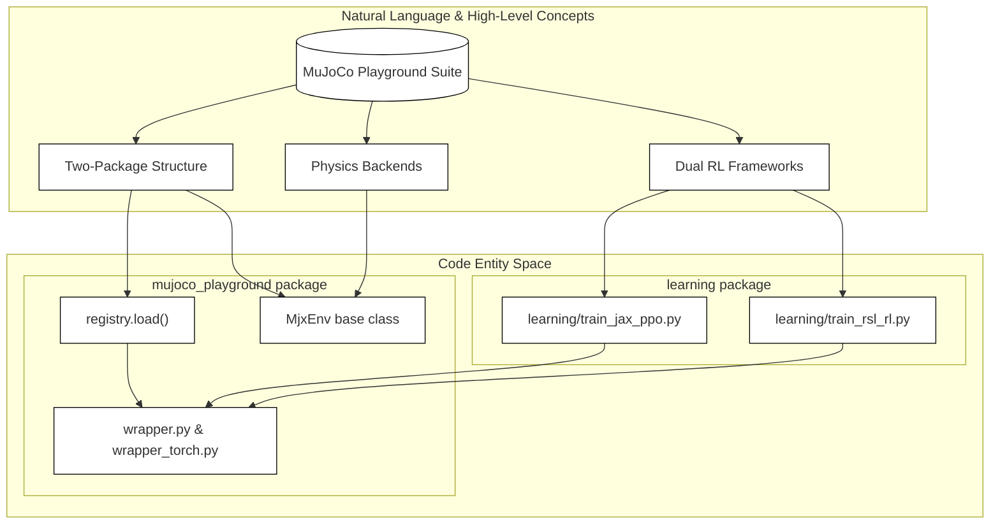
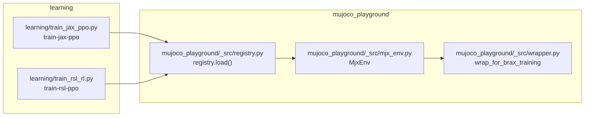

<!-- source: DeepWiki mcp.deepwiki.com · repo google-deepmind/mujoco_playground · page 1 Overview · fetched 2026-10-26 -->

# Overview

Relevant source files

The following files were used as context for generating this wiki page:

- [.github/workflows/ci.yml](.github/workflows/ci.yml)
- [CHANGELOG.md](CHANGELOG.md)
- [CONTRIBUTING.md](CONTRIBUTING.md)
- [README.md](README.md)
- [learning/README.md](learning/README.md)
- [mujoco_playground/__init__.py](mujoco_playground/__init__.py)
- [mujoco_playground/_src/manipulation/franka_emika_panda/panda.py](mujoco_playground/_src/manipulation/franka_emika_panda/panda.py)
- [mujoco_playground/_src/registry.py](mujoco_playground/_src/registry.py)
- [pyproject.toml](pyproject.toml)
- [uv.lock](uv.lock)

This page introduces MuJoCo Playground, its architectural design, and the key systems that enable GPU-accelerated reinforcement learning for robotics. MuJoCo Playground is a comprehensive suite of environments built on [MuJoCo MJX](https://github.com/google-deepmind/mujoco/tree/main/mjx) [README.md:1-7]() supporting parallel GPU simulation, dual physics backends (MJX and MuJoCo Warp) [README.md:18-19](), and dual training framework support across JAX/Brax and PyTorch/RSL-RL [learning/README.md:1-3]().

For detailed information on getting started and repository layout, refer to the child pages:
- **Installation and Setup**: See [Installation and Setup](#1.1) for PyPI/source installation, `uv` setup, GPU configuration, and Menagerie asset downloading.
- **Package Structure**: See [Package Structure](#1.2) for details on the `mujoco_playground` and `learning` packages, entry points (`train-jax-ppo`, `train-rsl-ppo`), and directory organization.

## Purpose and Architecture Overview

MuJoCo Playground serves as an open-source framework for robot learning research and sim-to-real transfer [README.md:104-106](). It decouples environment physics and reward definitions from reinforcement learning algorithms through a clean two-package design and a unified environment registry [mujoco_playground/_src/registry.py:33-71]().

*Figure 1: Conceptual bridge connecting high-level architectural concepts to concrete code entities.*

**Sources:** [README.md:1-7](), [mujoco_playground/_src/registry.py:33-71](), [learning/README.md:1-4]()

## Two-Package Structure and Backends

The codebase divides responsibilities between environment modeling and training pipelines [pyproject.toml:78-84]():
1. **`mujoco_playground`**: Contains environment definitions, XML assets, observation/reward logic, domain randomization, and the `MjxEnv` base class [mujoco_playground/__init__.py:15-35]().
2. **`learning`**: Houses training scripts, network architectures, and configuration wrappers for both JAX/Brax and PyTorch/RSL-RL [learning/README.md:1-4]().

Additionally, the suite supports multiple physics backends via MuJoCo MJX [README.md:7]() and MuJoCo Warp (`--impl warp`) [CHANGELOG.md:16-20](), maximizing throughput across modern GPU hardware.

*Figure 2: Interaction between environment loading, wrappers, and training CLI entry points.*

**Sources:** [pyproject.toml:78-84](), [mujoco_playground/_src/registry.py:49-62](), [mujoco_playground/_src/mjx_env.py]()

---

## 1.1. Installation and Setup

For step-by-step instructions on installing MuJoCo Playground from PyPI or source using `uv`/`pip`, configuring JAX for CUDA, handling optional dependencies (`cuda`, `learning`, `notebooks`, `dev`), downloading Menagerie assets, and verifying your setup, see [Installation and Setup](#1.1).

**Sources:** [README.md:21-46](), [pyproject.toml:40-73]()

---

## 1.2. Package Structure

For detailed documentation on the organization of the `mujoco_playground` and `learning` packages, command-line entry points (`train-jax-ppo`, `train-rsl-ppo`), configuration directories, and module layouts, see [Package Structure](#1.2).

**Sources:** [pyproject.toml:78-84](), [learning/README.md:1-4]()

---

