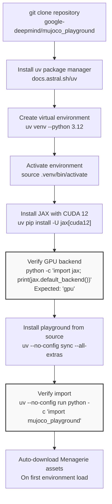
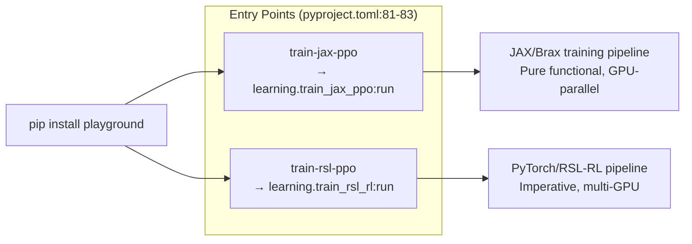

<!-- source: DeepWiki mcp.deepwiki.com · repo google-deepmind/mujoco_playground · page 1.1 Installation and Setup · fetched 2026-10-26 -->

# Installation and Setup

<details>
<summary>Relevant source files</summary>

The following files were used as context for generating this wiki page:

- [.github/workflows/ci.yml](.github/workflows/ci.yml)
- [.github/workflows/pypi.yml](.github/workflows/pypi.yml)
- [CONTRIBUTING.md](CONTRIBUTING.md)
- [README.md](README.md)
- [learning/README.md](learning/README.md)
- [mujoco_playground/_src/registry.py](mujoco_playground/_src/registry.py)
- [pyproject.toml](pyproject.toml)
- [uv.lock](uv.lock)

</details>


This document guides you through installing MuJoCo Playground and its dependencies, configuring JAX for GPU acceleration, installing optional dependency groups, downloading MuJoCo Menagerie assets, and verifying your installation. For information about running training workflows after installation, see [Command-Line Training](#5.4). For development setup including testing infrastructure and pre-commit hooks, see [Testing and CI/CD](#6.2).

## Prerequisites

MuJoCo Playground requires:
- **Python 3.12 or later** (as specified in package requirements)
- **Git** (for source installation)
- **CUDA-capable GPU** (recommended for training, optional for basic usage)

**Sources**: [pyproject.toml:12](), [.github/workflows/ci.yml:14]()

## Installation Methods

### PyPI Installation (Basic)

The simplest installation method uses PyPI:

```bash
pip install playground
```

This installs the core `mujoco_playground` and `learning` packages with default dependencies. However, **source installation is strongly recommended** to access the latest MuJoCo features and bug fixes.

**Sources**: [README.md:23-27]()

### Source Installation (Recommended)

Source installation provides access to the latest MuJoCo development versions and all features.

#### Installation Flow



**Sources**: [README.md:32-46]()

#### Step-by-Step Instructions

1. **Clone the repository**:
   ```bash
   git clone git@github.com:google-deepmind/mujoco_playground.git
   cd mujoco_playground
   ```

2. **Install uv package manager**:
   ```bash
   curl -LsSf https://astral.sh/uv/install.sh | sh
   ```
   
   The `uv` tool is a faster alternative to `pip` used by the project.

3. **Create and activate virtual environment**:
   ```bash
   uv venv --python 3.12
   source .venv/bin/activate
   ```

4. **Install JAX with CUDA 12 support**:
   ```bash
   uv pip install -U "jax[cuda12]" --index-url https://pypi.org/simple
   ```

5. **Verify GPU backend**:
   ```bash
   python -c "import jax; print(jax.default_backend())"
   ```
   
   Expected output: `gpu`
   
   If the output is `cpu`, try running `unset LD_LIBRARY_PATH` before the verification command.

6. **Install playground with all dependencies**:
   ```bash
   uv --no-config sync --all-extras
   ```
   
   This installs packages defined in [pyproject.toml:23-73]() including `mujoco_playground` and `learning`.

7. **Verify installation**:
   ```bash
   uv --no-config run python -c "import mujoco_playground; print('Success')"
   ```

8. **Trigger Menagerie asset download** (optional but recommended):
   ```bash
   uv --no-config run python -c "from mujoco_playground import locomotion; locomotion.load('G1JoystickFlatTerrain')"
   ```
   
   Menagerie assets (robot XML models) are automatically downloaded on first use via `mujoco_playground/_src/mjx_env.ensure_menagerie_exists()`.

**Sources**: [README.md:37-45](), [.github/workflows/ci.yml:27-29]()

## Dependency Structure and Optional Installations

### Core Dependencies

The base installation includes these packages:

| Package | Version | Purpose |
|---------|---------|---------|
| `absl-py` | latest | Abseil Python common libraries |
| `brax` | ≥0.14.2 | JAX-based RL training framework |
| `etils` | latest | Python utilities |
| `flax` | latest | JAX neural network library |
| `jax` | latest | GPU computation and JIT compilation |
| `lxml` | latest | XML processing |
| `mediapy` | latest | Media rendering and display |
| `ml_collections` | latest | Configuration management |
| `mujoco` | ≥3.6.0 | CPU physics engine |
| `mujoco-mjx` | ≥3.6.0 | JAX-accelerated physics engine |
| `warp-lang` | ≥1.18.0 | NVIDIA GPU acceleration and Warp backend |
| `orbax-checkpoint` | ≥0.11.22 | Model checkpointing |
| `tqdm` | latest | Progress bars |

**Sources**: [pyproject.toml:23-37]()

### Optional Dependency Groups

The project defines several optional dependency groups in [pyproject.toml:40-73]():

| Group | Installation Command | Contents | Purpose |
|-------|---------------------|----------|---------|
| `cuda` | `pip install playground[cuda]` | `jax[cuda12]` | GPU-accelerated JAX for training |
| `test` | `pip install playground[test]` | `absl-py`, `dm_control`, `pytest`, `pytest-xdist` | Running test suite |
| `notebooks` | `pip install playground[notebooks]` | `matplotlib`, `jupyter` | Interactive tutorials |
| `learning` | `pip install playground[learning]` | `rsl-rl-lib>=3.0.0`, `wandb` | PyTorch training pipeline and experiment tracking |
| `dev` | `pip install playground[dev]` | `playground[test]`, `mypy`, `pyink`, `pytype`, `ruff`, `pre-commit`, `pylint`, `pytest-xdist` | Development tools (linting, type checking) |
| `all` | `pip install playground[all]` | `playground[dev]`, `playground[cuda]`, `playground[notebooks]`, `playground[learning]` | Complete installation |

To install with specific groups:
```bash
# Source installation with all extras
uv --no-config sync --all-extras

# Or install specific groups
pip install playground[cuda,learning]
```

**Sources**: [pyproject.toml:40-73]()

## Entry Points and Command-Line Scripts

After installation, two command-line scripts become available:



| Script | Module Path | Purpose |
|--------|-------------|---------|
| `train-jax-ppo` | `learning.train_jax_ppo:run` | Train with JAX/Brax PPO (see [JAX/Brax Training Pipeline](#4.1)) |
| `train-rsl-ppo` | `learning.train_rsl_rl:run` | Train with PyTorch/RSL-RL PPO (see [PyTorch/RSL-RL Training Pipeline](#4.2)) |

These are defined in [pyproject.toml:81-83]() and installed automatically.

**Sources**: [pyproject.toml:81-83](), [README.md:56-71]()

## Verifying Installation

### Basic Import Test

```bash
python -c "import mujoco_playground; print('Success')"
```

This verifies that the core package is installed correctly.

### GPU Backend Verification

```bash
python -c "import jax; print(jax.default_backend())"
```

Expected output: `gpu`

If you see `cpu`, JAX is not using GPU acceleration. Troubleshooting steps:
1. Run `unset LD_LIBRARY_PATH` and try again
2. Verify CUDA installation: `nvidia-smi`
3. Reinstall JAX with CUDA: `uv pip install -U "jax[cuda12]" --index-url https://pypi.org/simple`

### Environment Loading Test

```bash
python -c "from mujoco_playground import registry; env = registry.load('CartpoleBalance'); print('Environment loaded successfully')"
```

This test:
1. Imports the registry system [mujoco_playground/_src/registry.py:49-61]()
2. Loads a simple environment
3. Triggers Menagerie asset download if not already present

### Training Script Test

```bash
train-jax-ppo --env_name CartpoleBalance --num_timesteps 100000
```

This minimal training run verifies:
- Entry point installation
- JAX/Brax integration
- Environment wrapping
- Basic training loop

**Sources**: [README.md:44-45](), [README.md:56-58](), [mujoco_playground/_src/registry.py:49-61]()

## Troubleshooting

### GPU Precision Issues (Ampere Architecture)

**Problem**: Inconsistent behavior or training instability on NVIDIA Ampere GPUs (RTX 30/40 series).

**Cause**: JAX defaults to TF32 precision for matrix multiplications on Ampere GPUs, which can affect RL training stability.

**Solution**: Force full float32 precision before running experiments:
```bash
export JAX_DEFAULT_MATMUL_PRECISION=highest
```

Add this to `~/.bashrc` for persistent configuration:
```bash
echo 'export JAX_DEFAULT_MATMUL_PRECISION=highest' >> ~/.bashrc
source ~/.bashrc
```

**Sources**: [README.md:94-96]()

### LD_LIBRARY_PATH Conflicts

**Problem**: JAX reports `cpu` backend despite CUDA installation.

**Solution**: Unset `LD_LIBRARY_PATH` which may point to conflicting libraries:
```bash
unset LD_LIBRARY_PATH
python -c "import jax; print(jax.default_backend())"
```

**Sources**: [README.md:42]()

### Menagerie Asset Download

**Problem**: `FileNotFoundError` when loading locomotion or manipulation environments.

**Cause**: Menagerie robot models are not included in the package and must be downloaded separately.

**Solution**: The download happens automatically on first use via `mujoco_playground/_src/mjx_env.ensure_menagerie_exists()`. You can trigger it manually:
```bash
python -c "from mujoco_playground._src import mjx_env; mjx_env.ensure_menagerie_exists()"
```

**Sources**: [.github/workflows/ci.yml:32-34](), [README.md:45]()

### Package Version Conflicts

**Problem**: Dependency conflicts during installation.

**Solution**: Use `uv` instead of `pip` for more reliable dependency resolution:
```bash
pip install uv
uv pip install -e ".[all]"
```

The `uv` tool has superior conflict resolution compared to pip.

**Sources**: [README.md:38-39]()

## Next Steps

After successful installation:

1. **Try basic training**: See [Command-Line Training](#5.4)
2. **Explore environments**: See [Locomotion Environments](#3.1) and [Manipulation Environments](#3.2)
3. **Run notebooks**: See [Examples and Tutorials](#5) for interactive guides
4. **Configure for vision**: See [Vision-Based Training](#4.5) if training from pixels

For development setup including testing, linting, and pre-commit hooks, see [Testing and CI/CD](#6.2).

**Sources**: [README.md:51-92](), [learning/README.md:1-43]()

---

