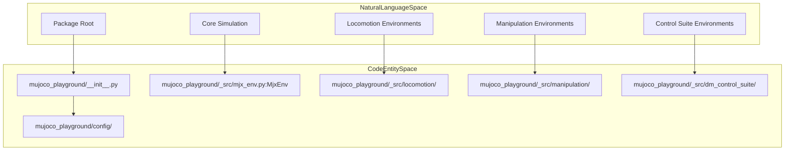
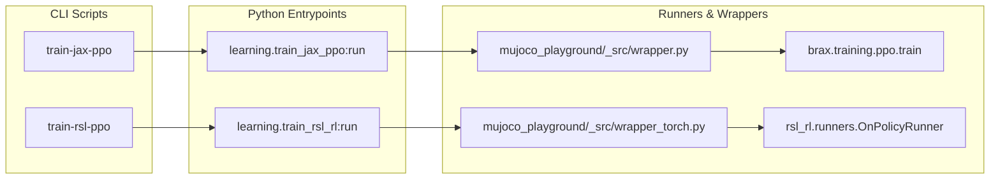
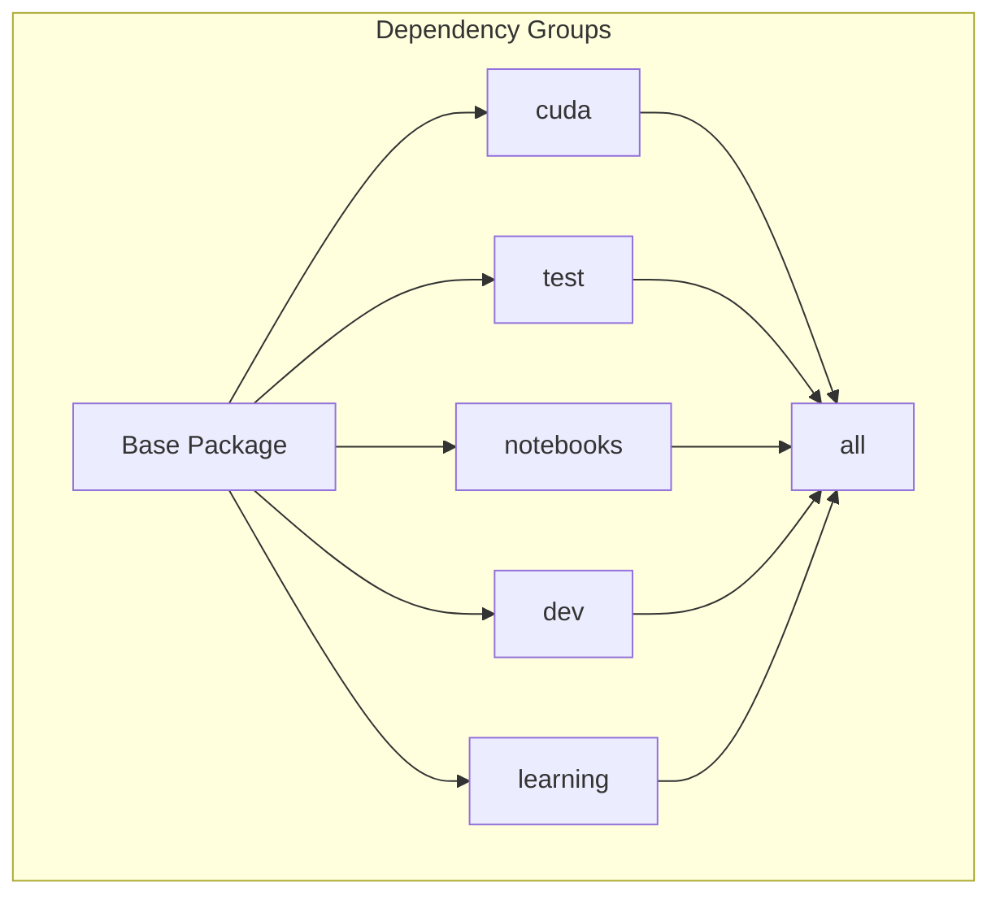

<!-- source: DeepWiki mcp.deepwiki.com · repo google-deepmind/mujoco_playground · page 1.2 Package Structure · fetched 2026-10-26 -->

# Package Structure

Relevant source files

The following files were used as context for generating this wiki page:

- [.github/workflows/ci.yml](.github/workflows/ci.yml)
- [CHANGELOG.md](CHANGELOG.md)
- [learning/__init__.py](learning/__init__.py)
- [mujoco_playground/__init__.py](mujoco_playground/__init__.py)
- [mujoco_playground/_src/manipulation/franka_emika_panda/panda.py](mujoco_playground/_src/manipulation/franka_emika_panda/panda.py)
- [pyproject.toml](pyproject.toml)
- [uv.lock](uv.lock)

This document describes the organization of the MuJoCo Playground repository, structured as two primary Python packages: `mujoco_playground` (core simulation, physics backends, and RL environments) and `learning` (dual RL training infrastructure). This page covers package layout, entry points, dependency architecture, configuration layouts, and optional installation groups.

For installation instructions, see [Installation and Setup](#1.1). For details on how environments are organized and registered within the `mujoco_playground` package, see [Environment Registry](#2.2).

## Two Main Packages

The repository distributes two separate but complementary Python packages defined under project packaging settings [pyproject.toml:78-80]():

### mujoco_playground Package

The `mujoco_playground` package provides the core environment simulation framework built on top of MuJoCo, MuJoCo MJX [pyproject.toml:32-33](), and MuJoCo Warp [pyproject.toml:34](). It contains:

| Directory / Module | Purpose |
|--------------------|---------|
| `mujoco_playground/__init__.py` | Package root exporting public APIs like `MjxEnv`, `State`, `put_model`, and registries [mujoco_playground/__init__.py:1-53]() |
| `mujoco_playground/_src/` | Core implementation including `MjxEnv` base class, environment wrappers, and collections |
| `mujoco_playground/_src/locomotion/` | Quadruped and bipedal robot environments |
| `mujoco_playground/_src/manipulation/` | Dexterous hand and robotic arm environments |
| `mujoco_playground/_src/dm_control_suite/` | DeepMind Control Suite ported environments |
| `mujoco_playground/config/` | Default training parameter configuration modules |

**Diagram: Code Entity Architecture of `mujoco_playground`**

**Sources:** [pyproject.toml:78-80](), [mujoco_playground/__init__.py:1-53]()

### learning Package

The `learning` package provides reinforcement learning training entry points, algorithm execution wrappers, and neural network definitions supporting both JAX/Brax and PyTorch/RSL-RL pipelines.

| Module | Purpose |
|--------|---------|
| `learning/train_jax_ppo.py` | JAX/Brax PPO training pipeline and entry point |
| `learning/train_rsl_rl.py` | PyTorch/RSL-RL training pipeline and entry point |
| `learning/ppo_networks.py` | Policy and value network architectures for JAX |
| `learning/getup_rl_games.py` | Experimental RL Games integration |

**Sources:** [pyproject.toml:78-80](), [pyproject.toml:81-84]()

## Entry Points and Command-Line Scripts

The repository defines two primary command-line scripts via project console scripts in [pyproject.toml:81-84]():

**Diagram: Execution Flow of Entry Points**

### train-jax-ppo

This executable script launches JAX-based PPO training sessions [pyproject.toml:82]():

- **Target Entry Point:** `learning.train_jax_ppo:run`
- **Mechanism:** Loads environments using `registry.load()`, wraps them for Brax training via `mujoco_playground/_src/wrapper.py`, builds PPO network graphs, and executes training using JIT compilation and VMAP parallelization.
- **Backends:** Fully compatible with MJX and MuJoCo Warp (`impl="warp"`) simulation backends.

**Sources:** [pyproject.toml:82](), [learning/__init__.py:1-15]()

### train-rsl-ppo

This executable script launches PyTorch-based RSL-RL training sessions [pyproject.toml:83]():

- **Target Entry Point:** `learning.train_rsl_rl:run`
- **Mechanism:** Interfacing JAX simulation state to PyTorch tensors via DLPack zero-copy memory sharing using wrappers in `mujoco_playground/_src/wrapper_torch.py`.
- **Runners:** Interfaces with `rsl_rl.runners.OnPolicyRunner` for accelerated actor-critic policy optimization.

**Sources:** [pyproject.toml:83](), [learning/__init__.py:1-15]()

## Configuration and Experimental Directories

The repository organizes default hyperparameter sets and experimental features in dedicated directories:

- **`mujoco_playground/config/`**: Contains default configuration files (`manipulation_params.py`, `locomotion_params.py`, `dm_control_suite_params.py`) structured using `ml_collections.ConfigDict`. These parameters control simulation timesteps, episode lengths, action scales, and reward component weights.
- **Experimental Directories**: Submodules and scripts intended for exploratory features, such as custom sim-to-sim export scripts and specialized wrapper variations. Note that pylint ignores experimental paths in static checks [pyproject.toml:160-161]().

**Sources:** [pyproject.toml:160-161](), [pyproject.toml:167]()

## Optional Dependency Groups

The project defines several optional dependency bundles in `pyproject.toml` to customize installation profiles [pyproject.toml:40-73]():

| Optional Group | Requirements | Target Use Case |
|----------------|--------------|-----------------|
| `cuda` | `jax[cuda12]` [pyproject.toml:41-43]() | NVIDIA GPU hardware acceleration |
| `test` | `absl-py`, `dm_control`, `pytest`, `pytest-xdist` [pyproject.toml:44-49]() | Running test suites and environment validation |
| `notebooks` | `matplotlib`, `jupyter` [pyproject.toml:50-53]() | Interactive exploration and tutorial notebooks |
| `dev` | `playground[test]`, `mypy`, `pyink`, `pytype`, `ruff`, `pre-commit`, `pylint`, `pytest-xdist` [pyproject.toml:54-63]() | Full code quality checks, type checking, and linting |
| `learning` | `rsl-rl-lib>=3.0.0`, `wandb` [pyproject.toml:64-67]() | PyTorch/RSL-RL training and experiment logging |
| `all` | Combines `dev`, `cuda`, `notebooks`, and `learning` [pyproject.toml:68-73]() | Complete installation for development and research |

**Diagram: Optional Dependency Tree**

**Sources:** [pyproject.toml:40-73]()

---

