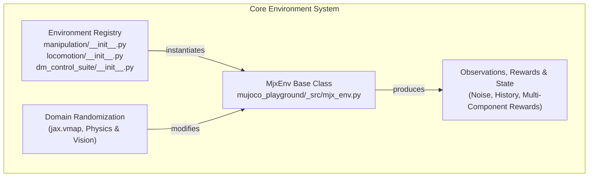

<!-- source: DeepWiki mcp.deepwiki.com · repo google-deepmind/mujoco_playground · page 2 Core Environment System · fetched 2026-10-26 -->

# Core Environment System

Relevant source files

The following files were used as context for generating this wiki page:

- [mujoco_playground/_src/dm_control_suite/__init__.py](mujoco_playground/_src/dm_control_suite/__init__.py)
- [mujoco_playground/_src/locomotion/__init__.py](mujoco_playground/_src/locomotion/__init__.py)
- [mujoco_playground/_src/locomotion/t1/randomize.py](mujoco_playground/_src/locomotion/t1/randomize.py)
- [mujoco_playground/_src/manipulation/__init__.py](mujoco_playground/_src/manipulation/__init__.py)
- [mujoco_playground/_src/mjx_env.py](mujoco_playground/_src/mjx_env.py)

This document provides a high-level overview of the foundational environment framework in MuJoCo Playground. The core environment system is built around the GPU-accelerated JAX and MuJoCo MJX backends, enabling parallelized, differentiable simulation for reinforcement learning. 

For detailed technical documentation, please refer to the child pages:
- **MjxEnv Base Class**: Detailed documentation of the `MjxEnv` abstract base class, required methods, properties, model/data helpers, Warp backend selection, and the `State` dataclass structure. For details, see [MjxEnv Base Class](#2.1).
- **Environment Registry**: Explanation of the registry system for discovering and loading environments across categories. For details, see [Environment Registry](#2.2).
- **Observations, Rewards, and State**: Documentation on generating noisy and privileged observations, history buffers, multi-component rewards, metrics, and termination conditions. For details, see [Observations, Rewards, and State](#2.3).
- **Domain Randomization**: Overview of physics parameter randomization with `jax.vmap` for sim-to-real transfer. For details, see [Domain Randomization](#2.4).

**Sources:** [mujoco_playground/_src/mjx_env.py:1-203](), [mujoco_playground/_src/manipulation/__init__.py:1-69](), [mujoco_playground/_src/locomotion/__init__.py:1-138]()

---

## MjxEnv Base Class

The `MjxEnv` class acts as the abstract base class for all simulation environments in MuJoCo Playground [mujoco_playground/_src/mjx_env.py:17-216](). It standardizes the environment interface—similar to Gym/Gymnasium—while relying entirely on JAX operations for high-throughput GPU execution. 

Concrete environments implement required abstract methods like `reset()`, `step()`, `xml_path()`, and `action_size()`, while utilizing helper utilities such as `put_model()` and `make_data()` for initialization [mujoco_playground/_src/mjx_env.py:130-187](). Episode states and physics arrays are encapsulated within a Flax `@struct.dataclass` named `State`.

For complete implementation details, method signatures, properties, and data structures, see [MjxEnv Base Class](#2.1).

**Sources:** [mujoco_playground/_src/mjx_env.py:130-216]()

---

## Environment Registry

Environments in MuJoCo Playground are managed through dedicated registry modules located across three primary domains: locomotion, manipulation, and the DeepMind Control Suite [mujoco_playground/_src/manipulation/__init__.py:33-44](), [mujoco_playground/_src/locomotion/__init__.py:45-87](), [mujoco_playground/_src/dm_control_suite/__init__.py:37-71](). 

The registry pattern provides unified functions to load environments (`registry.load()`), retrieve default configurations (`get_default_config()`), fetch domain randomizers (`get_domain_randomizer()`), and discover available environments via `ALL_ENVS` [mujoco_playground/_src/manipulation/__init__.py:66-133](). Additionally, the registry handles asset management by automatically downloading repository dependencies like `mujoco_menagerie` when required [mujoco_playground/_src/mjx_env.py:94-113]().

For detailed instructions on discovery, loading, and organization, see [Environment Registry](#2.2).

**Sources:** [mujoco_playground/_src/mjx_env.py:94-113](), [mujoco_playground/_src/manipulation/__init__.py:33-133](), [mujoco_playground/_src/locomotion/__init__.py:45-131]()

---

## Observations, Rewards, and State

During execution, environments process actions through physical substeps and concurrently compute observation vectors, reward signals, metrics, and termination flags. Observations can include sensory readings, task commands, and history buffers, often separated into noisy observation spaces for actors and privileged states for critics (asymmetric actor-critic).

Rewards are structured as weighted multi-component sums combining task objectives (such as velocity tracking or target reaching) with regularization penalties (such as energy or smoothness constraints). Episode termination logic monitors conditions like falling, constraint violations, or maximum episode lengths.

For details on observation construction, history buffers, reward shaping, and termination checks, see [Observations, Rewards, and State](#2.3).

**Sources:** [mujoco_playground/_src/mjx_env.py:190-203]()

---

## Domain Randomization

To bridge the reality gap and facilitate robust sim-to-real transfer, MuJoCo Playground implements domain randomization workflows via dedicated `randomize.py` modules [mujoco_playground/_src/locomotion/t1/randomize.py:15-130](). 

Physics parameters—such as geom friction, dof frictionloss, armature, body masses, joint stiffness, and damping—are perturbed across parallel environments using `jax.vmap` [mujoco_playground/_src/locomotion/t1/randomize.py:27-130](). These randomized models integrate directly with training wrappers and support specialized visual randomizations for vision-based policies.

For complete coverage of parameter randomization functions and vectorization patterns, see [Domain Randomization](#2.4).

**Sources:** [mujoco_playground/_src/locomotion/t1/randomize.py:15-130]()

---

