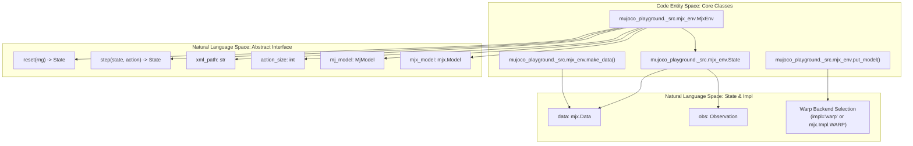
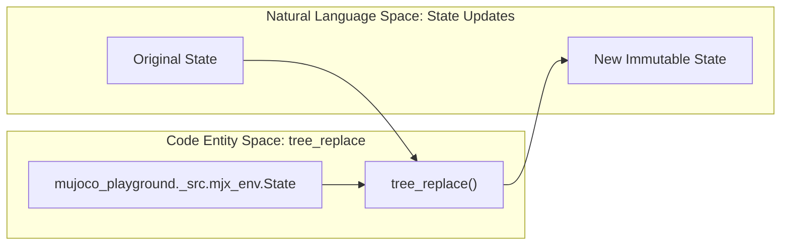
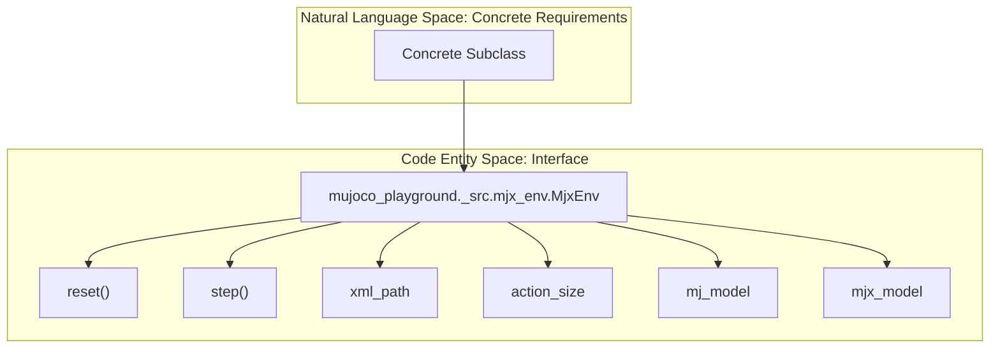

<!-- source: DeepWiki mcp.deepwiki.com · repo google-deepmind/mujoco_playground · page 2.1 MjxEnv Base Class · fetched 2026-10-26 -->

# MjxEnv Base Class

Relevant source files

The following files were used as context for generating this wiki page:

- [mujoco_playground/_src/mjx_env.py](mujoco_playground/_src/mjx_env.py)

This document covers the `MjxEnv` abstract base class, the foundational component that all MuJoCo Playground environments inherit from. It defines the standard interface for physics-based reinforcement learning environments and provides essential utilities for state management, asset handling, and GPU backend configuration (including the MuJoCo-Warp backend).

For information about how environments are registered and discovered, see [Environment Registry](#2.2). For details on specific environment implementations, see [Environment Collections](#3).

## Core Architecture and Data Flow

The `MjxEnv` base class establishes a standardized interface for MuJoCo-based environments, built on top of JAX and MJX (MuJoCo's JAX implementation). The architecture centers around the abstract `MjxEnv` class, the immutable `State` dataclass, and backend helper functions like `put_model` and `make_data` that support the Warp backend (`impl`).

Sources: [mujoco_playground/_src/mjx_env.py:1-203]()

## State Dataclass Structure

The `State` dataclass serves as an immutable container for all environment state information during training and inference. It combines MuJoCo physics data with RL-specific information like observations, rewards, and termination signals.

### State Fields

| Field | Type | Purpose |
|-------|------|---------|
| `data` | `mjx.Data` | MuJoCo physics state (positions, velocities, forces, control inputs) |
| `obs` | `Observation` | Agent observations (can be a `jax.Array` or a mapping of string arrays) [mujoco_playground/_src/mjx_env.py:114-114]() |
| `reward` | `jax.Array` | Scalar reward signal |
| `done` | `jax.Array` | Episode termination flag |
| `metrics` | `Dict[str, jax.Array]` | Environment-specific metrics for logging |
| `info` | `Dict[str, Any]` | Additional debugging information |

### State Manipulation via `tree_replace`

Because `State` is implemented as a Flax dataclass (`@struct.dataclass`), it supports functional updates through `tree_replace`, enabling JIT-compatible immutable modifications across simulation steps:

Sources: [mujoco_playground/_src/mjx_env.py:24-25]()

## Abstract Interface and Required Members

All concrete environment implementations must inherit from `MjxEnv` and provide specific abstract methods and properties.

### Required Methods

| Method | Signature | Purpose |
|--------|-----------|---------|
| `reset` | `reset(rng: jax.Array) -> State` | Initialize environment to a starting state using a JAX random key |
| `step` | `step(state: State, action: jax.Array) -> State` | Advance the simulation by one control step given an action |

### Required Properties

| Property | Type | Purpose |
|----------|------|---------|
| `xml_path` | `str` | Path to the MuJoCo XML model file |
| `action_size` | `int` | Dimensionality of the action space |
| `mj_model` | `mujoco.MjModel` | CPU MuJoCo model instance used for rendering and asset inspection |
| `mjx_model` | `mjx.Model` | GPU-accelerated MJX model instance used for vectorized simulation |

Sources: [mujoco_playground/_src/mjx_env.py:1-203]()

## Backend Helpers: `put_model`, `make_data`, and Warp Integration

The module provides helper functions to initialize models and data on accelerators, with specific handling for the MuJoCo-Warp backend (`impl`).

### `put_model` and Warp Backend Selection

The `put_model` function transfers a `mujoco.MjModel` to a target device with an optional implementation backend (`impl: Optional[Union[str, mjx.Impl]]`) [mujoco_playground/_src/mjx_env.py:130-137](). When using the Warp backend (`impl="warp"` or `mjx.Impl.WARP`), `put_model` automatically intercepts and filters overflow warnings (`warn_overflow`) caused by intentional tight tolerances in high-performance RL environments [mujoco_playground/_src/mjx_env.py:138-153]().

### `make_data` Initialization

The `make_data` function initializes an `mjx.Data` structure from an `mjx.Model`, supporting optional overrides for generalized positions (`qpos`), velocities (`qvel`), control inputs (`ctrl`), activation states (`act`), mocap targets (`mocap_pos`, `mocap_quat`), buffer sizes (`naconmax`, `naccdmax`, `njmax`), and target devices [mujoco_playground/_src/mjx_env.py:156-187]().

Sources: [mujoco_playground/_src/mjx_env.py:130-187]()

## Timestep Management

The base class manages the relationship between the control frequency (`dt`) and the physics simulation timestep (`sim_dt`) through substep calculations:

| Property / Parameter | Purpose |
|----------------------|---------|
| `dt` | Control timestep (frequency at which actions are updated) |
| `sim_dt` | Physics simulation integration timestep |
| `n_substeps` | Number of physics integration substeps executed per control step (`round(dt / sim_dt)`) |

Sources: [mujoco_playground/_src/mjx_env.py:1-203]()

## Asset Management and Utilities

Environments rely on external XML files and assets, managed via `update_assets` and automatic Menagerie downloading utilities (`ensure_menagerie_exists`) [mujoco_playground/_src/mjx_env.py:94-128]().

Sources: [mujoco_playground/_src/mjx_env.py:94-128]()

---

