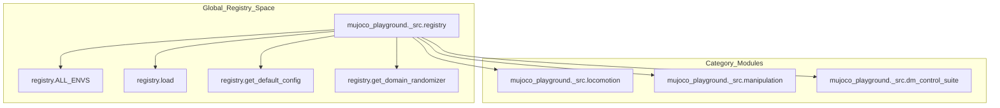
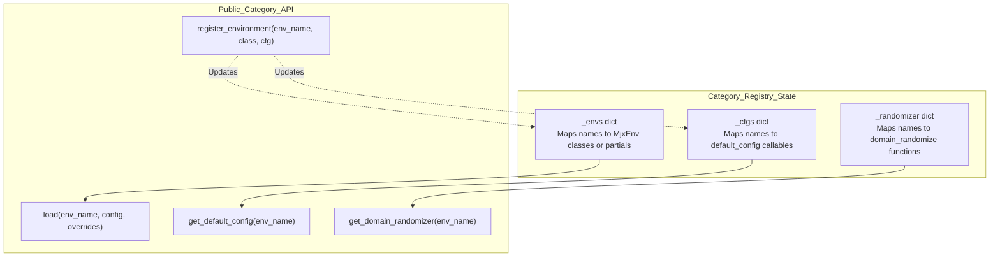
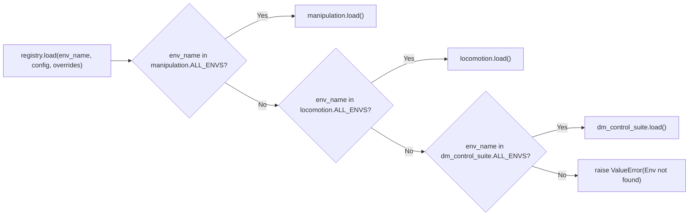

<!-- source: DeepWiki mcp.deepwiki.com · repo google-deepmind/mujoco_playground · page 2.2 Environment Registry · fetched 2026-10-26 -->

# Environment Registry

<details>
<summary>Relevant source files</summary>

The following files were used as context for generating this wiki page:

- [CONTRIBUTING.md](CONTRIBUTING.md)
- [README.md](README.md)
- [learning/README.md](learning/README.md)
- [mujoco_playground/_src/dm_control_suite/__init__.py](mujoco_playground/_src/dm_control_suite/__init__.py)
- [mujoco_playground/_src/locomotion/__init__.py](mujoco_playground/_src/locomotion/__init__.py)
- [mujoco_playground/_src/locomotion/t1/randomize.py](mujoco_playground/_src/locomotion/t1/randomize.py)
- [mujoco_playground/_src/manipulation/__init__.py](mujoco_playground/_src/manipulation/__init__.py)
- [mujoco_playground/_src/registry.py](mujoco_playground/_src/registry.py)
- [mujoco_playground/_src/registry_test.py](mujoco_playground/_src/registry_test.py)
- [mujoco_playground/experimental/learning/ablate_device_topology.ipynb](mujoco_playground/experimental/learning/ablate_device_topology.ipynb)

</details>


## Purpose and Scope

The environment registry provides a centralized system for discovering, configuring, and instantiating environments in MuJoCo Playground. It organizes environments into three main categories (`locomotion`, `manipulation`, and `dm_control_suite`), maps environment names to their implementation classes via `ALL_ENVS`, and provides uniform interfaces for loading environments with default or custom configurations through `registry.load()`, `registry.get_default_config()`, and `registry.get_domain_randomizer()`. 

For details on the `MjxEnv` base class that all registered environments inherit from, see [MjxEnv Base Class](#2.1). For information on creating and registering custom environments, see [Creating Custom Environments](#6.1).

Sources: [mujoco_playground/_src/registry.py:15-36]()

---

## Global and Category Registry Architecture

MuJoCo Playground organizes its environment suites across three submodules (`locomotion`, `manipulation`, and `dm_control_suite`), which are unified under a central global registry module (`mujoco_playground._src.registry`) [mujoco_playground/_src/registry.py:22-35]().


**Diagram 1: Global registry aggregation of environment category modules**

Sources: [mujoco_playground/_src/registry.py:22-71]()

---

## Internal Data Structures

Each environment module maintains internal dictionaries (`_envs`, `_cfgs`, and `_randomizer`) to map environment identifiers to their corresponding implementation classes, default configuration factories, and domain randomization functions.


**Diagram 2: Internal dictionaries and public functions within category registries**

### Environment Class Dictionary (`_envs`)
Maps string keys (e.g., `"Go1JoystickFlatTerrain"`, `"PandaPickCube"`, `"AcrobotSwingup"`) to either concrete `MjxEnv` subclasses or `functools.partial` wrappers [mujoco_playground/_src/manipulation/__init__.py:33-44](), [mujoco_playground/_src/locomotion/__init__.py:45-87](), [mujoco_playground/_src/dm_control_suite/__init__.py:37-71]().

### Configuration Dictionary (`_cfgs`)
Maps environment names to functions returning `ml_collections.ConfigDict` objects [mujoco_playground/_src/manipulation/__init__.py:46-57](), [mujoco_playground/_src/locomotion/__init__.py:89-113](), [mujoco_playground/_src/dm_control_suite/__init__.py:73-99]().

### Domain Randomizer Dictionary (`_randomizer`)
Maps environment names to domain randomization callables with the signature `(mjx.Model, jax.Array) -> Tuple[mjx.Model, mjx.Model]` [mujoco_playground/_src/manipulation/__init__.py:59-63](), [mujoco_playground/_src/locomotion/__init__.py:115-131](), [mujoco_playground/_src/registry.py:27-29]().

Sources: [mujoco_playground/_src/manipulation/__init__.py:33-64](), [mujoco_playground/_src/locomotion/__init__.py:45-131](), [mujoco_playground/_src/dm_control_suite/__init__.py:37-99](), [mujoco_playground/_src/registry.py:27-35]()

---

## Loading Environments with `registry.load()`

The `registry.load()` function routes instantiation requests to the appropriate submodule depending on which category contains `env_name` [mujoco_playground/_src/registry.py:49-61]().


**Diagram 3: Control flow for environment resolution in `registry.load()`**

### Usage Example

```python
from mujoco_playground._src import registry

# Load environment using the global registry loader
env = registry.load("Go1JoystickFlatTerrain")

# Load with custom configuration overrides
env = registry.load(
    "PandaPickCube",
    config_overrides={"ctrl_dt": 0.02, "episode_length": 500}
)
```

Sources: [mujoco_playground/_src/registry.py:49-62]()

---

## Configuration Management

The function `registry.get_default_config(env_name)` inspects the environment suites to locate and return the default `ConfigDict` configuration for the requested environment [mujoco_playground/_src/registry.py:38-46]().

```python
from mujoco_playground._src import registry

# Retrieve default configuration
config = registry.get_default_config("CartpoleBalance")
print(config.ctrl_dt)
```

Sources: [mujoco_playground/_src/registry.py:38-47]()

---

## Domain Randomization

Domain randomizers are fetched via `registry.get_domain_randomizer(env_name)` [mujoco_playground/_src/registry.py:64-71](). If an environment supports domain randomization (predominantly locomotion and select manipulation tasks), a randomization function is returned; otherwise, `None` is returned [mujoco_playground/_src/registry.py:64-71]().

```python
from mujoco_playground._src import registry
import jax

randomizer = registry.get_domain_randomizer("Go1JoystickFlatTerrain")
if randomizer is not None:
    env = registry.load("Go1JoystickFlatTerrain")
    rng = jax.random.PRNGKey(0)
    rand_model, orig_model = randomizer(env.mjx_model, rng)
```

Sources: [mujoco_playground/_src/registry.py:64-71]()

---

## Environment Registration (`register_environment`)

New environments can be added dynamically to any of the suite registries using `register_environment()` [mujoco_playground/_src/manipulation/__init__.py:72-86](), [mujoco_playground/_src/locomotion/__init__.py:140-154](), [mujoco_playground/_src/dm_control_suite/__init__.py:108-122]().

```python
from mujoco_playground._src import locomotion, mjx_env
from ml_collections import config_dict

class DemoEnv(mjx_env.MjxEnv):
    def __init__(self, config, config_overrides):
        pass

def demo_default_config() -> config_dict.ConfigDict:
    return config_dict.ConfigDict()

locomotion.register_environment('DemoEnv', DemoEnv, demo_default_config)
```

Sources: [mujoco_playground/_src/registry_test.py:28-56](), [mujoco_playground/_src/locomotion/__init__.py:140-154]()

---

