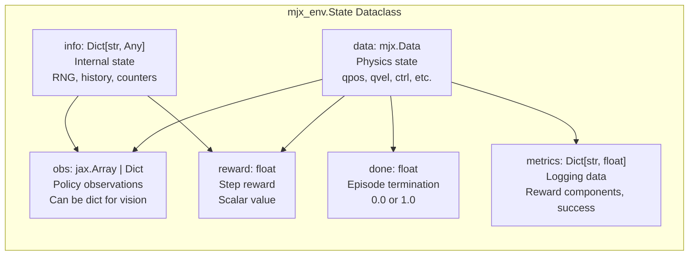
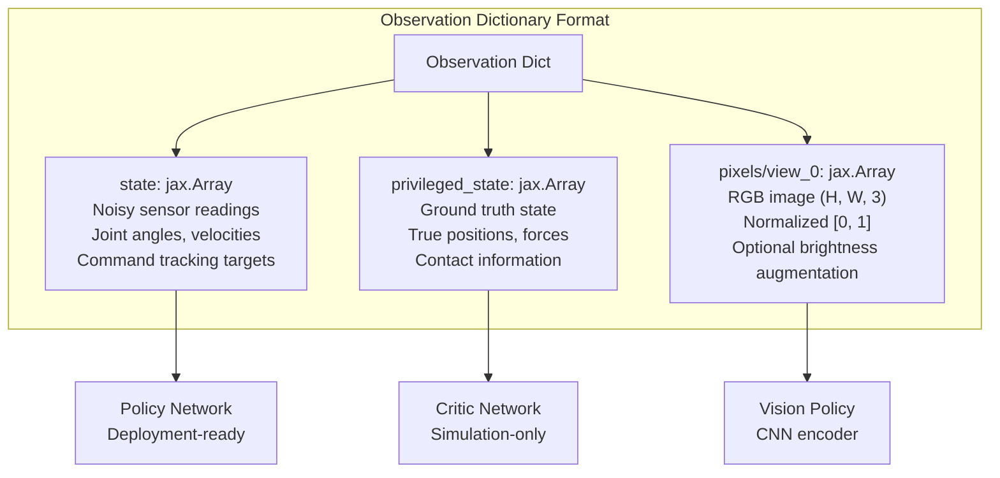
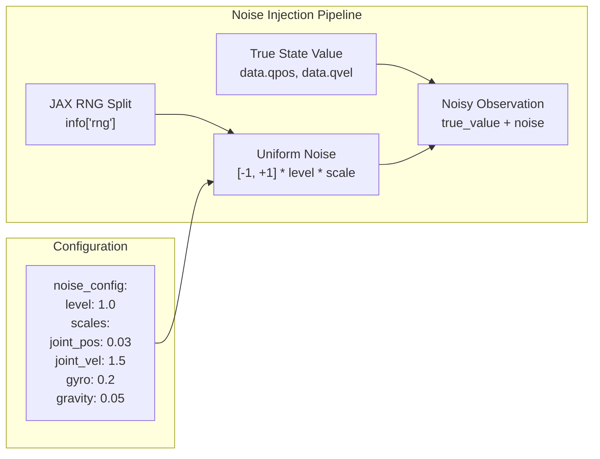
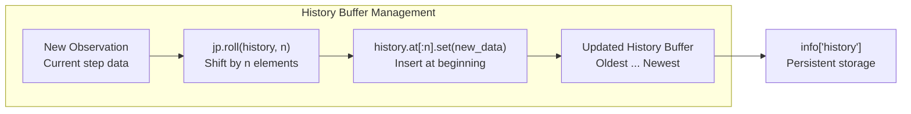
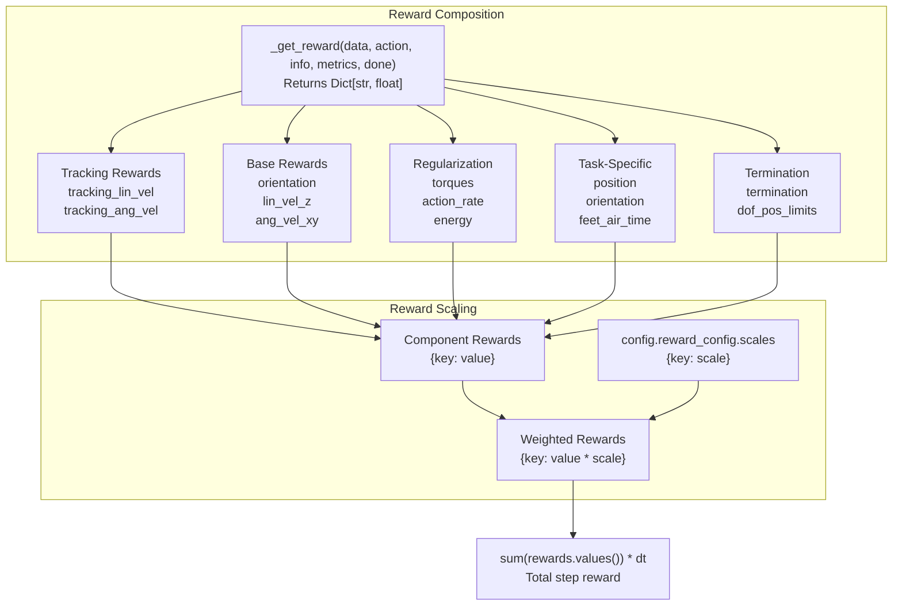
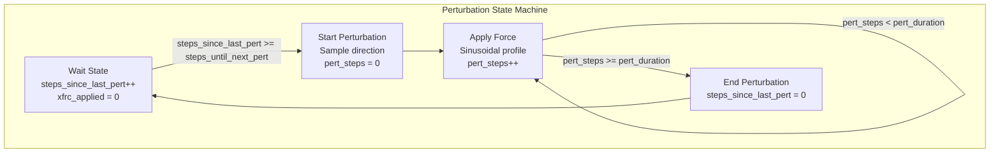
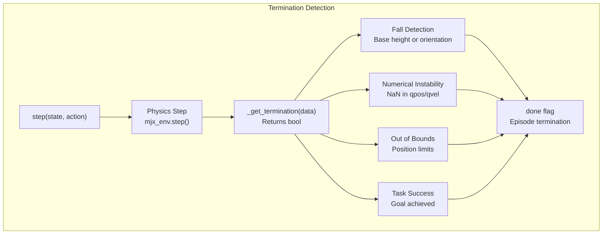

<!-- source: DeepWiki mcp.deepwiki.com · repo google-deepmind/mujoco_playground · page 2.3 Observations, Rewards, and State · fetched 2026-10-26 -->

# Observations, Rewards, and State

<details>
<summary>Relevant source files</summary>

The following files were used as context for generating this wiki page:

- [mujoco_playground/_src/locomotion/go1/joystick.py](mujoco_playground/_src/locomotion/go1/joystick.py)
- [mujoco_playground/_src/manipulation/franka_emika_panda_robotiq/push_cube.py](mujoco_playground/_src/manipulation/franka_emika_panda_robotiq/push_cube.py)
- [mujoco_playground/_src/manipulation/leap_hand/reorient.py](mujoco_playground/_src/manipulation/leap_hand/reorient.py)
- [mujoco_playground/_src/manipulation/leap_hand/rotate_z.py](mujoco_playground/_src/manipulation/leap_hand/rotate_z.py)
- [mujoco_playground/_src/mjx_env.py](mujoco_playground/_src/mjx_env.py)

</details>


This page documents how MuJoCo Playground environments generate observations, calculate multi-component rewards, maintain episode state, and check termination conditions. Understanding these mechanisms is essential for training policies and customizing environment behavior.

For information about the environment step execution flow, see [Diagram 5](#) in the high-level system architecture. For creating custom environments with observations and rewards, see [Creating Custom Environments](#6.1).

---

## State Dataclass Structure

Every environment step returns an `mjx_env.State` dataclass that encapsulates all relevant information about the current episode state:


Sources: [mujoco_playground/_src/mjx_env.py:84-88]()

The `data` field contains MuJoCo/MJX physics state (generalized coordinates, velocities, contact forces). The `obs` field provides observations to the policy network. The `info` dictionary maintains episode-specific state that persists across steps but is not exposed to the policy. The `metrics` dictionary accumulates statistics for logging.

Sources: [mujoco_playground/_src/mjx_env.py:84-88]()

---

## Observation Generation

### Observation Types

Environments generate observations in three primary formats:

| Observation Type | Purpose | Characteristics | Availability |
|-----------------|---------|-----------------|--------------|
| **Standard** | Policy input | Noisy, partial state | All environments |
| **Privileged** | Critic input (asymmetric) | Full state, no noise | Manipulation, locomotion |
| **Vision** | Pixel-based policy | RGB images | With `--vision` flag |

**Standard observations** are designed for deployment on real robots and include realistic sensor noise. **Privileged observations** contain full ground-truth state information only available in simulation, enabling asymmetric actor-critic training where the critic has access to more information than the policy. **Vision observations** use rendered images instead of state vectors.

Sources: [mujoco_playground/_src/manipulation/leap_hand/reorient.py:273-375](), [mujoco_playground/_src/locomotion/go1/joystick.py:309-391]()

### Observation Dictionary Structure

Environments return observations as dictionaries with standardized keys:


Sources: [mujoco_playground/_src/manipulation/leap_hand/reorient.py:372-375](), [mujoco_playground/_src/locomotion/go1/joystick.py:388-391]()

Sources: [mujoco_playground/_src/manipulation/leap_hand/reorient.py:372-375](), [mujoco_playground/_src/locomotion/go1/joystick.py:388-391]()

### Standard Observation Components

Standard observations typically include:

```python
# Example from Leap Hand CubeReorient
state = jp.concatenate([
    noisy_joint_angles,           # 16 - Joint positions with noise
    qpos_error_history,           # 16 * history_len - Tracking errors
    cube_pos_error_history,       # 3 * history_len - Position errors
    cube_ori_error_history,       # 6 * history_len - Orientation errors
    info["last_act"],             # 16 - Previous action
])

# Example from Go1 Joystick
state = jp.hstack([
    noisy_linvel,                 # 3 - Linear velocity
    noisy_gyro,                   # 3 - Angular velocity
    noisy_gravity,                # 3 - Gravity direction
    noisy_joint_angles - default_pose,  # 12 - Joint deviations
    noisy_joint_vel,              # 12 - Joint velocities
    info["last_act"],             # 12 - Previous action
    info["command"],              # 3 - Velocity command
])
```
Sources: [mujoco_playground/_src/manipulation/leap_hand/reorient.py:351-357](), [mujoco_playground/_src/locomotion/go1/joystick.py:357-365]()

### Privileged Observation Components

Privileged observations extend standard observations with ground-truth information:

```python
# Example from Leap Hand CubeReorient
privileged_state = jp.concatenate([
    state,                         # Include all standard observations
    data.qpos[hand_qids],          # True joint positions
    data.qvel[hand_dqids],         # True joint velocities
    get_fingertip_positions(data), # Fingertip Cartesian positions
    cube_pos_error_uncorrupted,    # True position error
    xmat_diff_uncorrupted,         # True orientation error
    get_cube_linvel(data),         # Cube linear velocity
    get_cube_angvel(data),         # Cube angular velocity
    info["pert_dir"],              # Perturbation direction
    data.xfrc_applied[cube_body_id],  # Applied forces
])

# Example from Go1 Joystick
privileged_state = jp.hstack([
    state,                         # Include all standard observations
    gyro,                          # True angular velocity
    accelerometer,                 # True acceleration
    gravity,                       # True gravity vector
    linvel,                        # True linear velocity
    angvel,                        # True angular velocity
    joint_angles - default_pose,   # True joint deviations
    joint_vel,                     # True joint velocities
    data.actuator_force,           # Joint torques
    info["last_contact"],          # Foot contact state
    feet_vel,                      # Foot velocities
    info["feet_air_time"],         # Time in air
    data.xfrc_applied[torso_body_id, :3],  # Applied forces
    steps_since_last_pert >= steps_until_next_pert,  # Perturbation flag
])
```
Sources: [mujoco_playground/_src/manipulation/leap_hand/reorient.py:359-370](), [mujoco_playground/_src/locomotion/go1/joystick.py:371-386]()

### Noise Injection for Sim-to-Real Transfer

Observations include configurable noise to simulate real sensor characteristics:


Sources: [mujoco_playground/_src/locomotion/go1/joystick.py:313-346](), [mujoco_playground/_src/manipulation/leap_hand/reorient.py:277-284]()

Noise is applied uniformly across different sensor modalities:

```python
# Pattern used across environments
info["rng"], noise_rng = jax.random.split(info["rng"])
noisy_value = (
    true_value
    + (2 * jax.random.uniform(noise_rng, shape=true_value.shape) - 1)
    * config.noise_config.level
    * config.noise_config.scales.sensor_name
)
```
Sources: [mujoco_playground/_src/locomotion/go1/joystick.py:313-346](), [mujoco_playground/_src/manipulation/leap_hand/reorient.py:277-284]()

Noise configuration example from Go1 Joystick:

```python
noise_config=config_dict.create(
    level=1.0,  # Global noise multiplier (set to 0.0 to disable)
    scales=config_dict.create(
        joint_pos=0.03,    # Joint position noise
        joint_vel=1.5,     # Joint velocity noise
        gyro=0.2,          # Gyroscope noise
        gravity=0.05,      # Gravity vector noise
        linvel=0.1,        # Linear velocity noise
    ),
)
```
Sources: [mujoco_playground/_src/locomotion/go1/joystick.py:42-50]()

### History Buffers

Environments maintain rolling history buffers to provide temporal context:


Sources: [mujoco_playground/_src/manipulation/leap_hand/reorient.py:177-292]()

Example from CubeReorient tracking joint position errors:

```python
# Initialize history buffer at reset
info["qpos_error_history"] = jp.zeros(config.history_len * 16)

# Update history at each step
qpos_error_history = (
    jp.roll(info["qpos_error_history"], 16)  # Shift by observation size
    .at[:16]                                  # Take first 16 elements
    .set(noisy_joint_angles - motor_targets) # Insert new data
)
info["qpos_error_history"] = qpos_error_history
```
Sources: [mujoco_playground/_src/manipulation/leap_hand/reorient.py:177-292]()

History buffers enable the policy to infer velocities from position changes and detect trends. The buffer length is configurable via `config.history_len`.

### Vision Observations

When `config.vision=True`, environments return pixel observations instead of or alongside state vectors:

```python
# Vision observation generation (PandaPickCubeCartesian)
_, rgb, _ = self.renderer.render(info['render_token'], data)
obs = jp.asarray(rgb[0][..., :3], dtype=jp.float32) / 255.0
obs = adjust_brightness(obs, info['brightness'])
obs = {'pixels/view_0': obs}  # Dictionary format
```
Sources: [mujoco_playground/_src/manipulation/franka_emika_panda/pick_cartesian.py:398-401]()

Vision observations include brightness augmentation for domain randomization:

```python
# Sample brightness at reset
rng_brightness, rng = jax.random.split(rng)
brightness = jax.random.uniform(
    rng_brightness,
    (1,),
    minval=config.obs_noise.brightness[0],
    maxval=config.obs_noise.brightness[1],
)
info.update({'brightness': brightness})

# Apply augmentation
def adjust_brightness(img, scale):
    return jp.clip(img * scale, 0, 1)
```
Sources: [mujoco_playground/_src/manipulation/franka_emika_panda/pick_cartesian.py:256-269, 84-86]()

---

## Reward Calculation

### Multi-Component Reward Architecture

Rewards are computed as a weighted sum of multiple components, each targeting different aspects of the task:


Sources: [mujoco_playground/_src/locomotion/go1/joystick.py:393-431](), [mujoco_playground/_src/manipulation/leap_hand/reorient.py:234-238, 379-414]()

Standard reward computation pattern:

```python
def step(self, state: mjx_env.State, action: jax.Array) -> mjx_env.State:
    # ... physics step ...
    
    # Get unscaled reward components
    rewards = self._get_reward(data, action, state.info, state.metrics, done)
    
    # Apply configured scales
    rewards = {
        k: v * self._config.reward_config.scales[k] 
        for k, v in rewards.items()
    }
    
    # Sum and scale by timestep
    reward = sum(rewards.values()) * self.dt
    
    # Update metrics for logging
    for k, v in rewards.items():
        state.metrics[f"reward/{k}"] = v
```
Sources: [mujoco_playground/_src/locomotion/go1/joystick.py:272-298](), [mujoco_playground/_src/manipulation/leap_hand/reorient.py:234-261]()

### Reward Configuration

Reward scales are defined in the environment's `default_config()`:

```python
# Example from Go1 Joystick
reward_config=config_dict.create(
    scales=config_dict.create(
        # Tracking rewards (positive)
        tracking_lin_vel=1.0,
        tracking_ang_vel=0.5,
        
        # Base regularization (negative)
        lin_vel_z=-0.5,
        ang_vel_xy=-0.05,
        orientation=-5.0,
        
        # Energy costs (negative)
        torques=-0.0002,
        action_rate=-0.01,
        energy=-0.001,
        
        # Task-specific (mixed)
        feet_clearance=-2.0,
        feet_air_time=0.1,
        
        # Termination penalty (negative)
        termination=-1.0,
    ),
    tracking_sigma=0.25,      # Gaussian tracking tolerance
    max_foot_height=0.1,      # Task-specific parameter
)
```
Sources: [mujoco_playground/_src/locomotion/go1/joystick.py:52-79]()

Example from Leap Hand CubeReorient:

```python
reward_config=config_dict.create(
    scales=config_dict.create(
        orientation=5.0,           # Main task objective
        position=0.5,              # Secondary objective
        termination=-100.0,        # Strong penalty
        hand_pose=-0.5,            # Regularization
        action_rate=-0.001,        # Smoothness
        joint_vel=0.0,             # Optional (disabled by default)
        energy=-1e-3,              # Energy efficiency
    ),
    success_reward=100.0,          # Sparse reward on success
)
```
Sources: [mujoco_playground/_src/manipulation/leap_hand/reorient.py:51-62]()

### Reward Component Types

#### Tracking Rewards

Exponential tracking rewards encourage following velocity commands:

```python
def _reward_tracking_lin_vel(
    self, commands: jax.Array, local_vel: jax.Array
) -> jax.Array:
    # Tracking of linear velocity commands (xy axes)
    lin_vel_error = jp.sum(jp.square(commands[:2] - local_vel[:2]))
    return jp.exp(-lin_vel_error / self._config.reward_config.tracking_sigma)

def _reward_tracking_ang_vel(
    self, commands: jax.Array, ang_vel: jax.Array
) -> jax.Array:
    # Tracking of angular velocity commands (yaw)
    ang_vel_error = jp.square(commands[2] - ang_vel[2])
    return jp.exp(-ang_vel_error / self._config.reward_config.tracking_sigma)
```
Sources: [mujoco_playground/_src/locomotion/go1/joystick.py:435-451]()

#### Tolerance-Based Rewards

The `reward.tolerance()` function provides smooth reward shaping:

```python
# From manipulation tasks
cube_pose_mse = jp.linalg.norm(palm_pos - cube_pos)
cube_pos_reward = reward.tolerance(
    cube_pose_mse,          # Distance metric
    (0, 0.02),              # Target bounds (min, max)
    margin=0.05,            # Full reward region
    sigmoid="linear"        # Interpolation type
)
```
Sources: [mujoco_playground/_src/manipulation/leap_hand/reorient.py:389-394]()

Orientation tracking uses angular distance:

```python
def _cube_orientation_error(self, data: mjx.Data):
    cube_ori = self.get_cube_orientation(data)
    goal_ori = self.get_cube_goal_orientation(data)
    quat_diff = math.quat_mul(cube_ori, math.quat_inv(goal_ori))
    quat_diff = math.normalize(quat_diff)
    return 2.0 * jp.asin(jp.clip(math.norm(quat_diff[1:]), a_max=1.0))

def _reward_cube_orientation(self, data: mjx.Data) -> jax.Array:
    ori_error = self._cube_orientation_error(data)
    return reward.tolerance(ori_error, (0, 0.2), margin=jp.pi, sigmoid="linear")
```
Sources: [mujoco_playground/_src/manipulation/leap_hand/reorient.py:421-430]()

#### Regularization Costs

Common regularization terms penalize undesirable behaviors:

```python
# Torque regularization
def _cost_torques(self, torques: jax.Array) -> jax.Array:
    return jp.sqrt(jp.sum(jp.square(torques))) + jp.sum(jp.abs(torques))

# Energy consumption
def _cost_energy(self, qvel: jax.Array, qfrc_actuator: jax.Array) -> jax.Array:
    return jp.sum(jp.abs(qvel) * jp.abs(qfrc_actuator))

# Action rate (smoothness)
def _cost_action_rate(
    self, act: jax.Array, last_act: jax.Array, last_last_act: jax.Array
) -> jax.Array:
    c1 = jp.sum(jp.square(act - last_act))           # First derivative
    c2 = jp.sum(jp.square(act - 2*last_act + last_last_act))  # Second derivative
    return c1 + c2
```
Sources: [mujoco_playground/_src/locomotion/go1/joystick.py:469-483](), [mujoco_playground/_src/manipulation/leap_hand/reorient.py:416-437]()

#### Constraint Penalties

Soft constraints prevent undesirable states:

```python
# Joint position limits
def _cost_joint_pos_limits(self, qpos: jax.Array) -> jax.Array:
    out_of_limits = -jp.clip(qpos - self._soft_lowers, None, 0.0)
    out_of_limits += jp.clip(qpos - self._soft_uppers, 0.0, None)
    return jp.sum(out_of_limits)

# Orientation constraint
def _cost_orientation(self, torso_zaxis: jax.Array) -> jax.Array:
    # Penalize non-flat base orientation
    return jp.sum(jp.square(torso_zaxis[:2]))

# Velocity constraints
def _cost_lin_vel_z(self, global_linvel) -> jax.Array:
    return jp.square(global_linvel[2])
```
Sources: [mujoco_playground/_src/locomotion/go1/joystick.py:455-465, 504-508]()

#### Task-Specific Rewards

Locomotion foot contact rewards:

```python
def _reward_feet_air_time(
    self, air_time: jax.Array, first_contact: jax.Array, commands: jax.Array
) -> jax.Array:
    cmd_norm = jp.linalg.norm(commands)
    rew_air_time = jp.sum((air_time - 0.1) * first_contact)
    rew_air_time *= cmd_norm > 0.01  # Only when moving
    return rew_air_time

def _cost_feet_slip(
    self, data: mjx.Data, contact: jax.Array, info: dict[str, Any]
) -> jax.Array:
    cmd_norm = jp.linalg.norm(info["command"])
    feet_vel = data.sensordata[self._foot_linvel_sensor_adr]
    vel_xy = feet_vel[..., :2]
    vel_xy_norm_sq = jp.sum(jp.square(vel_xy), axis=-1)
    return jp.sum(vel_xy_norm_sq * contact) * (cmd_norm > 0.01)
```
Sources: [mujoco_playground/_src/locomotion/go1/joystick.py:512-547]()

### Sparse and Dense Rewards

Environments combine dense shaping rewards with sparse success rewards:

```python
# Dense rewards from components
rewards = self._get_reward(data, action, state.info, state.metrics, done)
rewards = {k: v * self._config.reward_config.scales[k] for k, v in rewards.items()}
reward = sum(rewards.values()) * self.dt

# Sparse success reward
ori_error = self._cube_orientation_error(data)
success = ori_error < self._config.success_threshold
reward += success * self._config.reward_config.success_reward

# Sparse lifted reward (PandaPickCubeCartesian)
box_pos = data.xpos[self._obj_body]
lifted = (box_pos[2] > 0.05) * self._config.reward_config.lifted_reward
reward += lifted
```
Sources: [mujoco_playground/_src/manipulation/leap_hand/reorient.py:234-254](), [mujoco_playground/_src/manipulation/franka_emika_panda/pick_cartesian.py:356-360]()

### Potential-Based Reward Shaping

Some environments use reward progress tracking to encourage monotonic improvement:

```python
# Compute total potential-based reward
total_reward = jp.clip(sum(rewards.values()), -1e4, 1e4)

# Add sparse rewards
total_reward += lifted + success * config.reward_config.success_reward

# Return only positive progress
reward = jp.maximum(
    total_reward - state.info['prev_reward'], 
    jp.zeros_like(total_reward)
)
state.info['prev_reward'] = jp.maximum(total_reward, state.info['prev_reward'])
```
Sources: [mujoco_playground/_src/manipulation/franka_emika_panda/pick_cartesian.py:346-368]()

This prevents the agent from receiving negative rewards by regressing to worse states.

---

## Episode State Management

### Info Dictionary Structure

The `info` dictionary maintains episode-specific state that persists across steps:

| Category | Keys | Purpose |
|----------|------|---------|
| **RNG State** | `rng` | JAX random number generator for reproducible noise |
| **Action History** | `last_act`, `last_last_act` | Previous actions for smoothness penalties |
| **Command Tracking** | `command`, `steps_until_next_cmd` | Locomotion velocity commands |
| **Perturbation State** | `pert_dir`, `pert_steps`, `steps_until_next_pert` | External force application |
| **Task State** | `motor_targets`, `current_pos`, `reached_box` | Controller and progress tracking |
| **History Buffers** | `qpos_error_history`, `cube_pos_error_history` | Observation history |
| **Contact State** | `feet_air_time`, `last_contact`, `swing_peak` | Locomotion foot contact |
| **Counters** | `step`, `_steps`, `success_count` | Episode progress |

Sources: [mujoco_playground/_src/locomotion/go1/joystick.py:213-229](), [mujoco_playground/_src/manipulation/leap_hand/reorient.py:169-187](), [mujoco_playground/_src/manipulation/franka_emika_panda/pick_cartesian.py:237-249]()

### RNG State Management

JAX requires explicit random number generator splitting for deterministic pseudo-randomness:

```python
# Pattern used across all environments
def reset(self, rng: jax.Array) -> mjx_env.State:
    # Split RNG for different random operations
    rng, goal_rng = jax.random.split(rng)
    goal_quat = uniform_quat(goal_rng)
    
    rng, pos_rng, vel_rng = jax.random.split(rng, 3)
    # ... use pos_rng and vel_rng ...
    
    # Store RNG in info for step function
    info = {"rng": rng, ...}

def step(self, state: mjx_env.State, action: jax.Array) -> mjx_env.State:
    # Split RNG before each use
    state.info["rng"], noise_rng = jax.random.split(state.info["rng"])
    noisy_value = true_value + jax.random.uniform(noise_rng, ...)
```
Sources: [mujoco_playground/_src/manipulation/leap_hand/reorient.py:109-144, 278]()

### Command Sampling for Locomotion

Locomotion tasks sample velocity commands at random intervals:

```python
# Initialize command at reset
rng, key1, key2 = jax.random.split(rng, 3)
time_until_next_cmd = jax.random.exponential(key1) * 5.0
steps_until_next_cmd = jp.round(time_until_next_cmd / self.dt).astype(jp.int32)
cmd = jax.random.uniform(key2, shape=(3,), minval=-cmd_a, maxval=cmd_a)

info = {
    "command": cmd,
    "steps_until_next_cmd": steps_until_next_cmd,
}

# Update command in step
state.info["steps_until_next_cmd"] -= 1
state.info["rng"], key1, key2 = jax.random.split(state.info["rng"], 3)
state.info["command"] = jp.where(
    state.info["steps_until_next_cmd"] <= 0,
    self.sample_command(key1, state.info["command"]),
    state.info["command"],
)
state.info["steps_until_next_cmd"] = jp.where(
    done | (state.info["steps_until_next_cmd"] <= 0),
    jp.round(jax.random.exponential(key2) * 5.0 / self.dt).astype(jp.int32),
    state.info["steps_until_next_cmd"],
)
```
Sources: [mujoco_playground/_src/locomotion/go1/joystick.py:204-293]()

Command sampling uses exponential timing to create variable-length command intervals, with Bernoulli masking to zero out certain command dimensions:

```python
def sample_command(self, rng: jax.Array, x_k: jax.Array) -> jax.Array:
    rng, y_rng, w_rng, z_rng = jax.random.split(rng, 4)
    y_k = jax.random.uniform(
        y_rng, shape=(3,), minval=-self._cmd_a, maxval=self._cmd_a
    )
    z_k = jax.random.bernoulli(z_rng, self._cmd_b, shape=(3,))
    w_k = jax.random.bernoulli(w_rng, 0.5, shape=(3,))
    x_kp1 = x_k - w_k * (x_k - y_k * z_k)
    return x_kp1
```
Sources: [mujoco_playground/_src/locomotion/go1/joystick.py:607-615]()

### Perturbation State Management

External perturbations simulate disturbances during training:


Sources: [mujoco_playground/_src/locomotion/go1/joystick.py:551-605]()

Perturbation implementation:

```python
def _maybe_apply_perturbation(self, state: mjx_env.State) -> mjx_env.State:
    def apply_pert(state: mjx_env.State) -> mjx_env.State:
        t = state.info["pert_steps"] * self.dt
        u_t = 0.5 * jp.sin(jp.pi * t / state.info["pert_duration_seconds"])
        force = (
            u_t * self._torso_mass * state.info["pert_mag"] 
            / state.info["pert_duration_seconds"]
        )
        xfrc_applied = jp.zeros((self.mjx_model.nbody, 6))
        xfrc_applied = xfrc_applied.at[self._torso_body_id, :3].set(
            force * state.info["pert_dir"]
        )
        data = state.data.replace(xfrc_applied=xfrc_applied)
        state.info["pert_steps"] += 1
        return state.replace(data=data)
    
    return jax.lax.cond(
        state.info["steps_since_last_pert"] >= state.info["steps_until_next_pert"],
        apply_pert,
        wait,
        state,
    )
```
Sources: [mujoco_playground/_src/locomotion/go1/joystick.py:551-605](), [mujoco_playground/_src/manipulation/leap_hand/reorient.py:447-481]()

---

## Termination Conditions

### Termination Check Pattern

All environments implement `_get_termination()` to detect episode-ending conditions:


Sources: [mujoco_playground/_src/locomotion/go1/joystick.py:305-307](), [mujoco_playground/_src/manipulation/leap_hand/reorient.py:267-271]()

### Common Termination Conditions

#### Fall Detection (Locomotion)

```python
def _get_termination(self, data: mjx.Data) -> jax.Array:
    fall_termination = self.get_upvector(data)[-1] < 0.0
    return fall_termination
```
Sources: [mujoco_playground/_src/locomotion/go1/joystick.py:305-307]()

#### Fall and NaN Detection (Manipulation)

```python
def _get_termination(self, data: mjx.Data, info: dict[str, Any]) -> jax.Array:
    fall_termination = self.get_cube_position(data)[2] < -0.05
    nans = jp.any(jp.isnan(data.qpos)) | jp.any(jp.isnan(data.qvel))
    return fall_termination | nans
```
Sources: [mujoco_playground/_src/manipulation/leap_hand/reorient.py:267-271]()

#### Out of Bounds (Cartesian Tasks)

```python
out_of_bounds = jp.any(jp.abs(box_pos) > 1.0)
out_of_bounds |= box_pos[2] < 0.0
done = (
    out_of_bounds
    | jp.isnan(data.qpos).any()
    | jp.isnan(data.qvel).any()
    | success
)
```
Sources: [mujoco_playground/_src/manipulation/franka_emika_panda/pick_cartesian.py:371-385]()

### Episode Length Management

Episode length is enforced through auto-reset wrappers (see [Environment Wrappers](#4.4)), but environments may track steps internally:

```python
# Internal step counter for synchronization
state.info['_steps'] += self._config.action_repeat
state.info['_steps'] = jp.where(
    done | (state.info['_steps'] >= self._config.episode_length),
    0,
    state.info['_steps'],
)
```
Sources: [mujoco_playground/_src/manipulation/franka_emika_panda/pick_cartesian.py:388-393]()

---

## Metrics Tracking

### Metrics Dictionary

The `metrics` dictionary accumulates statistics for logging and analysis:

```python
# Initialize metrics at reset
metrics = {}
for k in self._config.reward_config.scales.keys():
    metrics[f"reward/{k}"] = jp.zeros(())
metrics["reward/success"] = jp.zeros((), dtype=float)
metrics["steps_since_last_success"] = 0
metrics["success_count"] = 0

# Update metrics at each step
for k, v in rewards.items():
    state.metrics[f"reward/{k}"] = v
state.metrics["reward/success"] = success.astype(float)
state.metrics["steps_since_last_success"] = state.info["steps_since_last_success"]
```
Sources: [mujoco_playground/_src/manipulation/leap_hand/reorient.py:189-262]()

### Success Tracking

Manipulation tasks track success events and time since last success:

```python
ori_error = self._cube_orientation_error(data)
success = ori_error < self._config.success_threshold

state.info["steps_since_last_success"] = jp.where(
    success, 0, state.info["steps_since_last_success"] + 1
)
state.info["success_count"] = jp.where(
    success, state.info["success_count"] + 1, state.info["success_count"]
)

state.metrics["steps_since_last_success"] = state.info["steps_since_last_success"]
state.metrics["success_count"] = state.info["success_count"]
```
Sources: [mujoco_playground/_src/manipulation/leap_hand/reorient.py:218-229]()

### Task-Specific Metrics

Locomotion environments track foot swing height:

```python
# Track maximum foot height during swing phase
p_f = data.site_xpos[self._feet_site_id]
p_fz = p_f[..., -1]
state.info["swing_peak"] = jp.maximum(state.info["swing_peak"], p_fz)

# Reset on contact
state.info["swing_peak"] *= ~contact

# Log average swing peak
state.metrics["swing_peak"] = jp.mean(state.info["swing_peak"])
```
Sources: [mujoco_playground/_src/locomotion/go1/joystick.py:263-299]()

### Reward Component Logging

All reward components are logged individually:

```python
# Raw rewards (before scaling)
raw_rewards = self._get_reward(data, state.info)

# Scaled rewards for training
rewards = {
    k: v * self._config.reward_config.reward_scales[k]
    for k, v in raw_rewards.items()
}

# Log both in metrics
state.metrics.update({f'reward/{k}': v for k, v in raw_rewards.items()})
```
Sources: [mujoco_playground/_src/manipulation/franka_emika_panda/pick_cartesian.py:333-378]()

This enables detailed analysis of which reward components are active during training and how they contribute to the total reward signal.

---

