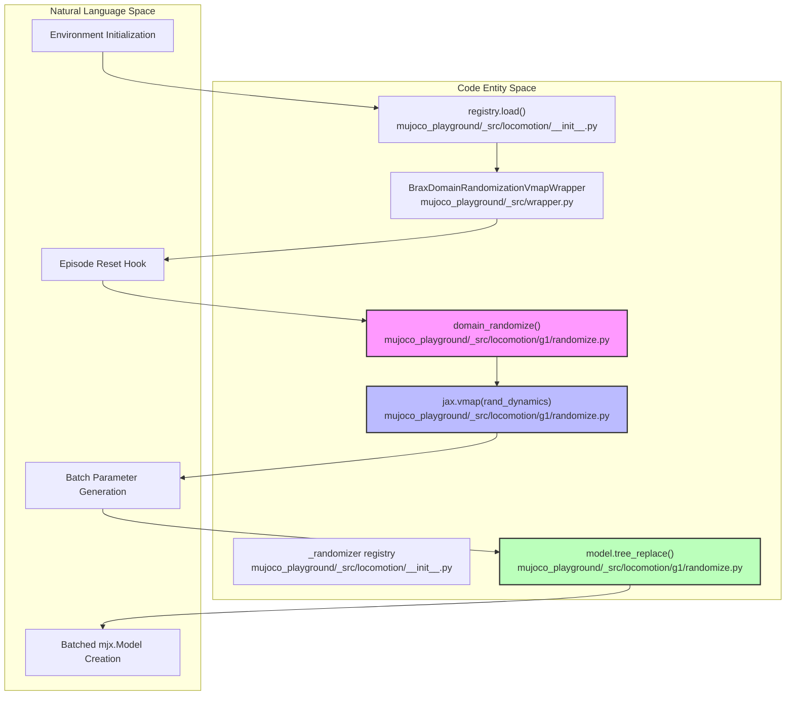
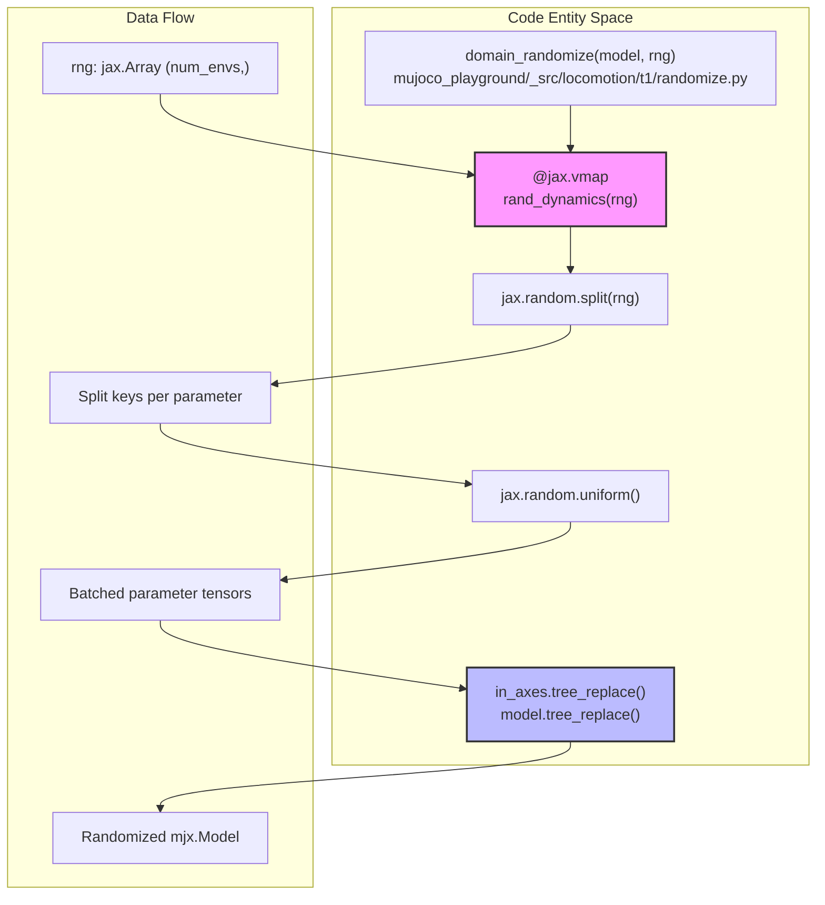
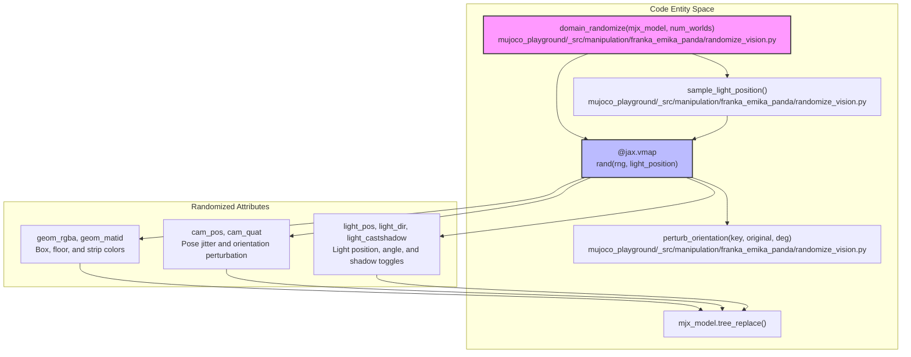
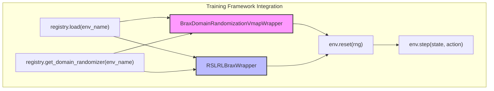

<!-- source: DeepWiki mcp.deepwiki.com · repo google-deepmind/mujoco_playground · page 2.4 Domain Randomization · fetched 2026-10-26 -->

# Domain Randomization

<details>
<summary>Relevant source files</summary>

The following files were used as context for generating this wiki page:

- [mujoco_playground/_src/dm_control_suite/__init__.py](mujoco_playground/_src/dm_control_suite/__init__.py)
- [mujoco_playground/_src/locomotion/__init__.py](mujoco_playground/_src/locomotion/__init__.py)
- [mujoco_playground/_src/locomotion/berkeley_humanoid/randomize.py](mujoco_playground/_src/locomotion/berkeley_humanoid/randomize.py)
- [mujoco_playground/_src/locomotion/g1/randomize.py](mujoco_playground/_src/locomotion/g1/randomize.py)
- [mujoco_playground/_src/locomotion/go1/randomize.py](mujoco_playground/_src/locomotion/go1/randomize.py)
- [mujoco_playground/_src/locomotion/t1/randomize.py](mujoco_playground/_src/locomotion/t1/randomize.py)
- [mujoco_playground/_src/manipulation/__init__.py](mujoco_playground/_src/manipulation/__init__.py)
- [mujoco_playground/_src/manipulation/franka_emika_panda/randomize_vision.py](mujoco_playground/_src/manipulation/franka_emika_panda/randomize_vision.py)
- [mujoco_playground/_src/manipulation/franka_emika_panda/xmls/mjx_cabinet.xml](mujoco_playground/_src/manipulation/franka_emika_panda/xmls/mjx_cabinet.xml)
- [mujoco_playground/_src/manipulation/franka_emika_panda/xmls/mjx_single_cube.xml](mujoco_playground/_src/manipulation/franka_emika_panda/xmls/mjx_single_cube.xml)
- [mujoco_playground/_src/manipulation/franka_emika_panda/xmls/mjx_single_cube_camera.xml](mujoco_playground/_src/manipulation/franka_emika_panda/xmls/mjx_single_cube_camera.xml)

</details>


## Purpose and Scope

This page documents the domain randomization system in MuJoCo Playground, which enables sim-to-real transfer by training policies robust to variations in physics parameters, lighting, and camera setups. Domain randomization applies stochastic modifications to simulation properties (friction, mass, armature, actuator gains, light positions, and camera poses) during training, creating a diverse distribution of simulation environments. Policies trained with domain randomization generalize effectively to real hardware where exact parameters are uncertain.

For details on how domain randomization integrates with environment wrappers, see [Environment Wrappers](#4.4). For vision training workflows, see [Vision-Based Training](#4.5).

Sources: [mujoco_playground/_src/manipulation/franka_emika_panda/randomize_vision.py:58-187](), [mujoco_playground/_src/locomotion/g1/randomize.py:23-100]()

---

## Overview and Architecture

Domain randomization in MuJoCo Playground operates by modifying `mjx.Model` parameters at episode reset. Environments define a `domain_randomize()` function within their respective `randomize.py` modules (or `randomize_vision.py` for vision tasks). The system uses `jax.vmap` to vectorize parameter generation and model tree updates across parallel GPU environments.



Sources: [mujoco_playground/_src/locomotion/__init__.py:115-131](), [mujoco_playground/_src/locomotion/g1/randomize.py:23-100]()

---

## Physics Parameters and `randomize.py` Implementation

Physics randomization functions follow a standardized signature accepting an `mjx.Model` and a JAX random key `rng`, returning a modified batched `mjx.Model` and an `in_axes` tree structure.

```python
def domain_randomize(model: mjx.Model, rng: jax.Array) -> Tuple[mjx.Model, Any]:
  ...
```

### Key Parameter Categories

| Parameter | Model Field | Typical Operation / Range | Purpose |
|-----------|-------------|---------------------------|---------|
| Floor / Pair Friction | `geom_friction` / `pair_friction` | Uniform: `U(0.4, 1.0)` | Vary ground slip and foot grip |
| Joint Friction Loss | `dof_frictionloss` | Multiplicative: `*U(0.5, 2.0)` | Joint internal resistance |
| Armature | `dof_armature` | Multiplicative: `*U(1.0, 1.05)` | Rotor inertia representation |
| Body Masses | `body_mass` | Multiplicative: `*U(0.9, 1.1)` + Additive | Total weight & payload distribution |
| Center of Mass | `body_ipos` | Additive: `+U(-0.05, 0.05)` | CoM offset jitter |
| Joint Stiffness & Bias | `actuator_gainprm`, `actuator_biasprm` | Multiplicative: `*U(0.9, 1.1)` | PD controller gain variation |
| Initial Pose | `qpos0` | Additive: `+U(-0.05, 0.05)` | Starting configuration noise |

Sources: [mujoco_playground/_src/locomotion/t1/randomize.py:26-130](), [mujoco_playground/_src/locomotion/g1/randomize.py:23-100]()

### Vectorized Execution Flow



Sources: [mujoco_playground/_src/locomotion/t1/randomize.py:26-130]()

---

## Vision-Specific Randomization

For vision-based tasks, `randomize_vision.py` randomizes appearance, cameras, and lighting parameters to bridge the visual gap between simulation and the real world.

### Implementation in `randomize_vision.py`

The vision randomizer modifies rendering and scene properties such as geom RGBA colors, material IDs, camera positions and orientations, light positions, light directions, and shadow casting flags [mujoco_playground/_src/manipulation/franka_emika_panda/randomize_vision.py:58-187]().



Sources: [mujoco_playground/_src/manipulation/franka_emika_panda/randomize_vision.py:27-187]()

---

## Integration with Training Wrappers

Domain randomization functions integrate into training workflows through environment wrappers like `BraxDomainRandomizationVmapWrapper` and `RSLRLBraxWrapper`.



When an episode resets, the wrapper evaluates the domain randomization function to instantiate randomized physical or visual models across the batch dimension.

Sources: [mujoco_playground/_src/manipulation/__init__.py:123-133](), [mujoco_playground/_src/locomotion/__init__.py:115-131]()

---

## Summary of Environment Randomizers

The table below catalogs environments that include dedicated domain randomization modules:

| Environment Category | Environment Name | Randomizer Source File | Key Randomized Properties |
|----------------------|------------------|------------------------|---------------------------|
| Locomotion | `Go1JoystickFlatTerrain` / `RoughTerrain` / `Getup` / `Handstand` | `mujoco_playground/_src/locomotion/go1/randomize.py` | Floor friction, frictionloss, armature, CoM position, body masses, `qpos0` |
| Locomotion | `G1JoystickFlatTerrain` / `RoughTerrain` | `mujoco_playground/_src/locomotion/g1/randomize.py` | Pair friction, static friction, armature, body masses, torso mass, `qpos0` |
| Locomotion | `T1JoystickFlatTerrain` / `RoughTerrain` | `mujoco_playground/_src/locomotion/t1/randomize.py` | Geom friction, frictionloss, armature, body masses, torso mass, `qpos0`, gains, damping |
| Locomotion | `BerkeleyHumanoid` | `mujoco_playground/_src/locomotion/berkeley_humanoid/randomize.py` | Floor friction, frictionloss, armature, body masses, torso mass, `qpos0` |
| Manipulation | `LeapCubeReorient` / `CubeRotateZAxis` | `mujoco_playground/_src/manipulation/leap_hand/` | Fingertip friction, cube mass/inertia/CoM, joint friction/armature/stiffness/damping |
| Manipulation | `PandaPickCubeCartesian` (Vision) | `mujoco_playground/_src/manipulation/franka_emika_panda/randomize_vision.py` | Geom RGBA, material IDs, camera position/orientation, light position/direction/shadows |

Sources: [mujoco_playground/_src/manipulation/__init__.py:59-63](), [mujoco_playground/_src/locomotion/__init__.py:115-131](), [mujoco_playground/_src/manipulation/franka_emika_panda/randomize_vision.py:58-187]()

---

