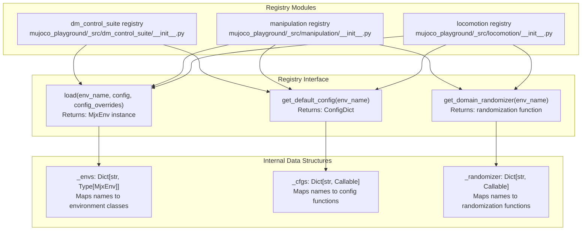

<!-- source: DeepWiki mcp.deepwiki.com · repo google-deepmind/mujoco_playground · page 3 Environment Collections · fetched 2026-10-26 -->

# Environment Collections

Relevant source files

The following files were used as context for generating this wiki page:

- [mujoco_playground/_src/dm_control_suite/__init__.py](mujoco_playground/_src/dm_control_suite/__init__.py)
- [mujoco_playground/_src/locomotion/__init__.py](mujoco_playground/_src/locomotion/__init__.py)
- [mujoco_playground/_src/locomotion/t1/randomize.py](mujoco_playground/_src/locomotion/t1/randomize.py)
- [mujoco_playground/_src/manipulation/__init__.py](mujoco_playground/_src/manipulation/__init__.py)

This page provides an overview of the three main environment categories in MuJoCo Playground: Locomotion, Manipulation, and the DeepMind Control Suite. MuJoCo Playground organizes over 50 GPU-accelerated reinforcement learning environments across these categories, utilizing unified registry modules to manage environment instantiation, configuration, and domain randomization.

For detailed technical specifications, base classes, reward formulations, and task implementations, refer to the child pages:
- [Locomotion Environments](#3.1)
- [Manipulation Environments](#3.2)
- [DM Control Suite](#3.3)

Sources: [mujoco_playground/_src/locomotion/__init__.py:1-44](), [mujoco_playground/_src/manipulation/__init__.py:1-44](), [mujoco_playground/_src/dm_control_suite/__init__.py:1-36]()

## Registry Architecture

Each environment category implements a registry pattern that handles environment discovery, configuration management, and domain randomizer retrieval.

Sources: [mujoco_playground/_src/locomotion/__init__.py:45-131](), [mujoco_playground/_src/manipulation/__init__.py:33-63]()

## 3.1. Locomotion Environments

The locomotion collection covers quadruped and bipedal robotic platforms performing tasks such as velocity joystick tracking, recovery, acrobatic maneuvers, and gait tracking. 

For detailed information on base classes, terrain XML scenes, command generators, and perturbation systems, see [Locomotion Environments](#3.1).

### Quadrupeds and Bipedal Catalog
- **Quadrupeds:** Unitree Go1 (`Go1JoystickFlatTerrain`, `Go1JoystickRoughTerrain`, `Go1Getup`, `Go1Handstand`, `Go1Footstand`), Boston Dynamics Spot (`SpotFlatTerrainJoystick`, `SpotGetup`, `SpotJoystickGaitTracking`), Barkour (`BarkourJoystick`), and Apollo (`ApolloJoystickFlatTerrain`). [mujoco_playground/_src/locomotion/__init__.py:45-87]()
- **Bipeds & Humanoids:** Unitree G1 (`G1JoystickFlatTerrain`, `G1JoystickRoughTerrain`), Berkeley Humanoid (`BerkeleyHumanoidJoystickFlatTerrain`, `BerkeleyHumanoidJoystickRoughTerrain`), Unitree H1 (`H1InplaceGaitTracking`, `H1JoystickGaitTracking`), Unitree T1 (`T1JoystickFlatTerrain`, `T1JoystickRoughTerrain`), and Robotis OP3 (`Op3Joystick`). [mujoco_playground/_src/locomotion/__init__.py:45-87]()

Sources: [mujoco_playground/_src/locomotion/__init__.py:45-87]()

## 3.2. Manipulation Environments

The manipulation collection spans dexterous hand control and robotic arm tasks, emphasizing in-hand reorientation, pick-and-place, open-cabinet, and bimanual handovers.

For detailed information on shared base classes, Cartesian control integration, and reward shaping, see [Manipulation Environments](#3.2).

### Manipulation Catalog
- **Dexterous Hands:** Leap Hand (`LeapCubeReorient`, `LeapCubeRotateZAxis`) and Aero Hand (`AeroCubeRotateZAxis`). [mujoco_playground/_src/manipulation/__init__.py:33-44]()
- **Robotic Arms:** Franka Emika Panda (`PandaPickCube`, `PandaPickCubeOrientation`, `PandaPickCubeCartesian`, `PandaOpenCabinet`), Panda with Robotiq gripper (`PandaRobotiqPushCube`), and ALOHA dual arms (`AlohaHandOver`, `AlohaSinglePegInsertion`). [mujoco_playground/_src/manipulation/__init__.py:33-44]()

Sources: [mujoco_playground/_src/manipulation/__init__.py:33-44]()

## 3.3. DM Control Suite

The DeepMind Control Suite integration ports classic continuous control benchmarks to the GPU-accelerated MJX backend. These environments support both dense and sparse reward variants as well as vision configurations.

For detailed information on the 25+ ported environments (cartpole, acrobot, cheetah, walker, finger, fish, hopper, humanoid, pendulum, point mass, reacher, swimmer, ball-in-cup), see [DM Control Suite](#3.3).

### DM Control Suite Catalog Highlights
- **Classic Control:** `AcrobotSwingup`, `AcrobotSwingupSparse`, `CartpoleBalance`, `CartpoleBalanceSparse`, `CartpoleSwingup`, `CartpoleSwingupSparse`, `PendulumSwingup`. [mujoco_playground/_src/dm_control_suite/__init__.py:37-71]()
- **Locomotion & Swimming:** `CheetahRun`, `FishSwim`, `HopperHop`, `HopperStand`, `HumanoidStand`, `HumanoidWalk`, `HumanoidRun`, `WalkerRun`, `WalkerStand`, `WalkerWalk`. [mujoco_playground/_src/dm_control_suite/__init__.py:37-71]()
- **Manipulation & Reaching:** `FingerSpin`, `FingerTurnEasy`, `FingerTurnHard`, `PointMass`, `ReacherEasy`, `ReacherHard`, `SwimmerSwimmer6`, `BallInCup`. [mujoco_playground/_src/dm_control_suite/__init__.py:37-71]()

Sources: [mujoco_playground/_src/dm_control_suite/__init__.py:37-71]()

---

