<!-- source: DeepWiki mcp.deepwiki.com · repo google-deepmind/mujoco_playground · page 3.1 Locomotion Environments · fetched 2026-10-26 -->

# Locomotion Environments

Relevant source files

The following files were used as context for generating this wiki page:

- [mujoco_playground/_src/locomotion/berkeley_humanoid/xmls/scene_mjx_feetonly_rough_terrain.xml](mujoco_playground/_src/locomotion/berkeley_humanoid/xmls/scene_mjx_feetonly_rough_terrain.xml)
- [mujoco_playground/_src/locomotion/g1/xmls/scene_mjx_feetonly_rough_terrain.xml](mujoco_playground/_src/locomotion/g1/xmls/scene_mjx_feetonly_rough_terrain.xml)
- [mujoco_playground/_src/locomotion/go1/base.py](mujoco_playground/_src/locomotion/go1/base.py)
- [mujoco_playground/_src/locomotion/go1/xmls/scene_mjx_feetonly_rough_terrain.xml](mujoco_playground/_src/locomotion/go1/xmls/scene_mjx_feetonly_rough_terrain.xml)
- [mujoco_playground/_src/locomotion/op3/base.py](mujoco_playground/_src/locomotion/op3/base.py)
- [mujoco_playground/_src/locomotion/t1/base.py](mujoco_playground/_src/locomotion/t1/base.py)
- [mujoco_playground/_src/locomotion/t1/xmls/scene_mjx_feetonly_rough_terrain.xml](mujoco_playground/_src/locomotion/t1/xmls/scene_mjx_feetonly_rough_terrain.xml)
- [mujoco_playground/config/locomotion_params.py](mujoco_playground/config/locomotion_params.py)
- [mujoco_playground/experimental/madrona_benchmarking/benchmark.py](mujoco_playground/experimental/madrona_benchmarking/benchmark.py)

This page provides an overview of the locomotion environments available in MuJoCo Playground, covering reinforcement learning tasks for both quadrupedal and bipedal robots. These GPU-accelerated environments support diverse locomotion behaviors, including joystick-controlled flat and rough terrain navigation, recovery tasks, specialized skills, and gait tracking.

For specific details on quadrupeds, see [Quadruped Robot Environments](#3.1.1). For bipeds and humanoids, see [Bipedal and Humanoid Environments](#3.1.2).

Sources: [mujoco_playground/config/locomotion_params.py:15-22]()

---

## Quadruped Robot Environments

Quadrupedal environments in MuJoCo Playground model robots such as Unitree Go1, Boston Dynamics Spot, Barkour, Apollo, and T1. These platforms feature high-frequency control loops, joint PD gain management [mujoco_playground/_src/locomotion/go1/base.py:58-61](), contact sensors, and specialized training pipelines. Task variations include velocity tracking via joystick on flat and rough terrain (hfields), getup and recovery tasks, footstands/handstands, and gait tracking.

For full details on task designs, reward components, command sampling, and perturbation systems for four-legged platforms, see [Quadruped Robot Environments](#3.1.1).

Sources: [mujoco_playground/config/locomotion_params.py:55-162](), [mujoco_playground/_src/locomotion/go1/base.py:40-78]()

---

## Bipedal and Humanoid Environments

Bipedal and humanoid environments cover complex balancing and locomotion tasks across platforms such as the Berkeley Humanoid, Unitree G1 and H1, Robotis OP3, and Booster T1. These environments utilize dedicated sensor XML layouts, root and joint state sensors, and specialized reward formulations to handle underactuation and stability during locomotion and gait tracking.

For comprehensive documentation on bipedal base classes, sensor interfaces, and joystick or gait-tracking task variations, see [Bipedal and Humanoid Environments](#3.1.2).

Sources: [mujoco_playground/config/locomotion_params.py:96-151](), [mujoco_playground/_src/locomotion/t1/base.py:39-100](), [mujoco_playground/_src/locomotion/op3/base.py:40-105]()

---

## Shared Infrastructure and Registration

All locomotion environments integrate with a centralized registry system, configuration manager, and domain randomization pipeline. 

### Robot Taxonomy and Tasks

The following diagram illustrates the taxonomy of locomotion environments across robot platforms and task types:

```mermaid
graph TD
    subgraph "Quadrupedal Robots"
        GO1["Go1 Robot"]
        SPOT["Spot Robot"] 
        BARKOUR["Barkour Robot"]
        APOLLO["Apollo Robot"]
        T1["T1 Robot"]
    end
    
    subgraph "Bipedal Humanoids"
        BERKELEY["Berkeley Humanoid"]
        G1["G1 Humanoid"]
        H1["H1 Humanoid"]
        OP3["OP3 Humanoid"]
    end
    
    subgraph "Joystick Control Tasks"
        GO1_JOY_FLAT["Go1JoystickFlatTerrain"]
        GO1_JOY_ROUGH["Go1JoystickRoughTerrain"]
        SPOT_JOY["SpotFlatTerrainJoystick"]
        BARKOUR_JOY["BarkourJoystick"]
        APOLLO_JOY["ApolloJoystickFlatTerrain"]
        T1_JOY_FLAT["T1JoystickFlatTerrain"]
        T1_JOY_ROUGH["T1JoystickRoughTerrain"]
        BERK_JOY_FLAT["BerkeleyHumanoidJoystickFlatTerrain"]
        BERK_JOY_ROUGH["BerkeleyHumanoidJoystickRoughTerrain"]
        G1_JOY_FLAT["G1JoystickFlatTerrain"]
        G1_JOY_ROUGH["G1JoystickRoughTerrain"]
        OP3_JOY["Op3Joystick"]
    end
    
    subgraph "Recovery and Skills"
        GO1_GET["Go1Getup"]
        SPOT_GET["SpotGetup"]
        GO1_HAND["Go1Handstand"]
    end
    
    subgraph "Gait Tracking"
        H1_INPLACE["H1InplaceGaitTracking"]
        H1_GAIT["H1JoystickGaitTracking"]
        SPOT_GAIT["SpotJoystickGaitTracking"]
    end
    
    GO1 --> GO1_JOY_FLAT
    GO1 --> GO1_JOY_ROUGH
    GO1 --> GO1_GET
    GO1 --> GO1_HAND
    
    SPOT --> SPOT_JOY
    SPOT --> SPOT_GET
    SPOT --> SPOT_GAIT
    
    BARKOUR --> BARKOUR_JOY
    APOLLO --> APOLLO_JOY
    T1 --> T1_JOY_FLAT
    T1 --> T1_JOY_ROUGH
    
    BERKELEY --> BERK_JOY_FLAT
    BERKELEY --> BERK_JOY_ROUGH
    
    G1 --> G1_JOY_FLAT
    G1 --> G1_JOY_ROUGH
    
    H1 --> H1_INPLACE
    H1 --> H1_GAIT
    OP3 --> OP3_JOY
```

Sources: [mujoco_playground/config/locomotion_params.py:24-166]()

### Configuration and Hyperparameters

Training parameters for locomotion environments are managed via `locomotion_params.py`, which provides tailored PPO configurations for both Brax [mujoco_playground/config/locomotion_params.py:24-166]() and RSL-RL [mujoco_playground/config/locomotion_params.py:169-202](). These configs specify neural network architectures (e.g., hidden dimensions `(512, 256, 128)`), asymmetric observation keys (`state` vs `privileged_state`), and rollout parameters.

Sources: [mujoco_playground/config/locomotion_params.py:24-202]()

---

