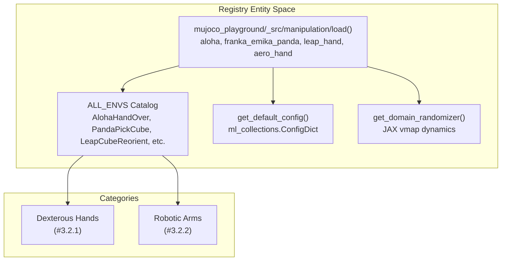
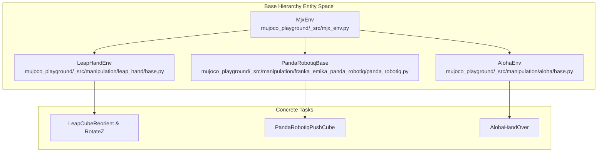
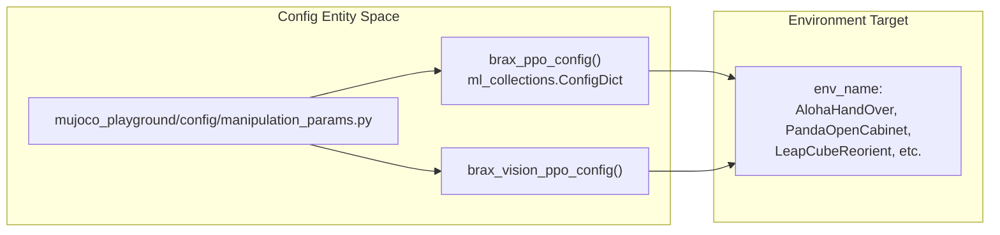

<!-- source: DeepWiki mcp.deepwiki.com · repo google-deepmind/mujoco_playground · page 3.2 Manipulation Environments · fetched 2026-10-26 -->

# Manipulation Environments

Relevant source files

The following files were used as context for generating this wiki page:

- [mujoco_playground/_src/dm_control_suite/__init__.py](mujoco_playground/_src/dm_control_suite/__init__.py)
- [mujoco_playground/_src/locomotion/__init__.py](mujoco_playground/_src/locomotion/__init__.py)
- [mujoco_playground/_src/locomotion/apollo/base.py](mujoco_playground/_src/locomotion/apollo/base.py)
- [mujoco_playground/_src/locomotion/h1/base.py](mujoco_playground/_src/locomotion/h1/base.py)
- [mujoco_playground/_src/locomotion/spot/base.py](mujoco_playground/_src/locomotion/spot/base.py)
- [mujoco_playground/_src/locomotion/t1/randomize.py](mujoco_playground/_src/locomotion/t1/randomize.py)
- [mujoco_playground/_src/manipulation/__init__.py](mujoco_playground/_src/manipulation/__init__.py)
- [mujoco_playground/_src/manipulation/franka_emika_panda_robotiq/panda_robotiq.py](mujoco_playground/_src/manipulation/franka_emika_panda_robotiq/panda_robotiq.py)
- [mujoco_playground/_src/manipulation/leap_hand/base.py](mujoco_playground/_src/manipulation/leap_hand/base.py)
- [mujoco_playground/config/manipulation_params.py](mujoco_playground/config/manipulation_params.py)

## Purpose and Scope

This document provides a high-level overview of manipulation environments in `mujoco_playground`, focusing on contact-rich robotic tasks involving dexterous multi-fingered hands and robotic arms [mujoco_playground/_src/manipulation/__init__.py:15-16](). These environments enable GPU-accelerated reinforcement learning for complex coordination tasks such as in-hand object reorientation, bimanual assembly, and cartesian trajectory tracking.

Because manipulation environments span diverse hardware platforms and control paradigms, this page outlines the shared architecture, registry system, and configuration pipelines. Detailed technical documentation for specific tasks, reward formulations, and observation spaces is organized into two child pages:
- **Dexterous Hand Manipulation**: See [Dexterous Hand Manipulation](#3.2.1) for Leap Hand and Aero Hand environments (`CubeReorient`, `CubeRotateZAxis`) [mujoco_playground/_src/manipulation/__init__.py:29-43]().
- **Robotic Arm Manipulation**: See [Robotic Arm Manipulation](#3.2.2) for Franka Emika Panda, Panda with Robotiq gripper, and ALOHA dual-arm environments (`PandaPickCube`, `AlohaHandOver`, `AlohaSinglePegInsertion`) [mujoco_playground/_src/manipulation/__init__.py:23-40]().

Sources: [mujoco_playground/_src/manipulation/__init__.py:15-43]()

---

## Environment Catalog and Registry

Manipulation environments are registered in the centralized module loader [mujoco_playground/_src/manipulation/__init__.py:33-44](), which provides helper functions for environment creation, default configuration lookup, and domain randomizer retrieval [mujoco_playground/_src/manipulation/__init__.py:72-133]().

**Available Manipulation Environments Catalog**:

| Environment Name | Category / Platform | Primary Task | Source Module |
|------------------|---------------------|--------------|---------------|
| `AlohaHandOver` | Robotic Arm (ALOHA) | Bimanual object transfer | [mujoco_playground/_src/manipulation/aloha/handover.py]() [mujoco_playground/_src/manipulation/__init__.py:34]() |
| `AlohaSinglePegInsertion` | Robotic Arm (ALOHA) | Precision peg insertion | [mujoco_playground/_src/manipulation/aloha/single_peg_insertion.py]() [mujoco_playground/_src/manipulation/__init__.py:35]() |
| `PandaPickCube` | Robotic Arm (Panda) | Joint-space pick and place | [mujoco_playground/_src/manipulation/franka_emika_panda/pick.py]() [mujoco_playground/_src/manipulation/__init__.py:36]() |
| `PandaPickCubeOrientation` | Robotic Arm (Panda) | Pick and orient cube | [mujoco_playground/_src/manipulation/franka_emika_panda/pick.py]() [mujoco_playground/_src/manipulation/__init__.py:37]() |
| `PandaPickCubeCartesian` | Robotic Arm (Panda) | Cartesian IK-based control | [mujoco_playground/_src/manipulation/franka_emika_panda/pick_cartesian.py]() [mujoco_playground/_src/manipulation/__init__.py:38]() |
| `PandaOpenCabinet` | Robotic Arm (Panda) | Articulated door opening | [mujoco_playground/_src/manipulation/franka_emika_panda/open_cabinet.py]() [mujoco_playground/_src/manipulation/__init__.py:39]() |
| `PandaRobotiqPushCube` | Robotic Arm (Panda+Robotiq) | Surface pushing task | [mujoco_playground/_src/manipulation/franka_emika_panda_robotiq/push_cube.py]() [mujoco_playground/_src/manipulation/__init__.py:40]() |
| `LeapCubeReorient` | Dexterous Hand (Leap) | In-hand target orientation | [mujoco_playground/_src/manipulation/leap_hand/reorient.py]() [mujoco_playground/_src/manipulation/__init__.py:41]() |
| `LeapCubeRotateZAxis` | Dexterous Hand (Leap) | Continuous z-axis rotation | [mujoco_playground/_src/manipulation/leap_hand/rotate_z.py]() [mujoco_playground/_src/manipulation/__init__.py:42]() |
| `AeroCubeRotateZAxis` | Dexterous Hand (Aero) | Continuous z-axis rotation | [mujoco_playground/_src/manipulation/aero_hand/rotate_z.py]() [mujoco_playground/_src/manipulation/__init__.py:43]() |

Sources: [mujoco_playground/_src/manipulation/__init__.py:23-64]()

---

## Shared Base Class Architecture

All manipulation environments inherit from the core `mujoco_playground._src.mjx_env.MjxEnv` base class [mujoco_playground/_src/manipulation/franka_emika_panda_robotiq/panda_robotiq.py:63-64](), [mujoco_playground/_src/manipulation/leap_hand/base.py:42-43](). Platform-specific base classes unify common asset loading, XML parsing, sensor mapping, and forward kinematics utilities before task-specific reward and observation logic is applied.

Sources: [mujoco_playground/_src/manipulation/franka_emika_panda_robotiq/panda_robotiq.py:63-83](), [mujoco_playground/_src/manipulation/leap_hand/base.py:42-65]()

---

## Configuration and Training Hyperparameters

Reinforcement learning configurations for manipulation environments are centralized in [mujoco_playground/config/manipulation_params.py](). This module defines tuned PPO hyperparameters (such as discount factors, unroll lengths, network hidden dimensions, and entropy costs) for each task using `ml_collections.ConfigDict`.

For instance, `AlohaHandOver` utilizes a 100M timestep training budget with 2048 parallel environments and a `(256, 256, 256)` policy network [mujoco_playground/config/manipulation_params.py:43-56](), whereas `PandaPickCubeCartesian` is configured with shorter unrolls and specialized actor-critic keys [mujoco_playground/config/manipulation_params.py:81-95]().

Sources: [mujoco_playground/config/manipulation_params.py:24-186]()

---

## Sub-Topics and Child Pages

### 3.2.1 Dexterous Hand Manipulation
Dexterous hand environments model multi-fingered hands (Leap Hand, Aero Hand) performing high-DOF manipulation tasks like `CubeReorient` and `CubeRotateZAxis`. Key architectural elements covered in the child page include:
- Observation generation with asymmetric actor-critic states and sensor noise history buffers.
- Multi-component reward formulations balancing orientation tracking, action smoothing, and energy penalty.
- Time-varying perturbation systems injecting external forces to test robustness.
- Specialized XML assets and Menagerie integration.

For full details, see [Dexterous Hand Manipulation](#3.2.1).

Sources: [mujoco_playground/_src/manipulation/leap_hand/base.py](), [mujoco_playground/_src/manipulation/leap_hand/reorient.py]()

### 3.2.2 Robotic Arm Manipulation
Robotic arm environments feature single-arm (`Panda`, `PandaRobotiq`) and dual-arm (`ALOHA`) platforms executing pick-and-place, cabinet opening, peg insertion, and object handover tasks. Key topics covered in the child page include:
- Cartesian control modes integrating analytical and numerical Inverse Kinematics (IK).
- Stage-based reward shaping and logistic barriers for bimanual coordination.
- Contact sensor integration and vision-based rendering pipelines.

For full details, see [Robotic Arm Manipulation](#3.2.2).

Sources: [mujoco_playground/_src/manipulation/aloha/handover.py](), [mujoco_playground/_src/manipulation/franka_emika_panda/pick_cartesian.py]()

---

