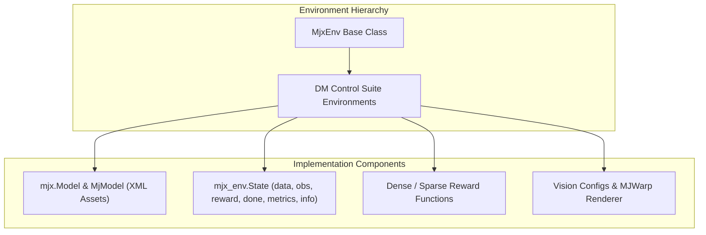
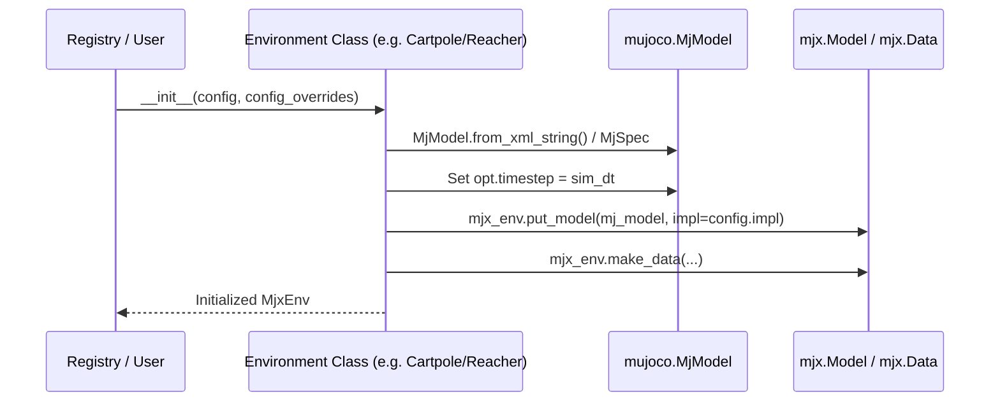
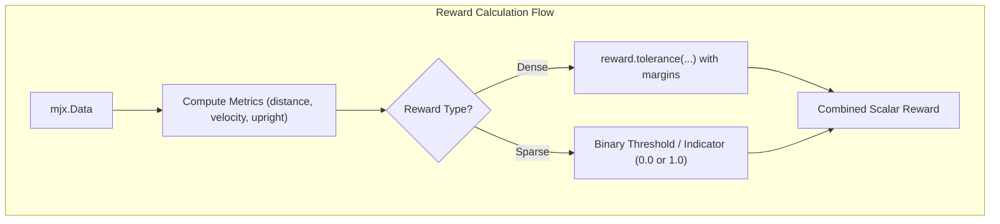

<!-- source: DeepWiki mcp.deepwiki.com · repo google-deepmind/mujoco_playground · page 3.3 DM Control Suite · fetched 2026-10-26 -->

# DM Control Suite

<details>
<summary>Relevant source files</summary>

The following files were used as context for generating this wiki page:

- [learning/train_jax_ppo.py](learning/train_jax_ppo.py)
- [mujoco_playground/_src/dm_control_suite/acrobot.py](mujoco_playground/_src/dm_control_suite/acrobot.py)
- [mujoco_playground/_src/dm_control_suite/ball_in_cup.py](mujoco_playground/_src/dm_control_suite/ball_in_cup.py)
- [mujoco_playground/_src/dm_control_suite/cartpole.py](mujoco_playground/_src/dm_control_suite/cartpole.py)
- [mujoco_playground/_src/dm_control_suite/cheetah.py](mujoco_playground/_src/dm_control_suite/cheetah.py)
- [mujoco_playground/_src/dm_control_suite/finger.py](mujoco_playground/_src/dm_control_suite/finger.py)
- [mujoco_playground/_src/dm_control_suite/fish.py](mujoco_playground/_src/dm_control_suite/fish.py)
- [mujoco_playground/_src/dm_control_suite/hopper.py](mujoco_playground/_src/dm_control_suite/hopper.py)
- [mujoco_playground/_src/dm_control_suite/humanoid.py](mujoco_playground/_src/dm_control_suite/humanoid.py)
- [mujoco_playground/_src/dm_control_suite/pendulum.py](mujoco_playground/_src/dm_control_suite/pendulum.py)
- [mujoco_playground/_src/dm_control_suite/point_mass.py](mujoco_playground/_src/dm_control_suite/point_mass.py)
- [mujoco_playground/_src/dm_control_suite/reacher.py](mujoco_playground/_src/dm_control_suite/reacher.py)
- [mujoco_playground/_src/dm_control_suite/swimmer.py](mujoco_playground/_src/dm_control_suite/swimmer.py)
- [mujoco_playground/_src/dm_control_suite/walker.py](mujoco_playground/_src/dm_control_suite/walker.py)
- [mujoco_playground/config/dm_control_suite_params.py](mujoco_playground/config/dm_control_suite_params.py)

</details>


## Purpose and Scope

This document provides detailed technical information about the DM Control Suite implementation in MuJoCo Playground. The DM Control Suite comprises 25+ classic continuous control environments ported from the original DeepMind Control Suite, fully re-implemented in JAX to exploit MuJoCo MJX's GPU acceleration. This page details their internal implementation, physics configurations, dense versus sparse reward functions, vision configurations, and integration with the training pipeline. For information about other environment collections, see [Locomotion Environments](#3.1) and [Manipulation Environments](#3.2).

Sources: [mujoco_playground/_src/dm_control_suite/__init__.py:15-35](), [learning/train_jax_ppo.py:40-42]()

---

## Overview & Architecture

The DM Control Suite port in MuJoCo Playground maintains compatibility with the core `MjxEnv` abstract base class while leveraging JAX transformations (`jax.jit`, `jax.vmap`) and hardware acceleration. Each environment wraps standard MuJoCo models compiled into `mjx.Model` and `mjx.Data` structures, running parallelized across thousands of GPU threads.



Sources: [mujoco_playground/_src/dm_control_suite/cartpole.py:59-107](), [mujoco_playground/_src/dm_control_suite/reacher.py:61-85]()

---

## Available Environments Catalog

The DM Control Suite includes the following core domains, task variants, and physical configurations:

| Environment | Task Variants | Key Features & Implementation Notes |
|-------------|---------------|-------------------------------------|
| Acrobot | `Balance`, `BalanceSparse`, `Swingup`, `SwingupSparse` | Double pendulum with actuator at the elbow joint; configurable sparse/dense margins. |
| Ball In Cup | `Catch` | Cup tracking a ball on a string; evaluates tracking and interception rewards. |
| Cartpole | `Balance`, `BalanceSparse`, `Swingup`, `SwingupSparse`, `Vision` | Cart-pole balancing/swingup; supports camera rendering and frame stacking for vision configs. |
| Cheetah | `Run` | 2D running cheetah; uses subtree linear velocity sensors for forward motion reward. |
| Finger | `Spin`, `TurnEasy`, `TurnHard` | 2D planar finger with touch sensors and target tracking. |
| Fish | `Swim` | Articulated fish agent in a 3D water-like basin tracking a moving mocap target. |
| Hopper | `Hop`, `Stand` | One-legged hopping agent using torso-to-foot height and subtree velocity metrics. |
| Humanoid | `Stand`, `Walk`, `Run` | 3D humanoid model with complex joint configurations and balance/velocity shaping. |
| Pendulum | `Swingup` | Simple pendulum swingup with action repeat and configurable discount factors. |
| Point Mass | `Default` | Point mass agent reaching randomized 2D/3D targets. |
| Reacher | `Easy`, `Hard` | 2D reacher arm with adjustable target geom sizes (`SMALL_TARGET`, `BIG_TARGET`). |
| Swimmer | `Swimmer6` | Snake-like multi-link swimming agent. |
| Walker | `Run`, `Stand`, `Walk` | Planar bipedal walker using torso orientation and subtree velocity metrics. |

Sources: [mujoco_playground/_src/dm_control_suite/__init__.py:37-71](), [mujoco_playground/_src/dm_control_suite/cartpole.py:59-91](), [mujoco_playground/_src/dm_control_suite/reacher.py:61-79]()

---

## GPU-Accelerated MJX Implementation & Physics

Environments are initialized by parsing MuJoCo XML specifications (`_XML_PATH`), configuring physical parameters such as timesteps (`sim_dt`, `ctrl_dt`), and lifting models into MJX via `mjx_env.put_model()`.



Sources: [mujoco_playground/_src/dm_control_suite/cartpole.py:65-102](), [mujoco_playground/_src/dm_control_suite/reacher.py:61-84]()

### Substep & Timestep Control
Unlike standard CPU implementations which often require very small physics timesteps, MJX implementations tune `sim_dt` and `ctrl_dt` explicitly. For example:
- **Cartpole**: `sim_dt = 0.01`, `ctrl_dt = 0.01` [mujoco_playground/_src/dm_control_suite/cartpole.py:47-48]()
- **Reacher**: `sim_dt = 0.005`, `ctrl_dt = 0.02` [mujoco_playground/_src/dm_control_suite/reacher.py:37-38]()
- **Humanoid**: `sim_dt = 0.005`, `ctrl_dt = 0.025` [mujoco_playground/_src/dm_control_suite/humanoid.py:40-41]()

Sources: [mujoco_playground/_src/dm_control_suite/cartpole.py:45-56](), [mujoco_playground/_src/dm_control_suite/reacher.py:35-45](), [mujoco_playground/_src/dm_control_suite/humanoid.py:38-48]()

---

## Reward Shaping: Dense vs. Sparse Rewards

Most DM Control Suite environments support both dense and sparse reward formulations. Dense rewards make extensive use of `reward.tolerance()` to smoothly scale components based on distances, orientations, or velocities.

### Dense Reward Example (Reacher)
In `Reacher`, the reward is calculated using a tolerance function over the distance between the fingertip and target:
```python
def _get_reward(self, data: mjx.Data, action: jax.Array, info: dict[str, Any], metrics: dict[str, Any]) -> jax.Array:
  del action, info, metrics
  return reward.tolerance(self._finger_to_target_dist(data), (0, self._radii))
```
[mujoco_playground/_src/dm_control_suite/reacher.py:153-162]()

### Sparse Reward Example (Acrobot / Cartpole)
Sparse variants configure `_margin = 0.0` or binary indicator conditions (`jp.where(...)`), rewarding agents only upon reaching precise goal thresholds (e.g., entering a target container or balancing within tight angular bounds).



Sources: [mujoco_playground/_src/dm_control_suite/acrobot.py:45-60](), [mujoco_playground/_src/dm_control_suite/reacher.py:153-162]()

---

## Vision Configurations & Batch Rendering

Certain environments (such as `CartpoleBalance` with vision enabled) support camera-based observations. When `vision=True`:
1. `default_vision_config()` defines camera resolutions (`cam_res=(64, 64)`), world batch size (`nworld=1024`), active cameras, and geometry groups.
2. Render contexts (`mjx.create_render_context`) and pytrees (`_rc_pytree`) are instantiated during environment setup.
3. During `reset()` and `step()`, frames are rendered, converted to grayscale, and stacked (e.g., frame stacking of 3 channels) to form pixel observations (`obs = {"pixels/view_0": frame_stack}`).

```python
def default_vision_config() -> config_dict.ConfigDict:
  return config_dict.create(
      nworld=1024,
      cam_res=(64, 64),
      use_textures=False,
      use_shadows=False,
      render_rgb=(True,),
      render_depth=(False,),
      enabled_geom_groups=[0, 1, 2],
      cam_active=(True, False),
  )
```
[mujoco_playground/_src/dm_control_suite/cartpole.py:32-42]()

Sources: [mujoco_playground/_src/dm_control_suite/cartpole.py:32-42](), [mujoco_playground/_src/dm_control_suite/cartpole.py:103-191]()

---

## Integration with RL Training (PPO / SAC)

DM Control Suite environments integrate seamlessly with training scripts like `learning/train_jax_ppo.py` via `dm_control_suite_params.py`. Tuned hyperparameters vary by task:
- **PPO Configs**: Default timesteps range from 60M to 100M, using `reward_scaling=10.0`, `num_envs=2048`, and `discounting=0.995`.
- **SAC Configs**: Supported via `brax_sac_config()`, tuning replay buffer sizes and gradient updates per step.
- **Vision PPO**: Uses specialized CNN network factories (`cnn_output_channels=(16, 32)`, ELU activations) with `num_timesteps=5_000_000`.

```python
def brax_ppo_config(env_name: str, impl: Optional[str] = None) -> config_dict.ConfigDict:
  env_config = dm_control_suite.get_default_config(env_name)
  rl_config = config_dict.create(
      num_timesteps=60_000_000,
      num_evals=10,
      reward_scaling=10.0,
      episode_length=env_config.episode_length,
      normalize_observations=True,
      action_repeat=1,
      unroll_length=30,
      num_minibatches=32,
      num_updates_per_batch=16,
      discounting=0.995,
      learning_rate=1e-3,
      entropy_cost=1e-2,
      num_envs=2048,
      batch_size=1024,
  )
  return rl_config
```
[mujoco_playground/config/dm_control_suite_params.py:24-62]()

Sources: [learning/train_jax_ppo.py:40-42](), [mujoco_playground/config/dm_control_suite_params.py:24-152]()

---

