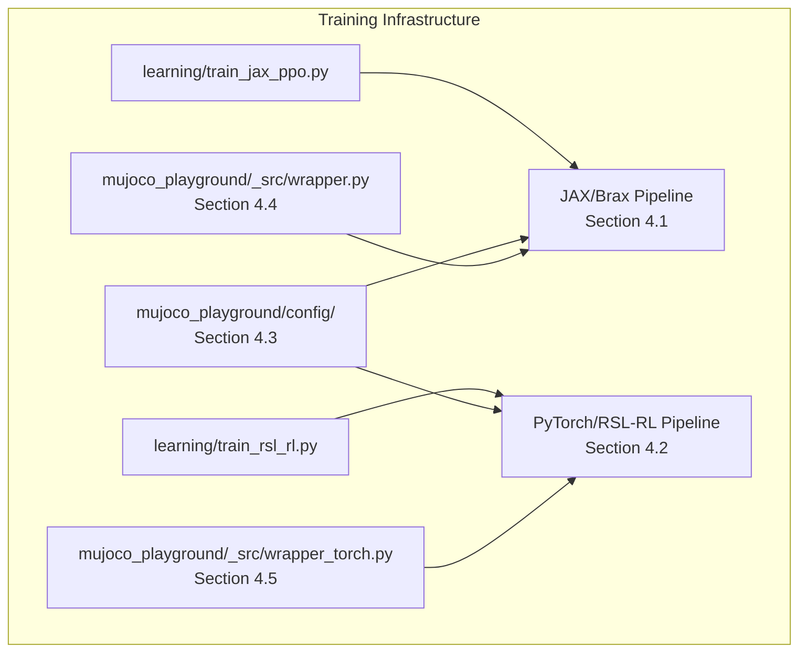
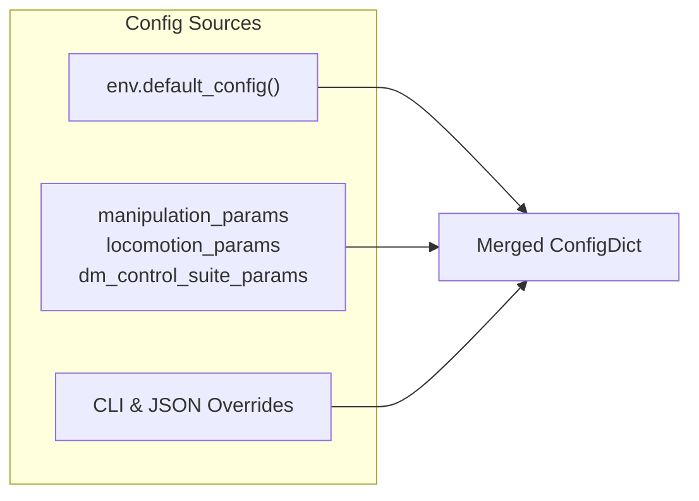

<!-- source: DeepWiki mcp.deepwiki.com · repo google-deepmind/mujoco_playground · page 4 Training Infrastructure · fetched 2026-10-26 -->

# Training Infrastructure

Relevant source files

The following files were used as context for generating this wiki page:

- [.gitignore](.gitignore)
- [learning/train_jax_ppo.py](learning/train_jax_ppo.py)
- [learning/train_rsl_rl.py](learning/train_rsl_rl.py)
- [mujoco_playground/_src/dm_control_suite/cartpole.py](mujoco_playground/_src/dm_control_suite/cartpole.py)
- [mujoco_playground/_src/wrapper.py](mujoco_playground/_src/wrapper.py)
- [mujoco_playground/_src/wrapper_test.py](mujoco_playground/_src/wrapper_test.py)
- [mujoco_playground/_src/wrapper_torch.py](mujoco_playground/_src/wrapper_torch.py)
- [mujoco_playground/config/dm_control_suite_params.py](mujoco_playground/config/dm_control_suite_params.py)

## Purpose and Scope

This page provides a high-level overview of the dual training framework architecture in MuJoCo Playground, which supports both JAX/Brax and PyTorch/RSL-RL ecosystems. It outlines how configurations, environment wrappers, and vision pipelines integrate to support GPU-accelerated reinforcement learning.

For deep technical details, refer to the child pages covering specific pipelines, wrappers, and configuration modules.

Sources: [learning/train_jax_ppo.py:15-185](), [learning/train_rsl_rl.py:15-95](), [mujoco_playground/_src/wrapper.py:30-133]()

---

## 4.1 JAX/Brax Training Pipeline

The JAX training pipeline is orchestrated via `learning/train_jax_ppo.py` and leverages Brax's PPO and SAC agent implementations. It maximizes GPU utilization by compiling environment steps and gradient updates with JAX `jax.jit` and parallelizing rollouts across thousands of environments using `jax.vmap`. 

For details, see [JAX/Brax Training Pipeline](#4.1).

Sources: [learning/train_jax_ppo.py:27-30](), [mujoco_playground/config/dm_control_suite_params.py:24-152]()

---

## 4.2 PyTorch/RSL-RL Training Pipeline

The PyTorch training pipeline uses `learning/train_rsl_rl.py` to interface with the RSL-RL `OnPolicyRunner` class. It bridges JAX-based MJX environments with PyTorch tensors via `RSLRLBraxWrapper` [mujoco_playground/_src/wrapper_torch.py:84-132]() using zero-copy DLPack interop (`_jax_to_torch` and `_torch_to_jax`) [mujoco_playground/_src/wrapper_torch.py:42-53]().

For details, see [PyTorch/RSL-RL Training Pipeline](#4.2).

Sources: [learning/train_rsl_rl.py:28-34](), [mujoco_playground/_src/wrapper_torch.py:84-210]()

---

## 4.3 Configuration System

MuJoCo Playground uses a multi-layered configuration pattern powered by `ml_collections.config_dict`. Environment defaults (`default_config()`) are combined with algorithm-specific parameter sets from `manipulation_params`, `locomotion_params`, and `dm_control_suite_params`, and can be overridden via command-line flags or JSON override strings.

Sources: [learning/train_jax_ppo.py:186-190](), [learning/train_rsl_rl.py:97-134](), [mujoco_playground/config/dm_control_suite_params.py:24-63]()

For details, see [Configuration System](#4.3).

---

## 4.4 Environment Wrappers

The wrapper module provides modular environment transformations required for RL training. The orchestration function `wrap_for_brax_training` [mujoco_playground/_src/wrapper.py:87-132]() wraps environments with `VmapWrapper`, `EpisodeWrapper`, `BraxAutoResetWrapper`, and `DeferredVisionWrapper` to handle episode bookkeeping, auto-resetting, domain randomization, and deferred pixel rendering.

For details, see [Environment Wrappers](#4.4).

Sources: [mujoco_playground/_src/wrapper.py:30-160](), [mujoco_playground/_src/wrapper_test.py:30-153]()

---

## 4.5 Vision-Based Training

Vision-based workflows enable end-to-end policy learning directly from pixel observations. This pipeline incorporates the MJWarp batch renderer, convolutional neural network (CNN) feature extractors, asymmetric observation spaces (combining privileged state for critics and pixels for actors), and camera/appearance randomization.

For details, see [Vision-Based Training](#4.5).

Sources: [mujoco_playground/_src/dm_control_suite/cartpole.py:32-56](), [mujoco_playground/config/dm_control_suite_params.py:65-110]()

---

