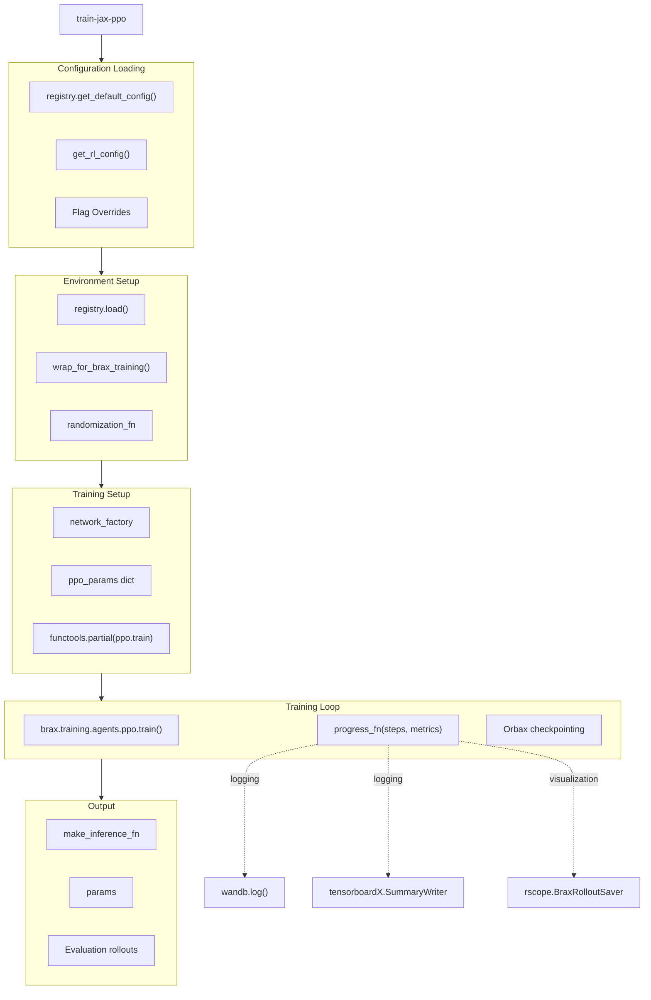
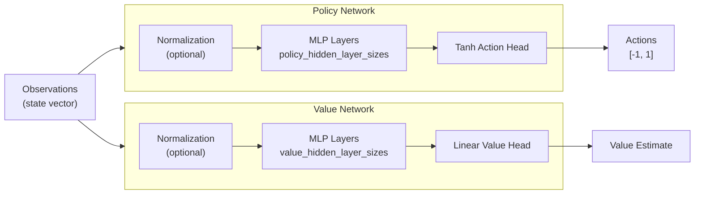
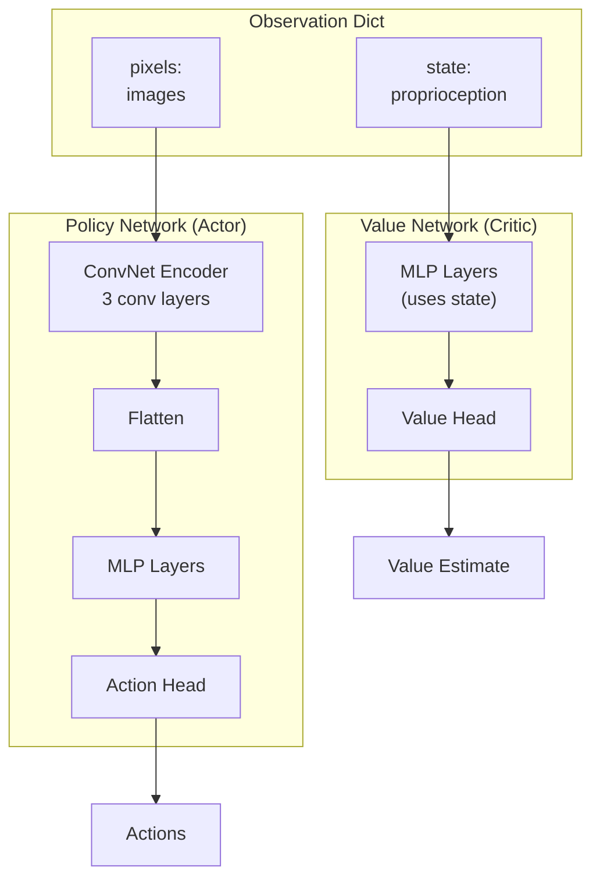
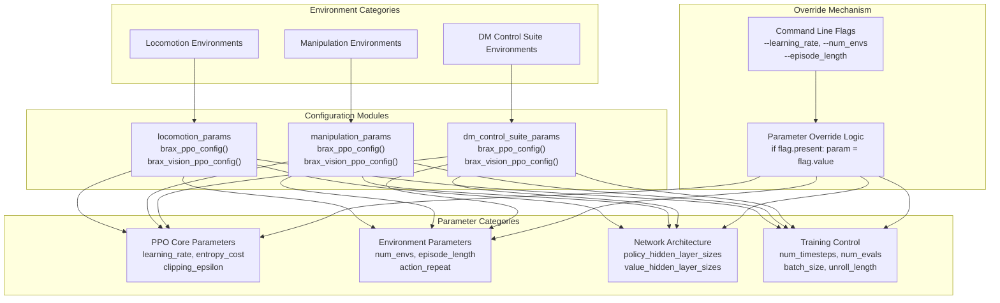
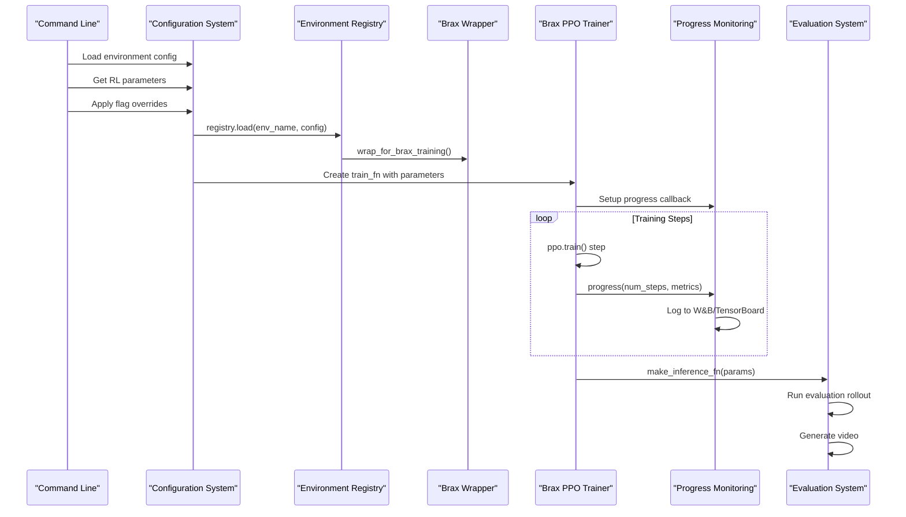
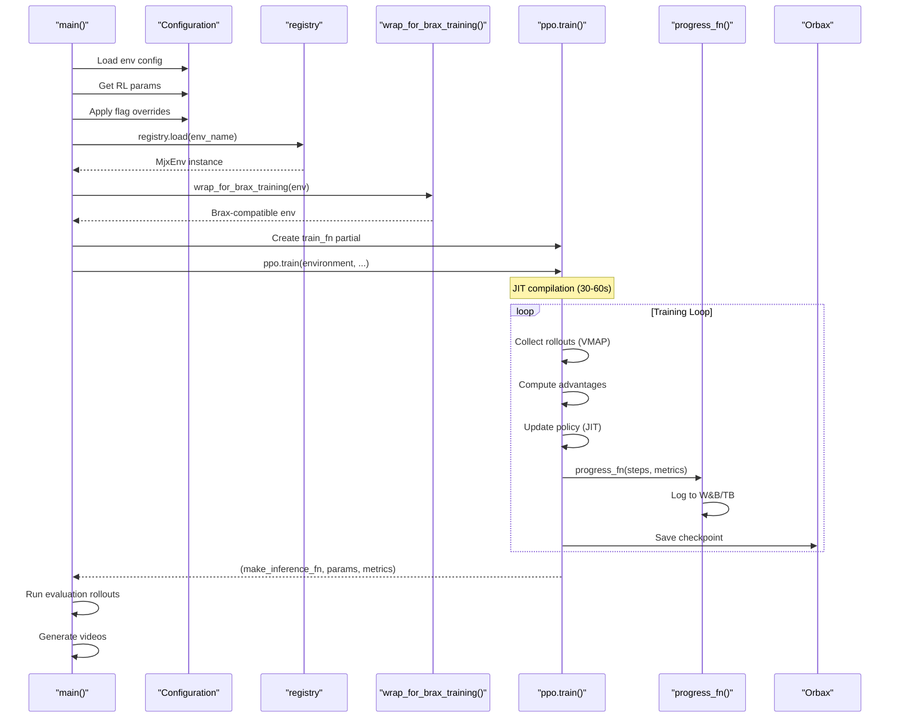
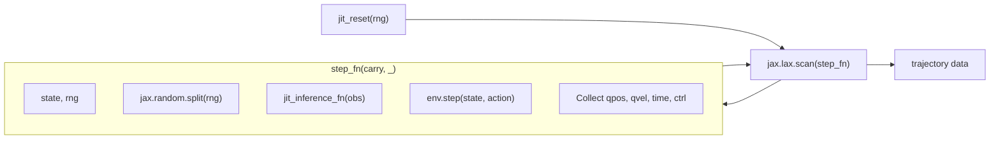

<!-- source: DeepWiki mcp.deepwiki.com · repo google-deepmind/mujoco_playground · page 4.1 JAX/Brax Training Pipeline · fetched 2026-10-26 -->

# JAX/Brax Training Pipeline

<details>
<summary>Relevant source files</summary>

The following files were used as context for generating this wiki page:

- [CONTRIBUTING.md](CONTRIBUTING.md)
- [README.md](README.md)
- [learning/README.md](learning/README.md)
- [learning/train_jax_ppo.py](learning/train_jax_ppo.py)
- [mujoco_playground/_src/dm_control_suite/cartpole.py](mujoco_playground/_src/dm_control_suite/cartpole.py)
- [mujoco_playground/_src/registry.py](mujoco_playground/_src/registry.py)
- [mujoco_playground/config/dm_control_suite_params.py](mujoco_playground/config/dm_control_suite_params.py)

</details>


This document covers the JAX-based training pipeline using Brax PPO (Proximal Policy Optimization) in MuJoCo Playground. The system provides a command-line interface via `train-jax-ppo` for training reinforcement learning policies on any registered environment, leveraging JAX's JIT compilation and VMAP parallelization for GPU-accelerated training.

For alternative training frameworks, see [PyTorch/RSL-RL Training Pipeline](#4.2). For vision-based training details, see [Vision-Based Training](#4.5). For configuration details, see [Configuration System](#4.3). For environment wrappers, see [Environment Wrappers](#4.4).

## Overview

The JAX/Brax training pipeline is the primary training system in MuJoCo Playground. It uses:

- **Brax PPO**: Implementation from `brax.training.agents.ppo` [learning/train_jax_ppo.py:27-29]()
- **JAX Backend**: JIT compilation and VMAP for GPU parallelization [learning/train_jax_ppo.py:31-32]()
- **MJX Environments**: GPU-accelerated physics via MuJoCo MJX [README.md:7-14]()
- **Flax Networks**: Neural networks in pure JAX/Flax [learning/train_jax_ppo.py:27-28]()

The entry point is `learning/train_jax_ppo.py`, which can be invoked via the `train-jax-ppo` command-line script.

Sources: [learning/train_jax_ppo.py:1-68](), [README.md:56-64]()

## Training Pipeline Architecture

### High-Level Data Flow



**Diagram: Training pipeline data flow from CLI to trained policy**

The pipeline executes in these stages:

1. **Configuration**: Load default configs, apply overrides [learning/train_jax_ppo.py:215-288]()
2. **Environment Setup**: Load environment, wrap for Brax, add randomization [learning/train_jax_ppo.py:290-380]()
3. **Training Setup**: Create network factory and training function [learning/train_jax_ppo.py:349-394]()
4. **Training Loop**: Execute Brax PPO with callbacks [learning/train_jax_ppo.py:385-461]()
5. **Output**: Generate inference function and evaluate [learning/train_jax_ppo.py:463-539]()

Sources: [learning/train_jax_ppo.py:210-469]()

### Main Function Structure

The `main()` function in `train_jax_ppo.py` orchestrates the pipeline:

| Stage | Lines | Key Operations |
|-------|-------|----------------|
| Config Loading | [learning/train_jax_ppo.py:215-288]() | Load env config, get RL params, apply flag overrides |
| Setup | [learning/train_jax_ppo.py:290-344]() | Create logdir, setup W&B/TensorBoard, handle checkpoints |
| Network Factory | [learning/train_jax_ppo.py:349-359]() | Choose vision or standard networks |
| Domain Randomization | [learning/train_jax_ppo.py:361-364]() | Add randomization function if enabled |
| Wrapper | [learning/train_jax_ppo.py:366-380]() | Wrap environment for Brax (vision or standard) |
| Training Function | [learning/train_jax_ppo.py:385-394]() | Create partial `ppo.train` with all parameters |
| Callbacks | [learning/train_jax_ppo.py:399-461]() | Setup progress logging and rscope visualization |
| Training | [learning/train_jax_ppo.py:463-468]() | Execute training, get inference function |
| Evaluation | [learning/train_jax_ppo.py:476-539]() | Run rollouts and generate videos |

Sources: [learning/train_jax_ppo.py:210-549]()

## Brax PPO Implementation

### PPO Algorithm

The training uses `brax.training.agents.ppo.train()` which implements Proximal Policy Optimization with:

- **Clipped Surrogate Objective**: Constrains policy updates [learning/train_jax_ppo.py:27-29]()
- **Generalized Advantage Estimation (GAE)**: For advantage computation [learning/train_jax_ppo.py:27-29]()
- **Value Function Loss**: MSE between predicted and actual returns [learning/train_jax_ppo.py:27-29]()
- **Entropy Bonus**: Encourages exploration [learning/train_jax_ppo.py:127]()

The core PPO function signature:

```
ppo.train(
    environment,
    num_timesteps,
    episode_length,
    num_envs,
    learning_rate,
    entropy_cost,
    discounting,
    unroll_length,
    batch_size,
    num_minibatches,
    num_updates_per_batch,
    normalize_observations,
    reward_scaling,
    clipping_epsilon,
    max_grad_norm,
    network_factory,
    progress_fn,
    seed,
    ...
)
```

Sources: [learning/train_jax_ppo.py:385-394]()

### Training Parameters

Key PPO hyperparameters and their defaults:

| Parameter | Default | Description |
|-----------|---------|-------------|
| `learning_rate` | `5e-4` | Adam optimizer learning rate [learning/train_jax_ppo.py:126]() |
| `entropy_cost` | `5e-3` | Entropy bonus coefficient [learning/train_jax_ppo.py:127]() |
| `clipping_epsilon` | `0.3` | PPO clip range [learning/train_jax_ppo.py:134-136]() |
| `discounting` | `0.97` | Reward discount factor (γ) [learning/train_jax_ppo.py:125]() |
| `unroll_length` | `10` | Rollout steps before update [learning/train_jax_ppo.py:118]() |
| `num_minibatches` | `8` | Minibatches per update [learning/train_jax_ppo.py:119-121]() |
| `num_updates_per_batch` | `8` | SGD epochs per batch [learning/train_jax_ppo.py:122-124]() |
| `max_grad_norm` | `1.0` | Gradient clipping threshold [learning/train_jax_ppo.py:133]() |
| `batch_size` | `256` | Training batch size [learning/train_jax_ppo.py:132]() |
| `reward_scaling` | `0.1` | Scale rewards before training [learning/train_jax_ppo.py:112]() |

These are defined per environment category in config modules and can be overridden via flags [mujoco_playground/config/dm_control_suite_params.py:24-62]().

Sources: [learning/train_jax_ppo.py:112-136](), [mujoco_playground/config/dm_control_suite_params.py:24-62]()

### JIT Compilation and VMAP Parallelization

The Brax PPO implementation leverages JAX's key features:

**JIT Compilation**: The entire training loop is JIT-compiled for performance:
- Environment step functions: `jax.jit(env.step)` [mujoco_playground/_src/dm_control_suite/cartpole.py:194-195]()
- Policy forward pass: JIT-compiled within Brax [learning/train_jax_ppo.py:385-394]()
- PPO update: JIT-compiled gradient computation [learning/train_jax_ppo.py:385-394]()

**VMAP Parallelization**: Environments are batched and vectorized:
- `num_envs` environments run in parallel on GPU [learning/train_jax_ppo.py:128]()
- Each environment maintains independent state [mujoco_playground/_src/dm_control_suite/cartpole.py:192]()
- Single JIT-compiled function processes all environments simultaneously [learning/train_jax_ppo.py:385-394]()
- Typical batch sizes: 1024-4096 environments [learning/train_jax_ppo.py:128]()

The combination enables:
- 100-1000x speedup over CPU simulation [README.md:7-14]()
- Efficient GPU utilization through batching [README.md:7-14]()
- Minimal Python overhead through JIT [README.md:7-14]()

First compilation takes 30-60 seconds, then training is fast [learning/train_jax_ppo.py:385-469](). The `progress_fn` callback prints JIT compilation time [learning/train_jax_ppo.py:399-419]().

Sources: [learning/train_jax_ppo.py:128](), [README.md:7-14](), [learning/train_jax_ppo.py:385-469]()

## Network Architectures

### Standard Networks

The `ppo_networks.make_ppo_networks()` function creates standard MLP networks:



**Diagram: Standard MLP network architecture**

Default architecture:
- Policy: 3 hidden layers of 64 units each [learning/train_jax_ppo.py:137-141]()
- Value: 3 hidden layers of 64 units each [learning/train_jax_ppo.py:142-146]()
- Activation: typically ELU or ReLU (set by Brax) [learning/train_jax_ppo.py:27-29]()
- Output: Tanh-squashed continuous actions [learning/train_jax_ppo.py:27-29]()

Configuration via flags:
```bash
--policy_hidden_layer_sizes 128,128,128
--value_hidden_layer_sizes 256,256,256
```

Sources: [learning/train_jax_ppo.py:27-29](), [learning/train_jax_ppo.py:137-146](), [learning/train_jax_ppo.py:349-359]()

### Vision Networks

The `ppo_networks_vision.make_ppo_networks_vision()` function creates CNN-based networks:



**Diagram: Vision network architecture with asymmetric observations**

Key features:
- **Asymmetric Observations**: Policy sees pixels, value sees privileged state [mujoco_playground/config/dm_control_suite_params.py:65-110]()
- **CNN Encoder**: Convolutional layers for image processing [mujoco_playground/config/dm_control_suite_params.py:92-96]()
- **Observation Keys**: `policy_obs_key="pixels"`, `value_obs_key="state"` [learning/train_jax_ppo.py:147-150]()

Enabled via:
```bash
train-jax-ppo --env_name CartpoleBalance --vision
```

Sources: [learning/train_jax_ppo.py:28](), [learning/train_jax_ppo.py:142-150](), [mujoco_playground/config/dm_control_suite_params.py:65-110]()

## Configuration System

The training system uses a hierarchical configuration approach that combines default parameters with command-line overrides:



The `get_rl_config()` function determines the appropriate configuration module based on environment category [learning/train_jax_ppo.py:186-190]():

| Environment Category | Configuration Module | Function |
|---------------------|---------------------|----------|
| Locomotion | `locomotion_params` | `brax_ppo_config()` / `brax_vision_ppo_config()` [learning/train_jax_ppo.py:41]() |
| Manipulation | `manipulation_params` | `brax_ppo_config()` / `brax_vision_ppo_config()` [learning/train_jax_ppo.py:42]() |
| DM Control Suite | `dm_control_suite_params` | `brax_ppo_config()` / `brax_vision_ppo_config()` [learning/train_jax_ppo.py:40]() |

Sources: [learning/train_jax_ppo.py:39-43](), [learning/train_jax_ppo.py:186-190]()

## Command-Line Interface

The training script provides extensive command-line configuration through `absl.flags` [learning/train_jax_ppo.py:24-25]():

### Core Training Parameters

| Flag | Default | Description |
|------|---------|-------------|
| `--env_name` | `"LeapCubeReorient"` | Environment name from registry [learning/train_jax_ppo.py:74-78]() |
| `--num_timesteps` | `1_000_000` | Total training timesteps [learning/train_jax_ppo.py:105-107]() |
| `--learning_rate` | `5e-4` | PPO learning rate [learning/train_jax_ppo.py:126]() |
| `--num_envs` | `1024` | Parallel training environments [learning/train_jax_ppo.py:128]() |
| `--episode_length` | `1000` | Maximum episode length [learning/train_jax_ppo.py:113]() |

### Vision and Domain Randomization

| Flag | Default | Description |
|------|---------|-------------|
| `--vision` | `False` | Enable vision-based training [learning/train_jax_ppo.py:85]() |
| `--domain_randomization` | `False` | Enable domain randomization [learning/train_jax_ppo.py:101-103]() |

### Logging and Monitoring

| Flag | Default | Description |
|------|---------|-------------|
| `--use_wandb` | `False` | Enable Weights & Biases logging [learning/train_jax_ppo.py:93-97]() |
| `--use_tb` | `False` | Enable TensorBoard logging [learning/train_jax_ppo.py:98-100]() |
| `--rscope_envs` | `None` | Number of environments for rscope visualization [learning/train_jax_ppo.py:151-155]() |

### Checkpoint Management

| Flag | Default | Description |
|------|---------|-------------|
| `--load_checkpoint_path` | `None` | Path to load checkpoint from [learning/train_jax_ppo.py:86-88]() |
| `--play_only` | `False` | Skip training, only run inference [learning/train_jax_ppo.py:90-92]() |

### Advanced Training Flags

Additional control over training behavior:

| Flag | Default | Description |
|------|---------|-------------|
| `--run_evals` | `True` | Run evaluation rollouts during training [learning/train_jax_ppo.py:161-165]() |
| `--log_training_metrics` | `False` | Log training metrics (slows training) [learning/train_jax_ppo.py:166-171]() |
| `--training_metrics_steps` | `1_000_000` | Steps between training metric logs [learning/train_jax_ppo.py:172-177]() |
| `--normalize_observations` | `True` | Enable observation normalization [learning/train_jax_ppo.py:114-116]() |
| `--action_repeat` | `1` | Physics steps per control step [learning/train_jax_ppo.py:117]() |
| `--unroll_length` | `10` | Rollout length before PPO update [learning/train_jax_ppo.py:118]() |
| `--num_minibatches` | `8` | Minibatches for SGD [learning/train_jax_ppo.py:119-121]() |
| `--num_updates_per_batch` | `8` | SGD epochs per batch [learning/train_jax_ppo.py:122-124]() |

Sources: [learning/train_jax_ppo.py:69-184]()

### Example Command Lines

Basic training:
```bash
train-jax-ppo --env_name LeapCubeReorient --num_timesteps 5000000
```

With domain randomization and W&B logging:
```bash
train-jax-ppo --env_name Go1Joystick \
  --domain_randomization \
  --use_wandb \
  --num_envs 4096
```

Vision-based training:
```bash
train-jax-ppo --env_name PandaPickCube \
  --vision \
  --num_envs 2048
```

Resume from checkpoint:
```bash
train-jax-ppo --env_name LeapCubeReorient \
  --load_checkpoint_path logs/LeapCubeReorient-20250101-120000/checkpoints
```

Play-only mode (no training):
```bash
train-jax-ppo --env_name LeapCubeReorient \
  --load_checkpoint_path logs/LeapCubeReorient-20250101-120000/checkpoints \
  --play_only
```

Sources: [README.md:56-70](), [learning/README.md:16-26]()

## Training Workflow

The training process follows this sequence:



### Training Execution Sequence



**Diagram: Execution sequence showing JIT compilation and training loop**

Sources: [learning/train_jax_ppo.py:210-469]()

## Progress Callbacks and Monitoring

### Progress Function

The `progress()` callback is called periodically during training:

```python
def progress(num_steps, metrics):
    times.append(time.monotonic())
    
    # Log to Weights & Biases
    if _USE_WANDB.value and not _PLAY_ONLY.value:
        wandb.log(metrics, step=num_steps)
    
    # Log to TensorBoard
    if _USE_TB.value and not _PLAY_ONLY.value:
        for key, value in metrics.items:
            writer.add_scalar(key, value, num_steps)
        writer.flush()
    
    # Print to console
    if _RUN_EVALS.value:
        print(f"{num_steps}: reward={metrics['eval/episode_reward']:.3f}")
```

Sources: [learning/train_jax_ppo.py:399-419]()

### Logged Metrics

Brax PPO reports these metrics via the progress callback:

| Metric | Description |
|--------|-------------|
| `eval/episode_reward` | Mean reward on evaluation rollouts [learning/train_jax_ppo.py:399-419]() |
| `eval/episode_length` | Mean episode length on evaluation [learning/train_jax_ppo.py:399-419]() |
| `training/policy_loss` | Policy network loss [learning/train_jax_ppo.py:399-419]() |
| `training/value_loss` | Value network loss [learning/train_jax_ppo.py:399-419]() |
| `training/entropy` | Policy entropy [learning/train_jax_ppo.py:399-419]() |
| `training/learning_rate` | Current learning rate [learning/train_jax_ppo.py:399-419]() |

Additional environment-specific metrics may be included in the `metrics` dict [learning/train_jax_ppo.py:399-419]().

Sources: [learning/train_jax_ppo.py:399-419]()

### Rscope Visualization

Optional integration with [rscope](https://github.com/Andrew-Luo1/rscope) for interactive policy visualization:

```bash
train-jax-ppo --env_name Go1Joystick --rscope_envs 16 --deterministic_rscope
```

This saves rollout trajectories that can be viewed interactively:
```bash
python -m rscope
```

The `rscope_fn()` callback processes rollouts and computes episode statistics [learning/train_jax_ppo.py:431-461]().

Sources: [learning/train_jax_ppo.py:151-160](), [learning/train_jax_ppo.py:431-461](), [README.md:79-85]()

## Checkpointing

### Checkpoint System

Brax uses [Orbax](https://github.com/google/orbax) for checkpointing [learning/train_jax_ppo.py:336-343]():

**Save Location**: `logs/{exp_name}/checkpoints/` [learning/train_jax_ppo.py:336-343]()

**Saved Data**:
- Policy network parameters [learning/train_jax_ppo.py:336-343]()
- Value network parameters [learning/train_jax_ppo.py:336-343]()
- Optimizer state [learning/train_jax_ppo.py:336-343]()
- Training step counter [learning/train_jax_ppo.py:336-343]()
- Normalizer statistics (if enabled) [learning/train_jax_ppo.py:336-343]()

**Checkpoint Structure**:
```
logs/LeapCubeReorient-20250101-120000/
└── checkpoints/
    ├── 0/           # Checkpoint at step 0
    ├── 100000/      # Checkpoint at step 100000
    ├── 200000/      # Checkpoint at step 200000
    └── config.json  # Environment configuration
```

Sources: [learning/train_jax_ppo.py:336-343]()

### Loading Checkpoints

To resume training or run inference:

```bash
# Resume training
train-jax-ppo --env_name LeapCubeReorient \
  --load_checkpoint_path logs/LeapCubeReorient-20250101-120000/checkpoints

# Play-only mode (inference)
train-jax-ppo --env_name LeapCubeReorient \
  --load_checkpoint_path logs/LeapCubeReorient-20250101-120000/checkpoints \
  --play_only
```

The script automatically finds the latest checkpoint in the directory [learning/train_jax_ppo.py:319-334]().

Sources: [learning/train_jax_ppo.py:319-334](), [learning/train_jax_ppo.py:390]()

### Environment Configuration Saving

The environment configuration is saved alongside checkpoints [learning/train_jax_ppo.py:342-343]():

```json
{
  "impl": "jax",
  "episode_length": 1000,
  "ctrl_dt": 0.02,
  "sim_dt": 0.002,
  "action_repeat": 1,
  "reward_config": {
    "scales": {...}
  }
}
```

This ensures reproducibility when loading checkpoints [learning/train_jax_ppo.py:342-343]().

Sources: [learning/train_jax_ppo.py:342-343]()

## Evaluation and Visualization

After training completes, the system performs evaluation and generates visualizations:

### Inference Function

The trained policy is converted to an inference function:

```python
# Create inference function (deterministic)
make_inference_fn, params, metrics = train_fn(...)
inference_fn = make_inference_fn(params, deterministic=True)
jit_inference_fn = jax.jit(inference_fn)
```

The `deterministic=True` flag disables exploration noise for evaluation [learning/train_jax_ppo.py:463-479]().

Sources: [learning/train_jax_ppo.py:463-479]()

### Rollout Generation

Evaluation rollouts use JAX's functional interface:



**Diagram: Rollout generation using jax.lax.scan**

The `jax.lax.scan()` function efficiently collects trajectories in a JIT-compiled loop [learning/train_jax_ppo.py:482-516]().

Sources: [learning/train_jax_ppo.py:482-516]()

### Video Rendering

Videos are rendered from trajectory data:

```python
# Render frames
render_every = 2  # Subsample for performance
fps = 1.0 / eval_env.dt / render_every
frames = eval_env.render(traj, height=480, width=640, scene_option=scene_option)

# Save video
media.write_video(f"rollout{i}.mp4", frames, fps=fps)
```

**Scene Options**: Control visualization features (transparency, forces, contacts) [learning/train_jax_ppo.py:526-539]()

**Output**: MP4 videos saved in the current directory [learning/train_jax_ppo.py:526-539]()

Sources: [learning/train_jax_ppo.py:526-539]()

## Integration Points

The JAX PPO training system integrates with several key components:

### Brax Integration
- Uses `brax.training.agents.ppo.train` for core PPO algorithm [learning/train_jax_ppo.py:27-29]()
- Supports both standard and vision network architectures [learning/train_jax_ppo.py:27-28]()
- Leverages JAX for vectorized training across many environments [learning/train_jax_ppo.py:31-32]()

### Registry Integration  
- Loads environments via `registry.load()` [mujoco_playground/registry.py:49-61]()
- Gets default configurations via `registry.get_default_config()` [mujoco_playground/registry.py:38-46]()
- Supports domain randomization via `registry.get_domain_randomizer()` [mujoco_playground/registry.py:64-71]()

### Wrapper Integration
- Uses `wrapper.wrap_for_brax_training()` to adapt MjxEnv to Brax interface [mujoco_playground/wrapper.py]()
- Handles vision environments separately with batch rendering [learning/train_jax_ppo.py:366-380]()
- Applies domain randomization and episode configuration [mujoco_playground/wrapper.py]()

### Monitoring Integration
- W&B integration via `wandb.log()` for experiment tracking [learning/train_jax_ppo.py:50-52]()
- TensorBoard integration via `SummaryWriter` [learning/train_jax_ppo.py:44-47]()
- Optional rscope integration for interactive policy visualization [learning/train_jax_ppo.py:151-155]()

Sources: [learning/train_jax_ppo.py:27-43](), [mujoco_playground/registry.py:38-71](), [learning/train_jax_ppo.py:366-380]()

---

