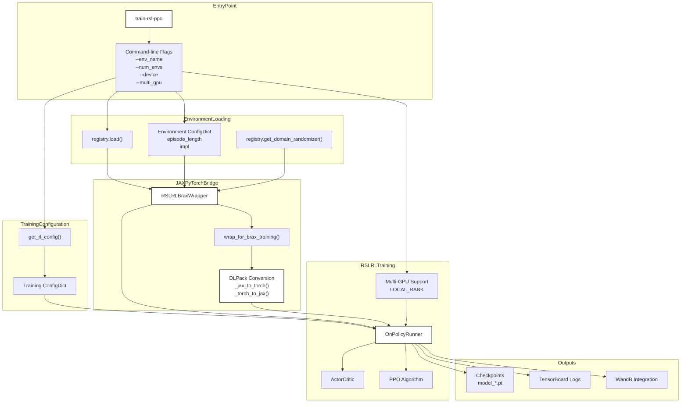
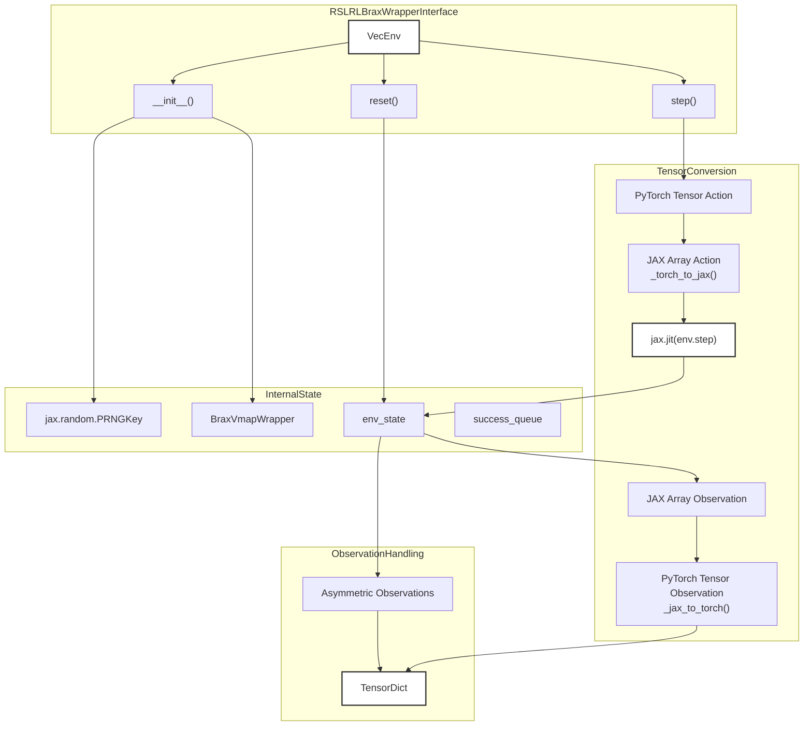
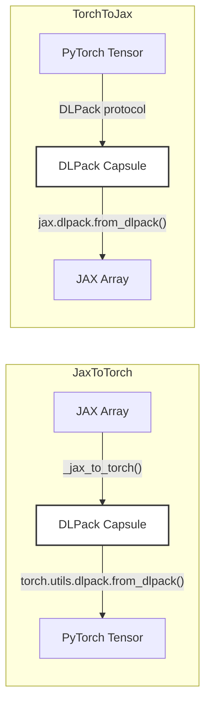

<!-- source: DeepWiki mcp.deepwiki.com · repo google-deepmind/mujoco_playground · page 4.2 PyTorch/RSL-RL Training Pipeline · fetched 2026-10-26 -->

# PyTorch/RSL-RL Training Pipeline

<details>
<summary>Relevant source files</summary>

The following files were used as context for generating this wiki page:

- [.gitignore](.gitignore)
- [learning/train_rsl_rl.py](learning/train_rsl_rl.py)
- [mujoco_playground/_src/wrapper_torch.py](mujoco_playground/_src/wrapper_torch.py)

</details>


## Purpose and Scope

This page documents the PyTorch-based training pipeline using the `rsl_rl` library. This pipeline provides an alternative to the JAX/Brax training path (see [JAX/Brax Training Pipeline](#4.1)) for users who prefer PyTorch's imperative programming model or need to integrate with PyTorch-based research workflows.

The key architectural difference is that environments remain JAX-based (using MuJoCo MJX for GPU-accelerated physics), while the policy network and training loop execute in PyTorch. The `RSLRLBraxWrapper` bridges these frameworks by converting tensors between JAX and PyTorch using the DLPack zero-copy protocol.

For configuration details, see [Configuration System](#4.3). For environment wrappers, see [Environment Wrappers](#4.4).

**Sources**: [learning/train_rsl_rl.py:1-291](), [mujoco_playground/_src/wrapper_torch.py:1-238]()

## Architecture Overview

The following diagram shows the complete PyTorch/RSL-RL training pipeline from command-line invocation to trained policy:

### Pipeline Architecture Overview


**Sources**: [learning/train_rsl_rl.py:106-227](), [mujoco_playground/_src/wrapper_torch.py:81-157]()

## RSLRLBraxWrapper: JAX-PyTorch Interoperability

The `RSLRLBraxWrapper` class is the core bridge between JAX-based environments and PyTorch-based training. It maintains environments in JAX for fast GPU physics simulation while exposing a PyTorch-compatible interface (`VecEnv`).

### Class Structure

### Wrapper Class Structure


**Sources**: [mujoco_playground/_src/wrapper_torch.py:84-238]()

### DLPack Tensor Conversion

The wrapper uses DLPack for zero-copy tensor conversion between JAX and PyTorch:

### DLPack Conversion Flow


The conversion functions are implemented at [mujoco_playground/_src/wrapper_torch.py:42-53]():

| Function | Purpose | Implementation |
|----------|---------|----------------|
| `_jax_to_torch` | Convert JAX Array to PyTorch Tensor | Uses `torch.utils.dlpack.from_dlpack()` [mujoco_playground/_src/wrapper_torch.py:43-46]() |
| `_torch_to_jax` | Convert PyTorch Tensor to JAX Array | Uses `jax.dlpack.from_dlpack()` [mujoco_playground/_src/wrapper_torch.py:50-53]() |

**Key properties:**
- Zero-copy: No data duplication in GPU memory.
- Maintains gradient flow when applicable.
- Automatic device placement alignment.

**Sources**: [mujoco_playground/_src/wrapper_torch.py:42-53]()

### Asymmetric Observation Support

The wrapper automatically detects and handles asymmetric observations for actor-critic training:

Configuration is set at [learning/train_rsl_rl.py:196-198]():
- If `observation_size` is a dict: Sets `obs_groups = {"policy": ["state"], "critic": ["privileged_state"]}` [learning/train_rsl_rl.py:196]()
- If `observation_size` is an int: Sets `obs_groups = {"policy": ["state"], "critic": ["state"]}` [learning/train_rsl_rl.py:198]()

**Sources**: [mujoco_playground/_src/wrapper_torch.py:135-147](), [learning/train_rsl_rl.py:194-199]()

## Training Configuration

Configuration for RSL-RL training is managed through environment-specific config functions defined in `locomotion_params` and `manipulation_params` [learning/train_rsl_rl.py:97-103]():

| Parameter | Type | Purpose |
|-----------|------|---------|
| `max_iterations` | int | Number of policy update iterations |
| `save_interval` | int | Iterations between checkpoint saves |
| `num_steps_per_env` | int | Rollout length per environment |
| `num_learning_epochs` | int | Number of SGD epochs per update |
| `actor_hidden_dims` | list[int] | Policy network layer sizes |
| `critic_hidden_dims` | list[int] | Value network layer sizes |
| `learning_rate` | float | Adam optimizer learning rate |

**Sources**: [learning/train_rsl_rl.py:97-104]()

## Command-Line Interface

The `train-rsl-ppo` command provides the entry point for PyTorch-based training [learning/train_rsl_rl.py:52-94]():

### Common Usage Patterns

```bash
# Basic training
train-rsl-ppo --env_name=LeapCubeReorient --num_envs=4096

# Multi-GPU training
train-rsl-ppo --env_name=Go1Joystick --multi_gpu --num_envs=8192

# Resume from checkpoint
train-rsl-ppo --env_name=BerkeleyHumanoidJoystickFlatTerrain \
  --load_run_name=BerkeleyHumanoidJoystickFlatTerrain-20240115-143022 \
  --checkpoint_num=500
```

**Sources**: [learning/train_rsl_rl.py:52-94]()

## OnPolicyRunner Integration

The `OnPolicyRunner` from `rsl_rl.runners` manages the complete training loop [learning/train_rsl_rl.py:28](). It initializes the `ActorCritic` network, manages rollouts via `RSLRLBraxWrapper`, computes GAE advantages, and executes PPO gradient updates.

**Sources**: [learning/train_rsl_rl.py:208-227]()

## Multi-GPU Training

Multi-GPU support uses PyTorch's distributed training variables (`LOCAL_RANK`) to partition environments across available GPUs [learning/train_rsl_rl.py:113-120](). The `device_rank` is passed down to `RSLRLBraxWrapper` to align JAX device allocations [mujoco_playground/_src/wrapper_torch.py:106-111]().

**Sources**: [learning/train_rsl_rl.py:113-120](), [mujoco_playground/_src/wrapper_torch.py:106-111]()

## Checkpoint Management

Checkpoints are saved in PyTorch's native `.pt` format under the configured `logdir` path [learning/train_rsl_rl.py:144-151](). The `get_load_path()` helper function handles locating runs and checkpoint files automatically [mujoco_playground/_src/wrapper_torch.py:56-81]().

**Sources**: [learning/train_rsl_rl.py:144-151](), [mujoco_playground/_src/wrapper_torch.py:56-81]()

---

