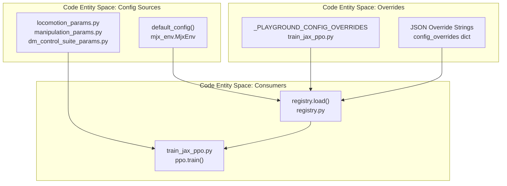
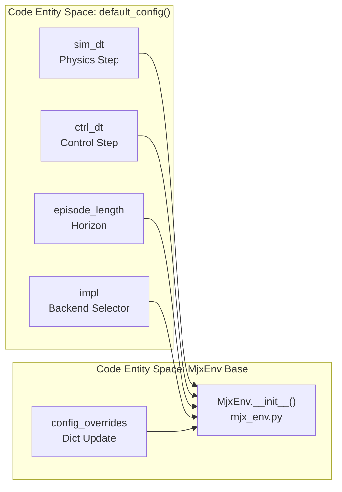
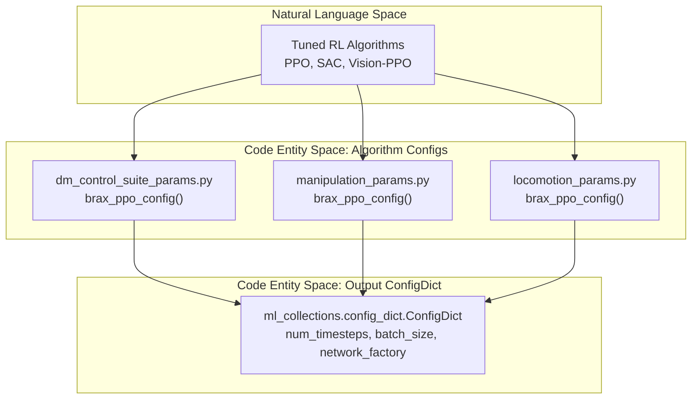
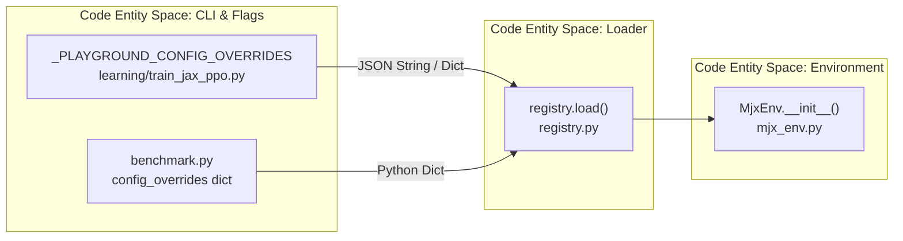

<!-- source: DeepWiki mcp.deepwiki.com · repo google-deepmind/mujoco_playground · page 4.3 Configuration System · fetched 2026-10-26 -->

# Configuration System

<details>
<summary>Relevant source files</summary>

The following files were used as context for generating this wiki page:

- [learning/train_jax_ppo.py](learning/train_jax_ppo.py)
- [mujoco_playground/_src/dm_control_suite/cartpole.py](mujoco_playground/_src/dm_control_suite/cartpole.py)
- [mujoco_playground/config/dm_control_suite_params.py](mujoco_playground/config/dm_control_suite_params.py)
- [mujoco_playground/config/locomotion_params.py](mujoco_playground/config/locomotion_params.py)
- [mujoco_playground/config/manipulation_params.py](mujoco_playground/config/manipulation_params.py)
- [mujoco_playground/experimental/madrona_benchmarking/benchmark.py](mujoco_playground/experimental/madrona_benchmarking/benchmark.py)

</details>


This page details the multi-layer configuration system in MuJoCo Playground, which manages hyperparameters from base physics environments up to reinforcement learning (RL) training algorithms, supporting command-line flags and JSON override strings.

Sources: [learning/train_jax_ppo.py:74-84](), [mujoco_playground/config/dm_control_suite_params.py:1-62](), [mujoco_playground/config/manipulation_params.py:1-42](), [mujoco_playground/config/locomotion_params.py:1-30]()

## Overview

The configuration architecture is layered across three distinct stages:
1. **Environment Defaults (`default_config()`)**: Defines core physics properties, simulation time steps (`sim_dt`), control time steps (`ctrl_dt`), action repeats, and vision sub-configurations.
2. **Algorithm Parameter Modules (`locomotion_params`, `manipulation_params`, `dm_control_suite_params`)**: Provides task-tuned RL hyperparameters (such as PPO network architectures, learning rates, discount factors, and unroll lengths).
3. **Runtime Overrides**: Allows modifying configurations dynamically via command-line flags and JSON override strings (`playground_config_overrides`).



Sources: [learning/train_jax_ppo.py:74-90](), [mujoco_playground/_src/dm_control_suite/cartpole.py:45-56]()

## Environment Default Configurations

Every environment implements a `default_config()` function returning an `ml_collections.config_dict.ConfigDict` instance. For example, the Cartpole environment defines simulation parameters, time steps, and vision settings as follows:

```python
def default_config() -> config_dict.ConfigDict:
  return config_dict.create(
      ctrl_dt=0.01,
      sim_dt=0.01,
      episode_length=1000,
      action_repeat=1,
      vision=False,
      vision_config=default_vision_config(),
      impl="warp",
      naconmax=0,
      njmax=2,
  )
```

These parameters govern physical integration steps (`sim_dt`), high-level control ticks (`ctrl_dt`), collision buffer allocations (`naconmax`, `njmax`), and execution backends (`impl="warp"` or `"jax"`).



Sources: [mujoco_playground/_src/dm_control_suite/cartpole.py:32-56](), [mujoco_playground/_src/dm_control_suite/cartpole.py:65-72]()

## RL Algorithm Parameter Modules

Reinforcement learning parameters are decoupled from environment physics and structured into category-specific modules: `locomotion_params`, `manipulation_params`, and `dm_control_suite_params`.

### Algorithm Config Modules

| Module Name | File Path | Target Domain | Key Functions |
|---|---|---|---|
| `locomotion_params` | `mujoco_playground/config/locomotion_params.py` | Quadrupeds & Humanoids | `brax_ppo_config()`, `rsl_rl_config()` |
| `manipulation_params` | `mujoco_playground/config/manipulation_params.py` | Robotic Arms & Hands | `brax_ppo_config()`, `brax_vision_ppo_config()` |
| `dm_control_suite_params` | `mujoco_playground/config/dm_control_suite_params.py` | Control Suite (25+ tasks) | `brax_ppo_config()`, `brax_vision_ppo_config()`, `brax_sac_config()` |

Sources: [mujoco_playground/config/dm_control_suite_params.py:24-152](), [mujoco_playground/config/manipulation_params.py:24-180](), [mujoco_playground/config/locomotion_params.py:24-202]()

The algorithm parameter functions combine environment default properties with tuned algorithmic hyperparameters (such as entropy costs, learning rates, discount factors, and network layer dimensions):



Sources: [mujoco_playground/config/dm_control_suite_params.py:24-46](), [mujoco_playground/config/manipulation_params.py:24-42](), [mujoco_playground/config/locomotion_params.py:24-53]()

## Command-Line Overrides and JSON Strings

When launching experiments using `learning/train_jax_ppo.py`, hyperparameters and environment options can be overridden via command-line flags or JSON override strings (`_PLAYGROUND_CONFIG_OVERRIDES`).

```python
_PLAYGROUND_CONFIG_OVERRIDES = flags.DEFINE_string(
    "playground_config_overrides",
    None,
    "Overrides for the playground env config.",
)
```

These overrides are parsed and passed directly to `registry.load()` via `config_overrides`, allowing developers to tune parameters (such as `vision_config.render_batch_size`, `episode_length`, or friction coefficients) without editing source files.



Sources: [learning/train_jax_ppo.py:80-84](), [mujoco_playground/experimental/madrona_benchmarking/benchmark.py:151-163]()

Sources: [learning/train_jax_ppo.py:74-90](), [mujoco_playground/_src/dm_control_suite/cartpole.py:45-72](), [mujoco_playground/config/dm_control_suite_params.py:24-110](), [mujoco_playground/config/manipulation_params.py:24-180](), [mujoco_playground/config/locomotion_params.py:24-202](), [mujoco_playground/experimental/madrona_benchmarking/benchmark.py:151-163]()

---

