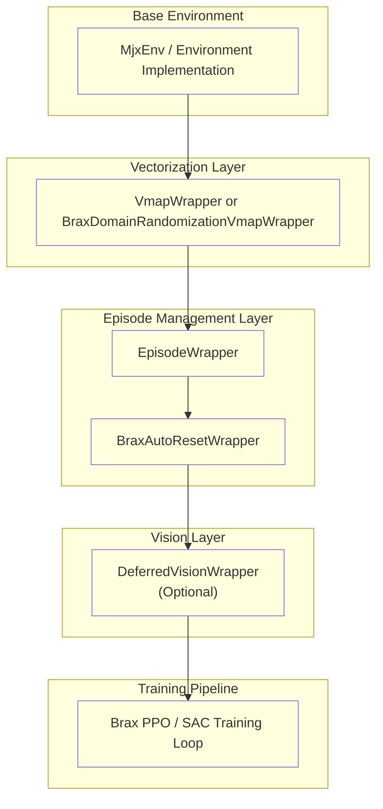
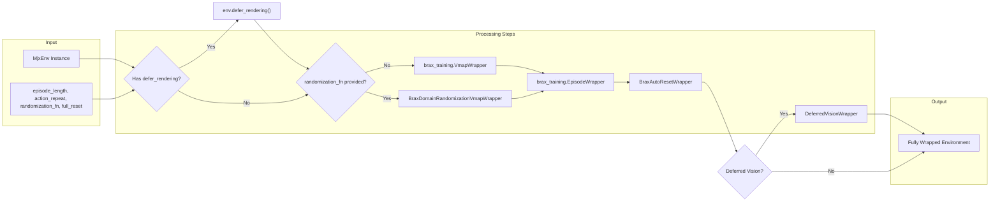

<!-- source: DeepWiki mcp.deepwiki.com · repo google-deepmind/mujoco_playground · page 4.4 Environment Wrappers · fetched 2026-10-26 -->

# Environment Wrappers

Relevant source files

The following files were used as context for generating this wiki page:

- [mujoco_playground/_src/wrapper.py](mujoco_playground/_src/wrapper.py)
- [mujoco_playground/_src/wrapper_test.py](mujoco_playground/_src/wrapper_test.py)

Environment wrappers provide modular transformation layers that integrate MuJoCo Playground environments with the Brax JAX-based reinforcement learning training framework [mujoco_playground/_src/wrapper.py:15-31](). This system manages environment vectorization (`vmap`), automatic episode resetting (`AutoResetWrapper`), domain randomization (`BraxDomainRandomizationVmapWrapper`), episode truncation/length bounds (`EpisodeWrapper`), and deferred vision rendering for pixel-based observations (`DeferredVisionWrapper`) [mujoco_playground/_src/wrapper.py:87-133]().

For details on the JAX PPO training pipeline that consumes these wrapped environments, see [JAX/Brax Training Pipeline](#4.1). For the core environment base class, see [Core Environment System](#2).

## Wrapper Architecture and Composition

The wrapper framework builds a modular onion-like structure around the base `MjxEnv` environment, injecting functionality for vectorization, resetting, state management, and observation post-processing before feeding tensors into Brax training algorithms [mujoco_playground/_src/wrapper.py:87-133]().

Sources: [mujoco_playground/_src/wrapper.py:87-133]()

---

## Core Wrapper Class

The base `Wrapper` class inherits from `mjx_env.MjxEnv` and acts as a transparent proxy for underlying environments, delegating model properties, step functions, resets, and rendering calls while allowing subclasses to override specific behaviors [mujoco_playground/_src/wrapper.py:30-86]().

### Key Properties and Methods

| Member | Type / Signature | Description |
| t | t | t |
| `__init__(env)` | Method | Stores the wrapped environment reference [mujoco_playground/_src/wrapper.py:33-34]() |
| `reset(rng)` | Method | Delegates environment reset to `self.env.reset(rng)` [mujoco_playground/_src/wrapper.py:36-37]() |
| `step(state, action)` | Method | Delegates environment step to `self.env.step(state, action)` [mujoco_playground/_src/wrapper.py:39-40]() |
| `observation_size` | Property | Returns the observation size or dictionary of sizes [mujoco_playground/_src/wrapper.py:43-45]() |
| `action_size` | Property | Returns the dimension of the action space [mujoco_playground/_src/wrapper.py:47-49]() |
| `unwrapped` | Property | Recursively unwraps to the root `MjxEnv` instance [mujoco_playground/_src/wrapper.py:51-53]() |
| `mj_model` / `mjx_model` | Property | Exposes the underlying MuJoCo `MjModel` and MJX model [mujoco_playground/_src/wrapper.py:60-65]() |
| `__getattr__(name)` | Method | Proxies all unhandled attributes and methods to the inner environment [mujoco_playground/_src/wrapper.py:54-57]() |

Sources: [mujoco_playground/_src/wrapper.py:30-86]()

---

## Training Orchestration: `wrap_for_brax_training`

The `wrap_for_brax_training()` function is the primary orchestration utility used to prepare an environment for Brax-based training loops [mujoco_playground/_src/wrapper.py:87-133](). It automatically chains vectorization, episode constraints, automatic resets, and vision rendering if required [mujoco_playground/_src/wrapper.py:117-132]().

### Orchestration Data Flow

Sources: [mujoco_playground/_src/wrapper.py:87-133]()

---

## Specialized Brax Wrappers

### `BraxAutoResetWrapper`
The `BraxAutoResetWrapper` intercepts environment steps to automatically reset environments when they reach termination or truncation states (`done == True`) [mujoco_playground/_src/wrapper.py:161-185](). 

- **Cached Reset vs Full Reset (`full_reset=False` vs `full_reset=True`)**:
  - When `full_reset=False` (default), environments reset to a cached initial state (`_first_data` and `_first_obs`), optimizing wall-clock performance by avoiding full procedural re-initialization [mujoco_playground/_src/wrapper.py:164-167]().
  - When `full_reset=True`, `env.reset()` is invoked upon completion, which fully randomizes initial conditions at a minor wall-clock penalty [mujoco_playground/_src/wrapper.py:168-174]().
- **Info Preservation**: Preserves custom metadata under `AutoResetWrapper_preserve_info` across automatic resets, supporting features like curriculum learning [mujoco_playground/_src/wrapper.py:172-174]().

Sources: [mujoco_playground/_src/wrapper.py:161-185]()

### `DeferredVisionWrapper`
When training vision-based policies (where observations consist of rendered pixels), rendering during the intermediate steps or cached resets can cause synchronization or memory overhead [mujoco_playground/_src/wrapper.py:135-141](). 
- The `DeferredVisionWrapper` captures pixel observations *after* episode bookkeeping and automatic resets have occurred [mujoco_playground/_src/wrapper.py:135-136]().
- It intercepts observation payloads using `_OBS_KEY`, executes environment steps, and delegates to `render_state()` or `render_observation()` on the unwrapped environment only after state transitions are finalized [mujoco_playground/_src/wrapper.py:143-158]().

Sources: [mujoco_playground/_src/wrapper.py:135-160]()

### `BraxDomainRandomizationVmapWrapper`
This wrapper combines JAX vectorization (`vmap`) with domain randomization functions (`randomization_fn`), mapping randomized physics models across parallel batch dimensions [mujoco_playground/_src/wrapper.py:124-125]().

Sources: [mujoco_playground/_src/wrapper.py:87-133]()

---

