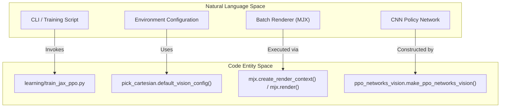
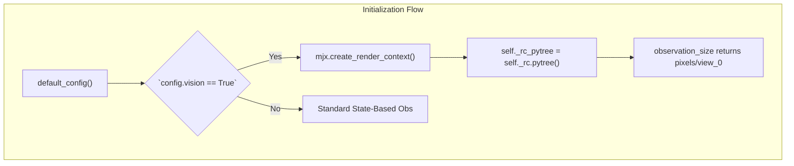
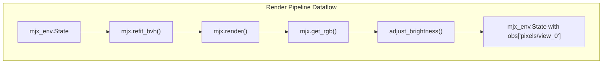
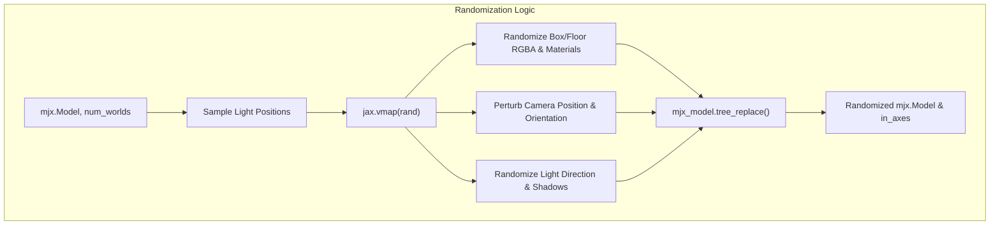
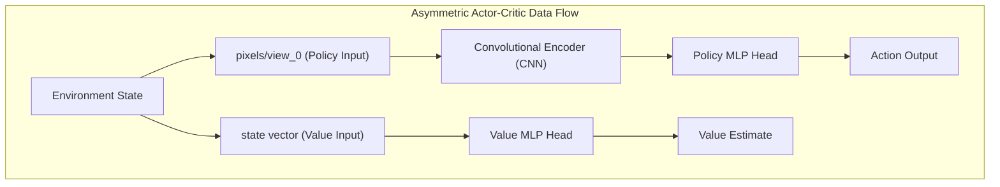

<!-- source: DeepWiki mcp.deepwiki.com · repo google-deepmind/mujoco_playground · page 4.5 Vision-Based Training · fetched 2026-10-26 -->

# Vision-Based Training

<details>
<summary>Relevant source files</summary>

The following files were used as context for generating this wiki page:

- [learning/notebooks/dm_control_suite.ipynb](learning/notebooks/dm_control_suite.ipynb)
- [learning/notebooks/locomotion.ipynb](learning/notebooks/locomotion.ipynb)
- [learning/notebooks/manipulation.ipynb](learning/notebooks/manipulation.ipynb)
- [learning/notebooks/vision.ipynb](learning/notebooks/vision.ipynb)
- [mujoco_playground/_src/locomotion/g1/randomize.py](mujoco_playground/_src/locomotion/g1/randomize.py)
- [mujoco_playground/_src/manipulation/franka_emika_panda/pick_cartesian.py](mujoco_playground/_src/manipulation/franka_emika_panda/pick_cartesian.py)
- [mujoco_playground/_src/manipulation/franka_emika_panda/randomize_vision.py](mujoco_playground/_src/manipulation/franka_emika_panda/randomize_vision.py)
- [mujoco_playground/_src/manipulation/franka_emika_panda/xmls/mjx_cabinet.xml](mujoco_playground/_src/manipulation/franka_emika_panda/xmls/mjx_cabinet.xml)
- [mujoco_playground/_src/manipulation/franka_emika_panda/xmls/mjx_single_cube.xml](mujoco_playground/_src/manipulation/franka_emika_panda/xmls/mjx_single_cube.xml)
- [mujoco_playground/_src/manipulation/franka_emika_panda/xmls/mjx_single_cube_camera.xml](mujoco_playground/_src/manipulation/franka_emika_panda/xmls/mjx_single_cube_camera.xml)
- [mujoco_playground/experimental/learning/viz_sim_policies.ipynb](mujoco_playground/experimental/learning/viz_sim_policies.ipynb)

</details>


This page explains the technical workflow, architecture, and implementation details for training vision-based policies in MuJoCo Playground. Vision training processes rendered camera pixel observations via convolutional neural networks, enabling sim-to-real transfer capabilities.

For general training execution, see [JAX/Brax Training Pipeline](#4.1). For environment wrappers, see [Environment Wrappers](#4.4). For hands-on workflows, see [Vision Training Workflow](#5.3).

## 1. Vision Training Workflow & Architecture

Vision-based training integrates GPU-accelerated batch rendering via MuJoCo MJX rendering primitives with the Brax PPO training pipeline. Environments equipped with camera sensors generate RGB frames within the JAX compilation loop, producing multi-modal observation dictionaries containing both proprioceptive state vectors and image observations.


*Figure 1: Bridging natural language concepts to code entities in vision training.*

Sources: [learning/notebooks/vision.ipynb](), [mujoco_playground/_src/manipulation/franka_emika_panda/pick_cartesian.py:32-42]()

---

## 2. Enabling Vision Mode and Environment Configuration

Vision mode is controlled through configuration flags in environment configuration dictionaries (e.g., `default_config()` in `pick_cartesian.py`). When `vision=True`, the environment configures camera parameters and rendering context specifications.

### Configuration Parameters

The vision configuration is defined by `default_vision_config()` [mujoco_playground/_src/manipulation/franka_emika_panda/pick_cartesian.py:32-43] and integrated into the main environment configuration [mujoco_playground/_src/manipulation/franka_emika_panda/pick_cartesian.py:45-82]:

| Parameter | Type | Default | Description |
|-----------|------|---------|-------------|
| `vision` | bool | `False` | Enables or disables vision-based observation mode |
| `vision_config.nworld` | int | `1024` | Number of parallel simulated worlds for batch rendering |
| `vision_config.cam_res` | tuple | `(64, 64)` | Resolution of rendered camera frames `(height, width)` |
| `vision_config.use_textures` | bool | `False` | Enables texture loading in render context |
| `vision_config.use_shadows` | bool | `False` | Enables shadow casting in render context |
| `vision_config.render_rgb` | tuple | `(True,)` | Specifies RGB rendering channels |


*Figure 2: Environment initialization flow when vision mode is enabled.*

Sources: [mujoco_playground/_src/manipulation/franka_emika_panda/pick_cartesian.py:32-149]()

---

## 3. MJX Batch Renderer and Render Pipeline

Rendering in MuJoCo Playground uses MJX's native GPU rendering routines (`mjx.create_render_context`, `mjx.refit_bvh`, `mjx.render`, and `mjx.get_rgb`) rather than external CPU renderers.

### Implementation in `PandaPickCubeCartesian`

In `pick_cartesian.py`, the rendering context is created during environment initialization if `self._vision` is true [mujoco_playground/_src/manipulation/franka_emika_panda/pick_cartesian.py:137-141]:

```python
    if self._vision:
      self._rc = mjx.create_render_context(
          mjm=self._mj_model, **self._config.vision_config.to_dict()
      )
      self._rc_pytree = self._rc.pytree()
```

During execution, `render_state()` processes pipeline states to update bounding volume hierarchies, render frames on GPU, extract RGB arrays, and apply brightness adjustments [mujoco_playground/_src/manipulation/franka_emika_panda/pick_cartesian.py:153-161]:

```python
  def render_state(self, state: mjx_env.State) -> mjx_env.State:
    data = mjx.refit_bvh(self._mjx_model, state.data, self._rc_pytree)
    out = mjx.render(self._mjx_model, data, self._rc_pytree)
    rgb = mjx.get_rgb(self._rc_pytree, 0, out[0])
    brightness = state.info['brightness'][..., None, None, :]
    rgb = adjust_brightness(rgb, brightness)
    return state.replace(
        data=out[2], obs={'pixels/view_0': rgb}
    )
```


*Figure 3: Data flow inside `render_state`.*

Sources: [mujoco_playground/_src/manipulation/franka_emika_panda/pick_cartesian.py:137-161]()

---

## 4. Vision Domain Randomization

To bridge the reality gap during sim-to-real transfer, vision environments use specialized domain randomization functions (such as `domain_randomize` in `randomize_vision.py`) that randomize appearance properties, camera placement, and lighting parameters across vectorized worlds using `jax.vmap`.

### Randomization Pipeline

The `domain_randomize` function constructs batched model fields over `num_worlds`:


*Figure 4: Domain randomization workflow for vision environments.*

Key randomized components include:
- **Appearance**: Box RGBA colors, floor grayscale textures, and material indices [mujoco_playground/_src/manipulation/franka_emika_panda/randomize_vision.py:91-120].
- **Cameras**: Cartesian offset positions and perturbed orientations up to 10 degrees via `perturb_orientation` [mujoco_playground/_src/manipulation/franka_emika_panda/randomize_vision.py:122-130].
- **Lighting**: Light position sampling, directional perturbation, and Bernoulli shadow-casting flags [mujoco_playground/_src/manipulation/franka_emika_panda/randomize_vision.py:82-151].

Sources: [mujoco_playground/_src/manipulation/franka_emika_panda/randomize_vision.py:34-187]()

---

## 5. Asymmetric Observations and Network Architectures

Vision-based models in MuJoCo Playground utilize asymmetric actor-critic setups:
- **Actor (Policy)**: Receives high-dimensional pixel observations (`pixels/view_0`) processed through convolutional encoder layers.
- **Critic (Value Function)**: Receives privileged state vectors (full internal simulation states) to stabilize value estimation and training convergence.


*Figure 5: Asymmetric observation architecture separating policy and value network inputs.*

Sources: [mujoco_playground/_src/manipulation/franka_emika_panda/pick_cartesian.py:143-161](), [learning/notebooks/vision.ipynb]()

---

