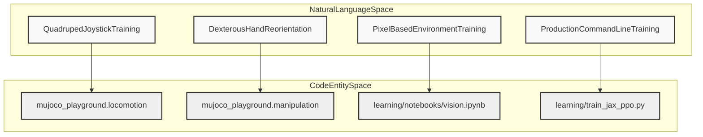
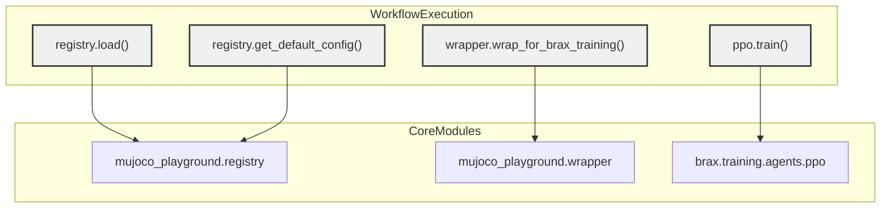

<!-- source: DeepWiki mcp.deepwiki.com · repo google-deepmind/mujoco_playground · page 5 Examples and Tutorials · fetched 2026-10-26 -->

# Examples and Tutorials

Relevant source files

The following files were used as context for generating this wiki page:

- [learning/notebooks/dm_control_suite.ipynb](learning/notebooks/dm_control_suite.ipynb)
- [learning/notebooks/locomotion.ipynb](learning/notebooks/locomotion.ipynb)
- [learning/notebooks/manipulation.ipynb](learning/notebooks/manipulation.ipynb)
- [learning/notebooks/vision.ipynb](learning/notebooks/vision.ipynb)
- [mujoco_playground/experimental/learning/cube_reorient.ipynb](mujoco_playground/experimental/learning/cube_reorient.ipynb)
- [mujoco_playground/experimental/learning/cube_rotate.ipynb](mujoco_playground/experimental/learning/cube_rotate.ipynb)
- [mujoco_playground/experimental/learning/gait_tracking.ipynb](mujoco_playground/experimental/learning/gait_tracking.ipynb)
- [mujoco_playground/experimental/learning/getup.ipynb](mujoco_playground/experimental/learning/getup.ipynb)
- [mujoco_playground/experimental/learning/handstand.ipynb](mujoco_playground/experimental/learning/handstand.ipynb)
- [mujoco_playground/experimental/learning/humanoid_joystick.ipynb](mujoco_playground/experimental/learning/humanoid_joystick.ipynb)
- [mujoco_playground/experimental/learning/humanoid_joystick_gait_tracking.ipynb](mujoco_playground/experimental/learning/humanoid_joystick_gait_tracking.ipynb)
- [mujoco_playground/experimental/learning/joystick.ipynb](mujoco_playground/experimental/learning/joystick.ipynb)
- [mujoco_playground/experimental/learning/viz_sim_policies.ipynb](mujoco_playground/experimental/learning/viz_sim_policies.ipynb)

This page provides a high-level overview of practical examples and interactive tutorials for training reinforcement learning policies in MuJoCo Playground. It covers interactive Jupyter notebooks and production-ready command-line scripts across locomotion, manipulation, vision, and classic control environments.

**Scope**: As a parent page, this section introduces the available training workflows and links to specialized child pages for deep technical details. For core training infrastructure, see [Training Infrastructure](#4).

**Sources**: [learning/notebooks/locomotion.ipynb:1-50](), [learning/notebooks/vision.ipynb:1-50]()

---

## 5.1 Locomotion Training Examples

Locomotion training workflows leverage GPU-accelerated simulation to train quadruped and bipedal robots on tasks such as joystick control, fall recovery getups, handstands, and gait tracking. These workflows incorporate domain randomization for sim-to-real transfer and curriculum learning for advanced acrobatic behaviors.

For comprehensive walkthroughs, code examples, and parameter configurations, see [Locomotion Training Examples](#5.1).

**Sources**: [learning/notebooks/locomotion.ipynb:250-400](), [mujoco_playground/experimental/learning/joystick.ipynb:1-100]()

---

## 5.2 Manipulation Training Examples

Manipulation training examples cover robotic arm tasks like Franka Panda pick-and-place, open-cabinet, and peg insertion, as well as dexterous hand reorientation tasks using the Leap Hand and ALOHA bimanual systems. These environments rely on task-specific reward shaping, success metrics, Cartesian control interfaces, and inverse kinematics integration.

For details on reward structures, training scripts, and performance metrics, see [Manipulation Training Examples](#5.2).

**Sources**: [learning/notebooks/manipulation.ipynb:250-400](), [mujoco_playground/experimental/learning/cube_reorient.ipynb:60-100]()

---

## 5.3 Vision Training Workflow

Vision-based training replaces state vectors with high-throughput pixel observations rendered directly on the GPU. Using specialized batch renderers and convolutional neural network architectures, policies learn directly from raw visual inputs while leveraging asymmetric actor-critic setups where the critic retains access to privileged simulation states.

For step-by-step guidance on setting up `vision.ipynb`, configuring the `MJWarp` batch renderer, and evaluating vision policies, see [Vision Training Workflow](#5.3).

**Sources**: [learning/notebooks/vision.ipynb:25-50]()

---

## 5.4 Command-Line Training

For large-scale or headless training runs, MuJoCo Playground provides robust command-line entry points via `train-jax-ppo` and `train-rsl-ppo`. These scripts support flag-based configuration overrides (`--impl warp`, `--vision`, `--rscope_envs`), checkpoint persistence using Orbax, and integrated experiment tracking via Weights & Biases (WandB).

For command-line flag documentation, workflow examples, and integration instructions, see [Command-Line Training](#5.4).

**Sources**: [learning/README.md:13-43]()

---

**Sources**: [learning/notebooks/locomotion.ipynb:258-398](), [learning/notebooks/manipulation.ipynb:259-372]()

---

