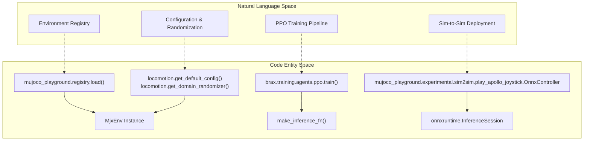
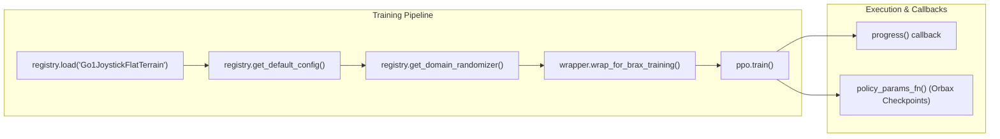
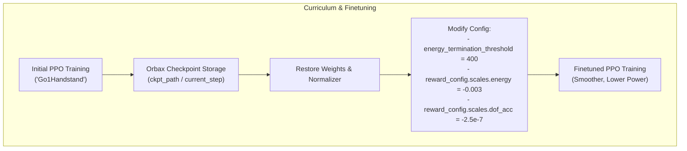
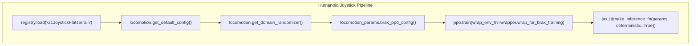
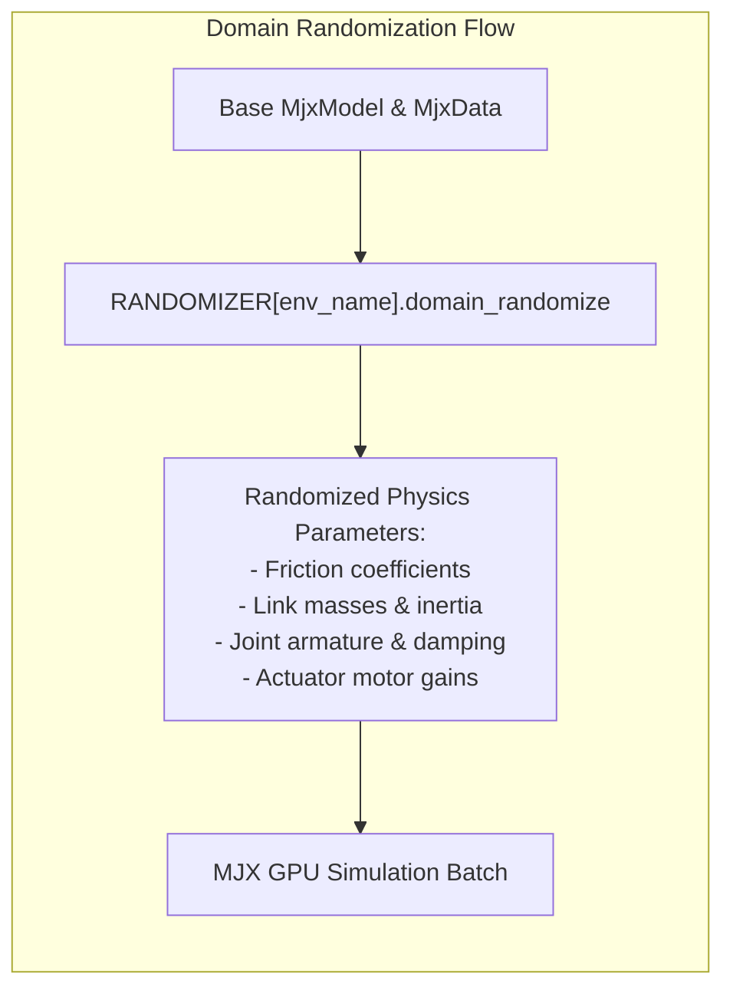
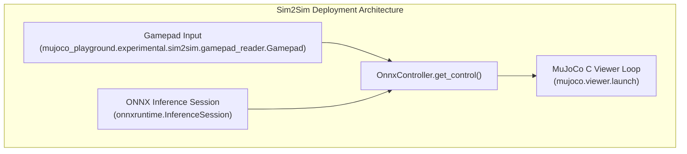

<!-- source: DeepWiki mcp.deepwiki.com · repo google-deepmind/mujoco_playground · page 5.1 Locomotion Training Examples · fetched 2026-10-26 -->

# Locomotion Training Examples

<details>
<summary>Relevant source files</summary>

The following files were used as context for generating this wiki page:

- [learning/notebooks/dm_control_suite.ipynb](learning/notebooks/dm_control_suite.ipynb)
- [learning/notebooks/locomotion.ipynb](learning/notebooks/locomotion.ipynb)
- [learning/notebooks/manipulation.ipynb](learning/notebooks/manipulation.ipynb)
- [learning/notebooks/vision.ipynb](learning/notebooks/vision.ipynb)
- [mujoco_playground/experimental/learning/apollo_joystick.ipynb](mujoco_playground/experimental/learning/apollo_joystick.ipynb)
- [mujoco_playground/experimental/learning/cube_reorient.ipynb](mujoco_playground/experimental/learning/cube_reorient.ipynb)
- [mujoco_playground/experimental/learning/cube_rotate.ipynb](mujoco_playground/experimental/learning/cube_rotate.ipynb)
- [mujoco_playground/experimental/learning/gait_tracking.ipynb](mujoco_playground/experimental/learning/gait_tracking.ipynb)
- [mujoco_playground/experimental/learning/getup.ipynb](mujoco_playground/experimental/learning/getup.ipynb)
- [mujoco_playground/experimental/learning/handstand.ipynb](mujoco_playground/experimental/learning/handstand.ipynb)
- [mujoco_playground/experimental/learning/humanoid_joystick.ipynb](mujoco_playground/experimental/learning/humanoid_joystick.ipynb)
- [mujoco_playground/experimental/learning/humanoid_joystick_gait_tracking.ipynb](mujoco_playground/experimental/learning/humanoid_joystick_gait_tracking.ipynb)
- [mujoco_playground/experimental/learning/joystick.ipynb](mujoco_playground/experimental/learning/joystick.ipynb)
- [mujoco_playground/experimental/learning/joystick_gait_tracking.ipynb](mujoco_playground/experimental/learning/joystick_gait_tracking.ipynb)
- [mujoco_playground/experimental/learning/viz_sim_policies.ipynb](mujoco_playground/experimental/learning/viz_sim_policies.ipynb)
- [mujoco_playground/experimental/sim2sim/onnx/apollo_policy.onnx](mujoco_playground/experimental/sim2sim/onnx/apollo_policy.onnx)
- [mujoco_playground/experimental/sim2sim/play_apollo_joystick.py](mujoco_playground/experimental/sim2sim/play_apollo_joystick.py)

</details>


This page provides interactive walkthroughs and technical documentation for training locomotion policies using MuJoCo Playground's locomotion notebooks and scripts. It covers end-to-end workflows ranging from quadruped joystick control and curriculum learning for tricks (such as handstands) to bipedal locomotion, gait tracking, domain randomization, and sim-to-sim deployment.

For architectural details on the underlying locomotion environments, see [Locomotion Environments](#3.1). For details on the training pipelines, see [JAX/Brax Training Pipeline](#4.1) and [PyTorch/RSL-RL Training Pipeline](#4.2).

---

## 1. Overview of Locomotion Training Framework

Locomotion training in MuJoCo Playground leverages GPU-accelerated simulation via MJX alongside JAX-based PPO (`ppo.train`) from Brax. The framework standardizes environment discovery, configuration loading, domain randomization, and rollout collection across diverse robot platforms.



Sources: [learning/notebooks/locomotion.ipynb:242-268](), [mujoco_playground/experimental/sim2sim/play_apollo_joystick.py:31-69]()

---

## 2. Quadrupedal Locomotion Workflows

### 2.1 Go1 Joystick Control

The Go1 joystick workflow trains a robust velocity-tracking policy using `Go1JoystickFlatTerrain`. The agent is rewarded for matching linear velocity commands ($v_x, v_y$) and angular velocity commands ($\omega_z$) while minimizing energy usage, action rates, and undesirable foot slips.



Sources: [learning/notebooks/locomotion.ipynb:266-324](), [mujoco_playground/experimental/learning/apollo_joystick.ipynb:147-158]()

### 2.2 Go1 Handstand and Curriculum Finetuning

Advanced quadrupedal behaviors like handstands require two-stage training pipelines where an initial policy is trained for general balance before being finetuned with tightened reward penalties and energy thresholds.



Sources: [learning/notebooks/locomotion.ipynb:770-1027]()

---

## 3. Bipedal and Humanoid Locomotion Workflows

Bipedal and humanoid robots (such as the Berkeley Humanoid, Unitree G1/H1, and Booster Apollo) utilize specialized phase variables and balance control tasks.

### 3.1 Humanoid Joystick Training

Humanoid environments like `G1JoystickFlatTerrain` and `ApolloJoystickFlatTerrain` incorporate gait phase signals ($\cos(\phi), \sin(\phi)$) into the observation space to coordinate periodic leg swing dynamics.



Sources: [mujoco_playground/experimental/learning/humanoid_joystick.ipynb:69-75](), [mujoco_playground/experimental/learning/apollo_joystick.ipynb:55-162]()

---

## 4. Gait Tracking and Domain Randomization

Gait tracking environments (e.g., `SpotInplaceGaitTracking` and `H1InplaceGaitTracking`) force the policy to follow reference joint trajectories or foot contact schedules.

### 4.1 Domain Randomization Integration

To achieve robust sim-to-real transfer, domain randomization functions modify physical attributes across parallelized environment instances using `jax.vmap`.



Sources: [mujoco_playground/experimental/learning/gait_tracking.ipynb:65-172]()

---

## 5. Checkpointing, Progress Monitoring, and Sim-to-Sim Deployment

### 5.1 Training Progress and Checkpoint Management

During training, progress is monitored via custom callback functions that log metrics to WandB or render live Matplotlib charts. Checkpoints are persisted using Orbax (`ocp.PyTreeCheckpointer`).

```python
# Example Checkpointing Call Structure (from Apollo / Humanoid notebooks)
def policy_params_fn(current_step, make_policy, params):
  orbax_checkpointer = ocp.PyTreeCheckpointer()
  save_args = orbax_utils.save_args_from_target(params)
  path = ckpt_path / f"{current_step}"
  orbax_checkpointer.save(path, params, force=True, save_args=save_args)
```

Sources: [mujoco_playground/experimental/learning/apollo_joystick.ipynb:136-142]()

### 5.2 Sim-to-Sim Policy Export and Deployment

Trained policies can be converted to ONNX format and deployed in vanilla C MuJoCo using real-time gamepad control (`play_apollo_joystick.py`).



Sources: [mujoco_playground/experimental/sim2sim/play_apollo_joystick.py:31-144]()

---

---

