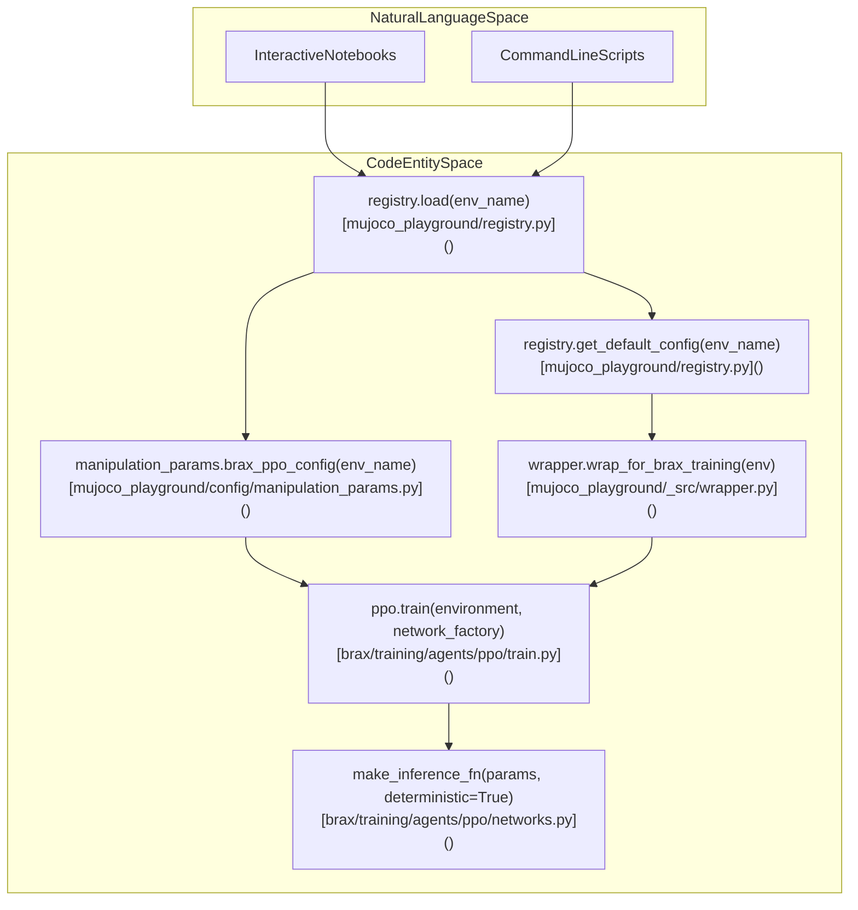
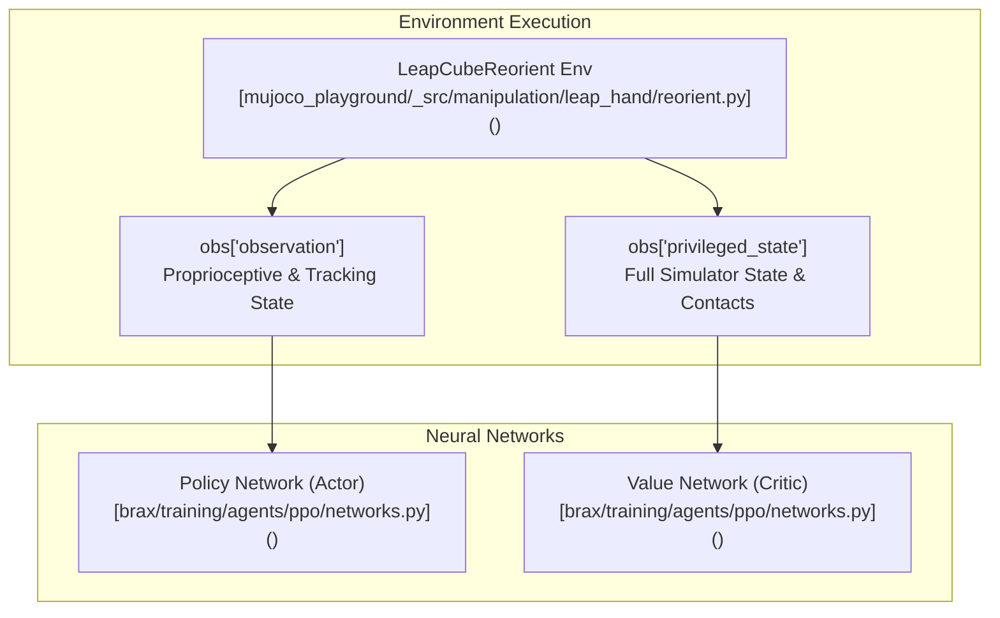

<!-- source: DeepWiki mcp.deepwiki.com · repo google-deepmind/mujoco_playground · page 5.2 Manipulation Training Examples · fetched 2026-10-26 -->

# Manipulation Training Examples

<details>
<summary>Relevant source files</summary>

The following files were used as context for generating this wiki page:

- [learning/notebooks/dm_control_suite.ipynb](learning/notebooks/dm_control_suite.ipynb)
- [learning/notebooks/locomotion.ipynb](learning/notebooks/locomotion.ipynb)
- [learning/notebooks/manipulation.ipynb](learning/notebooks/manipulation.ipynb)
- [learning/notebooks/vision.ipynb](learning/notebooks/vision.ipynb)
- [mujoco_playground/experimental/learning/open_cabinet.ipynb](mujoco_playground/experimental/learning/open_cabinet.ipynb)
- [mujoco_playground/experimental/learning/position_cube.ipynb](mujoco_playground/experimental/learning/position_cube.ipynb)
- [mujoco_playground/experimental/learning/viz_sim_policies.ipynb](mujoco_playground/experimental/learning/viz_sim_policies.ipynb)

</details>


This page provides practical walkthroughs for training manipulation policies in MuJoCo Playground. It demonstrates end-to-end training workflows using the Jupyter notebooks (`[learning/notebooks/manipulation.ipynb]()`, `[mujoco_playground/experimental/learning/open_cabinet.ipynb]()`, `[mujoco_playground/experimental/learning/position_cube.ipynb]()`) and command-line scripts, covering five key tasks:

- **Panda Pick-Place**: Basic robotic arm manipulation with reward shaping (`[mujoco_playground/_src/manipulation/panda/pick_cube.py]()`)
- **Open Cabinet**: Articulated object interaction (`[mujoco_playground/experimental/learning/open_cabinet.ipynb]()`, `[mujoco_playground/_src/manipulation/panda/cabinet.py]()`)
- **Cube Positioning**: Orientation and spatial placement (`[mujoco_playground/experimental/learning/position_cube.ipynb]()`, `[mujoco_playground/_src/manipulation/panda/orientation.py]()`)
- **Leap Hand Reorientation**: Dexterous manipulation with asymmetric actor-critic training (`[mujoco_playground/_src/manipulation/leap_hand/reorient.py]()`)
- **ALOHA Handover**: Bimanual coordination tasks (`[mujoco_playground/_src/manipulation/aloha/handover.py]()`)

For underlying environment implementations, see [Manipulation Environments](#3.2). For training system architecture, see [Training Infrastructure](#4).

## Overview

The manipulation training examples use interactive notebooks and Python scripts to demonstrate practical policy training workflows. Each example shows the complete pipeline from environment loading through training to policy visualization.

### Training Entry Points

| Entry Point | Framework | Use Case |
|-------------|-----------|----------|
| `[learning/notebooks/manipulation.ipynb]()` | JAX/Brax PPO | Interactive tutorials, pick-place, and reorientation |
| `[mujoco_playground/experimental/learning/open_cabinet.ipynb]()` | JAX/Brax PPO | Articulated object manipulation training |
| `[mujoco_playground/experimental/learning/position_cube.ipynb]()` | JAX/Brax PPO | Cube positioning and orientation training |
| `[learning/train_jax_ppo.py]()` | JAX/Brax PPO | Command-line training, batch jobs |
| `[learning/train_rsl_rl.py]()` | PyTorch/RSL-RL | PyTorch ecosystem, multi-algorithm support |

### Available Manipulation Environments

The manipulation registry provides environments across multiple robotic platforms (`[mujoco_playground/_src/manipulation/__init__.py:27-64]()`):

```python
registry.manipulation.ALL_ENVS
# Output: ['PandaPickCube', 'PandaPickCubeOrientation', 'PandaCabinet', 
#          'PandaPushCube', 'AlohaHandover', 'AlohaPegInsertion',
#          'LeapCubeReorient', 'LeapCubeRotateZ', 'AeroCubeRotateZ']
```

| Robot Platform | Environments | Key Features |
|----------------|--------------|--------------|
| Franka Emika Panda | `PandaPickCube`, `PandaPickCubeOrientation`, `PandaCabinet`, `PandaPushCube`, `PandaOrientation` | 7-DOF arm, parallel gripper, Cartesian control, articulated objects |
| ALOHA | `AlohaHandover`, `AlohaPegInsertion` | Dual-arm coordination, bimanual handover tasks |
| Leap Hand | `LeapCubeReorient`, `LeapCubeRotateZ` | 16-DOF dexterous hand, in-hand manipulation |
| Aero Hand | `AeroCubeRotateZ` | Alternative dexterous hand platform |

Sources: `[learning/notebooks/manipulation.ipynb:237-238]()`, `[mujoco_playground/_src/manipulation/__init__.py:27-64]()`

## Training Workflow

The manipulation training workflow follows a standard pipeline from environment setup through training to evaluation. This diagram maps natural language concepts to the underlying code entities:



Sources: `[learning/notebooks/manipulation.ipynb:258-372]()`, `[learning/train_jax_ppo.py:128-381]()`, `[mujoco_playground/config/manipulation_params.py:15-196]()`

## Example 1: Panda Pick Cube

The `PandaPickCubeOrientation` environment provides a foundational robotic arm manipulation task (`[mujoco_playground/_src/manipulation/panda/pick_cube.py]()`). The goal is to pick up a cube and lift it to a target position while maintaining a specific orientation.

### Environment Loading & Configuration

The environment and its configuration are loaded via the registry (`[learning/notebooks/manipulation.ipynb:258-279]()`):

```python
env_name = 'PandaPickCubeOrientation'
env = registry.load(env_name)
env_cfg = registry.get_default_config(env_name)
```

The configuration `env_cfg` defines critical timing and execution parameters:

| Parameter | Value | Purpose |
|-----------|-------|---------|
| `ctrl_dt` | 0.02 | Control timestep (50 Hz) |
| `sim_dt` | 0.002 | Simulation timestep (500 Hz) |
| `episode_length` | 200 | Episode duration in steps |
| `action_repeat` | 10 | Substeps per control action |

Sources: `[learning/notebooks/manipulation.ipynb:258-279]()`, `[mujoco_playground/_src/manipulation/panda/pick_cube.py]()`

### Reward Structure & Success Metrics

The Panda pick task uses a multi-component reward function combining reaching, lifting, and orientation penalties:
- **Reach reward**: End-effector distance to cube.
- **Lift reward**: Cube height above the table surface.
- **Orientation penalty**: Deviation from the target orientation quaternion.
- **Action rate / Torque penalty**: Regularization for smooth control.

Success is tracked via `state.metrics['success']`, evaluated when the cube exceeds a height threshold while maintaining valid orientation and contact stability (`[mujoco_playground/_src/manipulation/panda/pick_cube.py]()`).

Sources: `[mujoco_playground/_src/manipulation/panda/pick_cube.py]()`, `[learning/notebooks/manipulation.ipynb:270-279]()`

Sources: `[mujoco_playground/_src/manipulation/panda/pick_cube.py]()`, `[learning/notebooks/manipulation.ipynb:258-279]()`

---

## Example 2: Open Cabinet

The `PandaOpenCabinet` environment (`[mujoco_playground/experimental/learning/open_cabinet.ipynb]()`, `[mujoco_playground/_src/manipulation/panda/cabinet.py]()`) tasks the Franka Panda arm with opening a articulated cabinet door or drawer.

### Task Mechanics & Observation Space
- **Robot**: 7-DOF Franka Panda arm with parallel gripper.
- **Environment**: Cabinet model with revolute or prismatic joint representing the door/drawer.
- **Observations**: Joint positions, velocities, end-effector pose, and cabinet joint state.
- **Control**: Cartesian impedance or velocity control mapped through inverse kinematics.

### Training Setup in JAX

Training is executed using the experimental notebook workflow (`[mujoco_playground/experimental/learning/open_cabinet.ipynb:62-176]()`):

```python
env_name = "PandaOpenCabinet"
env_cfg = manipulation.get_default_config(env_name)

make_networks_factory = functools.partial(
    ppo_networks.make_ppo_networks, policy_hidden_layer_sizes=(32, 32, 32, 32)
)

env = manipulation.load(env_name, config=env_cfg)
make_inference_fn, params, _ = train_fn(
    wrap_env=False,
    environment=wrapper.wrap_for_brax_training(
        env,
        episode_length=env_cfg.episode_length,
        action_repeat=env_cfg.action_repeat,
    ),
    progress_fn=progress,
)
```

Sources: `[mujoco_playground/experimental/learning/open_cabinet.ipynb:62-176]()`, `[mujoco_playground/_src/manipulation/panda/cabinet.py]()`

---

## Example 3: Cube Positioning

The `PandaOrientation` environment (`[mujoco_playground/experimental/learning/position_cube.ipynb]()`, `[mujoco_playground/_src/manipulation/panda/orientation.py]()`) focuses on precise positioning and orientation of a cube on a workspace.

### Training Configuration (`position_cube.ipynb`)

The training hyperparameters for `PandaOrientation` are configured via PPO training arguments (`[mujoco_playground/experimental/learning/position_cube.ipynb:147-168]()`):

```python
train_fn = functools.partial(
    ppo.train,
    num_timesteps=20_000_000,
    num_evals=4,
    reward_scaling=0.1,
    episode_length=150,
    normalize_observations=True,
    action_repeat=1,
    unroll_length=10,
    num_minibatches=32,
    num_updates_per_batch=8,
    discounting=0.97,
    learning_rate=1e-3,
    entropy_cost=2e-2,
    num_envs=2048,
    batch_size=512,
    num_resets_per_eval=1,
    network_factory=make_networks_factory,
    seed=1,
    policy_params_fn=policy_params_fn,
)
```

Sources: `[mujoco_playground/experimental/learning/position_cube.ipynb:147-168]()`, `[mujoco_playground/_src/manipulation/panda/orientation.py]()`

---

## Example 4: Leap Hand Cube Reorient

The `LeapCubeReorient` environment (`[mujoco_playground/_src/manipulation/leap_hand/reorient.py]()`) demonstrates complex dexterous in-hand manipulation using the 16-DOF Leap Hand.

### Asymmetric Actor-Critic Architecture

Dexterous hand manipulation relies on asymmetric observations separating deployable proprioception from privileged simulator state (`[mujoco_playground/_src/manipulation/leap_hand/reorient.py:133-160]()`):



Sources: `[learning/notebooks/manipulation.ipynb:469-475]()`, `[mujoco_playground/_src/manipulation/leap_hand/reorient.py:133-160]()`

### Reward Shaping & Success Metrics
- **Orientation Reward**: Based on geodesic distance in $SO(3)$ between current and target object quaternions (`[mujoco_playground/_src/manipulation/leap_hand/reorient.py:186-213]()`).
- **Regularization**: Penalties on object linear/angular velocity, joint torque, and action rate.
- **Success Threshold**: Orientation error below `0.1` radians (`[mujoco_playground/_src/manipulation/leap_hand/reorient.py:161-185]()`).

Sources: `[mujoco_playground/_src/manipulation/leap_hand/reorient.py:161-213]()`, `[learning/notebooks/manipulation.ipynb:459-465]()`

---

## Example 5: ALOHA Handover Tasks

The `AlohaHandover` and `AlohaPegInsertion` environments (`[mujoco_playground/_src/manipulation/aloha/handover.py]()`, `[mujoco_playground/_src/manipulation/aloha/peg_insertion.py]()`) model bimanual manipulation coordination using dual arms.

### Task Characteristics
- **Bimanual Architecture**: Dual 6-DOF arms with parallel grippers.
- **Coordination Rewards**: Reward shaping encourages transferring objects smoothly between the primary and secondary arm, penalizing drops or excessive contact forces.
- **Metrics**: Track transfer success rate, insertion precision, and episode completion time.

Sources: `[mujoco_playground/_src/manipulation/aloha/handover.py]()`, `[mujoco_playground/_src/manipulation/aloha/peg_insertion.py]()`

---

## Configuration and Hyperparameter Management

The `manipulation_params` module (`[mujoco_playground/config/manipulation_params.py]()`) provides environment-specific training configurations for PPO and RSL-RL.

### Parameter Configuration Summary

| Environment Group | Timesteps (`num_timesteps`) | Batch Size (`num_envs`) | Episode Length (`episode_length`) | Notable Settings |
|----------------|----------------------------|-------------------------|-----------------------------------|------------------|
| Panda Pick / Cabinet | 20M – 50M | 2048 | 150 – 200 | Standard symmetric observation |
| Leap Hand Reorient | 100M | 4096 | 500 | Asymmetric observation keys enabled |
| ALOHA Handover | 50M | 2048 | 300 | Bimanual action space configuration |

Sources: `[mujoco_playground/config/manipulation_params.py:15-196]()`

---

## Command-Line Training & Alternative Frameworks

### JAX/Brax Training Script

```bash
python learning/train_jax_ppo.py \
    --env_name=PandaPickCube \
    --num_timesteps=20000000 \
    --use_wandb \
    --wandb_project=manipulation_training
```

Sources: `[learning/train_jax_ppo.py:128-381]()`, `[README.md:54-71]()`

### PyTorch / RSL-RL Integration

For PyTorch workflows, training uses `train_rsl_rl.py` with `RSLRLBraxWrapper` (`[mujoco_playground/_src/wrapper_torch.py:66-177]()`):

```bash
python learning/train_rsl_rl.py \
    --env_name=LeapCubeReorient \
    --num_envs=4096 \
    --use_wandb
```

Sources: `[learning/train_rsl_rl.py:83-198]()`, `[mujoco_playground/_src/wrapper_torch.py:66-177]()`

---

