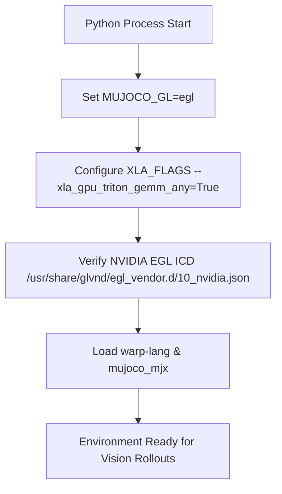
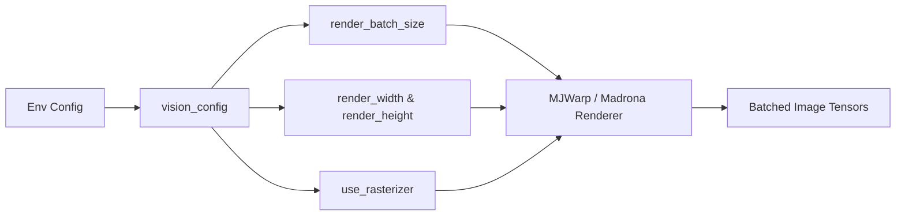
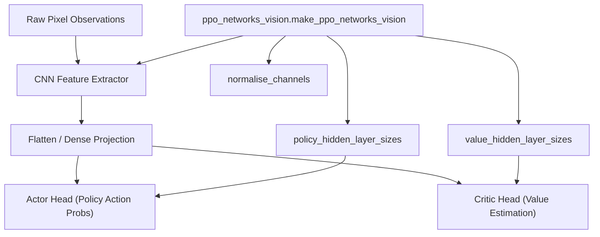
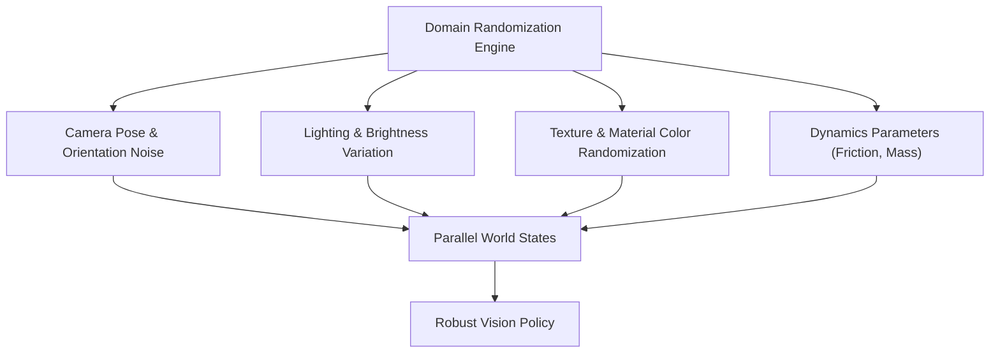

<!-- source: DeepWiki mcp.deepwiki.com · repo google-deepmind/mujoco_playground · page 5.3 Vision Training Workflow · fetched 2026-10-26 -->

# Vision Training Workflow

Relevant source files

The following files were used as context for generating this wiki page:

- [learning/notebooks/dm_control_suite.ipynb](learning/notebooks/dm_control_suite.ipynb)
- [learning/notebooks/locomotion.ipynb](learning/notebooks/locomotion.ipynb)
- [learning/notebooks/manipulation.ipynb](learning/notebooks/manipulation.ipynb)
- [learning/notebooks/vision.ipynb](learning/notebooks/vision.ipynb)
- [mujoco_playground/experimental/learning/viz_sim_policies.ipynb](mujoco_playground/experimental/learning/viz_sim_policies.ipynb)

This page provides a comprehensive, step-by-step guide for training vision-based policies in MuJoCo Playground using `learning/notebooks/vision.ipynb` [learning/notebooks/vision.ipynb:28]() and related scripts. It covers environment setup, batch renderer configuration (`MJWarp` / Madrona-MJX), network architecture selection, domain randomization, and policy evaluation.

## Purpose and Scope
Vision-based reinforcement learning requires processing high-dimensional image streams rather than low-level state vectors. MuJoCo Playground integrates GPU-accelerated batch rendering backends (`MJWarp` and Madrona-MJX) to render thousands of parallel simulation worlds directly into pixel arrays on the GPU. This page outlines the precise setup, configuration options, CNN feature extractors, and wrapper mechanics needed to execute pixel-to-action training.

---

## 1. Environment Setup & GPU Configuration

To run vision-based training, specific environment variables and EGL rendering settings must be configured to allow headless GPU rendering and Triton-accelerated GEMM operations within JAX.

**Vision Initialization and GPU Context**

- **EGL Context**: `MUJOCO_GL=egl` must be set prior to importing MuJoCo to ensure headless GPU-accelerated rendering [learning/notebooks/vision.ipynb:88]().
- **Triton GEMM**: XLA flags are updated to enable Triton operations, improving steps-per-second throughput [learning/notebooks/vision.ipynb:105-108]().
- **ICD Vendor Config**: On containerized or Colab runtimes, missing EGL vendor JSON files are programmatically populated [learning/notebooks/vision.ipynb:75-84]().

**Sources:** [learning/notebooks/vision.ipynb:75-108]()

---

## 2. Batch Renderer Configuration (`MJWarp` / Madrona-MJX)

Vision workflows rely on high-throughput batch rendering to supply parallel pixel frames to the PPO training loop. The environment accepts a `vision_config` dictionary or configuration object that controls camera properties, resolution, and rendering backend behavior.

### Configuration Parameters

| Parameter | Type | Default / Example | Purpose |
|           |      |                   |         |
| `vision` | `bool` | `True` | Enables pixel observation mode in the environment wrapper. |
| `vision_config.render_batch_size` | `int` | `512`, `1024` | Number of parallel worlds rendered concurrently on device. |
| `vision_config.render_width` | `int` | `64`, `256` | Target pixel width of rendered frames. |
| `vision_config.render_height` | `int` | `64`, `256` | Target pixel height of rendered frames. |
| `vision_config.use_rasterizer` | `bool` | `True` / `False` | Selects between rasterization and ray-tracing pipelines. |

**Sources:** [learning/notebooks/vision.ipynb:294-317]()

---

## 3. Network Architecture Selection (CNN Encoders)

Because inputs consist of image tensors, standard MLP policies are insufficient. MuJoCo Playground uses specialized vision policy networks (`ppo_networks_vision`) from Brax, which prepend a convolutional neural network (CNN) feature extractor to the actor and critic networks.

**Vision Network Architecture Pipeline**

### Implementation Details
- **Convolutional Backbones**: Automatically process multi-channel images (RGB or stacked grayscale frames).
- **Asymmetric Observations**: Privileged state can still be passed to the critic while the actor relies solely on visual features, or both can share visual representations depending on the configuration module (`dm_control_suite_params.brax_vision_ppo_config` or `manipulation_params.brax_vision_ppo_config`).

**Sources:** [learning/notebooks/vision.ipynb:156](), [learning/notebooks/vision.ipynb:419-426]()

---

## 4. Domain Randomization & Camera Augmentation

To bridge the sim-to-real gap, vision pipelines randomize rendering attributes and physics parameters concurrently across the vectorized environments.

**Vision Domain Randomization Architecture**

- **Brightness & Color**: Modulates `obs_noise.brightness` (e.g., within `[0.75, 2.0]`) to handle varying lighting conditions [learning/notebooks/vision.ipynb:143-152]().
- **Camera Randomization**: Perturbs camera extrinsics per rollout to prevent overfitting to fixed viewpoints.
- **Integration**: Applied via `randomize.domain_randomize` inside `wrapper.wrap_for_brax_training()` where `num_worlds` matches the batch size.

**Sources:** [learning/notebooks/vision.ipynb:143-152]()

---

## 5. Evaluation and Visualization Workflow

Once training concludes, policies are evaluated using inference functions that load the saved parameter checkpoints and run deterministic rollouts, rendering frames for visualization with `mediapy`.

**Inference and Evaluation Pipeline**

### Key Code Patterns
- **Inference Function Factory**: Combines observation normalization statistics with policy weights [learning/notebooks/viz_sim_policies.ipynb:82-120]().
- **Deterministic Evaluation**: Setting `deterministic=True` when invoking the policy network ensures stable evaluation trajectories.

**Sources:** [mujoco_playground/experimental/learning/viz_sim_policies.ipynb:82-164]()

---

