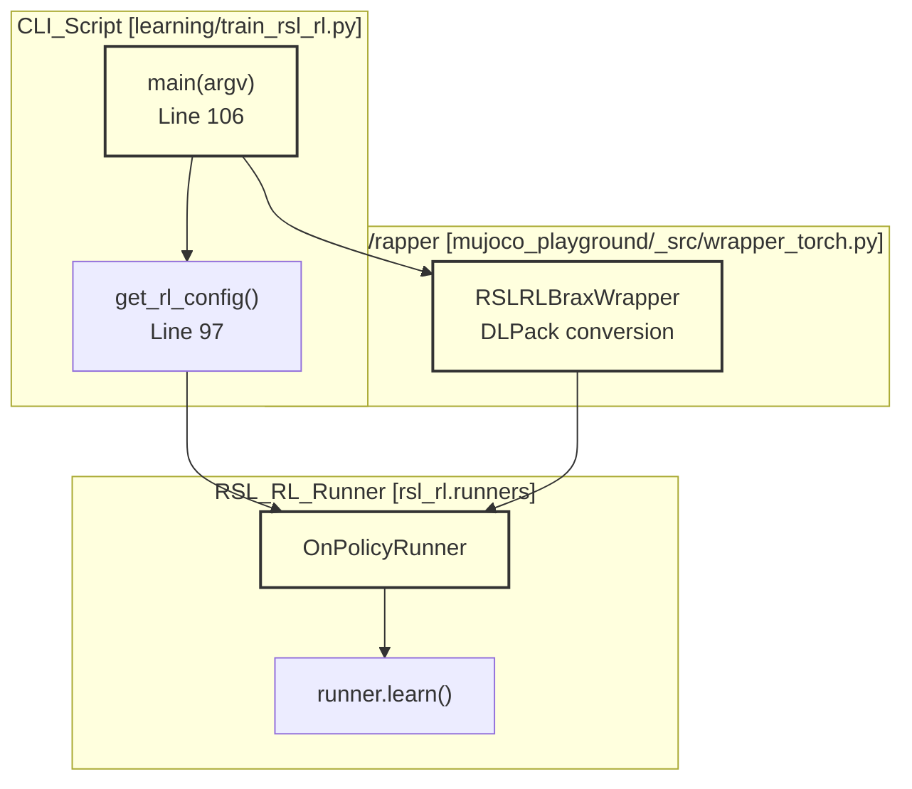

<!-- source: DeepWiki mcp.deepwiki.com · repo google-deepmind/mujoco_playground · page 5.4 Command-Line Training · fetched 2026-10-26 -->

# Command-Line Training

<details>
<summary>Relevant source files</summary>

The following files were used as context for generating this wiki page:

- [.gitignore](.gitignore)
- [CONTRIBUTING.md](CONTRIBUTING.md)
- [README.md](README.md)
- [learning/README.md](learning/README.md)
- [learning/train_jax_ppo.py](learning/train_jax_ppo.py)
- [learning/train_rsl_rl.py](learning/train_rsl_rl.py)
- [mujoco_playground/_src/dm_control_suite/cartpole.py](mujoco_playground/_src/dm_control_suite/cartpole.py)
- [mujoco_playground/_src/registry.py](mujoco_playground/_src/registry.py)
- [mujoco_playground/_src/wrapper_torch.py](mujoco_playground/_src/wrapper_torch.py)
- [mujoco_playground/config/dm_control_suite_params.py](mujoco_playground/config/dm_control_suite_params.py)

</details>


This page documents the command-line interfaces for training reinforcement learning policies using the `train-jax-ppo` and `train-rsl-ppo` scripts. These scripts provide terminal entry points for training with JAX/Brax or PyTorch/RSL-RL frameworks, respectively. For interactive training workflows and notebooks, see [Locomotion Training Examples](#5.1), [Manipulation Training Examples](#5.2), and [Vision Training Workflow](#5.3). For architectural details, consult [JAX/Brax Training Pipeline](#4.1) and [PyTorch/RSL-RL Training Pipeline](#4.2).

Sources: `learning/README.md:1-43](), [README.md:53-71]()`

## Overview

MuJoCo Playground provides two command-line training binaries corresponding to different RL backend frameworks:

| Script | Framework | Backend | Primary Use Case |
|--------|-----------|---------|------------------|
| `train-jax-ppo` | JAX/Brax | Pure JAX / MJX / Warp, JIT-compiled | Fast GPU-parallel training, vision tasks |
| `train-rsl-ppo` | PyTorch/RSL-RL | JAX physics + PyTorch NN (`RSLRLBraxWrapper`) | Multi-GPU distributed training, RSL-RL runner |

Sources: `learning/train_jax_ppo.py:15-29](), [learning/train_rsl_rl.py:15-30]()`

## Script Entry Points and Installation

The console scripts are registered during installation and can be invoked directly or via `uv`:

```bash
# Direct invocation after source install
train-jax-ppo --env_name CartpoleBalance
train-rsl-ppo --env_name LeapCubeReorient

# Development invocation via uv
uv --no-config run train-jax-ppo --env_name CartpoleBalance
uv --no-config run train-rsl-ppo --env_name CartpoleBalance
```

Sources: `README.md:62-67](), [learning/train_jax_ppo.py:542-548]()`

## train-jax-ppo Command-Line Interface

### Core Flags and Configuration Flow

```mermaid
graph TB
    subgraph "CLI_Arguments [learning/train_jax_ppo.py]"
        ENV_NAME["_ENV_NAME(\"env_name\")"]
        IMPL["_IMPL(\"impl\")"]
        CFG_OVERRIDE["_PLAYGROUND_CONFIG_OVERRIDES(\"playground_config_overrides\")"]
        VISION["_VISION(\"vision\")"]
    end
    
    subgraph "Registry_and_Config [mujoco_playground/_src/registry.py]"
        GET_DEFAULT["registry.get_default_config()"]
        LOAD_ENV["registry.load()"]
    end
    
    subgraph "Training_Pipeline [brax.training.agents.ppo]"
        PPO_TRAIN["ppo.train()"]
    end
    
    ENV_NAME --> GET_DEFAULT
    GET_DEFAULT --> LOAD_ENV
    CFG_OVERRIDE --> LOAD_ENV
    IMPL --> LOAD_ENV
    VISION --> LOAD_ENV
    LOAD_ENV --> PPO_TRAIN
    
    style ENV_NAME fill:none,stroke:#333,stroke-width:2px
    style GET_DEFAULT fill:none,stroke:#333,stroke-width:2px
    style PPO_TRAIN fill:none,stroke:#333,stroke-width:2px
```
Sources: `learning/train_jax_ppo.py:74-85](), [mujoco_playground/_src/registry.py:38-59]()`

**Basic usage examples:**
```bash
train-jax-ppo --env_name LeapCubeReorient
train-jax-ppo --env_name CartpoleBalance --impl warp
train-jax-ppo --env_name Go1Joystick --seed 42
```
Sources: `learning/train_jax_ppo.py:74-104]()`

### Training Hyperparameter Flags

The `train-jax-ppo` script [learning/train_jax_ppo.py:15]() exposes PPO hyperparameters as `absl.flags` that override the defaults defined in configuration modules like `manipulation_params` [learning/train_jax_ppo.py:42](), `locomotion_params` [learning/train_jax_ppo.py:41](), and `dm_control_suite_params` [learning/train_jax_ppo.py:40]():

| Flag | Type | Default | Description |
|------|------|---------|-------------|
| `--num_timesteps` | int | 1,000,000 | Total training timesteps [learning/train_jax_ppo.py:105-107]() |
| `--num_evals` | int | 5 | Number of evaluation intervals [learning/train_jax_ppo.py:111]() |
| `--num_envs` | int | 1024 | Parallel training environments [learning/train_jax_ppo.py:128]() |
| `--num_eval_envs` | int | 128 | Parallel evaluation environments [learning/train_jax_ppo.py:129-131]() |
| `--learning_rate` | float | 5e-4 | Adam optimizer learning rate [learning/train_jax_ppo.py:126]() |
| `--batch_size` | int | 256 | Mini-batch size for updates [learning/train_jax_ppo.py:132]() |
| `--unroll_length` | int | 10 | Steps per environment between updates [learning/train_jax_ppo.py:118]() |
| `--num_minibatches` | int | 8 | Minibatches per update [learning/train_jax_ppo.py:119-121]() |
| `--num_updates_per_batch` | int | 8 | SGD epochs per batch [learning/train_jax_ppo.py:122-124]() |
| `--discounting` | float | 0.97 | Reward discount factor ($\gamma$) [learning/train_jax_ppo.py:125]() |
| `--entropy_cost` | float | 5e-3 | Entropy regularization coefficient [learning/train_jax_ppo.py:127]() |
| `--max_grad_norm` | float | 1.0 | Gradient clipping threshold [learning/train_jax_ppo.py:133]() |
| `--clipping_epsilon` | float | 0.3 | PPO clipping parameter ($\epsilon$) [learning/train_jax_ppo.py:134-136]() |

Sources: `learning/train_jax_ppo.py:105-146]()`

### Network Architecture and Observation Keys

Network architectures and asymmetric observations are controlled via hidden layer flags and observation key bindings:

```bash
train-jax-ppo --env_name PandaPickCube \
  --policy_hidden_layer_sizes 128,128,128 \
  --value_hidden_layer_sizes 128,128,128 \
  --policy_obs_key state \
  --value_obs_key privileged_state
```

Sources: `learning/train_jax_ppo.py:137-150]()`

### Vision Mode and Domain Randomization

Enabling vision mode uses `ppo_networks_vision` and binds pixel observation channels:
```bash
train-jax-ppo --env_name CartpoleBalance --vision
```
Enabling domain randomization activates physics parameter variations via `registry.get_domain_randomizer()` [mujoco_playground/_src/registry.py:64-71]():
```bash
train-jax-ppo --env_name Go1Joystick --domain_randomization
```
Sources: `learning/train_jax_ppo.py:85](), [learning/train_jax_ppo.py:101-103]()`

### Checkpoint Management and Play-Only Mode

Checkpoints are saved using Orbax under `logs/{env_name}-{timestamp}-{suffix}/checkpoints/`.

```bash
# Save checkpoints with a custom experiment suffix
train-jax-ppo --env_name Go1Joystick --suffix my-experiment

# Resume or evaluate using play_only mode
train-jax-ppo --env_name Go1Joystick \
  --play_only \
  --load_checkpoint_path logs/Go1Joystick-20250115-143022-my-experiment/checkpoints \
  --num_videos 3
```
Sources: `learning/train_jax_ppo.py:86-92](), [learning/train_jax_ppo.py:290-343]()`

### Monitoring: WandB, TensorBoard, and rscope

- **Weights & Biases**: `--use_wandb` initializes `wandb` [learning/train_jax_ppo.py:93-97]() logging to project `mjxrl`.
- **TensorBoard**: `--use_tb` writes TF events [learning/train_jax_ppo.py:98-100]().
- **rscope**: Real-time trajectory streaming for offline/online debugging via `--rscope_envs` [learning/train_jax_ppo.py:151-155]():
  ```bash
  train-jax-ppo --env_name PandaPickCube --rscope_envs 16 --run_evals=False --deterministic_rscope=True
  python -m rscope
  ```
Sources: `README.md:77-85](), [learning/train_jax_ppo.py:88-100](), [learning/train_jax_ppo.py:151-160]()`

---

## train-rsl-ppo Command-Line Interface

### Architecture and Training Flow


Sources: `learning/train_rsl_rl.py:97-202](), [mujoco_playground/_src/wrapper_torch.py:84-132]()`

### PyTorch-Specific Flags

| Flag | Type | Default | Description |
|------|------|---------|-------------|
| `--device` | str | `cuda:0` | PyTorch training device [learning/train_rsl_rl.py:83]() |
| `--multi_gpu` | bool | False | Enable distributed multi-GPU training [learning/train_rsl_rl.py:84-86]() |
| `--num_envs` | int | 4096 | Parallel environments count [learning/train_rsl_rl.py:82]() |
| `--wp_kernel_cache_dir` | str | `/tmp/wp_kernel_cache_playground` | Warp kernel cache directory [learning/train_rsl_rl.py:90-94]() |

Sources: `learning/train_rsl_rl.py:82-94]()`

### Checkpoint and Run Restoration

RSL-RL checkpoints store PyTorch state dicts inside `/tmp/rslrl-training-logs/{run_name}/checkpoints/`.
```bash
# Train with custom run name
train-rsl-ppo --env_name LeapCubeReorient --suffix custom-run

# Play or evaluate using play_only
train-rsl-ppo --env_name LeapCubeReorient \
  --play_only \
  --load_run_name LeapCubeReorient-20250115-143022-custom-run \
  --checkpoint_num -1
```
Sources: `learning/train_rsl_rl.py:66-74](), [learning/train_rsl_rl.py:136-151]()`

---

## Configuration Resolution Flow

Configuration values are synthesized from multiple layers in priority order:
1. Command-line flags (`absl.flags`)
2. JSON override strings (`--playground_config_overrides`)
3. Algorithm parameter dictionaries (`manipulation_params`, `locomotion_params`, `dm_control_suite_params`)
4. Environment default configs (`default_config()`)

Sources: `learning/train_jax_ppo.py:74-184](), [learning/train_rsl_rl.py:52-134]()`

---

