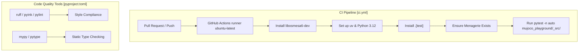
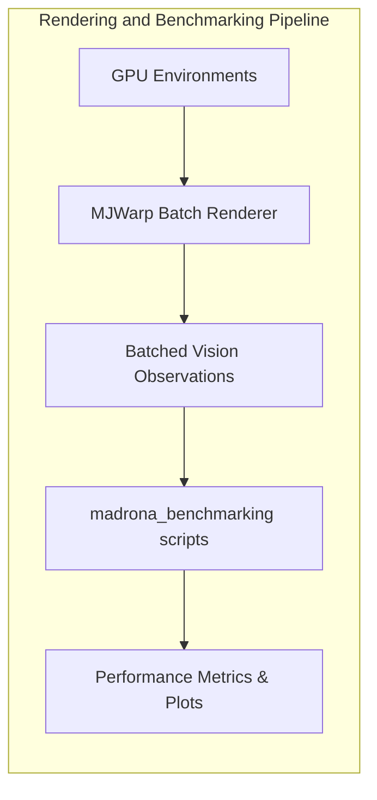
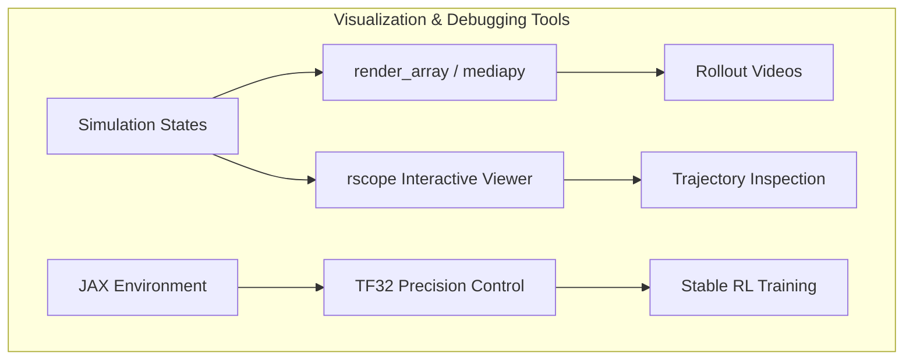
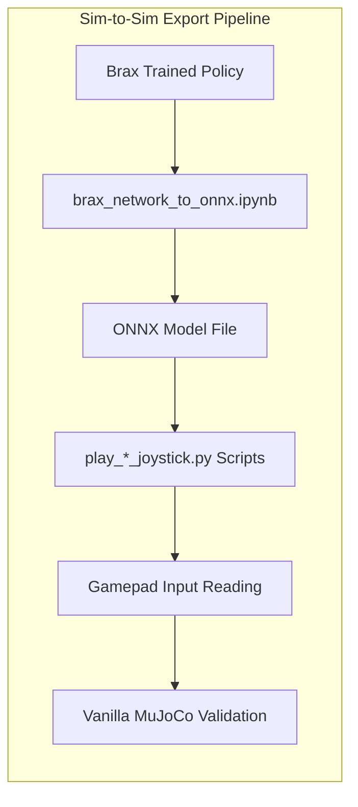

<!-- source: DeepWiki mcp.deepwiki.com · repo google-deepmind/mujoco_playground · page 6 Development and Advanced Topics · fetched 2026-10-26 -->

# Development and Advanced Topics

Relevant source files

The following files were used as context for generating this wiki page:

- [.github/workflows/ci.yml](.github/workflows/ci.yml)
- [CONTRIBUTING.md](CONTRIBUTING.md)
- [README.md](README.md)
- [learning/README.md](learning/README.md)
- [mujoco_playground/_src/registry.py](mujoco_playground/_src/registry.py)
- [pyproject.toml](pyproject.toml)
- [uv.lock](uv.lock)

This page serves as a high-level guide to advanced development topics within MuJoCo Playground. It covers custom environment creation, testing infrastructure, GPU batch rendering and benchmarking, interactive visualization and debugging, and sim-to-sim deployment pipelines. 

As a parent page, this document provides an architectural overview and summarizes key components. For in-depth implementation guides, detailed code walkthroughs, and exhaustive parameters, refer to the individual child sections linked below.

Sources: [README.md:1-119](), [pyproject.toml:1-169]()

---

## 6.1 Creating Custom Environments

Implementing new tasks or robotic platforms within MuJoCo Playground involves subclassing core environment abstractions, defining custom XML models, configuring state transitions, and registering the environment for discovery. Custom environments leverage JAX-accelerated simulation via `mjx_env.MjxEnv` [mujoco_playground/_src/registry.py:25-25] and seamlessly integrate with the global configuration and training loops.

For a comprehensive guide on implementing custom environments by inheriting from `MjxEnv`, defining observations and rewards, creating MuJoCo XML models, and registering them via `register_environment`, see [Creating Custom Environments](#6.1).

Sources: [pyproject.toml:78-80](), [mujoco_playground/_src/registry.py:15-71]()

---

## 6.2 Testing and CI/CD

MuJoCo Playground maintains robust test suites and continuous integration workflows to ensure code health across multiple suites such as `dm_control_suite_test`, `manipulation_test`, `locomotion_test`, `wrapper_test`, and `registry_test`. Code quality is strictly enforced via linting and type-checking tools like `ruff`, `pyink`, `pylint`, `mypy`, and `pytype` [pyproject.toml:54-63, 113-118, 148-156].

For detailed documentation on the test suites, GitHub Actions workflows, PyPI release procedures, and static analysis tools, see [Testing and CI/CD](#6.2).

Sources: [.github/workflows/ci.yml:1-37](), [pyproject.toml:44-63, 113-118, 148-162]()

---

## 6.3 Batch Rendering and Benchmarking

To support vision-based reinforcement learning and pixels-to-actions policies, MuJoCo Playground integrates GPU batch rendering via the `MJWarp` renderer and experimental backends. Performance benchmarks compare rendering throughput and simulation steps against platforms like IsaacLab and ManiSkill using dedicated benchmarking scripts.

For a deep dive into GPU batch rendering, the `MJWarp` renderer, benchmarking scripts, data plotting, and performance characteristics, see [Batch Rendering and Benchmarking](#6.3).

Sources: [README.md:14-14](), [pyproject.toml:34-34]()

---

## 6.4 Visualization and Debugging

Debugging high-throughput GPU simulations and reinforcement learning policies requires specialized visualization and inspection utilities. Tools include array rendering via `render_array` and `mediapy`, interactive trajectory viewing with `rscope`, metric plotting routines, and resolution of numerical precision issues such as NVIDIA TF32 floating-point behaviors.

For detailed guides on visualization tools, interactive trajectory inspection with `rscope`, metric plotting utilities, and floating-point precision configurations, see [Visualization and Debugging](#6.4).

Sources: [README.md:30-30, 79-85, 94-96](), [pyproject.toml:30-30]()

---

## 6.5 Sim-to-Sim and Policy Export

To validate policies trained in GPU simulation on traditional or external physics engines, MuJoCo Playground provides experimental sim-to-sim pipelines. This includes exporting Brax-trained policies to ONNX format using notebooks like `brax_network_to_onnx.ipynb`, running real-time deployment and gamepad input scripts such as `play_*_joystick.py`, and validating policy behaviors in vanilla MuJoCo.

For complete instructions on exporting policies to ONNX, reading gamepad inputs, executing deployment scripts, and validating behavior in vanilla MuJoCo, see [Sim-to-Sim and Policy Export](#6.5).

Sources: [README.md:105-110](), [learning/README.md:1-43]()

---

