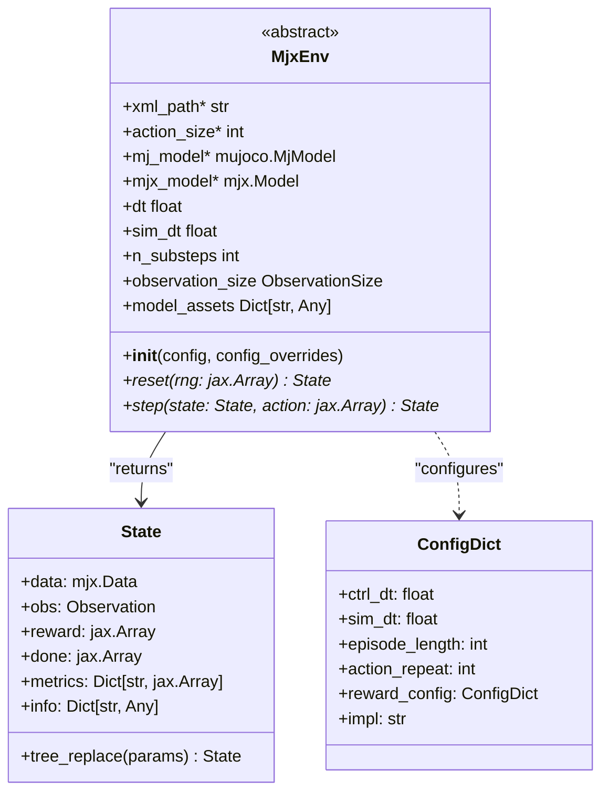
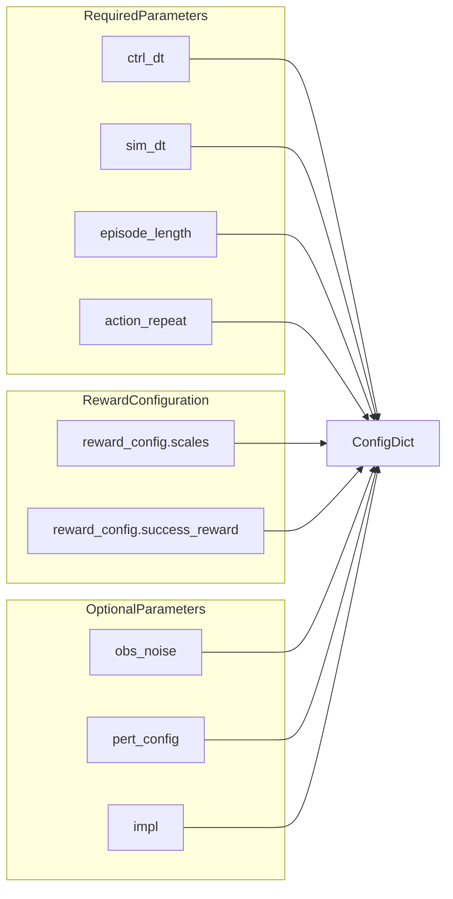
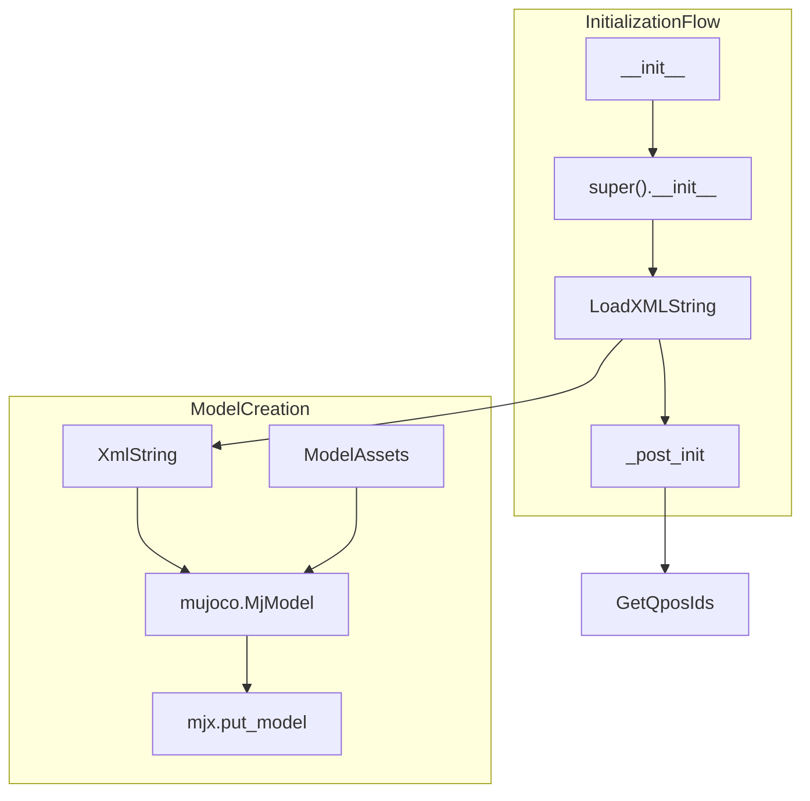
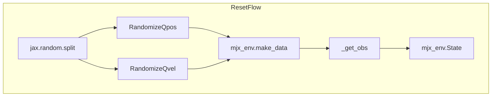
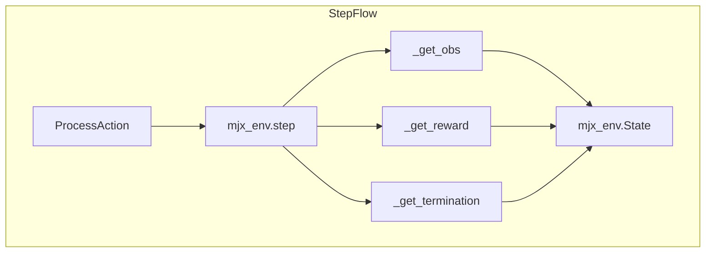
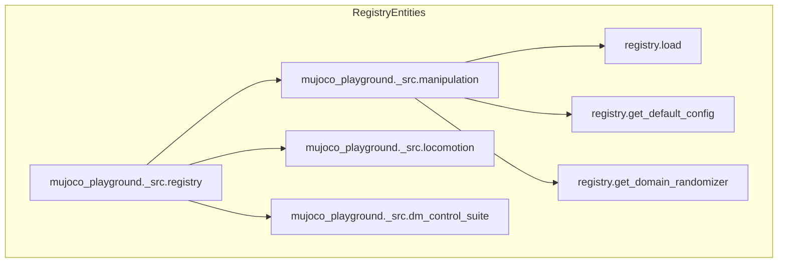
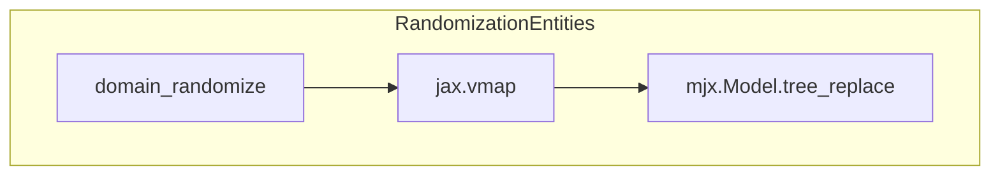

<!-- source: DeepWiki mcp.deepwiki.com · repo google-deepmind/mujoco_playground · page 6.1 Creating Custom Environments · fetched 2026-10-26 -->

# Creating Custom Environments

Relevant source files

The following files were used as context for generating this wiki page:

- [CONTRIBUTING.md](CONTRIBUTING.md)
- [README.md](README.md)
- [learning/README.md](learning/README.md)
- [mujoco_playground/_src/dm_control_suite/__init__.py](mujoco_playground/_src/dm_control_suite/__init__.py)
- [mujoco_playground/_src/locomotion/__init__.py](mujoco_playground/_src/locomotion/__init__.py)
- [mujoco_playground/_src/locomotion/t1/randomize.py](mujoco_playground/_src/locomotion/t1/randomize.py)
- [mujoco_playground/_src/manipulation/__init__.py](mujoco_playground/_src/manipulation/__init__.py)
- [mujoco_playground/_src/mjx_env.py](mujoco_playground/_src/mjx_env.py)
- [mujoco_playground/_src/registry.py](mujoco_playground/_src/registry.py)

This page guides developers through implementing custom reinforcement learning environments in MuJoCo Playground. It covers inheriting from `mjx_env.MjxEnv`, defining observations and rewards, creating XML models, and registering environments with the discovery system. For training custom environments, see [Training Infrastructure](#4). For examples of existing environments, see [Environment Collections](#3).

---

## Overview

Creating a custom environment involves five main steps:

1. **Define a configuration schema** using `ml_collections.ConfigDict`
2. **Create a MuJoCo XML model** with robot and task assets
3. **Implement the environment class** by inheriting from `mjx_env.MjxEnv`
4. **Implement domain randomization** (optional but recommended for sim-to-real transfer)
5. **Register the environment** in the appropriate category registry

All custom environments must inherit from the `mjx_env.MjxEnv` abstract base class and implement its required methods. The environment will automatically be compatible with both JAX/Brax and PyTorch/RSL-RL training pipelines through the wrapper system.

Sources: [mujoco_playground/_src/mjx_env.py:216-316]()

---

## MjxEnv Abstract Base Class

The `MjxEnv` class defines the interface that all environments must implement. Below is the mapping between the conceptual environment design and the code entities defined in `mujoco_playground/_src/mjx_env.py`.

Title: "Environment Class Architecture and Data Flow"

Sources: [mujoco_playground/_src/mjx_env.py:175-214](), [mujoco_playground/_src/mjx_env.py:216-280]()

### Required Abstract Methods

| Method | Return Type | Description |
|--------|-------------|-------------`
| `reset(rng)` | `State` | Initialize environment to a starting state with optional randomization |
| `step(state, action)` | `State` | Execute one control step and return new state |
| `xml_path` | `str` | Property returning path to the MuJoCo XML model file |
| `action_size` | `int` | Property returning dimensionality of the action space |
| `mj_model` | `mujoco.MjModel` | Property returning CPU-based MuJoCo model |
| `mjx_model` | `mjx.Model` | Property returning GPU-accelerated MJX model |

Sources: [mujoco_playground/_src/mjx_env.py:216-280]()

---

## Step 1: Define Configuration Schema

Every environment requires a configuration schema defined as a `ConfigDict` containing parameters like control timestep, physics timestep, episode length, and reward scaling factors.

Title: "Configuration Parameter Hierarchy"

Sources: [mujoco_playground/_src/manipulation/leap_hand/reorient.py:32-73]()

---

## Step 2: Create MuJoCo XML Model

The XML file defines the robot, objects, and scene assets. Place it within the robot or task directory alongside the environment implementation. If external assets or Menagerie models are used, load them using `mujoco_playground._src.mjx_env.update_assets` and `mujoco_playground._src.mjx_env.ensure_menagerie_exists`.

Sources: [mujoco_playground/_src/mjx_env.py:94-129]()

---

## Step 3: Implement Environment Class

The environment class inherits from `mjx_env.MjxEnv` and implements the required properties and methods, utilizing `mujoco_playground._src.mjx_env.put_model` and `mujoco_playground._src.mjx_env.make_data` for model placement and state initialization.

Title: "Environment Initialization and Model Loading Pipeline"

Sources: [mujoco_playground/_src/mjx_env.py:130-188](), [mujoco_playground/_src/mjx_env.py:216-280]()

---

## Step 4: Implement reset() Method

The `reset()` method initializes the environment state using a JAX random key (`rng`), returning a `State` dataclass instance containing physics data, observations, metrics, and metadata.

Title: "Reset Data Flow"

Sources: [mujoco_playground/_src/mjx_env.py:156-188](), [mujoco_playground/_src/manipulation/leap_hand/reorient.py:107-198]()

---

## Step 5: Implement step() Method

The `step()` method processes actions, applies control inputs, advances the physics simulation using `mujoco_playground._src.mjx_env.step`, computes rewards and terminations, and returns the updated `State`.

Title: "Step Execution Pipeline"

Sources: [mujoco_playground/_src/mjx_env.py:190-202](), [mujoco_playground/_src/manipulation/leap_hand/reorient.py:200-265]()

---

## Step 6: Define Observations

Observations can be a single array or a dictionary mapping keys such as `"state"` and `"privileged_state"` for asymmetric actor-critic architectures. Noise and history buffers can be incorporated to support sim-to-real robustness.

Sources: [mujoco_playground/_src/manipulation/leap_hand/reorient.py:273-375]()

---

## Step 7: Define Reward Function

Rewards aggregate multiple weighted components (task progress, regularization, energy penalty, and termination penalties) and are multiplied by the control timestep `dt`.

Sources: [mujoco_playground/_src/manipulation/leap_hand/reorient.py:379-414]()

---

## Step 8: Register Environment

After implementing the environment class, configuration generator, and optional domain randomizer, register them within the appropriate module registry (`manipulation`, `locomotion`, or `dm_control_suite`) and the global `registry`.

Title: "Environment Registry and Discovery Code Entities"

Sources: [mujoco_playground/_src/registry.py:33-71](), [mujoco_playground/_src/manipulation/__init__.py:33-133]()

---

## Step 9: Domain Randomization (Optional)

Domain randomization modifies physics parameters (friction, mass, damping, armature, gains) across parallel environments using `jax.vmap` to enhance sim-to-real transfer.

Title: "Domain Randomization Architecture"

Sources: [mujoco_playground/_src/locomotion/t1/randomize.py:26-130]()

---

