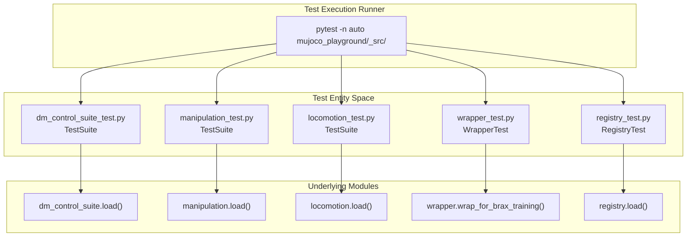
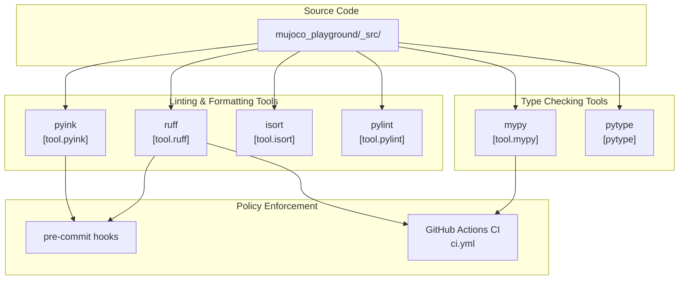

<!-- source: DeepWiki mcp.deepwiki.com · repo google-deepmind/mujoco_playground · page 6.2 Testing and CI/CD · fetched 2026-10-26 -->

# Testing and CI/CD

<details>
<summary>Relevant source files</summary>

The following files were used as context for generating this wiki page:

- [.github/workflows/ci.yml](.github/workflows/ci.yml)
- [.github/workflows/pypi.yml](.github/workflows/pypi.yml)
- [mujoco_playground/_src/dm_control_suite/dm_control_suite_test.py](mujoco_playground/_src/dm_control_suite/dm_control_suite_test.py)
- [mujoco_playground/_src/locomotion/locomotion_test.py](mujoco_playground/_src/locomotion/locomotion_test.py)
- [mujoco_playground/_src/manipulation/manipulation_test.py](mujoco_playground/_src/manipulation/manipulation_test.py)
- [mujoco_playground/_src/registry_test.py](mujoco_playground/_src/registry_test.py)
- [mujoco_playground/_src/wrapper.py](mujoco_playground/_src/wrapper.py)
- [mujoco_playground/_src/wrapper_test.py](mujoco_playground/_src/wrapper_test.py)
- [mujoco_playground/experimental/learning/ablate_device_topology.ipynb](mujoco_playground/experimental/learning/ablate_device_topology.ipynb)
- [pyproject.toml](pyproject.toml)
- [uv.lock](uv.lock)

</details>


## Purpose and Scope

This document details the testing infrastructure, unit test suites, continuous integration (CI) workflows, and continuous deployment (CD) pipelines for MuJoCo Playground. It covers pytest-based verification across environment categories (`dm_control_suite_test.py`, `manipulation_test.py`, `locomotion_test.py`, `wrapper_test.py`, `registry_test.py`), static analysis and code quality tooling (`ruff`, `pyink`, `pylint`, `mypy`, `pytype`), and GitHub Actions workflows for automated testing and PyPI releases.

For information on building custom environments, see [Creating Custom Environments](#6.1). For interactive trajectory inspection, see [Visualization and Debugging](#6.4).

---

## Test Infrastructure and Unit Test Suites

MuJoCo Playground uses **pytest** as its primary test runner. Unit tests are co-located within source directories and target specific environment domains, wrappers, and registry mechanics.

### Test Organization and Key Test Modules

The test suite validates creation, state execution, constraints, and wrappers across all supported domains. The testing framework is configured in `pyproject.toml` [pyproject.toml:119-122]():

```toml
[tool.pytest.ini_options]
testpaths = [
    "mujoco_playground/_src/",
]
```

Key test modules include:
- **`dm_control_suite_test.py`**: Validates environment creation, action execution, observation shapes, NaN handling for humanoids, and warp/jax implementation parity for the 25+ DM Control Suite environments [mujoco_playground/_src/dm_control_suite/dm_control_suite_test.py:28-80]().
- **`manipulation_test.py`**: Ensures all robotic arm and dexterous hand manipulation tasks instantiate correctly, process default configs, and return valid non-NaN states through `manipulation.ALL_ENVS` [mujoco_playground/_src/manipulation/manipulation_test.py:25-43]().
- **`locomotion_test.py`**: Tests quadruped and bipedal locomotion environments (`locomotion.ALL_ENVS`), checking JIT compilation, reset/step cycles, and observation shapes [mujoco_playground/_src/locomotion/locomotion_test.py:24-40]().
- **`wrapper_test.py`**: Verifies Brax training wrappers such as `BraxAutoResetWrapper`, `DeferredVisionWrapper`, domain randomization wrappers, and evaluation metrics [mujoco_playground/_src/wrapper_test.py:30-200]().
- **`registry_test.py`**: Confirms environment registration workflows via `dm_control_suite`, `manipulation`, and `locomotion` registration helpers, ensuring `registry.ALL_ENVS` matches aggregate collections [mujoco_playground/_src/registry_test.py:26-70]().



Sources: [pyproject.toml:119-122](), [mujoco_playground/_src/dm_control_suite/dm_control_suite_test.py:28-80](), [mujoco_playground/_src/manipulation/manipulation_test.py:25-43](), [mujoco_playground/_src/locomotion/locomotion_test.py:24-40](), [mujoco_playground/_src/wrapper_test.py:30-200](), [mujoco_playground/_src/registry_test.py:26-70]()

### Running Tests Locally

To install test requirements and run tests with parallel CPU execution via `pytest-xdist`:

```bash
# Install test dependencies
pip install -e ".[test]"

# Run all tests in parallel
pytest -n auto mujoco_playground/_src/
```

Sources: [pyproject.toml:44-49](), [.github/workflows/ci.yml:30-37]()

---

## Code Quality Tools

MuJoCo Playground enforces rigorous style, linting, and type checking rules through multiple integrated tools configured in `pyproject.toml`.

### Code Quality Architecture



Sources: [pyproject.toml:85-162]()

### Ruff: Fast Python Linter

**Ruff** replaces flake8, isort, and pyupgrade checks with a unified, high-performance rule engine [pyproject.toml:85-94]().

- **Selected Rules**: `E` (pycodestyle errors), `F` (Pyflakes rules), `PLC`/`PLE`/`PLR`/`PLW` (Pylint conventions, errors, refactors, warnings), and `I` (import sorting) [pyproject.toml:86-94]().
- **Ignored Rules**: Select strict checks such as `E501` (line length), `PLR2004` (magic values), and `PLR0913` (too many arguments) are ignored to accommodate complex physics parameterizations [pyproject.toml:95-108]().

Command:
```bash
ruff check --fix .
```

Sources: [pyproject.toml:85-111]()

### Pyink: Code Formatter

**Pyink** is Google's fork of Black configured with specific spacing and style preferences.
- `line-length = 80` [pyproject.toml:139]()
- `pyink-indentation = 2` [pyproject.toml:141]()
- `pyink-use-majority-quotes = true` [pyproject.toml:142]()

Command:
```bash
pyink .
```

Sources: [pyproject.toml:138-147]()

### Mypy & Pytype: Static Type Checkers

Type safety is verified using both Mypy and Google's Pytype [pyproject.toml:113-118](), [pyproject.toml:148-159]().
- **Mypy**: Targets Python `3.12` with `ignore_missing_imports = true` [pyproject.toml:113-115](). Excludes `scripts/` and `mujoco_menagerie/` [pyproject.toml:117]().
- **Pytype**: Performs deeper static analysis and type inference on codebase inputs while excluding test files and dynamic modules [pyproject.toml:148-156]().

Commands:
```bash
mypy .
pytype
```

Sources: [pyproject.toml:113-159]()

### Pylint & Isort

- **Pylint**: Analyzes code design patterns, ignoring experimental modules (`mujoco_playground/experimental/**`) [pyproject.toml:160-162]().
- **Isort**: Sorts imports lexicographically with single-line enforcement [pyproject.toml:124-137]().

Sources: [pyproject.toml:124-162]()

---

## GitHub Actions CI/CD Workflows

Continuous integration and publishing are managed via workflows in `.github/workflows/`.

### CI Pipeline Workflow (`ci.yml`)

The CI workflow triggers on every push and pull request to `main` [.github/workflows/ci.yml:3-7]().

```yaml
name: build
on:
  push:
    branches: [main]
  pull_request:
    branches: [main]
```

**Workflow Execution Steps:**
1. **Checkout Code**: Uses `actions/checkout@v2` (or v6) to clone the target commit [.github/workflows/ci.yml:17]().
2. **System Dependencies**: Installs `libosmesa6-dev` for headless software rendering [.github/workflows/ci.yml:20-23]().
3. **Environment Setup**: Configures Python `3.12` via `astral-sh/setup-uv` and creates a virtual environment [.github/workflows/ci.yml:24-31]().
4. **Menagerie Initialization**: Clones or verifies the `mujoco_menagerie` asset repository by executing `mjx_env.ensure_menagerie_exists()` [.github/workflows/ci.yml:32-34]().
5. **Test Execution**: Runs pytest in parallel across all core modules via `pytest -n auto mujoco_playground/_src/` [.github/workflows/ci.yml:35-37]().

Sources: [.github/workflows/ci.yml:1-37]()

### PyPI Release Workflow (`pypi.yml`)

When a GitHub release is created (`types: [created]`), the automated deployment workflow builds and publishes the package to PyPI [.github/workflows/pypi.yml:1-28]().

```yaml
name: Upload Python Package
on:
  release:
    types: [created]
```

**Deployment Steps:**
1. Sets up Python 3.11 and installs `uv`, `build`, and `twine` [.github/workflows/pypi.yml:12-21]().
2. Builds wheel and source distributions using `python -m build` [.github/workflows/pypi.yml:22-27]().
3. Uploads the built distribution to PyPI using repository secrets (`PYPI_USERNAME`, `PYPI_API_TOKEN`) [.github/workflows/pypi.yml:23-28]().

Sources: [.github/workflows/pypi.yml:1-28]()

---

## Development Workflow and Pre-Commit

Developers use **pre-commit** hooks to run linters, formatters, and type checks locally before commits are accepted.

```bash
# Install development dependencies including pre-commit
pip install -e ".[dev]"

# Register git pre-commit hooks
pre-commit install
```

Sources: [pyproject.toml:54-63]()

Sources: [pyproject.toml:44-67](), [pyproject.toml:119-122](), [.github/workflows/ci.yml:1-37](), [.github/workflows/pypi.yml:1-28]()

---

