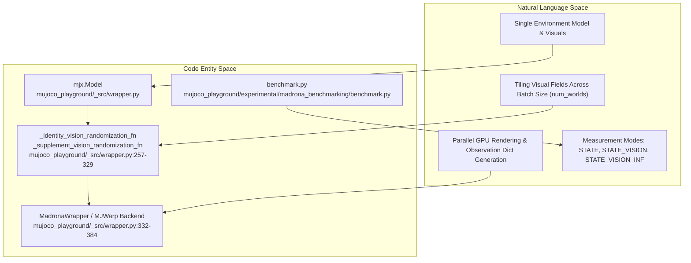
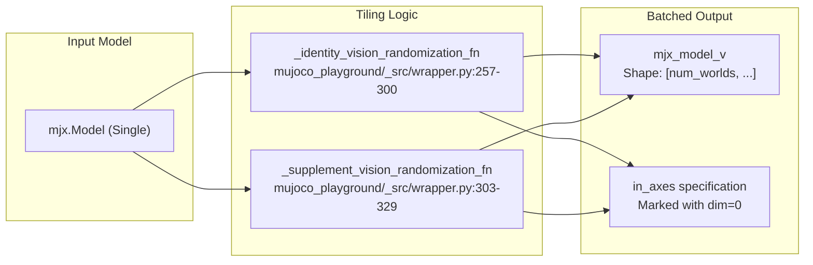
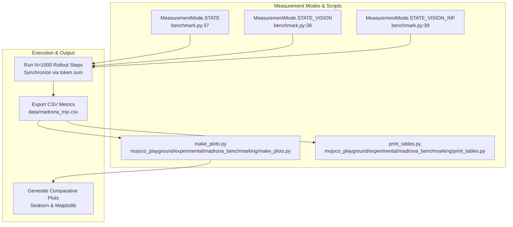
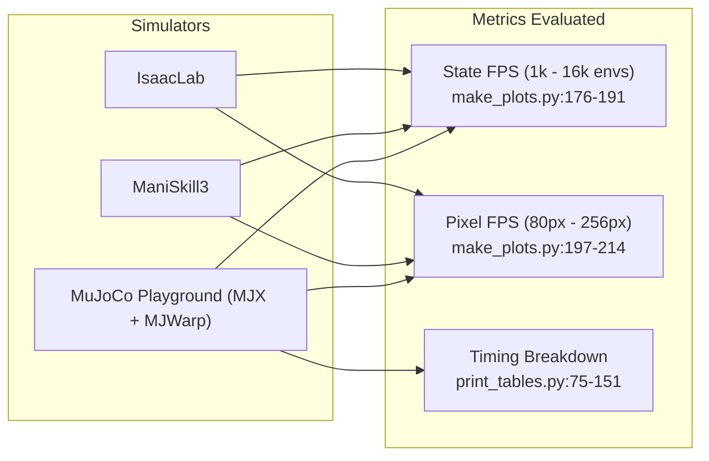

<!-- source: DeepWiki mcp.deepwiki.com · repo google-deepmind/mujoco_playground · page 6.3 Batch Rendering and Benchmarking · fetched 2026-10-26 -->

# Batch Rendering and Benchmarking

Relevant source files

The following files were used as context for generating this wiki page:

- [learning/notebooks/dm_control_suite.ipynb](learning/notebooks/dm_control_suite.ipynb)
- [learning/notebooks/locomotion.ipynb](learning/notebooks/locomotion.ipynb)
- [learning/notebooks/manipulation.ipynb](learning/notebooks/manipulation.ipynb)
- [learning/notebooks/vision.ipynb](learning/notebooks/vision.ipynb)
- [mujoco_playground/config/locomotion_params.py](mujoco_playground/config/locomotion_params.py)
- [mujoco_playground/experimental/learning/viz_sim_policies.ipynb](mujoco_playground/experimental/learning/viz_sim_policies.ipynb)
- [mujoco_playground/experimental/madrona_benchmarking/benchmark.py](mujoco_playground/experimental/madrona_benchmarking/benchmark.py)
- [mujoco_playground/experimental/madrona_benchmarking/make_plots.py](mujoco_playground/experimental/madrona_benchmarking/make_plots.py)
- [mujoco_playground/experimental/madrona_benchmarking/print_tables.py](mujoco_playground/experimental/madrona_benchmarking/print_tables.py)

This page provides a comprehensive deep dive into GPU batch rendering and benchmarking within MuJoCo Playground. It covers the modern `MJWarp` renderer alongside the historical `Madrona-MJX` integration, details the benchmarking scripts (`benchmark.py`, `make_plots.py`, `print_tables.py`), analyzes performance data and plots, and compares throughput characteristics against external frameworks like `IsaacLab` and `ManiSkill`.

---

## 1. Overview of GPU Batch Rendering Architecture

MuJoCo Playground utilizes GPU-accelerated batch rendering to generate high-throughput pixel observations for vision-based reinforcement learning. By parallelizing both physics simulation via `MJX` and rendering via specialized backend layers, the playground avoids CPU-GPU synchronization bottlenecks during training rollouts.

The rendering subsystem historically integrated `Madrona-MJX` and evolved to support the `MJWarp` renderer. The pipeline tiles environment geometry and lighting properties across a batch dimension (`num_worlds`), allowing JAX `vmap` or custom CUDA kernels to process thousands of visual environments simultaneously.

**Sources:** `[mujoco_playground/_src/wrapper.py:257-384]`, `[mujoco_playground/experimental/madrona_benchmarking/benchmark.py:32-175]`

---

## 2. Model Field Tiling and Randomization

To render multiple worlds in parallel without individual CPU draw calls, visual properties must be replicated into batched model structures.

### Required Visual Fields
The rendering wrappers enforce that specific visual fields carry a leading batch dimension matching `num_worlds`:
* `geom_rgba`: Geometry colors (RGBA) `[num_worlds, num_geoms, 4]`
* `geom_matid`: Material IDs `[num_worlds, num_geoms]`
* `geom_size`: Geometry dimensions `[num_worlds, num_geoms, 3]`
* `light_pos`, `light_dir`, `light_type`, `light_castshadow`, `light_cutoff`: Lighting parameters.

### Tiling Functions
The helper `_identity_vision_randomization_fn` replicates default visual fields using `jp.repeat` and `jp.expand_dims`, while `_supplement_vision_randomization_fn` merges user-supplied physics domain randomization with required visual fields `[mujoco_playground/_src/wrapper.py:257-288]()`.

**Sources:** `[mujoco_playground/_src/wrapper.py:257-329]`

---

## 3. Benchmarking Framework and Scripts

The `madrona_benchmarking` package provides rigorous performance profiling scripts under `mujoco_playground/experimental/madrona_benchmarking/`.

### Measurement Modes
`benchmark.py` defines three `MeasurementMode` enums to isolate physics simulation, rendering, and neural network inference overhead `[mujoco_playground/experimental/madrona_benchmarking/benchmark.py:32-41]()`:
1. `STATE` (Mode 0): Physics simulation via `mjx.step` only (no rendering).
2. `STATE_VISION` (Mode 1): Physics simulation combined with GPU batch rendering.
3. `STATE_VISION_INF` (Mode 2): Full pipeline including physics, GPU batch rendering, and CNN/Policy network inference.

**Sources:** `[mujoco_playground/experimental/madrona_benchmarking/benchmark.py:32-250]`, `[mujoco_playground/experimental/madrona_benchmarking/make_plots.py:1-122]`, `[mujoco_playground/experimental/madrona_benchmarking/print_tables.py:1-152]`

---

## 4. Performance Characteristics and Comparisons

Performance benchmarks evaluate throughput (Frames Per Second, FPS) across varying environment counts and image resolutions on NVIDIA hardware (e.g., RTX 4090).

### Comparative Analysis vs. IsaacLab and ManiSkill
* **State-Based Simulation:** MuJoCo MJX achieves extreme scaling for pure physics (exceeding hundreds of thousands of FPS at batch sizes $\geq 16,384$), matching or exceeding `IsaacLab` and `ManiSkill3` due to JAX XLA compilation efficiency.
* **Vision-Based Rendering:** Utilizing GPU rasterization/raytracing pipelines (`Madrona-MJX` / `MJWarp`), rendering hundreds of parallel camera streams at resolutions like $128 \times 128$ or $256 \times 256$ maintains high throughput (~10k–50k FPS), scaling linearly until GPU memory bandwidth or tile rasterization saturation occurs.

**Sources:** `[mujoco_playground/experimental/madrona_benchmarking/benchmark.py:250-299]`, `[mujoco_playground/experimental/madrona_benchmarking/make_plots.py:58-122]`, `[mujoco_playground/experimental/madrona_benchmarking/print_tables.py:35-152]`

---

